# 网络与模块

[返回 Element](../README.md) · [Teaser](../../teaser/README.md) · [Architecture](../../architecture/README.md) · [范例与元素对照表](../with-examples.md)

关联范例按表达功能互链；是否为原图拆件见对照表与元素来源记录。

| 预览 | 名称与 SVG | 来源与许可 | 关联范例（最多列三项） |
|---|---|---|---|
| 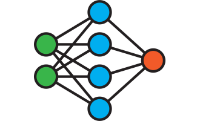 | [浅层神经网络](../../element/svg/towaki-neuralnetwork.svg) | Towaki CC0 · CC0-1.0 | [DPO · RLHF 与直接偏好优化的流程简化](../../teaser/dpo-comparison/README.md) · [D2L · 多层感知机](../../architecture/d2l-mlp/README.md) · [Instant NGP · 多分辨率哈希编码到 MLP](../../architecture/instant-ngp-hash-architecture/README.md) |
| 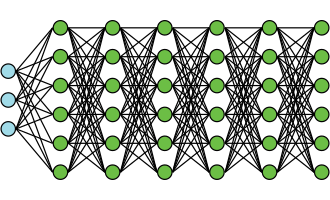 | [深层神经网络](../../element/svg/towaki-deepneuralnetwork.svg) | Towaki CC0 · CC0-1.0 | [D2L · 生成对抗网络](../../architecture/d2l-gan/README.md) · [D2L · 多层感知机](../../architecture/d2l-mlp/README.md) |
| 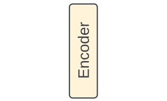 | [编码器块](../../element/svg/rust-encoder.svg) | RUST 原图部件 · 原项目未发现独立图形授权；仅作出处明确的参考 | [CLIP Figure 1：训练到零样本预测](../../architecture/clip/README.md) · [CUT3R · 持久状态的更新、读取与未见视角推断](../../architecture/cut3r-architecture/README.md) · [D2L · 编码器—解码器](../../architecture/d2l-encoder-decoder/README.md) |
| 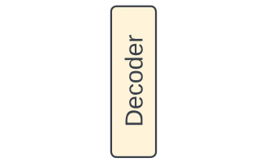 | [解码器块](../../element/svg/rust-decoder.svg) | RUST 原图部件 · 原项目未发现独立图形授权；仅作出处明确的参考 | [CUT3R · 持久状态的更新、读取与未见视角推断](../../architecture/cut3r-architecture/README.md) · [D2L · 编码器—解码器](../../architecture/d2l-encoder-decoder/README.md) · [D2L · 带注意力的 Seq2Seq](../../architecture/d2l-seq2seq-attention/README.md) |
| 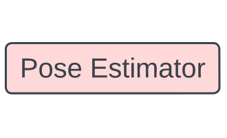 | [位姿估计模块](../../element/svg/rust-pose-estimator.svg) | RUST 原图部件 · 原项目未发现独立图形授权；仅作出处明确的参考 | [OrienterNet：用二维地图定位的任务与动机](../../teaser/orienternet/README.md) · [RUST：编码器、场景表示与位姿分支](../../architecture/rust/README.md) |
| 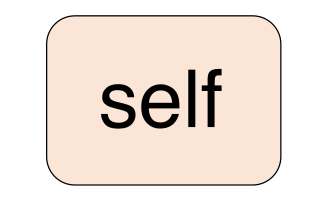 | [Self attention 块](../../element/svg/lightglue-self-attention.svg) | LightGlue 原图部件 · Apache-2.0（LightGlue 来源仓库） | [D2L · 带注意力的 Seq2Seq](../../architecture/d2l-seq2seq-attention/README.md) · [D2L · Transformer 编码器与解码器](../../architecture/d2l-transformer/README.md) · [D2L · Vision Transformer](../../architecture/d2l-vit/README.md) |
|  | [大脑](../../element/svg/tabler-brain.svg) | Tabler outline · MIT | [Agent 社会场景 · 综述概念 teaser](../../teaser/survey-agent-society-teaser/README.md) · [Agent 概念框架 · 感知、大脑与行动](../../architecture/survey-agent-perception-brain-action/README.md) · [自主 Agent 统一框架 · 四列模块分解](../../architecture/survey-autonomous-agent-modules/README.md) |
| 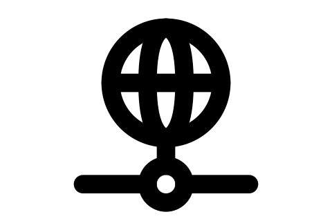 | [网络](../../element/svg/tabler-network.svg) | Tabler outline · MIT | [3DGS 综述路线图 · 双侧分类地图](../../teaser/survey-3dgs-review-map/README.md) |
| 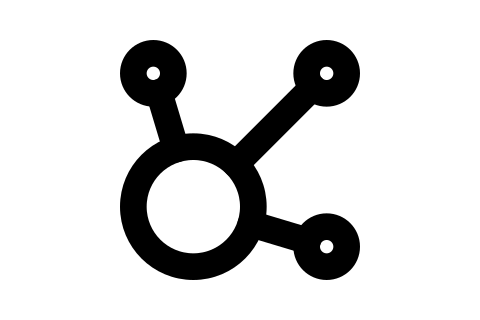 | [节点分支](../../element/svg/tabler-affiliate.svg) | Tabler outline · MIT | [LLaMA 家族关系 · 模型与数据继承图](../../teaser/survey-llama-family-map/README.md) · [LLM 发布脉络 · 主轴与时间分支](../../teaser/survey-llm-release-timeline/README.md) |
| 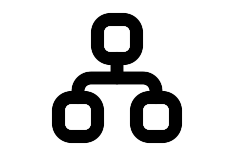 | [层级结构](../../element/svg/tabler-sitemap.svg) | Tabler outline · MIT | [3DGS 应用全景 · 中心主题与场景分支](../../teaser/survey-3dgs-application-landscape/README.md) · [3DGS 综述路线图 · 双侧分类地图](../../teaser/survey-3dgs-review-map/README.md) · [LLaMA 家族关系 · 模型与数据继承图](../../teaser/survey-llama-family-map/README.md) |
| 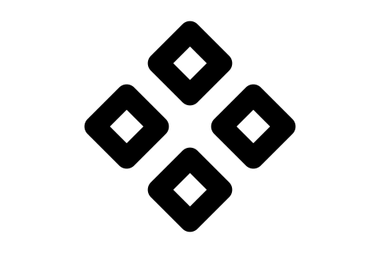 | [组件](../../element/svg/tabler-components.svg) | Tabler outline · MIT | — |
| 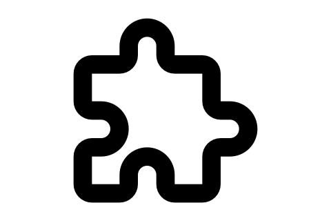 | [拼图](../../element/svg/tabler-puzzle.svg) | Tabler outline · MIT | — |
| 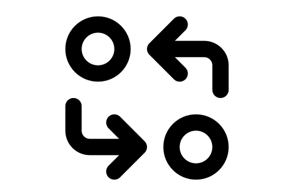 | [变换](../../element/svg/tabler-transform.svg) | Tabler outline · MIT | — |
| 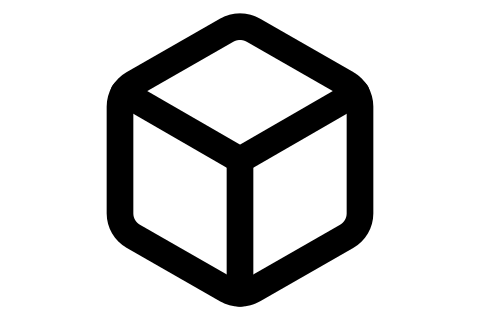 | [立方体](../../element/svg/tabler-cube.svg) | Tabler outline · MIT | — |
| 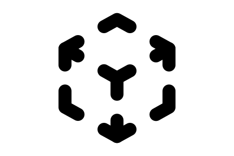 | [三维坐标物体](../../element/svg/tabler-cube-3d-sphere.svg) | Tabler outline · MIT | [3DETR · 输入点云、注意力与检测结果的对应](../../teaser/3detr-attention-teaser/README.md) · [Uneven Double Refraction：原型与成像能力展示](../../teaser/birefractive-rgbd/README.md) · [DECOLLAGE：局部风格控制与三维细化](../../teaser/decollage/README.md) |
| 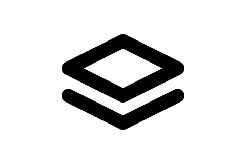 | [堆叠](../../element/svg/tabler-stack.svg) | Tabler outline · MIT | — |
| 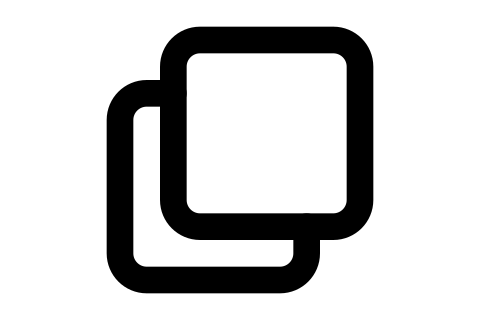 | [多层方框](../../element/svg/tabler-box-multiple.svg) | Tabler outline · MIT | — |
|  | [函数](../../element/svg/tabler-function.svg) | Tabler outline · MIT | — |
|  | [函数图形](../../element/svg/tabler-graph.svg) | Tabler outline · MIT | — |
| 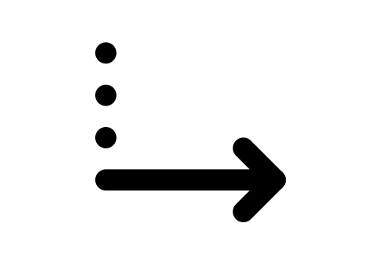 | [横坐标轴](../../element/svg/tabler-axis-x.svg) | Tabler outline · MIT | — |
| 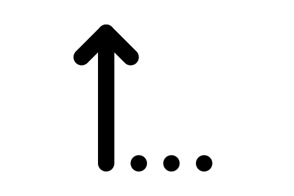 | [纵坐标轴](../../element/svg/tabler-axis-y.svg) | Tabler outline · MIT | — |
| 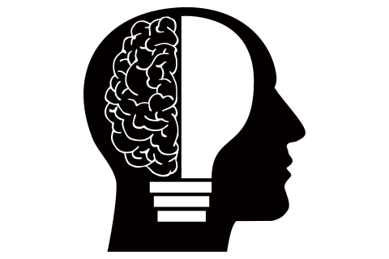 | [AI 灯泡符号](../../element/svg/bioicons-ai-bulb.svg) | Bioicons · CC0-1.0 | — |
| 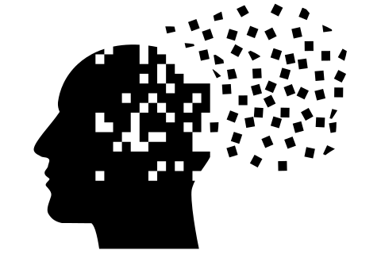 | [认知符号](../../element/svg/bioicons-ai-cognition.svg) | Bioicons · CC0-1.0 | — |
| 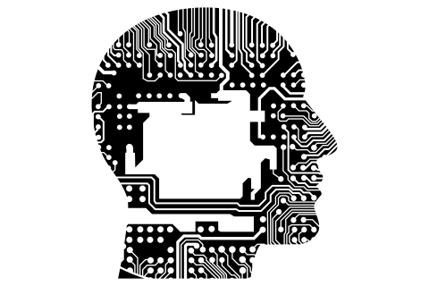 | [AI 人像符号](../../element/svg/bioicons-ai-head.svg) | Bioicons · CC0-1.0 | — |
|  | [AI 芯片符号](../../element/svg/bioicons-ai.svg) | Bioicons · CC0-1.0 | — |
| 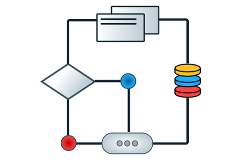 | [算法流程](../../element/svg/bioicons-algorithm.svg) | Bioicons · CC0-1.0 | — |
| 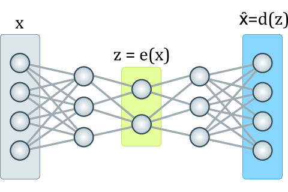 | [自编码器](../../element/svg/bioicons-autoencoder.svg) | Bioicons · CC0-1.0 | — |
| 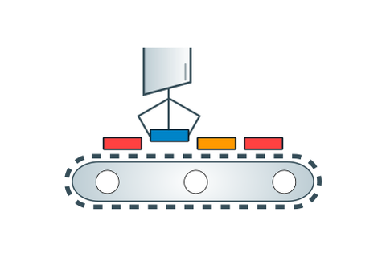 | [自动化](../../element/svg/bioicons-automation.svg) | Bioicons · CC0-1.0 | — |
| 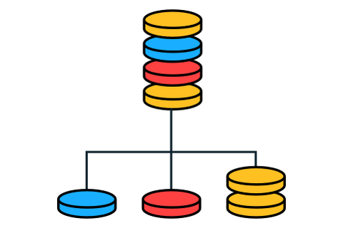 | [分类](../../element/svg/bioicons-classification.svg) | Bioicons · CC0-1.0 | — |
| 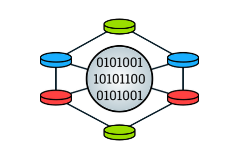 | [数据挖掘](../../element/svg/bioicons-datamining.svg) | Bioicons · CC0-1.0 | — |
| 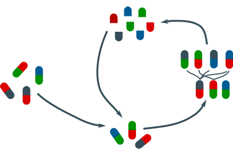 | [遗传算法](../../element/svg/bioicons-genetic-algorithm.svg) | Bioicons · CC0-1.0 | — |
| 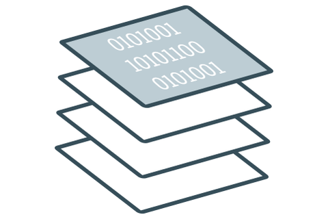 | [模型层堆叠](../../element/svg/bioicons-model-layers.svg) | Bioicons · CC0-1.0 | — |
| 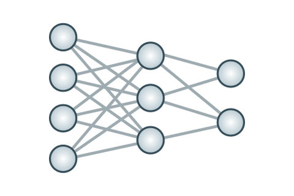 | [神经网络](../../element/svg/bioicons-neural-network-1.svg) | Bioicons · CC0-1.0 | — |
| 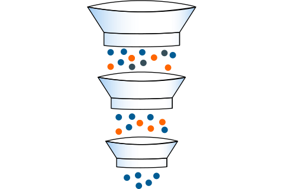 | [处理流程](../../element/svg/bioicons-pipeline.svg) | Bioicons · CC0-1.0 | — |
| 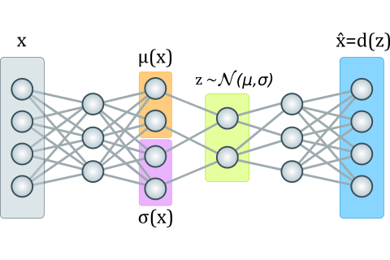 | [变分自编码器](../../element/svg/bioicons-variational-autoencoder.svg) | Bioicons · CC0-1.0 | — |
| 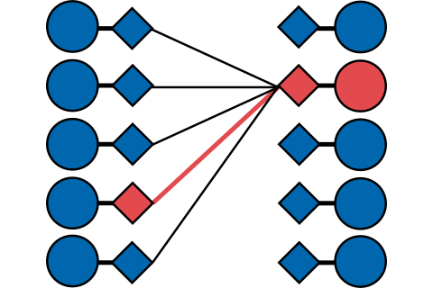 | [注意力机制](../../element/svg/bioicons-attention-mechanism.svg) | Bioicons · CC-BY-4.0 | — |
| 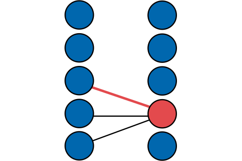 | [卷积连接](../../element/svg/bioicons-convolutional-network.svg) | Bioicons · CC-BY-4.0 | — |
| 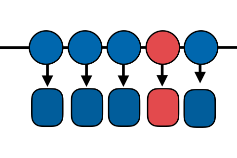 | [隐马尔可夫模型](../../element/svg/bioicons-hidden-markov-model.svg) | Bioicons · CC-BY-4.0 | — |
| 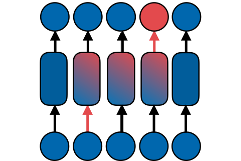 | [循环神经网络](../../element/svg/bioicons-recurrent-neural-network.svg) | Bioicons · CC-BY-4.0 | — |
| 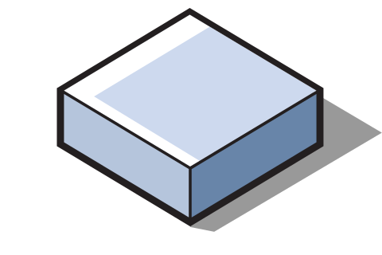 | [块](../../element/svg/isoflow-block.svg) | Isoflow · MIT | — |
| 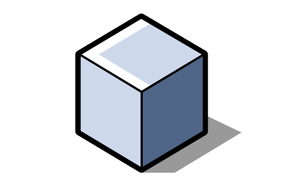 | [立方体](../../element/svg/isoflow-cube.svg) | Isoflow · MIT | — |
| 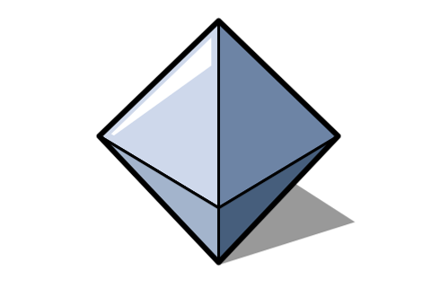 | [菱形体](../../element/svg/isoflow-diamond.svg) | Isoflow · MIT | — |
| 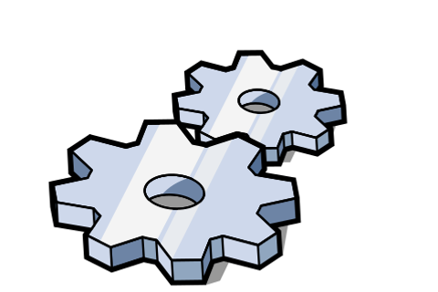 | [功能模块](../../element/svg/isoflow-function-module.svg) | Isoflow · MIT | — |
| 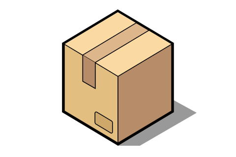 | [包模块](../../element/svg/isoflow-package-module.svg) | Isoflow · MIT | — |
| 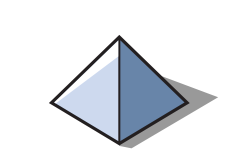 | [金字塔](../../element/svg/isoflow-pyramid.svg) | Isoflow · MIT | — |
| 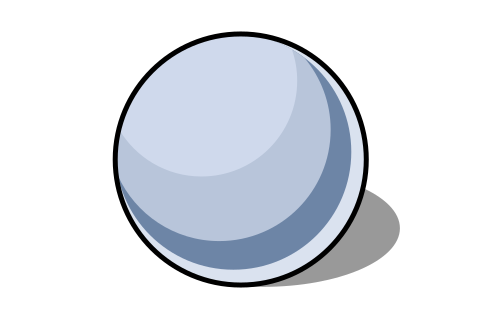 | [球体](../../element/svg/isoflow-sphere.svg) | Isoflow · MIT | — |
| 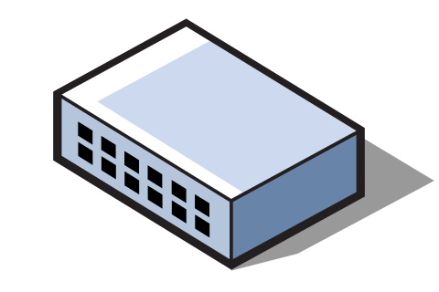 | [交换机模块](../../element/svg/isoflow-switch-module.svg) | Isoflow · MIT | — |
| 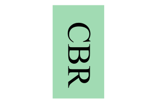 | [CBR 模块](../../element/svg/task5-cbr.svg) | Illustrator task5 source · 原作者未声明独立复用授权 | [D2L · AlexNet](../../architecture/d2l-alexnet/README.md) · [D2L · DenseNet 密集连接块](../../architecture/d2l-densenet-block/README.md) · [D2L · 全卷积网络](../../architecture/d2l-fcn/README.md) |
| 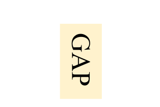 | [GAP 模块](../../element/svg/task5-gap.svg) | Illustrator task5 source · 原作者未声明独立复用授权 | [多尺度网络总览与模块展开](../../architecture/multiscale-network/README.md) |
| 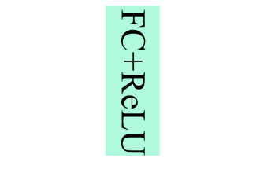 | [FC + ReLU 模块](../../element/svg/task5-fc-relu.svg) | Illustrator task5 source · 原作者未声明独立复用授权 | [D2L · 多层感知机](../../architecture/d2l-mlp/README.md) · [多尺度网络总览与模块展开](../../architecture/multiscale-network/README.md) |
|  | [Patchify 图像分块模块](../../element/svg/dit-patchify.svg) | DiT 原图部件 · CC-BY-4.0 | [DiT · 整体主干与三种条件注入模块](../../architecture/dit-architecture/README.md) |
|  | [条件嵌入模块](../../element/svg/dit-embed.svg) | DiT 原图部件 · CC-BY-4.0 | [3DETR · 点云编码器、查询嵌入与集合预测](../../architecture/3detr-architecture/README.md) · [BLIP-2 · 冻结图像与语言模型的两阶段桥接](../../architecture/blip2-bridge-framework/README.md) · [DiT · 整体主干与三种条件注入模块](../../architecture/dit-architecture/README.md) |
| 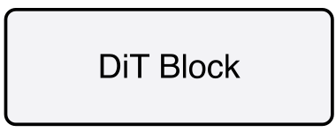 | [DiT block 模块](../../element/svg/dit-block.svg) | DiT 原图部件 · CC-BY-4.0 | [DiT · 整体主干与三种条件注入模块](../../architecture/dit-architecture/README.md) |
| 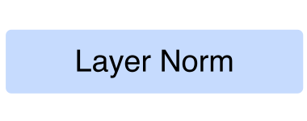 | [LayerNorm 模块](../../element/svg/dit-layer-norm.svg) | DiT 原图部件 · CC-BY-4.0 | [DiT · 整体主干与三种条件注入模块](../../architecture/dit-architecture/README.md) |
|  | [DiT 多头自注意力模块](../../element/svg/dit-self-attention.svg) | DiT 原图部件 · CC-BY-4.0 | [3DETR · 点云编码器、查询嵌入与集合预测](../../architecture/3detr-architecture/README.md) · [BLIP-2 · Q-Former 与三种注意力掩码](../../architecture/blip2-qformer-architecture/README.md) · [DiT · 整体主干与三种条件注入模块](../../architecture/dit-architecture/README.md) |
|  | [逐位置前馈网络模块](../../element/svg/dit-feed-forward.svg) | DiT 原图部件 · CC-BY-4.0 | [BLIP-2 · Q-Former 与三种注意力掩码](../../architecture/blip2-qformer-architecture/README.md) · [DiT · 整体主干与三种条件注入模块](../../architecture/dit-architecture/README.md) |
| 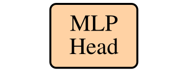 | [ViT 分类 MLP 头](../../element/svg/vit-mlp-head.svg) | ViT 原图部件 · 作者保留权利 / 参考收录 | [ViT 原论文 · 图像分块、token 序列与编码器展开](../../architecture/vit-original-architecture/README.md) |
| 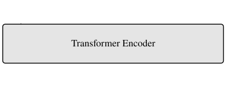 | [ViT 编码器块](../../element/svg/vit-encoder-block.svg) | ViT 原图部件 · 作者保留权利 / 参考收录 | [SAM 2 · 任务、模型与数据引擎三联概念图](../../teaser/sam2-task-model-data/README.md) · [3DETR · 点云编码器、查询嵌入与集合预测](../../architecture/3detr-architecture/README.md) · [BLIP-2 · 冻结图像与语言模型的两阶段桥接](../../architecture/blip2-bridge-framework/README.md) |
|  | [图像块线性投影模块](../../element/svg/vit-patch-projection.svg) | ViT 原图部件 · 作者保留权利 / 参考收录 | [ViT 原论文 · 图像分块、token 序列与编码器展开](../../architecture/vit-original-architecture/README.md) |
|  | [ViT 多头注意力模块](../../element/svg/vit-self-attention.svg) | ViT 原图部件 · 作者保留权利 / 参考收录 | [ViT 原论文 · 图像分块、token 序列与编码器展开](../../architecture/vit-original-architecture/README.md) |
|  | [ViT 归一化模块](../../element/svg/vit-norm.svg) | ViT 原图部件 · 作者保留权利 / 参考收录 | [ViT 原论文 · 图像分块、token 序列与编码器展开](../../architecture/vit-original-architecture/README.md) |
|  | [ViT 前馈 MLP 模块](../../element/svg/vit-mlp.svg) | ViT 原图部件 · 作者保留权利 / 参考收录 | [3DETR · 点云编码器、查询嵌入与集合预测](../../architecture/3detr-architecture/README.md) · [ViT 原论文 · 图像分块、token 序列与编码器展开](../../architecture/vit-original-architecture/README.md) |
|  | [MM-DiT block 模块](../../element/svg/sd3-mmdit-block.svg) | SD3 原图部件 · 作者保留权利 / 参考收录 | [SD3 · 双模态主干与 MM-DiT block 展开](../../architecture/sd3-mmdit-architecture/README.md) |
|  | [条件 MLP 模块](../../element/svg/sd3-conditioning-mlp.svg) | SD3 原图部件 · 作者保留权利 / 参考收录 | [SD3 · 双模态主干与 MM-DiT block 展开](../../architecture/sd3-mmdit-architecture/README.md) |
|  | [图像潜变量分块模块](../../element/svg/sd3-patching.svg) | SD3 原图部件 · 作者保留权利 / 参考收录 | [SD3 · 双模态主干与 MM-DiT block 展开](../../architecture/sd3-mmdit-architecture/README.md) |
|  | [条件调制模块](../../element/svg/sd3-modulation.svg) | SD3 原图部件 · 作者保留权利 / 参考收录 | [SD3 · 双模态主干与 MM-DiT block 展开](../../architecture/sd3-mmdit-architecture/README.md) |
