# 运算与变换

[返回 Element](../README.md) · [Teaser](../../teaser/README.md) · [Architecture](../../architecture/README.md) · [范例与元素对照表](../with-examples.md)

关联范例按表达功能互链；是否为原图拆件见对照表与元素来源记录。

| 预览 | 名称与 SVG | 来源与许可 | 关联范例（最多列三项） |
|---|---|---|---|
| 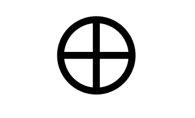 | [残差加法节点](../../element/svg/lightglue-residual-add.svg) | LightGlue 原图部件 · Apache-2.0（LightGlue 来源仓库） | [D2L · Transformer 编码器与解码器](../../architecture/d2l-transformer/README.md) · [D2L · Vision Transformer](../../architecture/d2l-vit/README.md) · [DiT · 整体主干与三种条件注入模块](../../architecture/dit-architecture/README.md) |
| 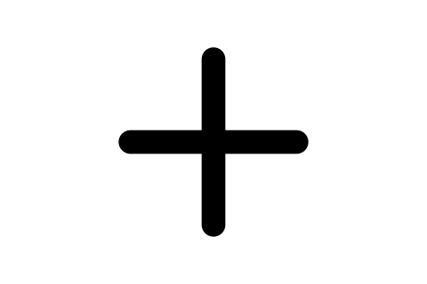 | [加号](../../element/svg/tabler-plus.svg) | Tabler outline · MIT | — |
| 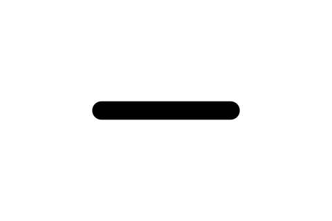 | [减号](../../element/svg/tabler-minus.svg) | Tabler outline · MIT | — |
| 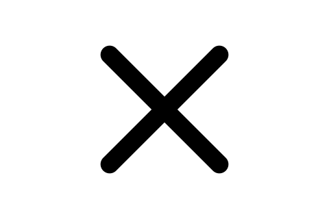 | [叉号](../../element/svg/tabler-x.svg) | Tabler outline · MIT | — |
| 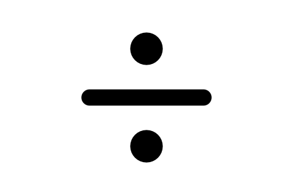 | [除号](../../element/svg/tabler-divide.svg) | Tabler outline · MIT | — |
| 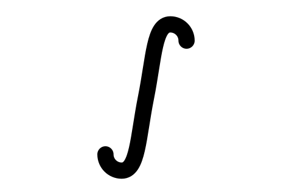 | [积分](../../element/svg/tabler-math-integral.svg) | Tabler outline · MIT | — |
| 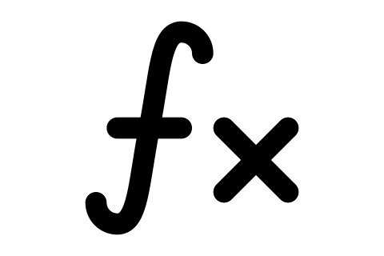 | [函数运算](../../element/svg/tabler-math-function.svg) | Tabler outline · MIT | — |
| 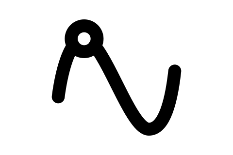 | [最大值](../../element/svg/tabler-math-max.svg) | Tabler outline · MIT | — |
| 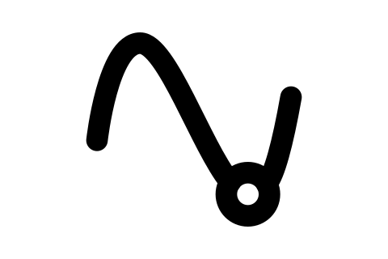 | [最小值](../../element/svg/tabler-math-min.svg) | Tabler outline · MIT | — |
| 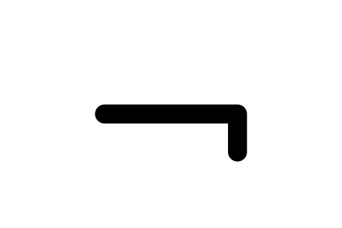 | [逻辑非](../../element/svg/tabler-math-not.svg) | Tabler outline · MIT | — |
|  | [过滤](../../element/svg/tabler-filter.svg) | Tabler outline · MIT | [CRAG · 评估分流、知识纠正与三路生成](../../architecture/crag-evaluate-correct-generate/README.md) · [HippoRAG 2 · 图谱索引、筛选与检索双阶段](../../architecture/hipporag2-indexing-retrieval-framework/README.md) |
| 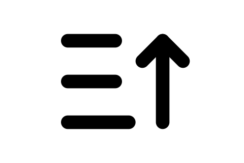 | [升序](../../element/svg/tabler-sort-ascending.svg) | Tabler outline · MIT | — |
| 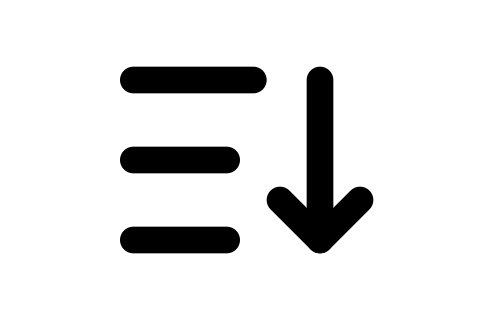 | [降序](../../element/svg/tabler-sort-descending.svg) | Tabler outline · MIT | — |
|  | [放大](../../element/svg/tabler-zoom-in.svg) | Tabler outline · MIT | — |
|  | [缩小](../../element/svg/tabler-zoom-out.svg) | Tabler outline · MIT | — |
| 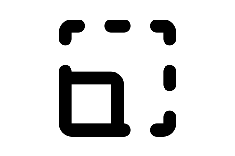 | [改变尺寸](../../element/svg/tabler-resize.svg) | Tabler outline · MIT | — |
|  | [扩展](../../element/svg/tabler-arrows-maximize.svg) | Tabler outline · MIT | — |
|  | [收缩](../../element/svg/tabler-arrows-minimize.svg) | Tabler outline · MIT | — |
| 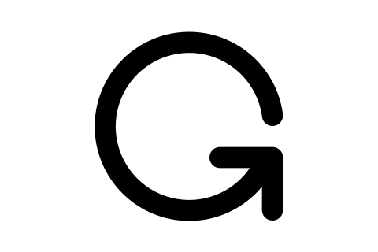 | [旋转](../../element/svg/tabler-rotate.svg) | Tabler outline · MIT | — |
| 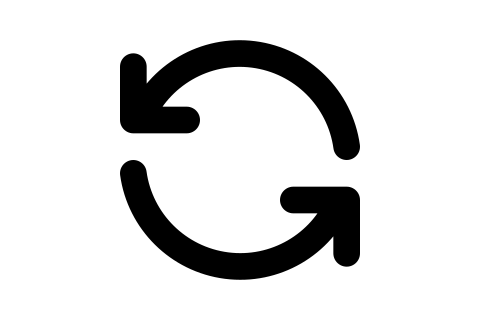 | [循环更新](../../element/svg/tabler-refresh.svg) | Tabler outline · MIT | — |
| 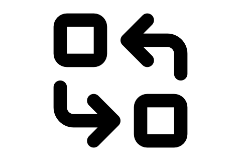 | [替换](../../element/svg/tabler-replace.svg) | Tabler outline · MIT | — |
| 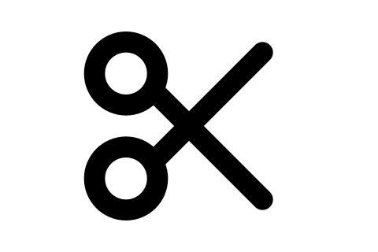 | [裁剪](../../element/svg/tabler-scissors.svg) | Tabler outline · MIT | — |
|  | [复制](../../element/svg/tabler-copy.svg) | Tabler outline · MIT | — |
|  | [等号](../../element/svg/tabler-equal.svg) | Tabler outline · MIT | — |
| 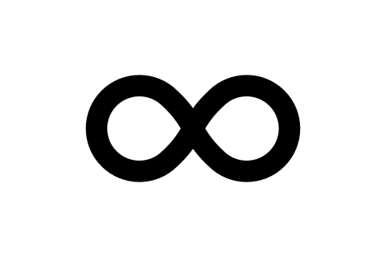 | [无穷](../../element/svg/tabler-infinity.svg) | Tabler outline · MIT | — |
| 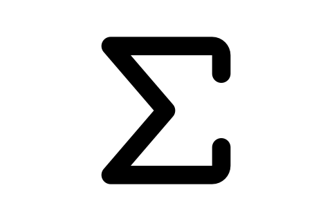 | [求和](../../element/svg/tabler-sum.svg) | Tabler outline · MIT | — |
|  | [magnifying-glass](../../element/svg/bioicons-magnifying-glass.svg) | Bioicons · CC0-1.0 | — |
| 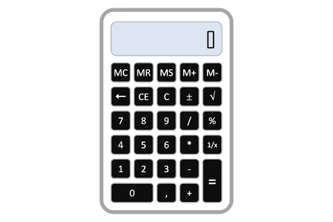 | [calculator](../../element/svg/bioicons-calculator.svg) | Bioicons · CC0-1.0 | — |
| 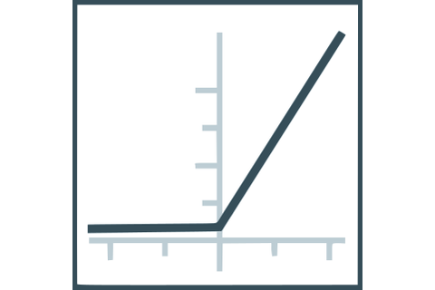 | [ReLU 曲线](../../element/svg/bioicons-relu.svg) | Bioicons · CC0-1.0 | [D2L · AlexNet](../../architecture/d2l-alexnet/README.md) · [D2L · DenseNet 密集连接块](../../architecture/d2l-densenet-block/README.md) · [D2L · 全卷积网络](../../architecture/d2l-fcn/README.md) |
| 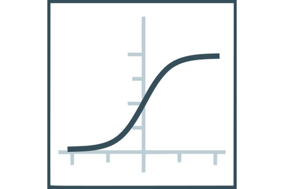 | [Sigmoid 曲线](../../element/svg/bioicons-sigmoid.svg) | Bioicons · CC0-1.0 | [D2L · GRU 内部门控](../../architecture/d2l-gru-3/README.md) · [D2L · LSTM 内部门控](../../architecture/d2l-lstm-3/README.md) · [D2L · 多层感知机](../../architecture/d2l-mlp/README.md) |
| 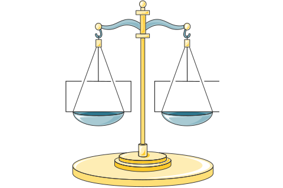 | [scale-balanced](../../element/svg/bioicons-scale-balanced.svg) | Bioicons · CC-BY-3.0 | — |
| 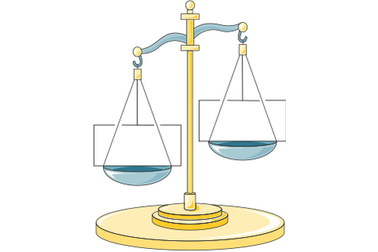 | [scale-imbalanced-left-1](../../element/svg/bioicons-scale-imbalanced-left-1.svg) | Bioicons · CC-BY-3.0 | — |
|  | [拼接节点](../../element/svg/task5-concat.svg) | Illustrator task5 source · 原作者未声明独立复用授权 | [VAR · 从逐 token 到逐尺度生成的范式对照](../../teaser/var-paradigm/README.md) · [D2L · DenseNet 密集连接块](../../architecture/d2l-densenet-block/README.md) · [D2L · Inception 并行分支](../../architecture/d2l-inception/README.md) |
|  | [加法节点](../../element/svg/task5-add.svg) | Illustrator task5 source · 原作者未声明独立复用授权 | [D2L · GRU 内部门控](../../architecture/d2l-gru-3/README.md) · [D2L · LSTM 内部门控](../../architecture/d2l-lstm-3/README.md) · [D2L · ResNet 残差块](../../architecture/d2l-resnet-block/README.md) |
|  | [乘法节点](../../element/svg/task5-multiply.svg) | Illustrator task5 source · 原作者未声明独立复用授权 | [D2L · GRU 内部门控](../../architecture/d2l-gru-3/README.md) · [D2L · LSTM 内部门控](../../architecture/d2l-lstm-3/README.md) · [DiT · 整体主干与三种条件注入模块](../../architecture/dit-architecture/README.md) |
|  | [上采样节点](../../element/svg/task5-upsample.svg) | Illustrator task5 source · 原作者未声明独立复用授权 | [VAR · 从逐 token 到逐尺度生成的范式对照](../../teaser/var-paradigm/README.md) · [D2L · 全卷积网络](../../architecture/d2l-fcn/README.md) · [LGM · 非对称 U-Net 与跨视角注意力](../../architecture/lgm-architecture/README.md) |
| 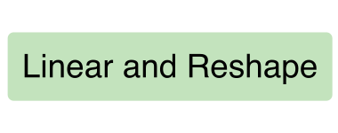 | [线性映射与形状重排](../../element/svg/dit-linear-reshape.svg) | DiT 原图部件 · CC-BY-4.0 | [DiT · 整体主干与三种条件注入模块](../../architecture/dit-architecture/README.md) · [LLaVA · 视觉投影与语言 token 的统一输入](../../architecture/llava-original-architecture/README.md) |
|  | [条件缩放与平移模块](../../element/svg/dit-scale-shift.svg) | DiT 原图部件 · CC-BY-4.0 | [DiT · 整体主干与三种条件注入模块](../../architecture/dit-architecture/README.md) |
| 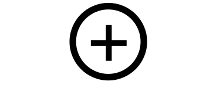 | [DiT 残差加法节点](../../element/svg/dit-residual-add.svg) | DiT 原图部件 · CC-BY-4.0 | [DiT · 整体主干与三种条件注入模块](../../architecture/dit-architecture/README.md) · [FlashTrace · 片段归因与多跳递归追踪](../../architecture/flashtrace-span-recursive-attribution/README.md) |
