# 科学与图表

[返回 Element](../README.md) · [Teaser](../../teaser/README.md) · [Architecture](../../architecture/README.md) · [范例与元素对照表](../with-examples.md)

关联范例按表达功能互链；是否为原图拆件见对照表与元素来源记录。

| 预览 | 名称与 SVG | 来源与许可 | 关联范例（最多列三项） |
|---|---|---|---|
| 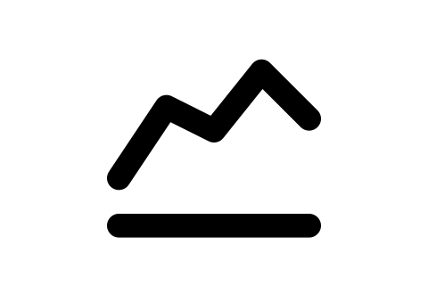 | [折线图符号](../../element/svg/tabler-chart-line.svg) | Tabler outline · MIT | [图基础模型范式对照 · 专用学习与共享预训练](../../teaser/survey-graph-foundation-paradigm/README.md) · [EAGLE · 图像子区搜索与模态归因](../../architecture/eagle-visual-language-attribution/README.md) |
|  | [柱状图符号](../../element/svg/tabler-chart-bar.svg) | Tabler outline · MIT | [MVSplat · 重建质量、速度与参数量的并列对照](../../teaser/mvsplat-comparison/README.md) · [Tokengeist · 五轮退款对话的递归溯源](../../architecture/tokengeist-refund-provenance-trace/README.md) · [VTrace · 从回答到视觉证据的多跳归因](../../architecture/vtrace-multihop-visual-attribution/README.md) |
| 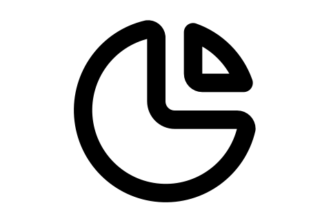 | [饼图符号](../../element/svg/tabler-chart-pie.svg) | Tabler outline · MIT | — |
| 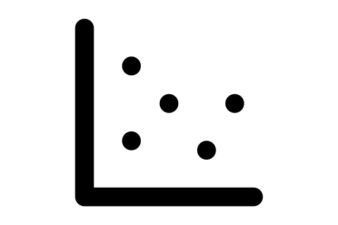 | [散点图符号](../../element/svg/tabler-chart-scatter.svg) | Tabler outline · MIT | [LightGlue：速度与精度权衡](../../teaser/lightglue-tradeoff/README.md) · [自主 Agent 发展 · 趋势曲线与代表场景](../../teaser/survey-agent-growth-landscape/README.md) · [AI4Science 时空尺度图 · 研究对象与共同挑战](../../teaser/survey-ai4science-scale-map/README.md) |
| 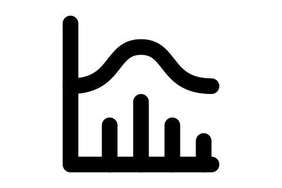 | [直方图符号](../../element/svg/tabler-chart-histogram.svg) | Tabler outline · MIT | — |
| 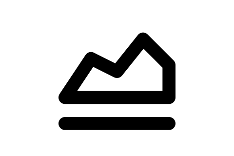 | [面积图符号](../../element/svg/tabler-chart-area.svg) | Tabler outline · MIT | — |
| 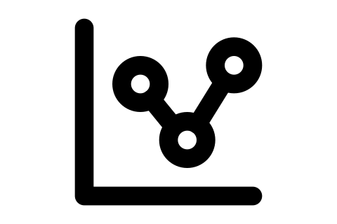 | [点线图符号](../../element/svg/tabler-chart-dots.svg) | Tabler outline · MIT | — |
| 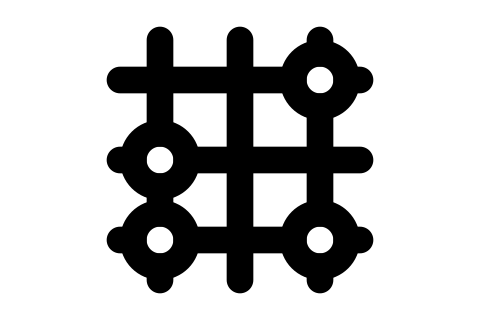 | [网格图符号](../../element/svg/tabler-chart-grid-dots.svg) | Tabler outline · MIT | — |
| 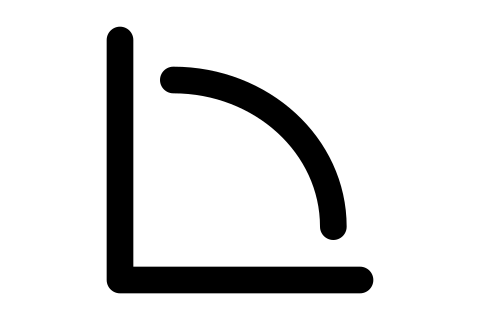 | [分布曲线符号](../../element/svg/tabler-chart-ppf.svg) | Tabler outline · MIT | — |
| 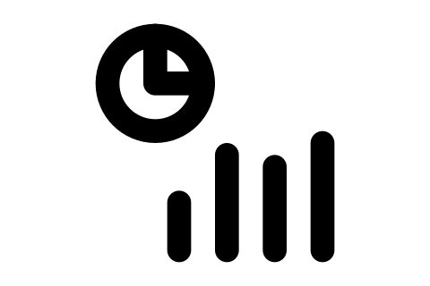 | [信息图符号](../../element/svg/tabler-chart-infographic.svg) | Tabler outline · MIT | — |
| 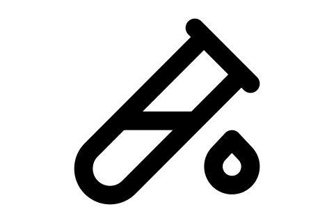 | [试管](../../element/svg/tabler-test-pipe.svg) | Tabler outline · MIT | — |
| 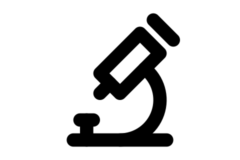 | [显微镜](../../element/svg/tabler-microscope.svg) | Tabler outline · MIT | [科学大模型综述 · 六学科环形问答总览](../../teaser/survey-scillm-six-domain-examples/README.md) |
| 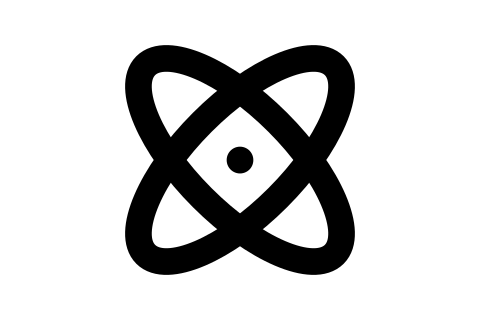 | [原子](../../element/svg/tabler-atom.svg) | Tabler outline · MIT | [PBDL · 领域位置与方法空间的概念总览](../../teaser/pbdl-field-method-space/README.md) · [AI for PDEs · 领域定位、方法与应用全景](../../teaser/survey-ai-pde-scope-map/README.md) · [AI4Research · 三大领域、七类应用面板](../../teaser/survey-ai4research-seven-domains/README.md) |
| 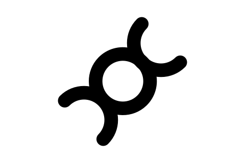 | [DNA](../../element/svg/tabler-dna.svg) | Tabler outline · MIT | — |
| 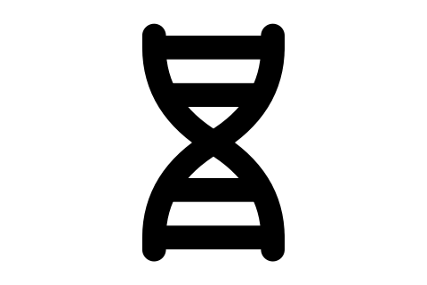 | [DNA 双螺旋](../../element/svg/tabler-dna-2.svg) | Tabler outline · MIT | — |
| 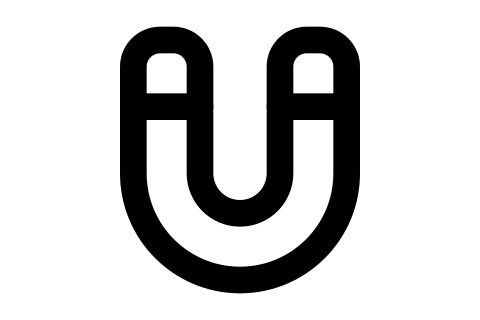 | [磁体](../../element/svg/tabler-magnet.svg) | Tabler outline · MIT | — |
| 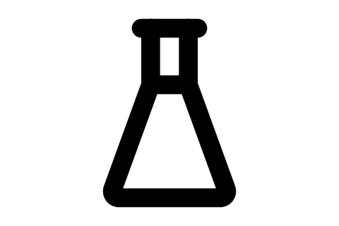 | [烧瓶](../../element/svg/tabler-flask.svg) | Tabler outline · MIT | [AI4Science 领域圆环 · 从量子到连续系统](../../teaser/survey-ai4science-domain-wheel/README.md) |
| 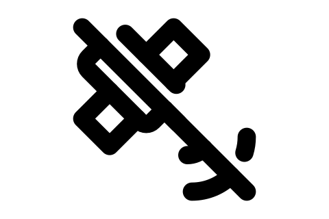 | [卫星关闭](../../element/svg/tabler-satellite-off.svg) | Tabler outline · MIT | — |
| 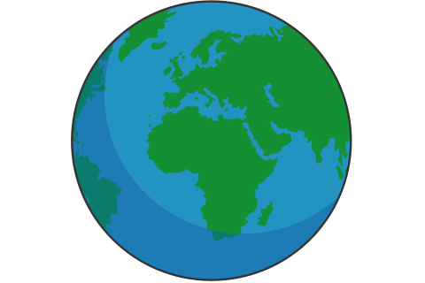 | [earth](../../element/svg/bioicons-earth.svg) | Bioicons · CC-BY-3.0 | — |
| 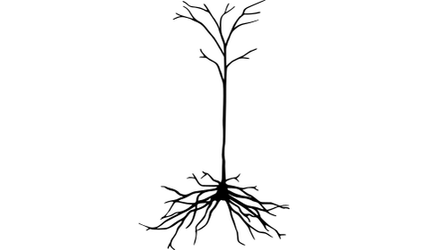 | [锥体神经元](../../element/svg/bioicons-pyramidal-neuron.svg) | Bioicons · CC0-1.0 | [Cortex · 生物系统巩固与模型记忆巩固类比](../../teaser/cortex-memory-consolidation/README.md) · [HippoRAG · 普通 RAG、人类记忆与海马索引对照](../../teaser/hipporag-human-memory-comparison/README.md) · [MemoryVLA · 人类记忆类比、方法与性能首图](../../teaser/memoryvla-cognition-memory-action/README.md) |
| 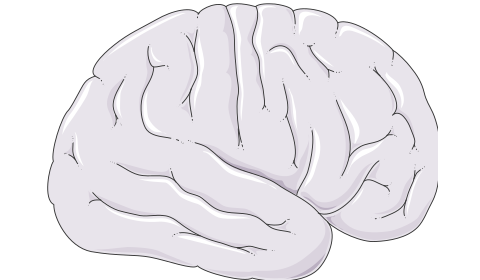 | [大脑侧视图（Servier）](../../element/svg/bioicons-brain-servier-1.svg) | Bioicons · CC-BY-3.0 | [Cortex · 生物系统巩固与模型记忆巩固类比](../../teaser/cortex-memory-consolidation/README.md) · [HippoRAG · 普通 RAG、人类记忆与海马索引对照](../../teaser/hipporag-human-memory-comparison/README.md) · [MemoryVLA · 人类记忆类比、方法与性能首图](../../teaser/memoryvla-cognition-memory-action/README.md) |
| 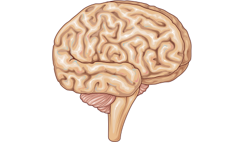 | [大脑与脑干（Servier）](../../element/svg/bioicons-brain-servier-2.svg) | Bioicons · CC-BY-3.0 | [Cortex · 生物系统巩固与模型记忆巩固类比](../../teaser/cortex-memory-consolidation/README.md) · [HippoRAG · 普通 RAG、人类记忆与海马索引对照](../../teaser/hipporag-human-memory-comparison/README.md) · [MemoryVLA · 人类记忆类比、方法与性能首图](../../teaser/memoryvla-cognition-memory-action/README.md) |
| 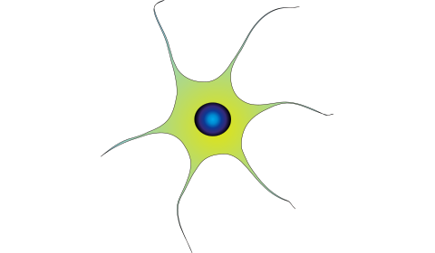 | [神经元（DBCLS）](../../element/svg/bioicons-neuron-dbcls.svg) | Bioicons · CC-BY-4.0 | — |
| 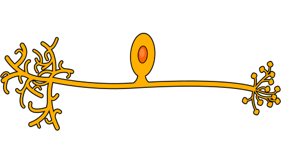 | [感觉神经元（Maddock）](../../element/svg/bioicons-sensory-neuron-maddock.svg) | Bioicons · CC-BY-4.0 | — |
| 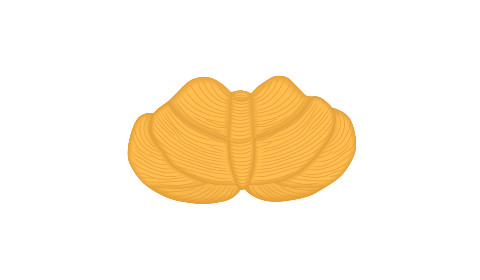 | [小脑背侧视图](../../element/svg/bioicons-cerebellum-dorsal.svg) | Bioicons · CC-BY-4.0 | — |
| 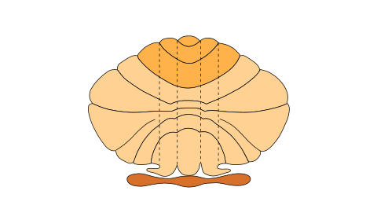 | [小脑分区](../../element/svg/bioicons-cerebellum-divisions.svg) | Bioicons · CC-BY-4.0 | — |
| 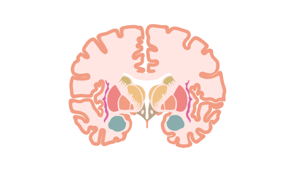 | [脑冠状面与杏仁核定位](../../element/svg/bioicons-brain-amygdala.svg) | Bioicons · CC-BY-4.0 | — |
| 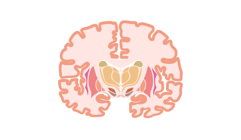 | [脑冠状面与海马定位](../../element/svg/bioicons-brain-hippocampus.svg) | Bioicons · CC-BY-4.0 | [Cortex · 生物系统巩固与模型记忆巩固类比](../../teaser/cortex-memory-consolidation/README.md) · [HippoRAG · 普通 RAG、人类记忆与海马索引对照](../../teaser/hipporag-human-memory-comparison/README.md) · [MemoryVLA · 人类记忆类比、方法与性能首图](../../teaser/memoryvla-cognition-memory-action/README.md) |
| 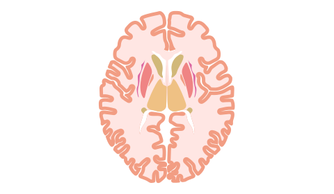 | [大脑水平切面](../../element/svg/bioicons-brain-horizontal.svg) | Bioicons · CC-BY-4.0 | — |
| 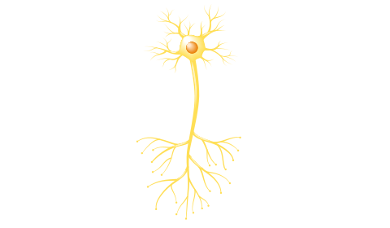 | [中间神经元](../../element/svg/bioicons-interneuron.svg) | Bioicons · CC-BY-4.0 | — |
| 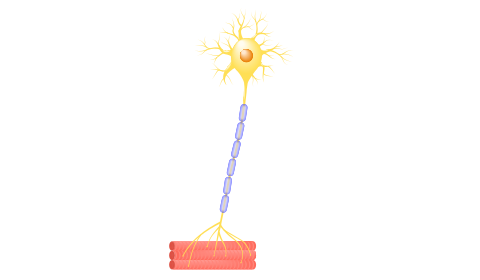 | [运动神经元](../../element/svg/bioicons-motor-neuron.svg) | Bioicons · CC-BY-4.0 | — |
| 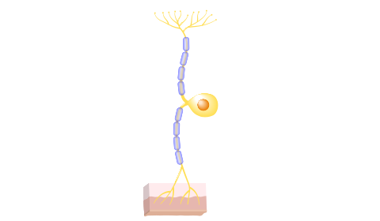 | [感觉神经元（DBCLS）](../../element/svg/bioicons-sensory-neuron-dbcls.svg) | Bioicons · CC-BY-4.0 | — |
