# 训练与标记

[返回 Element](../README.md) · [Teaser](../../teaser/README.md) · [Architecture](../../architecture/README.md) · [范例与元素对照表](../with-examples.md)

关联范例按表达功能互链；是否为原图拆件见对照表与元素来源记录。

| 预览 | 名称与 SVG | 来源与许可 | 关联范例（最多列三项） |
|---|---|---|---|
|  | [锁定](../../element/svg/tabler-lock.svg) | Tabler outline · MIT | [K-LoRA：主体风格组合与训练范式比较](../../teaser/k-lora/README.md) · [RayDer：数据瓶颈与新训练范式](../../teaser/rayder-concept/README.md) · [BLIP-2 · 冻结图像与语言模型的两阶段桥接](../../architecture/blip2-bridge-framework/README.md) |
|  | [解锁](../../element/svg/tabler-lock-open.svg) | Tabler outline · MIT | [K-LoRA：主体风格组合与训练范式比较](../../teaser/k-lora/README.md) · [BLIP-2 · 冻结图像与语言模型的两阶段桥接](../../architecture/blip2-bridge-framework/README.md) · [LGM · 从文本或图像到三维高斯和网格的流程](../../architecture/lgm-pipeline/README.md) |
| 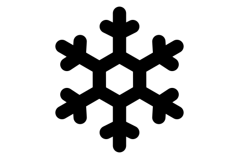 | [冻结标记](../../element/svg/tabler-snowflake.svg) | Tabler outline · MIT | — |
| 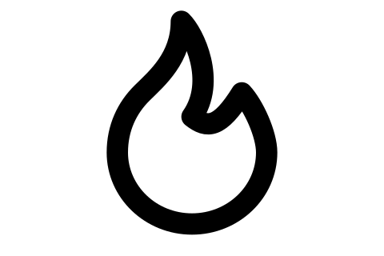 | [训练标记](../../element/svg/tabler-flame.svg) | Tabler outline · MIT | — |
| 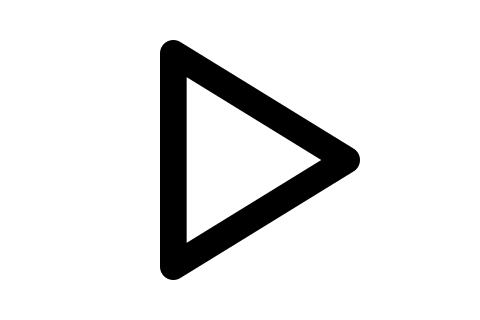 | [开始](../../element/svg/tabler-player-play.svg) | Tabler outline · MIT | [Genie · 不同提示生成可交互世界](../../teaser/genie-interaction/README.md) · [SAM 2 · 任务、模型与数据引擎三联概念图](../../teaser/sam2-task-model-data/README.md) |
| 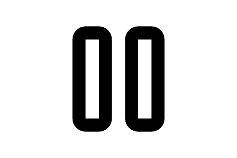 | [暂停](../../element/svg/tabler-player-pause.svg) | Tabler outline · MIT | — |
| 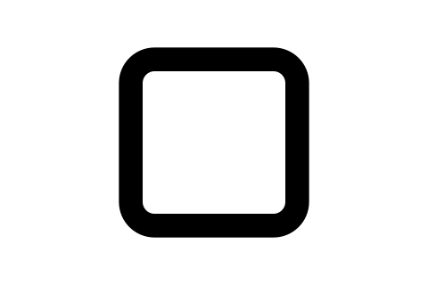 | [停止](../../element/svg/tabler-player-stop.svg) | Tabler outline · MIT | — |
| 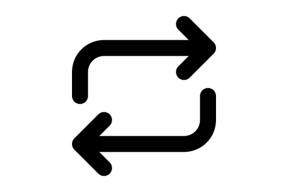 | [重复](../../element/svg/tabler-repeat.svg) | Tabler outline · MIT | — |
| 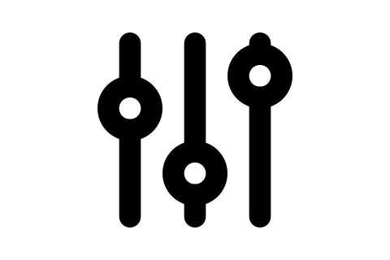 | [参数设置](../../element/svg/tabler-adjustments.svg) | Tabler outline · MIT | [DECOLLAGE：局部风格控制与三维细化](../../teaser/decollage/README.md) · [ShaDDR：粗形状与示例驱动的成果展示](../../teaser/shaddr/README.md) |
| 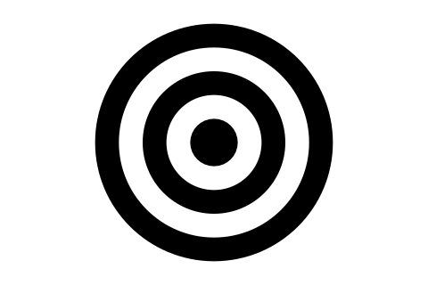 | [目标](../../element/svg/tabler-target.svg) | Tabler outline · MIT | [3DETR · 输入点云、注意力与检测结果的对应](../../teaser/3detr-attention-teaser/README.md) · [LightGlue：速度与精度权衡](../../teaser/lightglue-tradeoff/README.md) · [自主 Agent 统一框架 · 四列模块分解](../../architecture/survey-autonomous-agent-modules/README.md) |
| 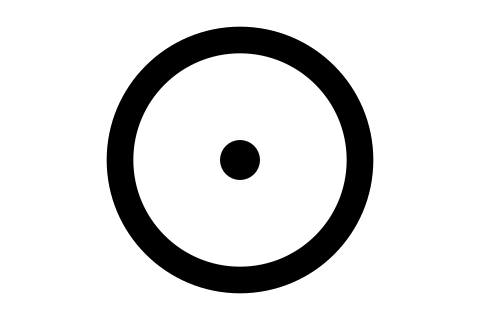 | [聚焦](../../element/svg/tabler-focus.svg) | Tabler outline · MIT | — |
| 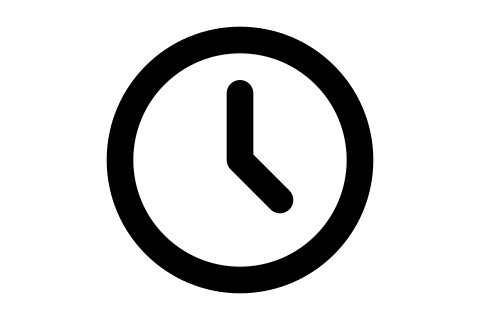 | [时钟](../../element/svg/tabler-clock.svg) | Tabler outline · MIT | [DreamGaussian · 生成能力与优化进程同图展示](../../teaser/dreamgaussian-progress/README.md) · [LightGlue：速度与精度权衡](../../teaser/lightglue-tradeoff/README.md) · [MVSplat · 重建质量、速度与参数量的并列对照](../../teaser/mvsplat-comparison/README.md) |
| 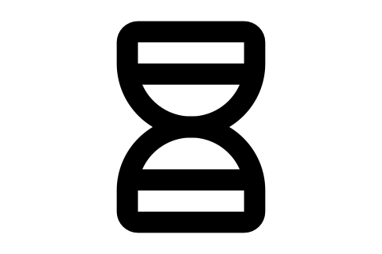 | [沙漏](../../element/svg/tabler-hourglass.svg) | Tabler outline · MIT | — |
| 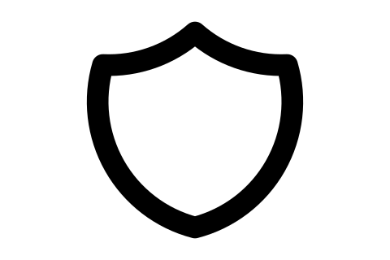 | [保护](../../element/svg/tabler-shield.svg) | Tabler outline · MIT | — |
|  | [验证](../../element/svg/tabler-shield-check.svg) | Tabler outline · MIT | — |
|  | [警告](../../element/svg/tabler-alert-triangle.svg) | Tabler outline · MIT | — |
| 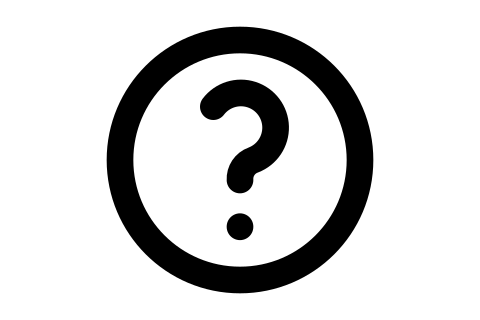 | [问号](../../element/svg/tabler-help.svg) | Tabler outline · MIT | — |
| 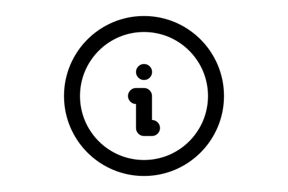 | [信息](../../element/svg/tabler-info-circle.svg) | Tabler outline · MIT | — |
|  | [勾选](../../element/svg/tabler-check.svg) | Tabler outline · MIT | — |
|  | [星标](../../element/svg/tabler-star.svg) | Tabler outline · MIT | — |
| 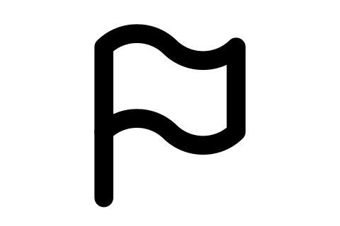 | [旗帜](../../element/svg/tabler-flag.svg) | Tabler outline · MIT | — |
| 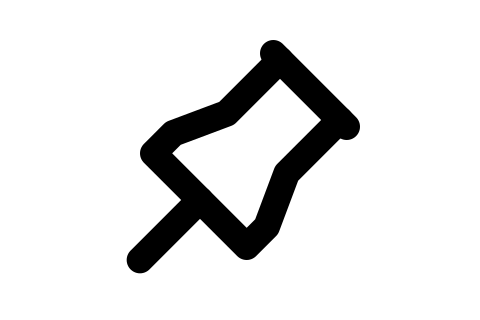 | [图钉](../../element/svg/tabler-pin.svg) | Tabler outline · MIT | — |
|  | [奖章](../../element/svg/tabler-award.svg) | Tabler outline · MIT | — |
| 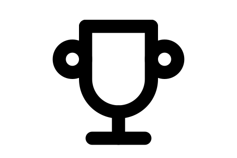 | [奖杯](../../element/svg/tabler-trophy.svg) | Tabler outline · MIT | — |
|  | [天平](../../element/svg/tabler-scale.svg) | Tabler outline · MIT | — |
| 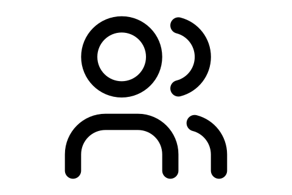 | [多用户](../../element/svg/tabler-users.svg) | Tabler outline · MIT | [DPO · RLHF 与直接偏好优化的流程简化](../../teaser/dpo-comparison/README.md) · [自主 Agent 发展 · 趋势曲线与代表场景](../../teaser/survey-agent-growth-landscape/README.md) · [Agent 社会场景 · 综述概念 teaser](../../teaser/survey-agent-society-teaser/README.md) |
| 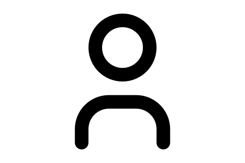 | [用户](../../element/svg/tabler-user.svg) | Tabler outline · MIT | [自主 Agent 统一框架 · 四列模块分解](../../architecture/survey-autonomous-agent-modules/README.md) |
|  | [对话](../../element/svg/tabler-message.svg) | Tabler outline · MIT | [DPO · RLHF 与直接偏好优化的流程简化](../../teaser/dpo-comparison/README.md) · [Agent 社会场景 · 综述概念 teaser](../../teaser/survey-agent-society-teaser/README.md) |
|  | [聊天机器人](../../element/svg/tabler-message-chatbot.svg) | Tabler outline · MIT | [Agent 概念框架 · 感知、大脑与行动](../../architecture/survey-agent-perception-brain-action/README.md) |
| 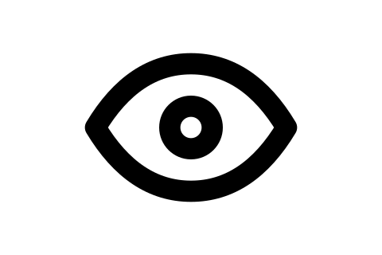 | [可见](../../element/svg/tabler-eye.svg) | Tabler outline · MIT | — |
| 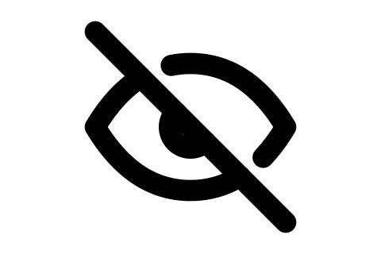 | [隐藏](../../element/svg/tabler-eye-off.svg) | Tabler outline · MIT | — |
| 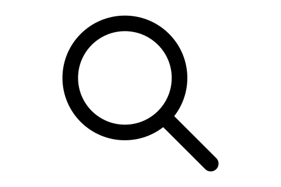 | [搜索](../../element/svg/tabler-search.svg) | Tabler outline · MIT | — |
| 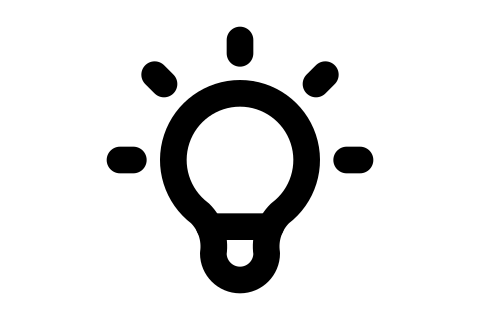 | [想法](../../element/svg/tabler-bulb.svg) | Tabler outline · MIT | — |
| 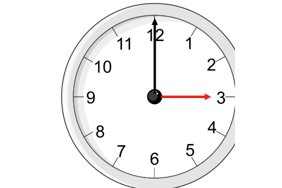 | [时钟](../../element/svg/bioicons-clock.svg) | Bioicons · CC-BY-3.0 | — |
| 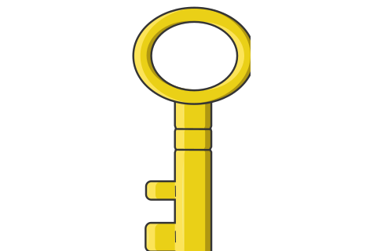 | [key](../../element/svg/bioicons-key.svg) | Bioicons · CC-BY-3.0 | — |
|  | [padlock-closed](../../element/svg/bioicons-padlock-closed.svg) | Bioicons · CC-BY-3.0 | — |
|  | [padlock-open](../../element/svg/bioicons-padlock-open.svg) | Bioicons · CC-BY-3.0 | — |
|  | [sand-clock](../../element/svg/bioicons-sand-clock.svg) | Bioicons · CC-BY-3.0 | — |
| 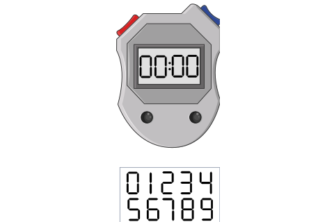 | [stopwatch-digital](../../element/svg/bioicons-stopwatch-digital.svg) | Bioicons · CC-BY-3.0 | — |
| 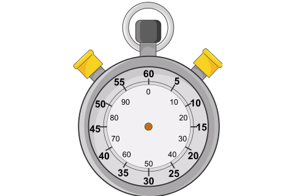 | [stopwatch](../../element/svg/bioicons-stopwatch.svg) | Bioicons · CC-BY-3.0 | — |
|  | [时间步条件块](../../element/svg/dit-timestep.svg) | DiT 原图部件 · CC-BY-4.0 | [DiT · 整体主干与三种条件注入模块](../../architecture/dit-architecture/README.md) |
| 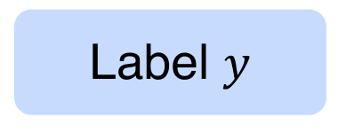 | [类别条件块](../../element/svg/dit-class-condition.svg) | DiT 原图部件 · CC-BY-4.0 | [DiT · 整体主干与三种条件注入模块](../../architecture/dit-architecture/README.md) |
