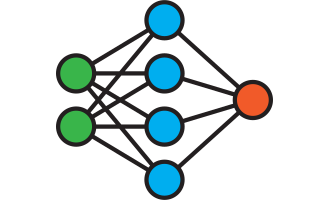
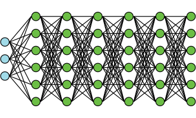

# Towaki CC0

[返回元素库](../README.md)

| 预览 | 名称 | 原来源 |
|---|---|---|
|  | [浅层神经网络](../../element/svg/towaki-neuralnetwork.svg) | [出处](https://raw.githubusercontent.com/tovacinni/cv-gfx-ml-icons/75bc108cd5777b96d702449d871e9067642c75b0/neuralnetwork.svg) · CC0-1.0 |
|  | [深层神经网络](../../element/svg/towaki-deepneuralnetwork.svg) | [出处](https://raw.githubusercontent.com/tovacinni/cv-gfx-ml-icons/75bc108cd5777b96d702449d871e9067642c75b0/deepneuralnetwork.svg) · CC0-1.0 |
|  | [神经场论文图标](../../element/svg/towaki-neuralfieldpaper.svg) | [出处](https://raw.githubusercontent.com/tovacinni/cv-gfx-ml-icons/75bc108cd5777b96d702449d871e9067642c75b0/neuralfieldpaper.svg) · CC0-1.0 |
|  | [兔形图标](../../element/svg/towaki-bunny.svg) | [出处](https://raw.githubusercontent.com/tovacinni/cv-gfx-ml-icons/75bc108cd5777b96d702449d871e9067642c75b0/bunny.svg) · CC0-1.0 |
|  | [存储图标](../../element/svg/towaki-floppydisk.svg) | [出处](https://raw.githubusercontent.com/tovacinni/cv-gfx-ml-icons/75bc108cd5777b96d702449d871e9067642c75b0/floppydisk.svg) · CC0-1.0 |
