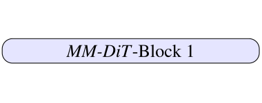
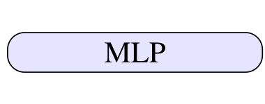
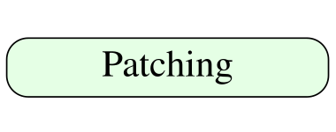
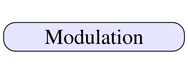

# SD3 原图部件

[返回元素库](../README.md)

| 预览 | 名称 | 原来源 |
|---|---|---|
|  | [MM-DiT block 模块](../../element/svg/sd3-mmdit-block.svg) | [出处](https://icml.cc/virtual/2024/oral/35548) · 作者保留权利 / 参考收录 |
|  | [条件 MLP 模块](../../element/svg/sd3-conditioning-mlp.svg) | [出处](https://icml.cc/virtual/2024/oral/35548) · 作者保留权利 / 参考收录 |
|  | [图像潜变量分块模块](../../element/svg/sd3-patching.svg) | [出处](https://icml.cc/virtual/2024/oral/35548) · 作者保留权利 / 参考收录 |
|  | [条件调制模块](../../element/svg/sd3-modulation.svg) | [出处](https://icml.cc/virtual/2024/oral/35548) · 作者保留权利 / 参考收录 |
