# MemoryVLA 原图部件

[返回元素库](../README.md)

| 预览 | 名称 | 原来源 |
|---|---|---|
| 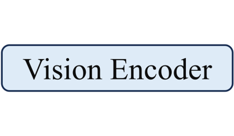 | [MemoryVLA 视觉编码器](../../element/svg/memoryvla-vision-encoder.svg) | [出处](https://openreview.net/forum?id=54U3XHf7qq) · 作者保留权利 / 私有参考 |
| 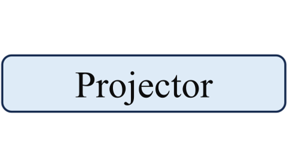 | [MemoryVLA 投影模块](../../element/svg/memoryvla-projector.svg) | [出处](https://openreview.net/forum?id=54U3XHf7qq) · 作者保留权利 / 私有参考 |
| 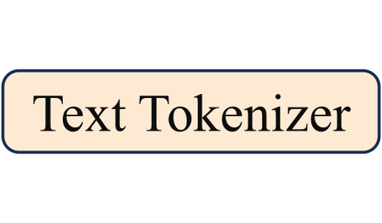 | [文本 Tokenizer 模块](../../element/svg/memoryvla-text-tokenizer.svg) | [出处](https://openreview.net/forum?id=54U3XHf7qq) · 作者保留权利 / 私有参考 |
| 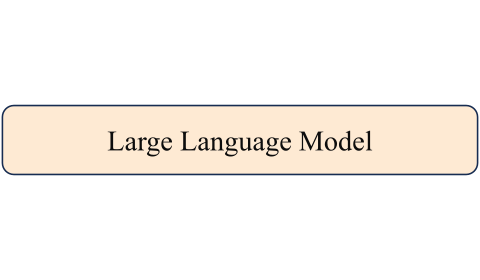 | [MemoryVLA 语言模型块](../../element/svg/memoryvla-language-model.svg) | [出处](https://openreview.net/forum?id=54U3XHf7qq) · 作者保留权利 / 私有参考 |
| 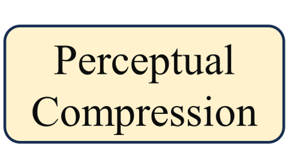 | [感知压缩模块](../../element/svg/memoryvla-perceptual-compression.svg) | [出处](https://openreview.net/forum?id=54U3XHf7qq) · 作者保留权利 / 私有参考 |
| 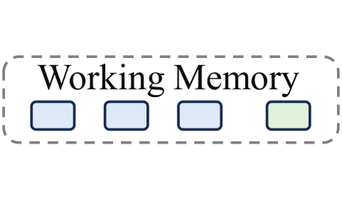 | [工作记忆与 Token 组](../../element/svg/memoryvla-working-memory.svg) | [出处](https://openreview.net/forum?id=54U3XHf7qq) · 作者保留权利 / 私有参考 |
| 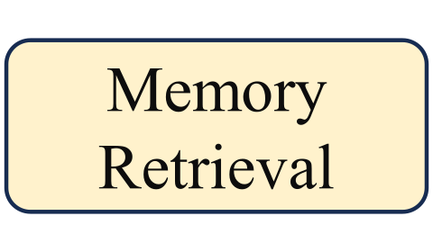 | [记忆检索模块](../../element/svg/memoryvla-memory-retrieval.svg) | [出处](https://openreview.net/forum?id=54U3XHf7qq) · 作者保留权利 / 私有参考 |
| 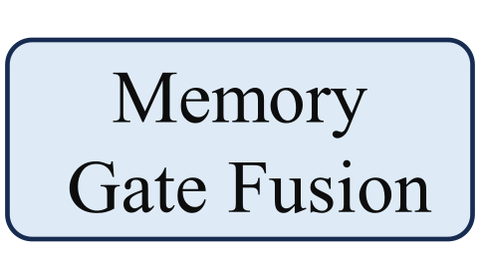 | [记忆门控融合模块](../../element/svg/memoryvla-gated-fusion.svg) | [出处](https://openreview.net/forum?id=54U3XHf7qq) · 作者保留权利 / 私有参考 |
| 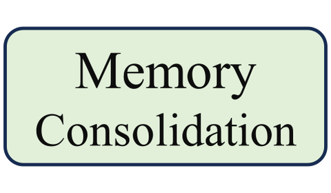 | [记忆巩固模块](../../element/svg/memoryvla-consolidation.svg) | [出处](https://openreview.net/forum?id=54U3XHf7qq) · 作者保留权利 / 私有参考 |
| 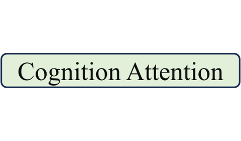 | [认知注意力模块](../../element/svg/memoryvla-cognition-attention.svg) | [出处](https://openreview.net/forum?id=54U3XHf7qq) · 作者保留权利 / 私有参考 |
| 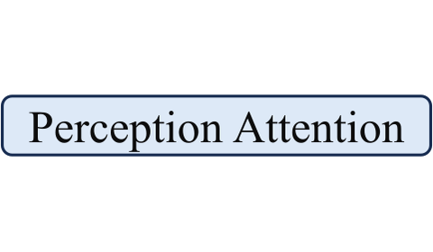 | [感知注意力模块](../../element/svg/memoryvla-perception-attention.svg) | [出处](https://openreview.net/forum?id=54U3XHf7qq) · 作者保留权利 / 私有参考 |
|  | [层叠记忆条目](../../element/svg/memoryvla-memory-stack.svg) | [出处](https://openreview.net/forum?id=54U3XHf7qq) · 作者保留权利 / 私有参考 |
| 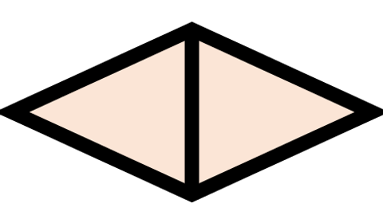 | [时间步嵌入菱形](../../element/svg/memoryvla-timestep-diamond.svg) | [出处](https://openreview.net/forum?id=54U3XHf7qq) · 作者保留权利 / 私有参考 |
