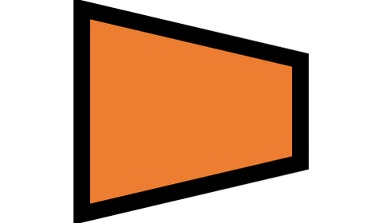
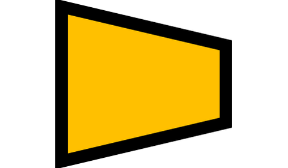
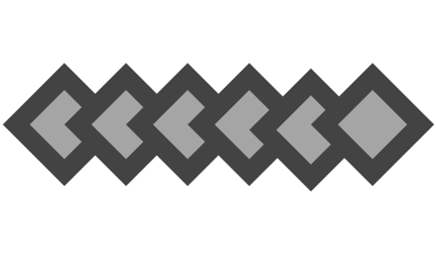

# 无线感知综述原图部件

[返回元素库](../README.md)

| 预览 | 名称 | 原来源 |
|---|---|---|
|  | [生成模型双梯形符号](../../element/svg/wireless-generative-bowtie.svg) | [出处](https://arxiv.org/src/2509.15258v1) · 作者保留权利 / 私有参考 |
|  | [雷达编码器梯形](../../element/svg/wireless-radar-encoder.svg) | [出处](https://arxiv.org/src/2509.15258v1) · 作者保留权利 / 私有参考 |
|  | [雷达解码器梯形](../../element/svg/wireless-radar-decoder.svg) | [出处](https://arxiv.org/src/2509.15258v1) · 作者保留权利 / 私有参考 |
|  | [特征提取梯形](../../element/svg/wireless-feature-extractor.svg) | [出处](https://arxiv.org/src/2509.15258v1) · 作者保留权利 / 私有参考 |
|  | [判别器梯形](../../element/svg/wireless-discriminator.svg) | [出处](https://arxiv.org/src/2509.15258v1) · 作者保留权利 / 私有参考 |
|  | [CSI 菱形输入序列](../../element/svg/wireless-csi-input.svg) | [出处](https://arxiv.org/src/2509.15258v1) · 作者保留权利 / 私有参考 |
