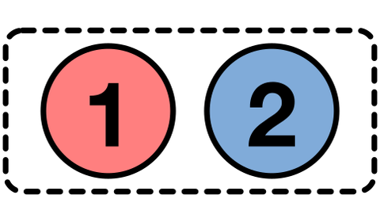
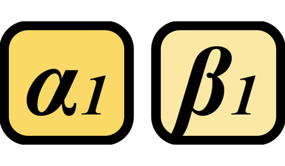

# Speculative RAG 原图部件

[返回元素库](../README.md)

| 预览 | 名称 | 原来源 |
|---|---|---|
|  | [知识查询 Q 标记](../../element/svg/spec-rag-query.svg) | [出处](https://storage.googleapis.com/gweb-research2023-media/images/Speculative_RAG_img1.width-1250.png) · 作者保留权利 / 私有参考 |
|  | [证据支持答案 A 标记](../../element/svg/spec-rag-answer.svg) | [出处](https://storage.googleapis.com/gweb-research2023-media/images/Speculative_RAG_img1.width-1250.png) · 作者保留权利 / 私有参考 |
|  | [同主题检索文档组](../../element/svg/spec-rag-topic-documents.svg) | [出处](https://storage.googleapis.com/gweb-research2023-media/images/Speculative_RAG_img1.width-1250.png) · 作者保留权利 / 私有参考 |
|  | [答案与依据配对标记](../../element/svg/spec-rag-answer-rationale.svg) | [出处](https://storage.googleapis.com/gweb-research2023-media/images/Speculative_RAG_img1.width-1250.png) · 作者保留权利 / 私有参考 |
|  | [方法阶段箭头带](../../element/svg/spec-rag-stage-chevron.svg) | [出处](https://storage.googleapis.com/gweb-research2023-media/images/Speculative_RAG_img1.width-1250.png) · 作者保留权利 / 私有参考 |
