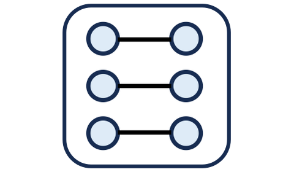
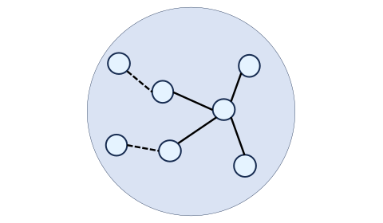
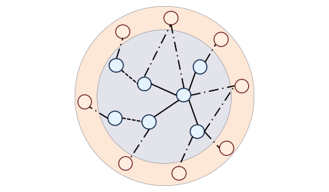

# HippoRAG 2 原图部件

[返回元素库](../README.md)

| 预览 | 名称 | 原来源 |
|---|---|---|
|  | [图谱检索文档图标](../../element/svg/hipporag2-passage.svg) | [出处](https://proceedings.mlr.press/v267/gutierrez25a.html) · 作者保留权利 / 私有参考 |
|  | [三元组关系表](../../element/svg/hipporag2-triples.svg) | [出处](https://proceedings.mlr.press/v267/gutierrez25a.html) · 作者保留权利 / 私有参考 |
|  | [单层知识图谱节点组](../../element/svg/hipporag2-knowledge-graph.svg) | [出处](https://proceedings.mlr.press/v267/gutierrez25a.html) · 作者保留权利 / 私有参考 |
|  | [短语与文档双层图谱](../../element/svg/hipporag2-heterogeneous-graph.svg) | [出处](https://proceedings.mlr.press/v267/gutierrez25a.html) · 作者保留权利 / 私有参考 |
