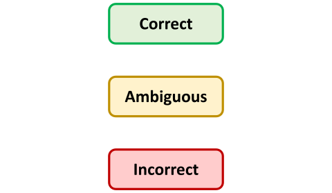
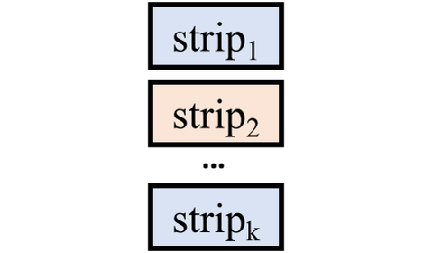
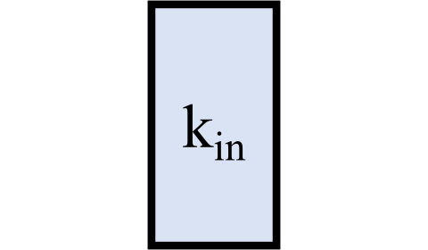
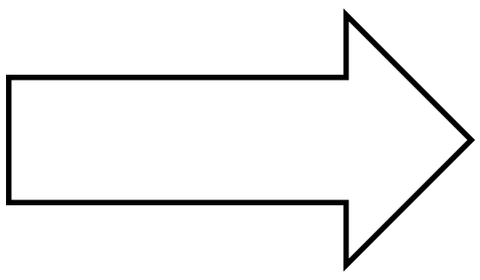

# CRAG 原图部件

[返回元素库](../README.md)

| 预览 | 名称 | 原来源 |
|---|---|---|
|  | [检索评估思考气泡轮廓](../../element/svg/crag-thought-cloud.svg) | [出处](https://arxiv.org/src/2401.15884v3) · 作者保留权利 / 私有参考 |
|  | [检索评估状态标记（三种变体）](../../element/svg/crag-evaluation-statuses.svg) | [出处](https://arxiv.org/src/2401.15884v3) · 作者保留权利 / 私有参考 |
|  | [分解后的文档条带](../../element/svg/crag-document-strips.svg) | [出处](https://arxiv.org/src/2401.15884v3) · 作者保留权利 / 私有参考 |
|  | [内部知识块 k-in](../../element/svg/crag-internal-knowledge.svg) | [出处](https://arxiv.org/src/2401.15884v3) · 作者保留权利 / 私有参考 |
|  | [空心流程箭头](../../element/svg/crag-hollow-arrow.svg) | [出处](https://arxiv.org/src/2401.15884v3) · 作者保留权利 / 私有参考 |
