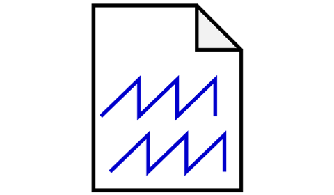
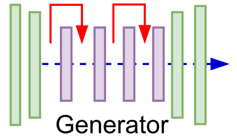
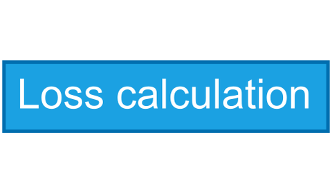

# 无线安全综述原图部件

[返回元素库](../README.md)

| 预览 | 名称 | 原来源 |
|---|---|---|
|  | [带信号的文档符号](../../element/svg/security-signal-document.svg) | [出处](https://arxiv.org/src/2405.20024v2) · 作者保留权利 / 私有参考 |
|  | [多层特征图堆叠](../../element/svg/security-feature-stack.svg) | [出处](https://arxiv.org/src/2405.20024v2) · 作者保留权利 / 私有参考 |
|  | [生成器层结构](../../element/svg/security-generator-network.svg) | [出处](https://arxiv.org/src/2405.20024v2) · 作者保留权利 / 私有参考 |
|  | [损失计算模块](../../element/svg/security-loss-calculation.svg) | [出处](https://arxiv.org/src/2405.20024v2) · 作者保留权利 / 私有参考 |
