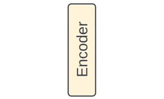
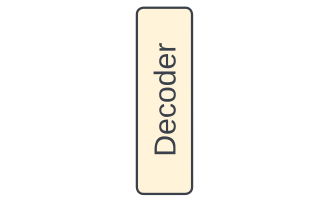
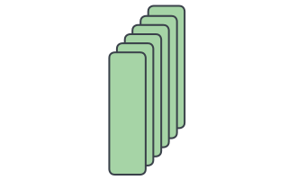
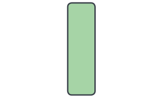
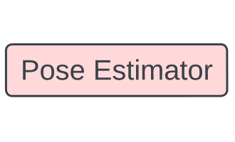
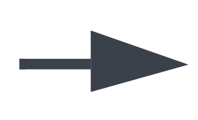
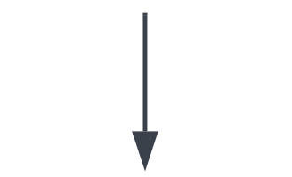

# RUST 原图部件

[返回元素库](../README.md)

| 预览 | 名称 | 原来源 |
|---|---|---|
|  | [编码器块](../../element/svg/rust-encoder.svg) | [出处](https://raw.githubusercontent.com/rust-paper/rust-paper.github.io/8c3a856479a91b2acebb652d91e6b621b005ad95/data/teaser.svg) · 原项目未发现独立图形授权；仅作出处明确的参考 |
|  | [解码器块](../../element/svg/rust-decoder.svg) | [出处](https://raw.githubusercontent.com/rust-paper/rust-paper.github.io/8c3a856479a91b2acebb652d91e6b621b005ad95/data/teaser.svg) · 原项目未发现独立图形授权；仅作出处明确的参考 |
|  | [特征表示堆叠](../../element/svg/rust-feature-stack.svg) | [出处](https://raw.githubusercontent.com/rust-paper/rust-paper.github.io/8c3a856479a91b2acebb652d91e6b621b005ad95/data/teaser.svg) · 原项目未发现独立图形授权；仅作出处明确的参考 |
|  | [单层特征块](../../element/svg/rust-feature-tile.svg) | [出处](https://raw.githubusercontent.com/rust-paper/rust-paper.github.io/8c3a856479a91b2acebb652d91e6b621b005ad95/data/teaser.svg) · 原项目未发现独立图形授权；仅作出处明确的参考 |
|  | [位姿估计模块](../../element/svg/rust-pose-estimator.svg) | [出处](https://raw.githubusercontent.com/rust-paper/rust-paper.github.io/8c3a856479a91b2acebb652d91e6b621b005ad95/data/teaser.svg) · 原项目未发现独立图形授权；仅作出处明确的参考 |
|  | [右向流程箭头](../../element/svg/rust-arrow-right.svg) | [出处](https://raw.githubusercontent.com/rust-paper/rust-paper.github.io/8c3a856479a91b2acebb652d91e6b621b005ad95/data/teaser.svg) · 原项目未发现独立图形授权；仅作出处明确的参考 |
|  | [下向流程箭头](../../element/svg/rust-arrow-down.svg) | [出处](https://raw.githubusercontent.com/rust-paper/rust-paper.github.io/8c3a856479a91b2acebb652d91e6b621b005ad95/data/teaser.svg) · 原项目未发现独立图形授权；仅作出处明确的参考 |
