# Bioicons

[返回元素库](../README.md)

| 预览 | 名称 | 原来源 |
|---|---|---|
| 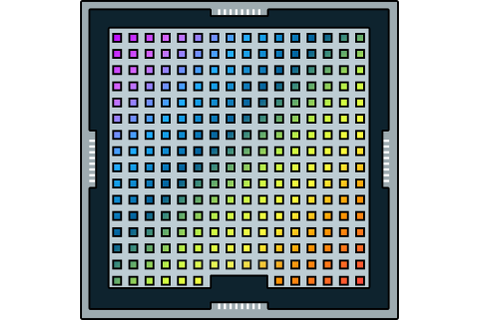 | [CPU](../../element/svg/bioicons-cpu.svg) | [出处](https://raw.githubusercontent.com/duerrsimon/bioicons/d29e766ea7580b8063c4f47b29e872db40a4d979/static/icons/cc-0/Computer_hardware/Simon_D%C3%BCrr/cpu.svg) · CC0-1.0 |
| 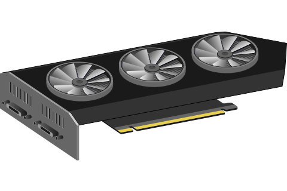 | [三维 GPU](../../element/svg/bioicons-gpu-3d.svg) | [出处](https://raw.githubusercontent.com/duerrsimon/bioicons/d29e766ea7580b8063c4f47b29e872db40a4d979/static/icons/cc-0/Computer_hardware/Simon_D%C3%BCrr/gpu-3d.svg) · CC0-1.0 |
| 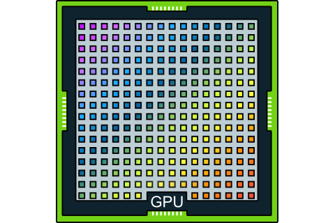 | [GPU](../../element/svg/bioicons-gpu.svg) | [出处](https://raw.githubusercontent.com/duerrsimon/bioicons/d29e766ea7580b8063c4f47b29e872db40a4d979/static/icons/cc-0/Computer_hardware/Simon_D%C3%BCrr/gpu.svg) · CC0-1.0 |
|  | [硬盘](../../element/svg/bioicons-hdd.svg) | [出处](https://raw.githubusercontent.com/duerrsimon/bioicons/d29e766ea7580b8063c4f47b29e872db40a4d979/static/icons/cc-0/Computer_hardware/Simon_D%C3%BCrr/hdd.svg) · CC0-1.0 |
|  | [笔记本电脑](../../element/svg/bioicons-laptop.svg) | [出处](https://raw.githubusercontent.com/duerrsimon/bioicons/d29e766ea7580b8063c4f47b29e872db40a4d979/static/icons/cc-0/Computer_hardware/Simon_D%C3%BCrr/laptop.svg) · CC0-1.0 |
|  | [显示器](../../element/svg/bioicons-screen.svg) | [出处](https://raw.githubusercontent.com/duerrsimon/bioicons/d29e766ea7580b8063c4f47b29e872db40a4d979/static/icons/cc-0/Computer_hardware/Simon_D%C3%BCrr/screen.svg) · CC0-1.0 |
| 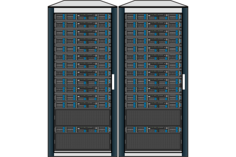 | [超级计算机](../../element/svg/bioicons-supercomputer.svg) | [出处](https://raw.githubusercontent.com/duerrsimon/bioicons/d29e766ea7580b8063c4f47b29e872db40a4d979/static/icons/cc-0/Computer_hardware/Simon_D%C3%BCrr/supercomputer.svg) · CC0-1.0 |
| 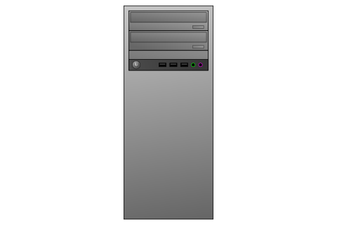 | [工作站](../../element/svg/bioicons-workstation.svg) | [出处](https://raw.githubusercontent.com/duerrsimon/bioicons/d29e766ea7580b8063c4f47b29e872db40a4d979/static/icons/cc-0/Computer_hardware/Simon_D%C3%BCrr/workstation.svg) · CC0-1.0 |
|  | [magnifying-glass](../../element/svg/bioicons-magnifying-glass.svg) | [出处](https://raw.githubusercontent.com/duerrsimon/bioicons/d29e766ea7580b8063c4f47b29e872db40a4d979/static/icons/cc-0/General_items/Marcel_Tisch/magnifying-glass.svg) · CC0-1.0 |
|  | [Document](../../element/svg/bioicons-document.svg) | [出处](https://raw.githubusercontent.com/duerrsimon/bioicons/d29e766ea7580b8063c4f47b29e872db40a4d979/static/icons/cc-0/General_items/OpenClipart/Document.svg) · CC0-1.0 |
| 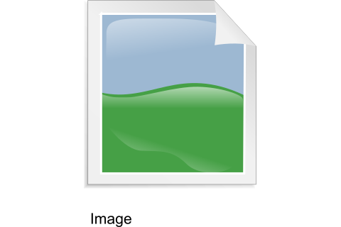 | [Image](../../element/svg/bioicons-image.svg) | [出处](https://raw.githubusercontent.com/duerrsimon/bioicons/d29e766ea7580b8063c4f47b29e872db40a4d979/static/icons/cc-0/General_items/OpenClipart/Image.svg) · CC0-1.0 |
|  | [calculator](../../element/svg/bioicons-calculator.svg) | [出处](https://raw.githubusercontent.com/duerrsimon/bioicons/d29e766ea7580b8063c4f47b29e872db40a4d979/static/icons/cc-0/General_items/OpenClipart/calculator.svg) · CC0-1.0 |
| 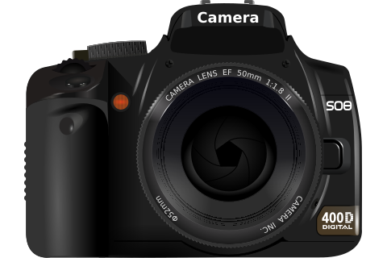 | [相机](../../element/svg/bioicons-camera.svg) | [出处](https://raw.githubusercontent.com/duerrsimon/bioicons/d29e766ea7580b8063c4f47b29e872db40a4d979/static/icons/cc-0/General_items/OpenClipart/camera.svg) · CC0-1.0 |
| 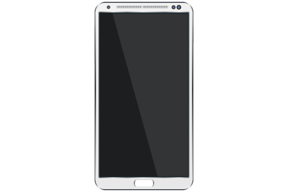 | [smartphone](../../element/svg/bioicons-smartphone.svg) | [出处](https://raw.githubusercontent.com/duerrsimon/bioicons/d29e766ea7580b8063c4f47b29e872db40a4d979/static/icons/cc-0/General_items/OpenClipart/smartphone.svg) · CC0-1.0 |
|  | [terminal](../../element/svg/bioicons-terminal.svg) | [出处](https://raw.githubusercontent.com/duerrsimon/bioicons/d29e766ea7580b8063c4f47b29e872db40a4d979/static/icons/cc-0/General_items/OpenClipart/terminal.svg) · CC0-1.0 |
|  | [AI 灯泡符号](../../element/svg/bioicons-ai-bulb.svg) | [出处](https://raw.githubusercontent.com/duerrsimon/bioicons/d29e766ea7580b8063c4f47b29e872db40a4d979/static/icons/cc-0/Machine_Learning/OpenClipart/ai-bulb.svg) · CC0-1.0 |
|  | [认知符号](../../element/svg/bioicons-ai-cognition.svg) | [出处](https://raw.githubusercontent.com/duerrsimon/bioicons/d29e766ea7580b8063c4f47b29e872db40a4d979/static/icons/cc-0/Machine_Learning/OpenClipart/ai-cognition.svg) · CC0-1.0 |
|  | [AI 人像符号](../../element/svg/bioicons-ai-head.svg) | [出处](https://raw.githubusercontent.com/duerrsimon/bioicons/d29e766ea7580b8063c4f47b29e872db40a4d979/static/icons/cc-0/Machine_Learning/OpenClipart/ai-head.svg) · CC0-1.0 |
|  | [AI 芯片符号](../../element/svg/bioicons-ai.svg) | [出处](https://raw.githubusercontent.com/duerrsimon/bioicons/d29e766ea7580b8063c4f47b29e872db40a4d979/static/icons/cc-0/Machine_Learning/Simon_D%C3%BCrr/ai.svg) · CC0-1.0 |
|  | [算法流程](../../element/svg/bioicons-algorithm.svg) | [出处](https://raw.githubusercontent.com/duerrsimon/bioicons/d29e766ea7580b8063c4f47b29e872db40a4d979/static/icons/cc-0/Machine_Learning/Simon_D%C3%BCrr/algorithm.svg) · CC0-1.0 |
| 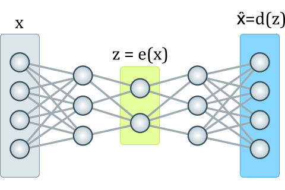 | [自编码器](../../element/svg/bioicons-autoencoder.svg) | [出处](https://raw.githubusercontent.com/duerrsimon/bioicons/d29e766ea7580b8063c4f47b29e872db40a4d979/static/icons/cc-0/Machine_Learning/Simon_D%C3%BCrr/autoencoder.svg) · CC0-1.0 |
| 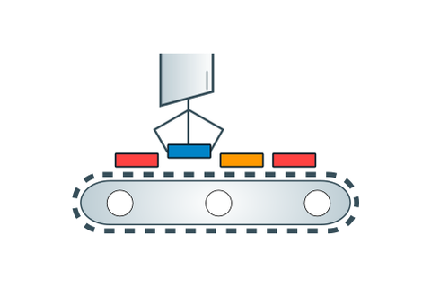 | [自动化](../../element/svg/bioicons-automation.svg) | [出处](https://raw.githubusercontent.com/duerrsimon/bioicons/d29e766ea7580b8063c4f47b29e872db40a4d979/static/icons/cc-0/Machine_Learning/Simon_D%C3%BCrr/automation.svg) · CC0-1.0 |
| 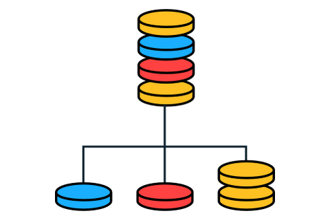 | [分类](../../element/svg/bioicons-classification.svg) | [出处](https://raw.githubusercontent.com/duerrsimon/bioicons/d29e766ea7580b8063c4f47b29e872db40a4d979/static/icons/cc-0/Machine_Learning/Simon_D%C3%BCrr/classification.svg) · CC0-1.0 |
| 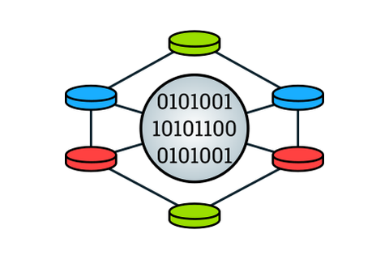 | [数据挖掘](../../element/svg/bioicons-datamining.svg) | [出处](https://raw.githubusercontent.com/duerrsimon/bioicons/d29e766ea7580b8063c4f47b29e872db40a4d979/static/icons/cc-0/Machine_Learning/Simon_D%C3%BCrr/datamining.svg) · CC0-1.0 |
| 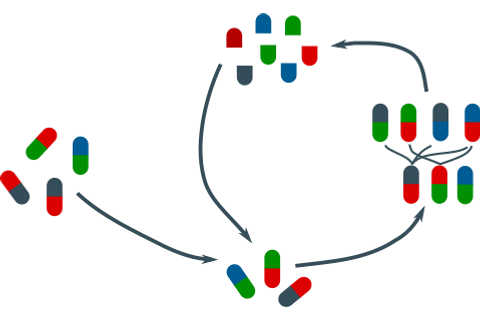 | [遗传算法](../../element/svg/bioicons-genetic-algorithm.svg) | [出处](https://raw.githubusercontent.com/duerrsimon/bioicons/d29e766ea7580b8063c4f47b29e872db40a4d979/static/icons/cc-0/Machine_Learning/Simon_D%C3%BCrr/genetic-algorithm.svg) · CC0-1.0 |
| 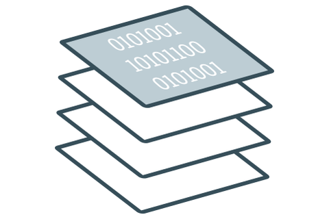 | [模型层堆叠](../../element/svg/bioicons-model-layers.svg) | [出处](https://raw.githubusercontent.com/duerrsimon/bioicons/d29e766ea7580b8063c4f47b29e872db40a4d979/static/icons/cc-0/Machine_Learning/Simon_D%C3%BCrr/model-layers.svg) · CC0-1.0 |
| 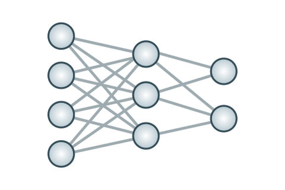 | [神经网络](../../element/svg/bioicons-neural-network-1.svg) | [出处](https://raw.githubusercontent.com/duerrsimon/bioicons/d29e766ea7580b8063c4f47b29e872db40a4d979/static/icons/cc-0/Machine_Learning/Simon_D%C3%BCrr/neural-network-1.svg) · CC0-1.0 |
| 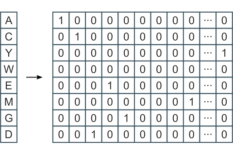 | [独热编码](../../element/svg/bioicons-onehotencoding.svg) | [出处](https://raw.githubusercontent.com/duerrsimon/bioicons/d29e766ea7580b8063c4f47b29e872db40a4d979/static/icons/cc-0/Machine_Learning/Simon_D%C3%BCrr/onehotencoding.svg) · CC0-1.0 |
| 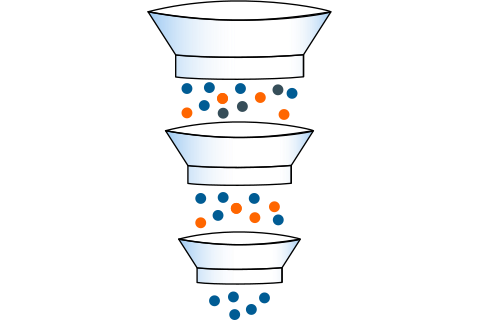 | [处理流程](../../element/svg/bioicons-pipeline.svg) | [出处](https://raw.githubusercontent.com/duerrsimon/bioicons/d29e766ea7580b8063c4f47b29e872db40a4d979/static/icons/cc-0/Machine_Learning/Simon_D%C3%BCrr/pipeline.svg) · CC0-1.0 |
| 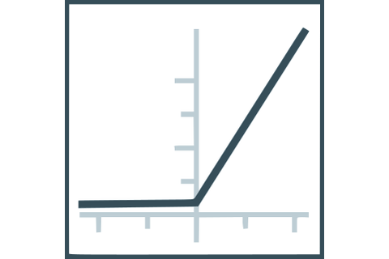 | [ReLU 曲线](../../element/svg/bioicons-relu.svg) | [出处](https://raw.githubusercontent.com/duerrsimon/bioicons/d29e766ea7580b8063c4f47b29e872db40a4d979/static/icons/cc-0/Machine_Learning/Simon_D%C3%BCrr/relu.svg) · CC0-1.0 |
| 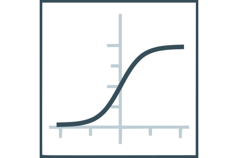 | [Sigmoid 曲线](../../element/svg/bioicons-sigmoid.svg) | [出处](https://raw.githubusercontent.com/duerrsimon/bioicons/d29e766ea7580b8063c4f47b29e872db40a4d979/static/icons/cc-0/Machine_Learning/Simon_D%C3%BCrr/sigmoid.svg) · CC0-1.0 |
| 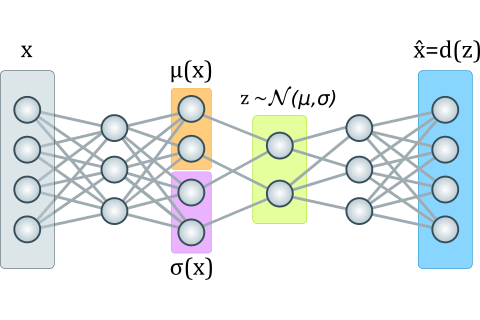 | [变分自编码器](../../element/svg/bioicons-variational-autoencoder.svg) | [出处](https://raw.githubusercontent.com/duerrsimon/bioicons/d29e766ea7580b8063c4f47b29e872db40a4d979/static/icons/cc-0/Machine_Learning/Simon_D%C3%BCrr/variational-autoencoder.svg) · CC0-1.0 |
|  | [database-colored](../../element/svg/bioicons-database-colored.svg) | [出处](https://raw.githubusercontent.com/duerrsimon/bioicons/d29e766ea7580b8063c4f47b29e872db40a4d979/static/icons/cc-0/Molecular_modelling/OpenClipart/database-colored.svg) · CC0-1.0 |
|  | [数据库](../../element/svg/bioicons-database.svg) | [出处](https://raw.githubusercontent.com/duerrsimon/bioicons/d29e766ea7580b8063c4f47b29e872db40a4d979/static/icons/cc-0/Molecular_modelling/OpenClipart/database.svg) · CC0-1.0 |
| 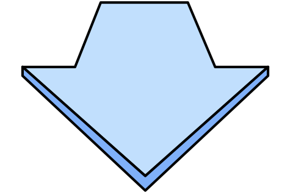 | [arrow-3d-forward](../../element/svg/bioicons-arrow-3d-forward.svg) | [出处](https://raw.githubusercontent.com/duerrsimon/bioicons/d29e766ea7580b8063c4f47b29e872db40a4d979/static/icons/cc-by-3.0/General_items/Servier/arrow-3d-forward.svg) · CC-BY-3.0 |
| 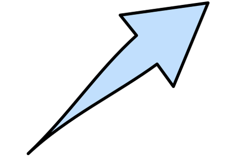 | [arrow-45deg-left](../../element/svg/bioicons-arrow-45deg-left.svg) | [出处](https://raw.githubusercontent.com/duerrsimon/bioicons/d29e766ea7580b8063c4f47b29e872db40a4d979/static/icons/cc-by-3.0/General_items/Servier/arrow-45deg-left.svg) · CC-BY-3.0 |
| 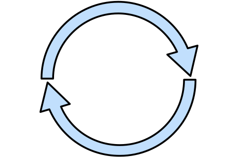 | [arrow-circular](../../element/svg/bioicons-arrow-circular.svg) | [出处](https://raw.githubusercontent.com/duerrsimon/bioicons/d29e766ea7580b8063c4f47b29e872db40a4d979/static/icons/cc-by-3.0/General_items/Servier/arrow-circular.svg) · CC-BY-3.0 |
| 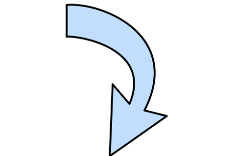 | [arrow-clockwise-4](../../element/svg/bioicons-arrow-clockwise-4.svg) | [出处](https://raw.githubusercontent.com/duerrsimon/bioicons/d29e766ea7580b8063c4f47b29e872db40a4d979/static/icons/cc-by-3.0/General_items/Servier/arrow-clockwise-4.svg) · CC-BY-3.0 |
| 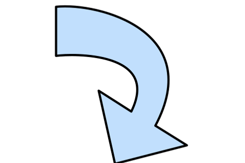 | [arrow-clockwise-5](../../element/svg/bioicons-arrow-clockwise-5.svg) | [出处](https://raw.githubusercontent.com/duerrsimon/bioicons/d29e766ea7580b8063c4f47b29e872db40a4d979/static/icons/cc-by-3.0/General_items/Servier/arrow-clockwise-5.svg) · CC-BY-3.0 |
| 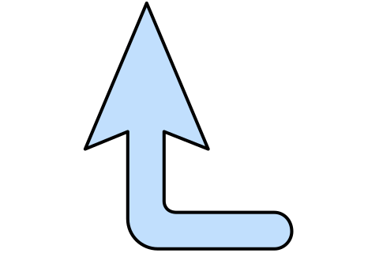 | [arrow-corner-left-up-2](../../element/svg/bioicons-arrow-corner-left-up-2.svg) | [出处](https://raw.githubusercontent.com/duerrsimon/bioicons/d29e766ea7580b8063c4f47b29e872db40a4d979/static/icons/cc-by-3.0/General_items/Servier/arrow-corner-left-up-2.svg) · CC-BY-3.0 |
|  | [arrow-corner-left-up](../../element/svg/bioicons-arrow-corner-left-up.svg) | [出处](https://raw.githubusercontent.com/duerrsimon/bioicons/d29e766ea7580b8063c4f47b29e872db40a4d979/static/icons/cc-by-3.0/General_items/Servier/arrow-corner-left-up.svg) · CC-BY-3.0 |
|  | [arrow-corner-up](../../element/svg/bioicons-arrow-corner-up.svg) | [出处](https://raw.githubusercontent.com/duerrsimon/bioicons/d29e766ea7580b8063c4f47b29e872db40a4d979/static/icons/cc-by-3.0/General_items/Servier/arrow-corner-up.svg) · CC-BY-3.0 |
| 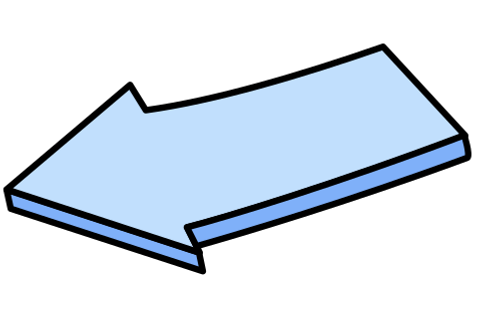 | [arrow-curved-clockwise-1](../../element/svg/bioicons-arrow-curved-clockwise-1.svg) | [出处](https://raw.githubusercontent.com/duerrsimon/bioicons/d29e766ea7580b8063c4f47b29e872db40a4d979/static/icons/cc-by-3.0/General_items/Servier/arrow-curved-clockwise-1.svg) · CC-BY-3.0 |
| 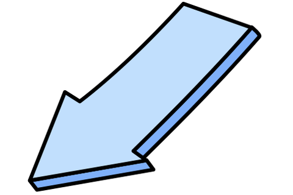 | [arrow-curved-clockwise-3](../../element/svg/bioicons-arrow-curved-clockwise-3.svg) | [出处](https://raw.githubusercontent.com/duerrsimon/bioicons/d29e766ea7580b8063c4f47b29e872db40a4d979/static/icons/cc-by-3.0/General_items/Servier/arrow-curved-clockwise-3.svg) · CC-BY-3.0 |
| 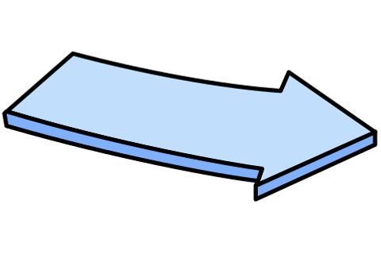 | [arrow-curved-counterclockwise-2](../../element/svg/bioicons-arrow-curved-counterclockwise-2.svg) | [出处](https://raw.githubusercontent.com/duerrsimon/bioicons/d29e766ea7580b8063c4f47b29e872db40a4d979/static/icons/cc-by-3.0/General_items/Servier/arrow-curved-counterclockwise-2.svg) · CC-BY-3.0 |
| 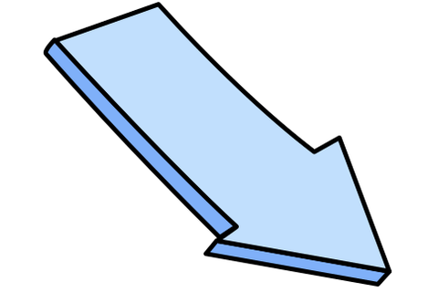 | [arrow-curved-counterclockwise-3](../../element/svg/bioicons-arrow-curved-counterclockwise-3.svg) | [出处](https://raw.githubusercontent.com/duerrsimon/bioicons/d29e766ea7580b8063c4f47b29e872db40a4d979/static/icons/cc-by-3.0/General_items/Servier/arrow-curved-counterclockwise-3.svg) · CC-BY-3.0 |
| 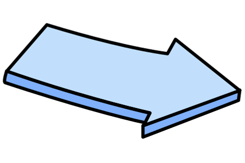 | [arrow-curved-counterclockwise-short](../../element/svg/bioicons-arrow-curved-counterclockwise-short.svg) | [出处](https://raw.githubusercontent.com/duerrsimon/bioicons/d29e766ea7580b8063c4f47b29e872db40a4d979/static/icons/cc-by-3.0/General_items/Servier/arrow-curved-counterclockwise-short.svg) · CC-BY-3.0 |
| 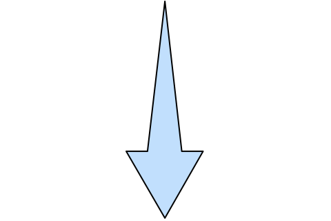 | [arrow-down-2](../../element/svg/bioicons-arrow-down-2.svg) | [出处](https://raw.githubusercontent.com/duerrsimon/bioicons/d29e766ea7580b8063c4f47b29e872db40a4d979/static/icons/cc-by-3.0/General_items/Servier/arrow-down-2.svg) · CC-BY-3.0 |
| 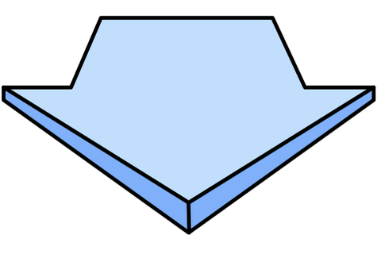 | [arrow-down-3d](../../element/svg/bioicons-arrow-down-3d.svg) | [出处](https://raw.githubusercontent.com/duerrsimon/bioicons/d29e766ea7580b8063c4f47b29e872db40a4d979/static/icons/cc-by-3.0/General_items/Servier/arrow-down-3d.svg) · CC-BY-3.0 |
| 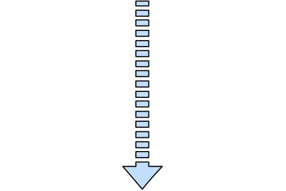 | [arrow-down-dotted](../../element/svg/bioicons-arrow-down-dotted.svg) | [出处](https://raw.githubusercontent.com/duerrsimon/bioicons/d29e766ea7580b8063c4f47b29e872db40a4d979/static/icons/cc-by-3.0/General_items/Servier/arrow-down-dotted.svg) · CC-BY-3.0 |
| 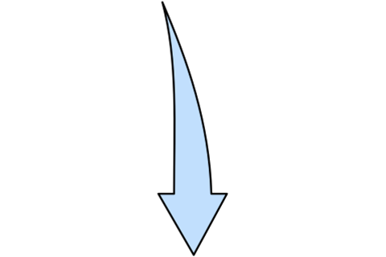 | [下箭头](../../element/svg/bioicons-arrow-down.svg) | [出处](https://raw.githubusercontent.com/duerrsimon/bioicons/d29e766ea7580b8063c4f47b29e872db40a4d979/static/icons/cc-by-3.0/General_items/Servier/arrow-down.svg) · CC-BY-3.0 |
| 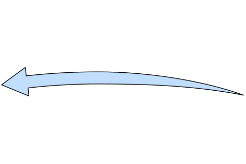 | [arrow-left-curved-1](../../element/svg/bioicons-arrow-left-curved-1.svg) | [出处](https://raw.githubusercontent.com/duerrsimon/bioicons/d29e766ea7580b8063c4f47b29e872db40a4d979/static/icons/cc-by-3.0/General_items/Servier/arrow-left-curved-1.svg) · CC-BY-3.0 |
| 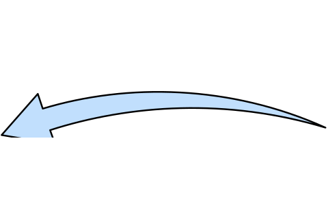 | [arrow-left-curved-2](../../element/svg/bioicons-arrow-left-curved-2.svg) | [出处](https://raw.githubusercontent.com/duerrsimon/bioicons/d29e766ea7580b8063c4f47b29e872db40a4d979/static/icons/cc-by-3.0/General_items/Servier/arrow-left-curved-2.svg) · CC-BY-3.0 |
| 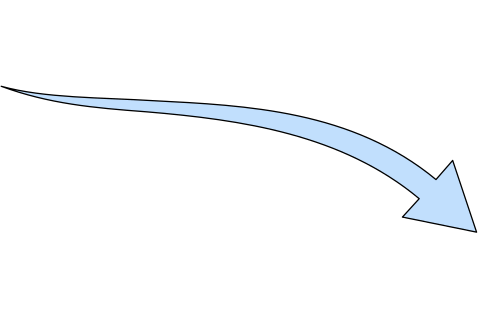 | [arrow-right-curved-3](../../element/svg/bioicons-arrow-right-curved-3.svg) | [出处](https://raw.githubusercontent.com/duerrsimon/bioicons/d29e766ea7580b8063c4f47b29e872db40a4d979/static/icons/cc-by-3.0/General_items/Servier/arrow-right-curved-3.svg) · CC-BY-3.0 |
| 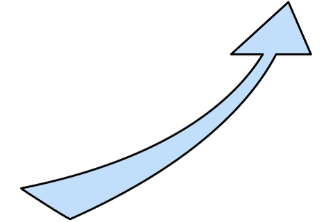 | [arrow-right-curved-4](../../element/svg/bioicons-arrow-right-curved-4.svg) | [出处](https://raw.githubusercontent.com/duerrsimon/bioicons/d29e766ea7580b8063c4f47b29e872db40a4d979/static/icons/cc-by-3.0/General_items/Servier/arrow-right-curved-4.svg) · CC-BY-3.0 |
| 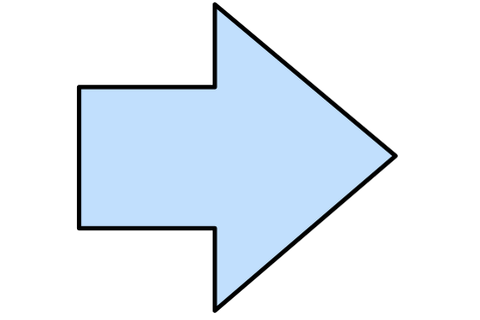 | [arrow-right-short](../../element/svg/bioicons-arrow-right-short.svg) | [出处](https://raw.githubusercontent.com/duerrsimon/bioicons/d29e766ea7580b8063c4f47b29e872db40a4d979/static/icons/cc-by-3.0/General_items/Servier/arrow-right-short.svg) · CC-BY-3.0 |
| 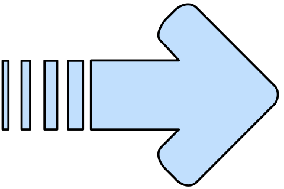 | [arrow-right-striped](../../element/svg/bioicons-arrow-right-striped.svg) | [出处](https://raw.githubusercontent.com/duerrsimon/bioicons/d29e766ea7580b8063c4f47b29e872db40a4d979/static/icons/cc-by-3.0/General_items/Servier/arrow-right-striped.svg) · CC-BY-3.0 |
| 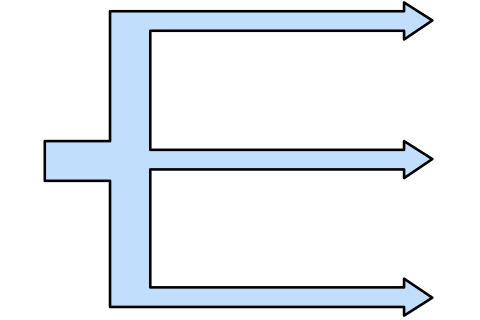 | [arrow-right-three-ends](../../element/svg/bioicons-arrow-right-three-ends.svg) | [出处](https://raw.githubusercontent.com/duerrsimon/bioicons/d29e766ea7580b8063c4f47b29e872db40a4d979/static/icons/cc-by-3.0/General_items/Servier/arrow-right-three-ends.svg) · CC-BY-3.0 |
| 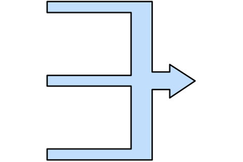 | [arrow-right-three-start](../../element/svg/bioicons-arrow-right-three-start.svg) | [出处](https://raw.githubusercontent.com/duerrsimon/bioicons/d29e766ea7580b8063c4f47b29e872db40a4d979/static/icons/cc-by-3.0/General_items/Servier/arrow-right-three-start.svg) · CC-BY-3.0 |
| 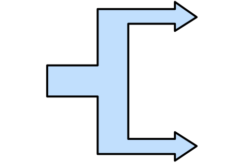 | [arrow-right-two-ends](../../element/svg/bioicons-arrow-right-two-ends.svg) | [出处](https://raw.githubusercontent.com/duerrsimon/bioicons/d29e766ea7580b8063c4f47b29e872db40a4d979/static/icons/cc-by-3.0/General_items/Servier/arrow-right-two-ends.svg) · CC-BY-3.0 |
| 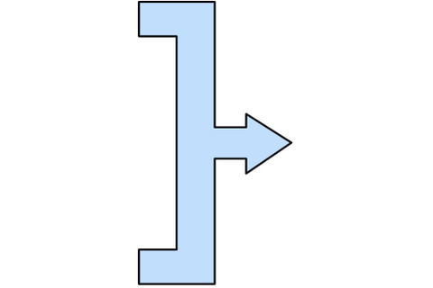 | [arrow-right-two-start](../../element/svg/bioicons-arrow-right-two-start.svg) | [出处](https://raw.githubusercontent.com/duerrsimon/bioicons/d29e766ea7580b8063c4f47b29e872db40a4d979/static/icons/cc-by-3.0/General_items/Servier/arrow-right-two-start.svg) · CC-BY-3.0 |
| 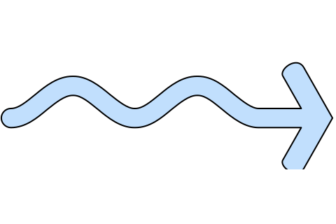 | [arrow-right-wavy-large](../../element/svg/bioicons-arrow-right-wavy-large.svg) | [出处](https://raw.githubusercontent.com/duerrsimon/bioicons/d29e766ea7580b8063c4f47b29e872db40a4d979/static/icons/cc-by-3.0/General_items/Servier/arrow-right-wavy-large.svg) · CC-BY-3.0 |
| 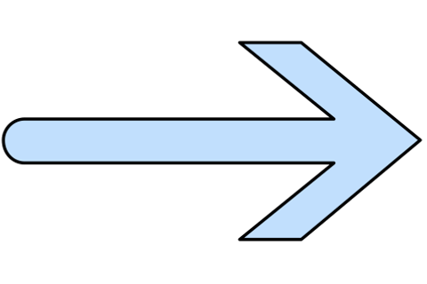 | [右箭头](../../element/svg/bioicons-arrow-right.svg) | [出处](https://raw.githubusercontent.com/duerrsimon/bioicons/d29e766ea7580b8063c4f47b29e872db40a4d979/static/icons/cc-by-3.0/General_items/Servier/arrow-right.svg) · CC-BY-3.0 |
| 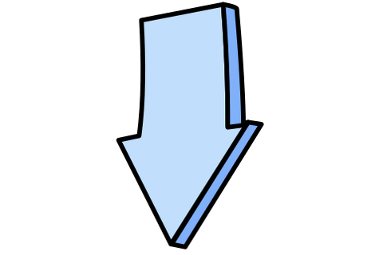 | [arrow-short-down](../../element/svg/bioicons-arrow-short-down.svg) | [出处](https://raw.githubusercontent.com/duerrsimon/bioicons/d29e766ea7580b8063c4f47b29e872db40a4d979/static/icons/cc-by-3.0/General_items/Servier/arrow-short-down.svg) · CC-BY-3.0 |
| 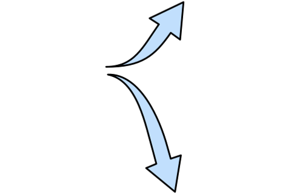 | [arrow-split-right](../../element/svg/bioicons-arrow-split-right.svg) | [出处](https://raw.githubusercontent.com/duerrsimon/bioicons/d29e766ea7580b8063c4f47b29e872db40a4d979/static/icons/cc-by-3.0/General_items/Servier/arrow-split-right.svg) · CC-BY-3.0 |
| 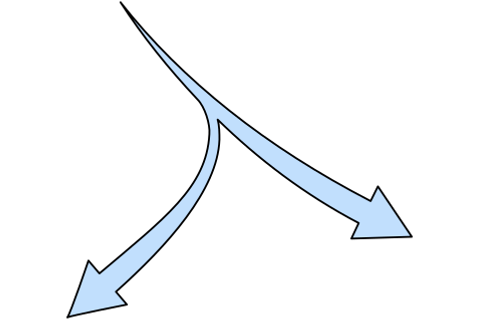 | [arrow-split](../../element/svg/bioicons-arrow-split.svg) | [出处](https://raw.githubusercontent.com/duerrsimon/bioicons/d29e766ea7580b8063c4f47b29e872db40a4d979/static/icons/cc-by-3.0/General_items/Servier/arrow-split.svg) · CC-BY-3.0 |
|  | [arrow-twosides-horizontal](../../element/svg/bioicons-arrow-twosides-horizontal.svg) | [出处](https://raw.githubusercontent.com/duerrsimon/bioicons/d29e766ea7580b8063c4f47b29e872db40a4d979/static/icons/cc-by-3.0/General_items/Servier/arrow-twosides-horizontal.svg) · CC-BY-3.0 |
|  | [arrow-up-3d-2](../../element/svg/bioicons-arrow-up-3d-2.svg) | [出处](https://raw.githubusercontent.com/duerrsimon/bioicons/d29e766ea7580b8063c4f47b29e872db40a4d979/static/icons/cc-by-3.0/General_items/Servier/arrow-up-3d-2.svg) · CC-BY-3.0 |
|  | [arrow-up-3d-3](../../element/svg/bioicons-arrow-up-3d-3.svg) | [出处](https://raw.githubusercontent.com/duerrsimon/bioicons/d29e766ea7580b8063c4f47b29e872db40a4d979/static/icons/cc-by-3.0/General_items/Servier/arrow-up-3d-3.svg) · CC-BY-3.0 |
|  | [arrow-up-3d](../../element/svg/bioicons-arrow-up-3d.svg) | [出处](https://raw.githubusercontent.com/duerrsimon/bioicons/d29e766ea7580b8063c4f47b29e872db40a4d979/static/icons/cc-by-3.0/General_items/Servier/arrow-up-3d.svg) · CC-BY-3.0 |
|  | [arrow-up-long](../../element/svg/bioicons-arrow-up-long.svg) | [出处](https://raw.githubusercontent.com/duerrsimon/bioicons/d29e766ea7580b8063c4f47b29e872db40a4d979/static/icons/cc-by-3.0/General_items/Servier/arrow-up-long.svg) · CC-BY-3.0 |
|  | [arrow-wavy-right-long](../../element/svg/bioicons-arrow-wavy-right-long.svg) | [出处](https://raw.githubusercontent.com/duerrsimon/bioicons/d29e766ea7580b8063c4f47b29e872db40a4d979/static/icons/cc-by-3.0/General_items/Servier/arrow-wavy-right-long.svg) · CC-BY-3.0 |
|  | [arrow-wavy-right-medium](../../element/svg/bioicons-arrow-wavy-right-medium.svg) | [出处](https://raw.githubusercontent.com/duerrsimon/bioicons/d29e766ea7580b8063c4f47b29e872db40a4d979/static/icons/cc-by-3.0/General_items/Servier/arrow-wavy-right-medium.svg) · CC-BY-3.0 |
|  | [arrow-wavy-right-short](../../element/svg/bioicons-arrow-wavy-right-short.svg) | [出处](https://raw.githubusercontent.com/duerrsimon/bioicons/d29e766ea7580b8063c4f47b29e872db40a4d979/static/icons/cc-by-3.0/General_items/Servier/arrow-wavy-right-short.svg) · CC-BY-3.0 |
|  | [arrow-zigzag-up](../../element/svg/bioicons-arrow-zigzag-up.svg) | [出处](https://raw.githubusercontent.com/duerrsimon/bioicons/d29e766ea7580b8063c4f47b29e872db40a4d979/static/icons/cc-by-3.0/General_items/Servier/arrow-zigzag-up.svg) · CC-BY-3.0 |
|  | [arrow3d-clockwise-1](../../element/svg/bioicons-arrow3d-clockwise-1.svg) | [出处](https://raw.githubusercontent.com/duerrsimon/bioicons/d29e766ea7580b8063c4f47b29e872db40a4d979/static/icons/cc-by-3.0/General_items/Servier/arrow3d-clockwise-1.svg) · CC-BY-3.0 |
|  | [arrow3d-clockwise-2](../../element/svg/bioicons-arrow3d-clockwise-2.svg) | [出处](https://raw.githubusercontent.com/duerrsimon/bioicons/d29e766ea7580b8063c4f47b29e872db40a4d979/static/icons/cc-by-3.0/General_items/Servier/arrow3d-clockwise-2.svg) · CC-BY-3.0 |
|  | [arrow3d-clockwise-3](../../element/svg/bioicons-arrow3d-clockwise-3.svg) | [出处](https://raw.githubusercontent.com/duerrsimon/bioicons/d29e766ea7580b8063c4f47b29e872db40a4d979/static/icons/cc-by-3.0/General_items/Servier/arrow3d-clockwise-3.svg) · CC-BY-3.0 |
|  | [arrow3d-counterclockwise-1](../../element/svg/bioicons-arrow3d-counterclockwise-1.svg) | [出处](https://raw.githubusercontent.com/duerrsimon/bioicons/d29e766ea7580b8063c4f47b29e872db40a4d979/static/icons/cc-by-3.0/General_items/Servier/arrow3d-counterclockwise-1.svg) · CC-BY-3.0 |
|  | [书籍](../../element/svg/bioicons-book.svg) | [出处](https://raw.githubusercontent.com/duerrsimon/bioicons/d29e766ea7580b8063c4f47b29e872db40a4d979/static/icons/cc-by-3.0/General_items/Servier/book.svg) · CC-BY-3.0 |
|  | [时钟](../../element/svg/bioicons-clock.svg) | [出处](https://raw.githubusercontent.com/duerrsimon/bioicons/d29e766ea7580b8063c4f47b29e872db40a4d979/static/icons/cc-by-3.0/General_items/Servier/clock.svg) · CC-BY-3.0 |
|  | [earth](../../element/svg/bioicons-earth.svg) | [出处](https://raw.githubusercontent.com/duerrsimon/bioicons/d29e766ea7580b8063c4f47b29e872db40a4d979/static/icons/cc-by-3.0/General_items/Servier/earth.svg) · CC-BY-3.0 |
|  | [glasses](../../element/svg/bioicons-glasses.svg) | [出处](https://raw.githubusercontent.com/duerrsimon/bioicons/d29e766ea7580b8063c4f47b29e872db40a4d979/static/icons/cc-by-3.0/General_items/Servier/glasses.svg) · CC-BY-3.0 |
|  | [key](../../element/svg/bioicons-key.svg) | [出处](https://raw.githubusercontent.com/duerrsimon/bioicons/d29e766ea7580b8063c4f47b29e872db40a4d979/static/icons/cc-by-3.0/General_items/Servier/key.svg) · CC-BY-3.0 |
|  | [labbook](../../element/svg/bioicons-labbook.svg) | [出处](https://raw.githubusercontent.com/duerrsimon/bioicons/d29e766ea7580b8063c4f47b29e872db40a4d979/static/icons/cc-by-3.0/General_items/Servier/labbook.svg) · CC-BY-3.0 |
|  | [notepad](../../element/svg/bioicons-notepad.svg) | [出处](https://raw.githubusercontent.com/duerrsimon/bioicons/d29e766ea7580b8063c4f47b29e872db40a4d979/static/icons/cc-by-3.0/General_items/Servier/notepad.svg) · CC-BY-3.0 |
|  | [padlock-closed](../../element/svg/bioicons-padlock-closed.svg) | [出处](https://raw.githubusercontent.com/duerrsimon/bioicons/d29e766ea7580b8063c4f47b29e872db40a4d979/static/icons/cc-by-3.0/General_items/Servier/padlock-closed.svg) · CC-BY-3.0 |
|  | [padlock-open](../../element/svg/bioicons-padlock-open.svg) | [出处](https://raw.githubusercontent.com/duerrsimon/bioicons/d29e766ea7580b8063c4f47b29e872db40a4d979/static/icons/cc-by-3.0/General_items/Servier/padlock-open.svg) · CC-BY-3.0 |
|  | [pencil](../../element/svg/bioicons-pencil.svg) | [出处](https://raw.githubusercontent.com/duerrsimon/bioicons/d29e766ea7580b8063c4f47b29e872db40a4d979/static/icons/cc-by-3.0/General_items/Servier/pencil.svg) · CC-BY-3.0 |
|  | [sand-clock](../../element/svg/bioicons-sand-clock.svg) | [出处](https://raw.githubusercontent.com/duerrsimon/bioicons/d29e766ea7580b8063c4f47b29e872db40a4d979/static/icons/cc-by-3.0/General_items/Servier/sand-clock.svg) · CC-BY-3.0 |
|  | [scale-balanced](../../element/svg/bioicons-scale-balanced.svg) | [出处](https://raw.githubusercontent.com/duerrsimon/bioicons/d29e766ea7580b8063c4f47b29e872db40a4d979/static/icons/cc-by-3.0/General_items/Servier/scale-balanced.svg) · CC-BY-3.0 |
|  | [scale-imbalanced-left-1](../../element/svg/bioicons-scale-imbalanced-left-1.svg) | [出处](https://raw.githubusercontent.com/duerrsimon/bioicons/d29e766ea7580b8063c4f47b29e872db40a4d979/static/icons/cc-by-3.0/General_items/Servier/scale-imbalanced-left-1.svg) · CC-BY-3.0 |
|  | [stopwatch-digital](../../element/svg/bioicons-stopwatch-digital.svg) | [出处](https://raw.githubusercontent.com/duerrsimon/bioicons/d29e766ea7580b8063c4f47b29e872db40a4d979/static/icons/cc-by-3.0/General_items/Servier/stopwatch-digital.svg) · CC-BY-3.0 |
|  | [stopwatch](../../element/svg/bioicons-stopwatch.svg) | [出处](https://raw.githubusercontent.com/duerrsimon/bioicons/d29e766ea7580b8063c4f47b29e872db40a4d979/static/icons/cc-by-3.0/General_items/Servier/stopwatch.svg) · CC-BY-3.0 |
|  | [Server rack](../../element/svg/bioicons-server-rack.svg) | [出处](https://raw.githubusercontent.com/duerrsimon/bioicons/d29e766ea7580b8063c4f47b29e872db40a4d979/static/icons/cc-by-4.0/Computer_hardware/DBCLS/Server_rack.svg) · CC-BY-4.0 |
|  | [serverroom](../../element/svg/bioicons-serverroom.svg) | [出处](https://raw.githubusercontent.com/duerrsimon/bioicons/d29e766ea7580b8063c4f47b29e872db40a4d979/static/icons/cc-by-4.0/Computer_hardware/DBCLS/serverroom.svg) · CC-BY-4.0 |
|  | [注意力机制](../../element/svg/bioicons-attention-mechanism.svg) | [出处](https://raw.githubusercontent.com/duerrsimon/bioicons/d29e766ea7580b8063c4f47b29e872db40a4d979/static/icons/cc-by-4.0/Machine_Learning/Noelia_Ferruz/Attention-mechanism.svg) · CC-BY-4.0 |
|  | [卷积连接](../../element/svg/bioicons-convolutional-network.svg) | [出处](https://raw.githubusercontent.com/duerrsimon/bioicons/d29e766ea7580b8063c4f47b29e872db40a4d979/static/icons/cc-by-4.0/Machine_Learning/Noelia_Ferruz/Convolutional-network.svg) · CC-BY-4.0 |
|  | [隐马尔可夫模型](../../element/svg/bioicons-hidden-markov-model.svg) | [出处](https://raw.githubusercontent.com/duerrsimon/bioicons/d29e766ea7580b8063c4f47b29e872db40a4d979/static/icons/cc-by-4.0/Machine_Learning/Noelia_Ferruz/Hidden-Markov-Model.svg) · CC-BY-4.0 |
|  | [循环神经网络](../../element/svg/bioicons-recurrent-neural-network.svg) | [出处](https://raw.githubusercontent.com/duerrsimon/bioicons/d29e766ea7580b8063c4f47b29e872db40a4d979/static/icons/cc-by-4.0/Machine_Learning/Noelia_Ferruz/Recurrent-Neural-Network.svg) · CC-BY-4.0 |
