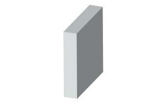
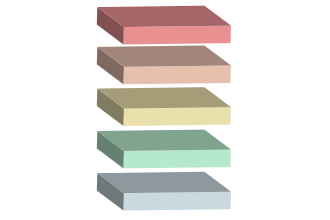
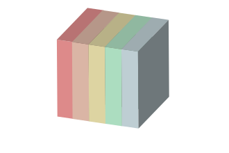
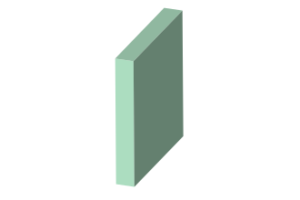
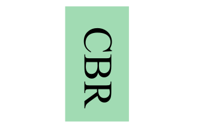
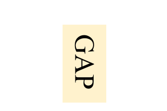
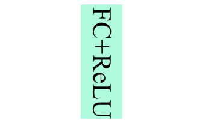

# Illustrator task5 source

[返回元素库](../README.md)

| 预览 | 名称 | 原来源 |
|---|---|---|
|  | [输入特征层](../../element/svg/task5-input-feature.svg) | [出处](https://github.com/JunchuanYu/Adobe_Illustrator_for_Scientific_Graphic_Design/blob/main/demo/task5/task5.ai) · 原作者未声明独立复用授权 |
|  | [多尺度特征堆叠](../../element/svg/task5-feature-pyramid.svg) | [出处](https://github.com/JunchuanYu/Adobe_Illustrator_for_Scientific_Graphic_Design/blob/main/demo/task5/task5.ai) · 原作者未声明独立复用授权 |
|  | [多通道彩色张量](../../element/svg/task5-rgb-tensor.svg) | [出处](https://github.com/JunchuanYu/Adobe_Illustrator_for_Scientific_Graphic_Design/blob/main/demo/task5/task5.ai) · 原作者未声明独立复用授权 |
|  | [输出特征层](../../element/svg/task5-output-feature.svg) | [出处](https://github.com/JunchuanYu/Adobe_Illustrator_for_Scientific_Graphic_Design/blob/main/demo/task5/task5.ai) · 原作者未声明独立复用授权 |
|  | [拼接节点](../../element/svg/task5-concat.svg) | [出处](https://github.com/JunchuanYu/Adobe_Illustrator_for_Scientific_Graphic_Design/blob/main/demo/task5/task5.ai) · 原作者未声明独立复用授权 |
|  | [加法节点](../../element/svg/task5-add.svg) | [出处](https://github.com/JunchuanYu/Adobe_Illustrator_for_Scientific_Graphic_Design/blob/main/demo/task5/task5.ai) · 原作者未声明独立复用授权 |
|  | [乘法节点](../../element/svg/task5-multiply.svg) | [出处](https://github.com/JunchuanYu/Adobe_Illustrator_for_Scientific_Graphic_Design/blob/main/demo/task5/task5.ai) · 原作者未声明独立复用授权 |
|  | [上采样节点](../../element/svg/task5-upsample.svg) | [出处](https://github.com/JunchuanYu/Adobe_Illustrator_for_Scientific_Graphic_Design/blob/main/demo/task5/task5.ai) · 原作者未声明独立复用授权 |
|  | [CBR 模块](../../element/svg/task5-cbr.svg) | [出处](https://github.com/JunchuanYu/Adobe_Illustrator_for_Scientific_Graphic_Design/blob/main/demo/task5/task5.ai) · 原作者未声明独立复用授权 |
|  | [GAP 模块](../../element/svg/task5-gap.svg) | [出处](https://github.com/JunchuanYu/Adobe_Illustrator_for_Scientific_Graphic_Design/blob/main/demo/task5/task5.ai) · 原作者未声明独立复用授权 |
|  | [FC + ReLU 模块](../../element/svg/task5-fc-relu.svg) | [出处](https://github.com/JunchuanYu/Adobe_Illustrator_for_Scientific_Graphic_Design/blob/main/demo/task5/task5.ai) · 原作者未声明独立复用授权 |
