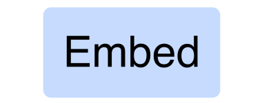
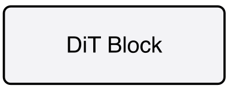
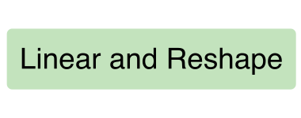
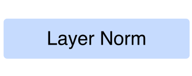
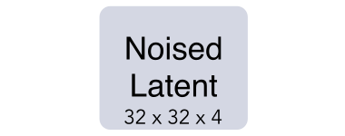
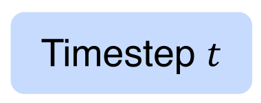
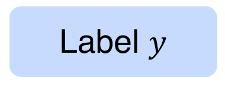
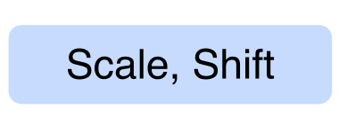
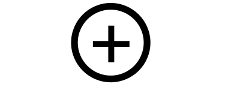

# DiT 原图部件

[返回元素库](../README.md)

| 预览 | 名称 | 原来源 |
|---|---|---|
|  | [Patchify 图像分块模块](../../element/svg/dit-patchify.svg) | [出处](https://www.wpeebles.com/DiT) · CC-BY-4.0 |
|  | [条件嵌入模块](../../element/svg/dit-embed.svg) | [出处](https://www.wpeebles.com/DiT) · CC-BY-4.0 |
|  | [DiT block 模块](../../element/svg/dit-block.svg) | [出处](https://www.wpeebles.com/DiT) · CC-BY-4.0 |
|  | [线性映射与形状重排](../../element/svg/dit-linear-reshape.svg) | [出处](https://www.wpeebles.com/DiT) · CC-BY-4.0 |
|  | [LayerNorm 模块](../../element/svg/dit-layer-norm.svg) | [出处](https://www.wpeebles.com/DiT) · CC-BY-4.0 |
|  | [带噪潜变量块](../../element/svg/dit-noised-latent.svg) | [出处](https://www.wpeebles.com/DiT) · CC-BY-4.0 |
|  | [时间步条件块](../../element/svg/dit-timestep.svg) | [出处](https://www.wpeebles.com/DiT) · CC-BY-4.0 |
|  | [类别条件块](../../element/svg/dit-class-condition.svg) | [出处](https://www.wpeebles.com/DiT) · CC-BY-4.0 |
|  | [DiT 多头自注意力模块](../../element/svg/dit-self-attention.svg) | [出处](https://www.wpeebles.com/DiT) · CC-BY-4.0 |
|  | [逐位置前馈网络模块](../../element/svg/dit-feed-forward.svg) | [出处](https://www.wpeebles.com/DiT) · CC-BY-4.0 |
|  | [条件缩放与平移模块](../../element/svg/dit-scale-shift.svg) | [出处](https://www.wpeebles.com/DiT) · CC-BY-4.0 |
|  | [DiT 残差加法节点](../../element/svg/dit-residual-add.svg) | [出处](https://www.wpeebles.com/DiT) · CC-BY-4.0 |
