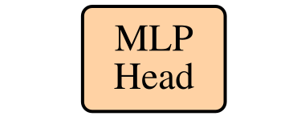
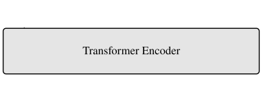
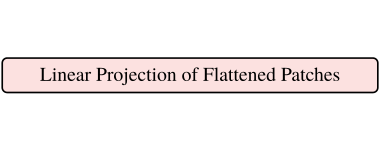
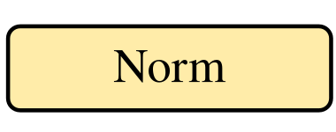
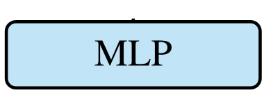

# ViT 原图部件

[返回元素库](../README.md)

| 预览 | 名称 | 原来源 |
|---|---|---|
|  | [ViT 分类 MLP 头](../../element/svg/vit-mlp-head.svg) | [出处](https://iclr.cc/virtual/2021/oral/3458) · 作者保留权利 / 参考收录 |
|  | [ViT 编码器块](../../element/svg/vit-encoder-block.svg) | [出处](https://iclr.cc/virtual/2021/oral/3458) · 作者保留权利 / 参考收录 |
|  | [类别输出列表](../../element/svg/vit-class-output.svg) | [出处](https://iclr.cc/virtual/2021/oral/3458) · 作者保留权利 / 参考收录 |
|  | [图像块线性投影模块](../../element/svg/vit-patch-projection.svg) | [出处](https://iclr.cc/virtual/2021/oral/3458) · 作者保留权利 / 参考收录 |
|  | [ViT 多头注意力模块](../../element/svg/vit-self-attention.svg) | [出处](https://iclr.cc/virtual/2021/oral/3458) · 作者保留权利 / 参考收录 |
|  | [ViT 归一化模块](../../element/svg/vit-norm.svg) | [出处](https://iclr.cc/virtual/2021/oral/3458) · 作者保留权利 / 参考收录 |
|  | [ViT 前馈 MLP 模块](../../element/svg/vit-mlp.svg) | [出处](https://iclr.cc/virtual/2021/oral/3458) · 作者保留权利 / 参考收录 |
|  | [图像块嵌入模块](../../element/svg/vit-embedded-patches.svg) | [出处](https://iclr.cc/virtual/2021/oral/3458) · 作者保留权利 / 参考收录 |
