# 最小可复用元素

只收录外部原始素材和从作者原 SVG 中提取的已有矢量对象。本次包含 5 个 Towaki Takikawa 的 CC0 原图元、7 个 RUST 原图部件、4 个 LightGlue 原图部件。图元不由本仓库自行绘制。

[全部元素 SVG](all-elements.svg) · [来源与许可索引](catalog.json) · [提取位置](extraction-specs.json)

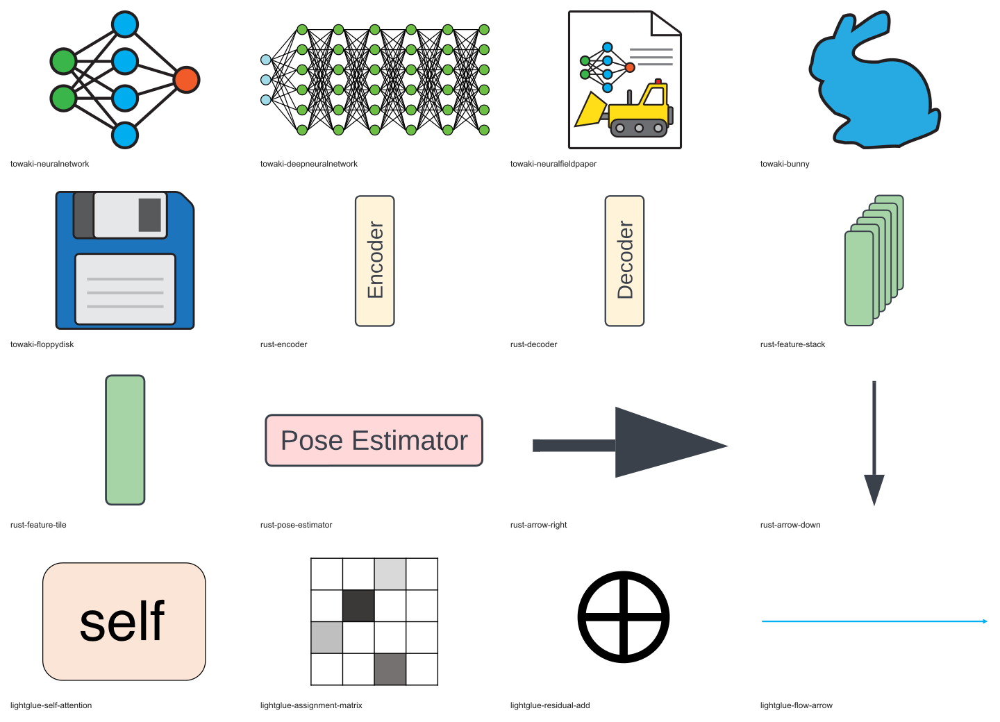

CC0 图标可按其原有授权使用。LightGlue 部件保留来源仓库 Apache-2.0 许可证。RUST 未发现独立图形授权，因此单列为参考元素，不因提取成单独 SVG 就获得额外复用权限。

| 元素 | 预览 | 文件 | 来源 |
|---|---|---|---|
| 浅层神经网络 | 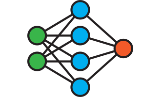 | [SVG](svg/towaki-neuralnetwork.svg) | CC0-1.0；保存作者原 SVG，字节未修改。 |
| 深层神经网络 | 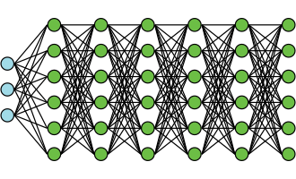 | [SVG](svg/towaki-deepneuralnetwork.svg) | CC0-1.0；保存作者原 SVG，字节未修改。 |
| 神经场论文图标 | 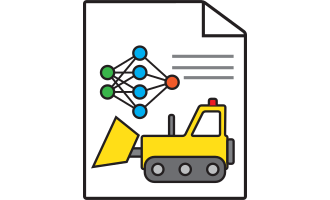 | [SVG](svg/towaki-neuralfieldpaper.svg) | CC0-1.0；保存作者原 SVG，字节未修改。 |
| 兔形图标 | 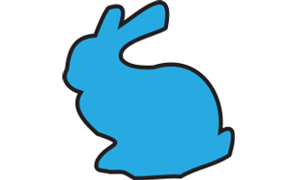 | [SVG](svg/towaki-bunny.svg) | CC0-1.0；保存作者原 SVG，字节未修改。 |
| 存储图标 |  | [SVG](svg/towaki-floppydisk.svg) | CC0-1.0；保存作者原 SVG，字节未修改。 |
| 编码器块 | 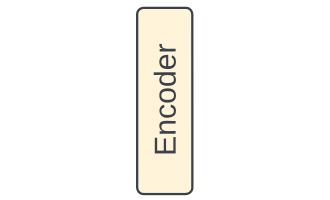 | [SVG](svg/rust-encoder.svg) | 原项目未发现独立图形授权；仅作出处明确的参考 |
| 解码器块 | 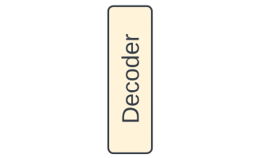 | [SVG](svg/rust-decoder.svg) | 原项目未发现独立图形授权；仅作出处明确的参考 |
| 特征表示堆叠 | 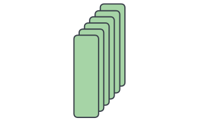 | [SVG](svg/rust-feature-stack.svg) | 原项目未发现独立图形授权；仅作出处明确的参考 |
| 单层特征块 | 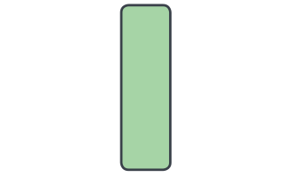 | [SVG](svg/rust-feature-tile.svg) | 原项目未发现独立图形授权；仅作出处明确的参考 |
| 位姿估计模块 | 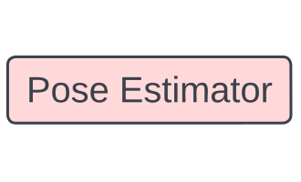 | [SVG](svg/rust-pose-estimator.svg) | 原项目未发现独立图形授权；仅作出处明确的参考 |
| 右向流程箭头 | 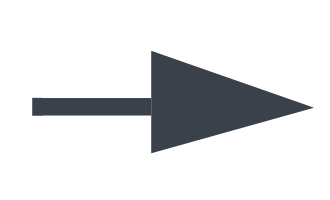 | [SVG](svg/rust-arrow-right.svg) | 原项目未发现独立图形授权；仅作出处明确的参考 |
| 下向流程箭头 | 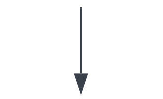 | [SVG](svg/rust-arrow-down.svg) | 原项目未发现独立图形授权；仅作出处明确的参考 |
| Self attention 块 | 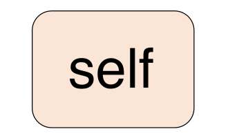 | [SVG](svg/lightglue-self-attention.svg) | Apache-2.0（LightGlue 来源仓库） |
| 匹配相似度矩阵 | 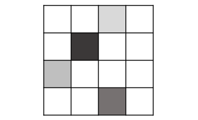 | [SVG](svg/lightglue-assignment-matrix.svg) | Apache-2.0（LightGlue 来源仓库） |
| 残差加法节点 | 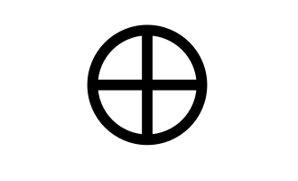 | [SVG](svg/lightglue-residual-add.svg) | Apache-2.0（LightGlue 来源仓库） |
| 蓝色流程箭头 | 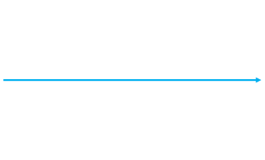 | [SVG](svg/lightglue-flow-arrow.svg) | Apache-2.0（LightGlue 来源仓库） |
