# 箭头与连接

[返回 Element](../README.md) · [Teaser](../../examples/teasers/README.md) · [Architecture](../../examples/architectures/README.md) · [范例与元素对照表](../with-examples.md)

关联范例按表达功能互链；是否为原图拆件见对照表与元素来源记录。

| 预览 | 名称与 SVG | 来源与许可 | 关联范例（最多列三项） |
|---|---|---|---|
| 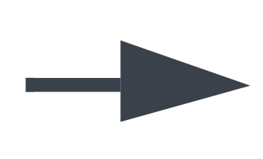 | [右向流程箭头](../../elements/svg/rust-arrow-right.svg) | RUST 原图部件 · 原项目未发现独立图形授权；仅作出处明确的参考 | [D2L · 编码器—解码器](../../examples/architectures/d2l-encoder-decoder/README.md) · [RUST：编码器、场景表示与位姿分支](../../examples/architectures/rust/README.md) |
| 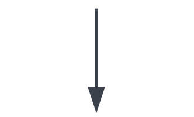 | [下向流程箭头](../../elements/svg/rust-arrow-down.svg) | RUST 原图部件 · 原项目未发现独立图形授权；仅作出处明确的参考 | [RUST：编码器、场景表示与位姿分支](../../examples/architectures/rust/README.md) |
| 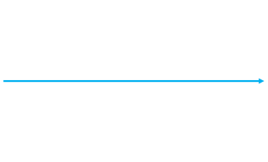 | [蓝色流程箭头](../../elements/svg/lightglue-flow-arrow.svg) | LightGlue 原图部件 · Apache-2.0（LightGlue 来源仓库） | [LightGlue：注意力、动态剪枝与匹配](../../examples/architectures/lightglue/README.md) |
| 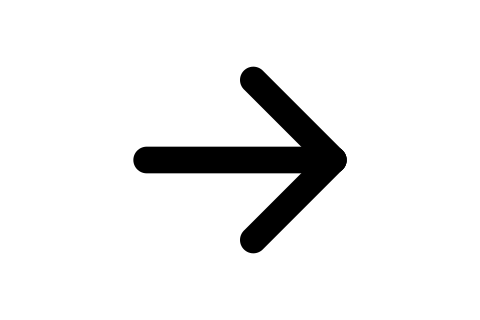 | [右箭头](../../elements/svg/tabler-arrow-right.svg) | Tabler outline · MIT | [Genie · 不同提示生成可交互世界](../../examples/teasers/genie-interaction/README.md) |
| 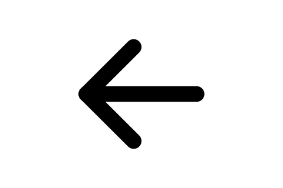 | [左箭头](../../elements/svg/tabler-arrow-left.svg) | Tabler outline · MIT | — |
| 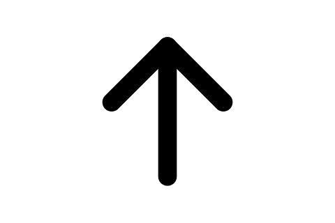 | [上箭头](../../elements/svg/tabler-arrow-up.svg) | Tabler outline · MIT | — |
| 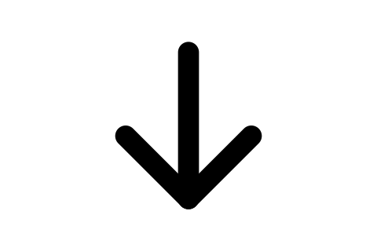 | [下箭头](../../elements/svg/tabler-arrow-down.svg) | Tabler outline · MIT | — |
| 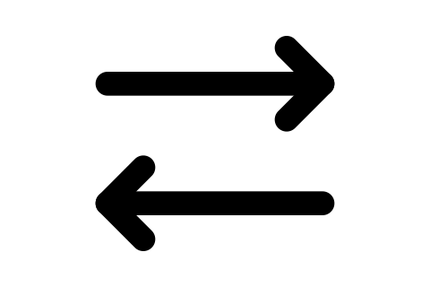 | [水平双向箭头](../../elements/svg/tabler-arrows-right-left.svg) | Tabler outline · MIT | [DPO · RLHF 与直接偏好优化的流程简化](../../examples/teasers/dpo-comparison/README.md) · [DreamGaussian · 生成能力与优化进程同图展示](../../examples/teasers/dreamgaussian-progress/README.md) · [K-LoRA：主体风格组合与训练范式比较](../../examples/teasers/k-lora/README.md) |
| 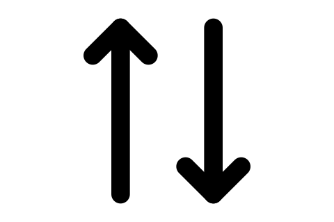 | [垂直双向箭头](../../elements/svg/tabler-arrows-up-down.svg) | Tabler outline · MIT | — |
| 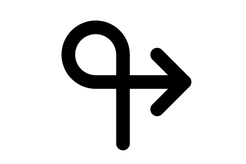 | [回环箭头](../../elements/svg/tabler-arrow-loop-right.svg) | Tabler outline · MIT | [CUT3R · 持久状态的更新、读取与未见视角推断](../../examples/architectures/cut3r-architecture/README.md) · [D2L · 生成对抗网络](../../examples/architectures/d2l-gan/README.md) · [D2L · GRU 内部门控](../../examples/architectures/d2l-gru-3/README.md) |
| 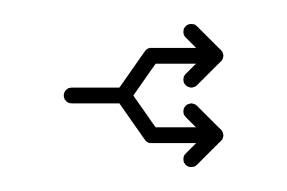 | [分流箭头](../../elements/svg/tabler-arrows-split.svg) | Tabler outline · MIT | [D2L · 生成对抗网络](../../examples/architectures/d2l-gan/README.md) · [D2L · Inception 并行分支](../../examples/architectures/d2l-inception/README.md) · [Genie · 视频 tokenizer、潜在动作与动力学模型](../../examples/architectures/genie-architecture/README.md) |
| 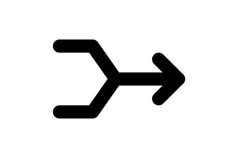 | [汇合箭头](../../elements/svg/tabler-arrows-join.svg) | Tabler outline · MIT | — |
| 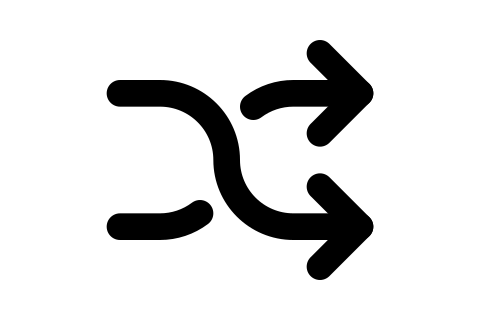 | [交叉连接](../../elements/svg/tabler-arrows-shuffle.svg) | Tabler outline · MIT | — |
|  | [折线箭头](../../elements/svg/tabler-arrow-elbow-right.svg) | Tabler outline · MIT | — |
| 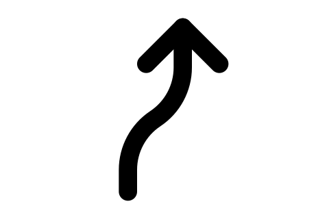 | [曲线箭头](../../elements/svg/tabler-arrow-curve-right.svg) | Tabler outline · MIT | — |
| 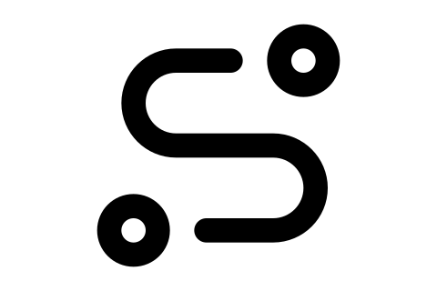 | [路径](../../elements/svg/tabler-route.svg) | Tabler outline · MIT | [LAV：感知、预测与驾驶控制流程](../../examples/architectures/lav/README.md) |
| 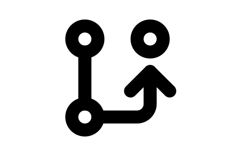 | [分支](../../elements/svg/tabler-git-branch.svg) | Tabler outline · MIT | — |
| 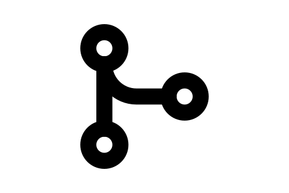 | [合并](../../elements/svg/tabler-git-merge.svg) | Tabler outline · MIT | — |
| 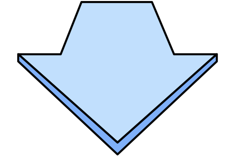 | [arrow-3d-forward](../../elements/svg/bioicons-arrow-3d-forward.svg) | Bioicons · CC-BY-3.0 | — |
| 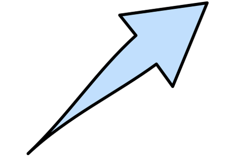 | [arrow-45deg-left](../../elements/svg/bioicons-arrow-45deg-left.svg) | Bioicons · CC-BY-3.0 | — |
| 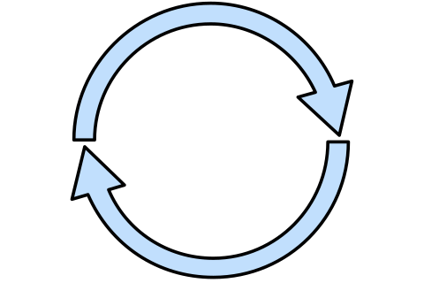 | [arrow-circular](../../elements/svg/bioicons-arrow-circular.svg) | Bioicons · CC-BY-3.0 | — |
| 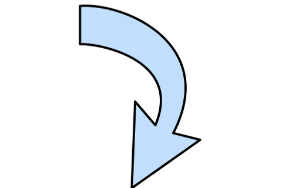 | [arrow-clockwise-4](../../elements/svg/bioicons-arrow-clockwise-4.svg) | Bioicons · CC-BY-3.0 | — |
| 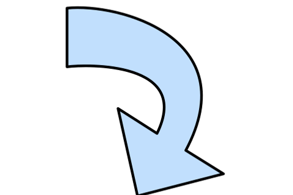 | [arrow-clockwise-5](../../elements/svg/bioicons-arrow-clockwise-5.svg) | Bioicons · CC-BY-3.0 | — |
| 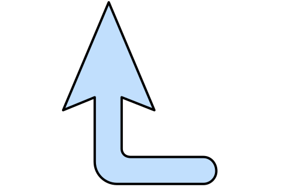 | [arrow-corner-left-up-2](../../elements/svg/bioicons-arrow-corner-left-up-2.svg) | Bioicons · CC-BY-3.0 | — |
| 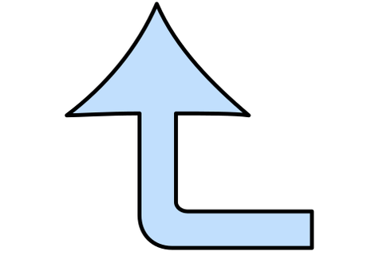 | [arrow-corner-left-up](../../elements/svg/bioicons-arrow-corner-left-up.svg) | Bioicons · CC-BY-3.0 | — |
| 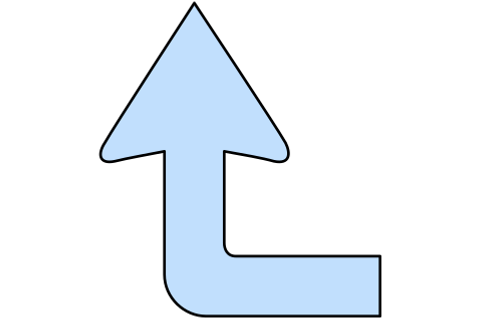 | [arrow-corner-up](../../elements/svg/bioicons-arrow-corner-up.svg) | Bioicons · CC-BY-3.0 | — |
| 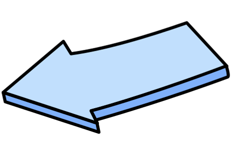 | [arrow-curved-clockwise-1](../../elements/svg/bioicons-arrow-curved-clockwise-1.svg) | Bioicons · CC-BY-3.0 | — |
| 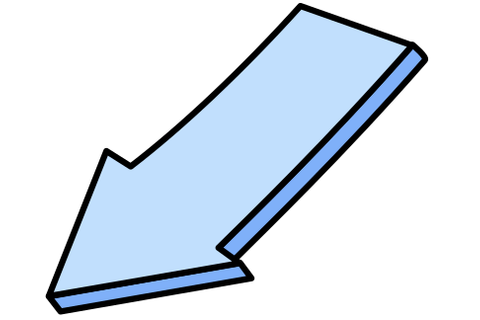 | [arrow-curved-clockwise-3](../../elements/svg/bioicons-arrow-curved-clockwise-3.svg) | Bioicons · CC-BY-3.0 | — |
| 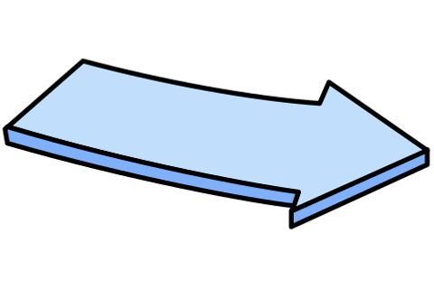 | [arrow-curved-counterclockwise-2](../../elements/svg/bioicons-arrow-curved-counterclockwise-2.svg) | Bioicons · CC-BY-3.0 | — |
| 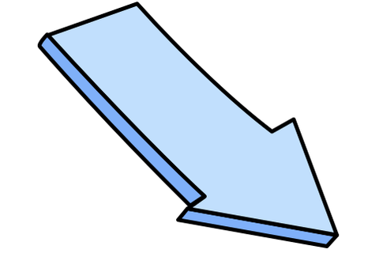 | [arrow-curved-counterclockwise-3](../../elements/svg/bioicons-arrow-curved-counterclockwise-3.svg) | Bioicons · CC-BY-3.0 | — |
| 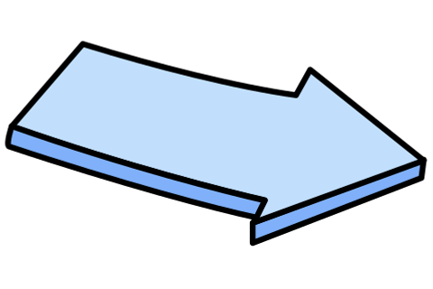 | [arrow-curved-counterclockwise-short](../../elements/svg/bioicons-arrow-curved-counterclockwise-short.svg) | Bioicons · CC-BY-3.0 | — |
| 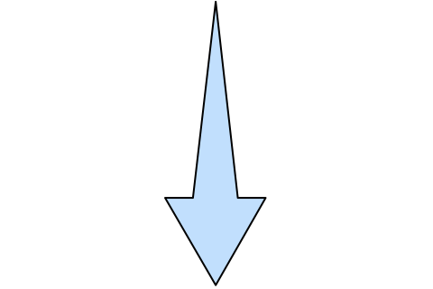 | [arrow-down-2](../../elements/svg/bioicons-arrow-down-2.svg) | Bioicons · CC-BY-3.0 | — |
| 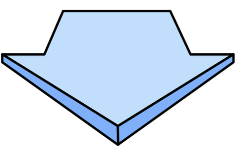 | [arrow-down-3d](../../elements/svg/bioicons-arrow-down-3d.svg) | Bioicons · CC-BY-3.0 | — |
| 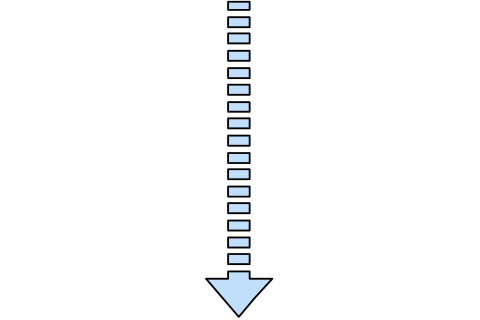 | [arrow-down-dotted](../../elements/svg/bioicons-arrow-down-dotted.svg) | Bioicons · CC-BY-3.0 | — |
| 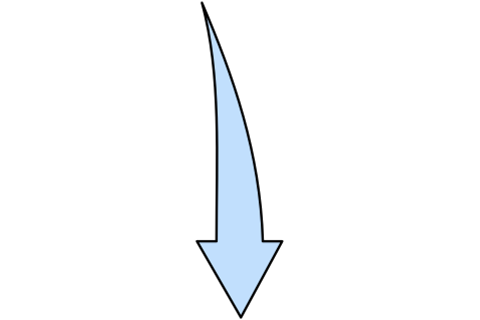 | [下箭头](../../elements/svg/bioicons-arrow-down.svg) | Bioicons · CC-BY-3.0 | — |
| 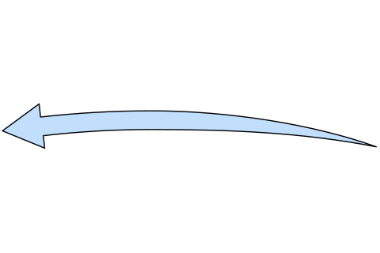 | [arrow-left-curved-1](../../elements/svg/bioicons-arrow-left-curved-1.svg) | Bioicons · CC-BY-3.0 | — |
| 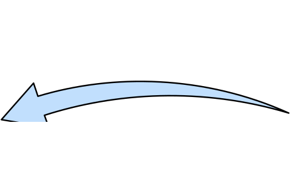 | [arrow-left-curved-2](../../elements/svg/bioicons-arrow-left-curved-2.svg) | Bioicons · CC-BY-3.0 | — |
| 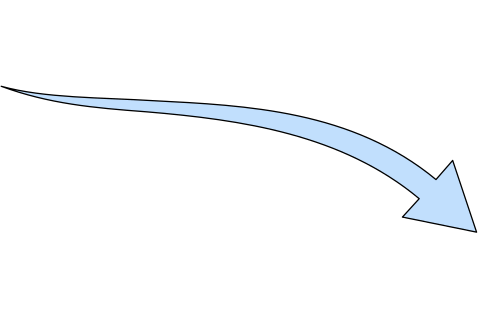 | [arrow-right-curved-3](../../elements/svg/bioicons-arrow-right-curved-3.svg) | Bioicons · CC-BY-3.0 | — |
| 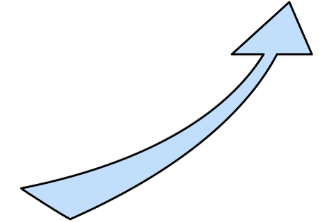 | [arrow-right-curved-4](../../elements/svg/bioicons-arrow-right-curved-4.svg) | Bioicons · CC-BY-3.0 | — |
| 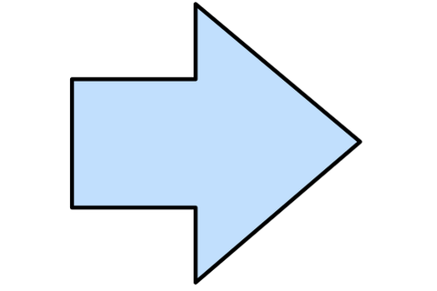 | [arrow-right-short](../../elements/svg/bioicons-arrow-right-short.svg) | Bioicons · CC-BY-3.0 | — |
| 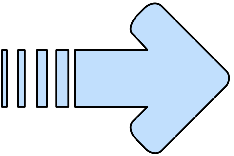 | [arrow-right-striped](../../elements/svg/bioicons-arrow-right-striped.svg) | Bioicons · CC-BY-3.0 | — |
| 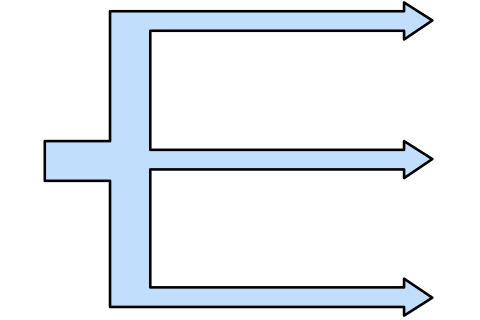 | [arrow-right-three-ends](../../elements/svg/bioicons-arrow-right-three-ends.svg) | Bioicons · CC-BY-3.0 | — |
| 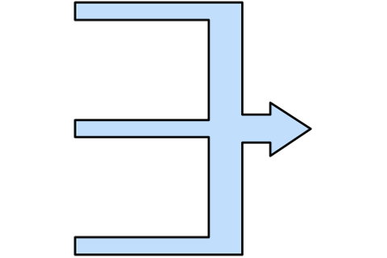 | [arrow-right-three-start](../../elements/svg/bioicons-arrow-right-three-start.svg) | Bioicons · CC-BY-3.0 | — |
| 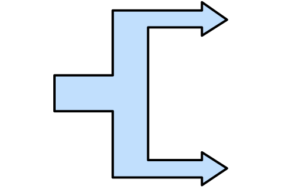 | [arrow-right-two-ends](../../elements/svg/bioicons-arrow-right-two-ends.svg) | Bioicons · CC-BY-3.0 | — |
| 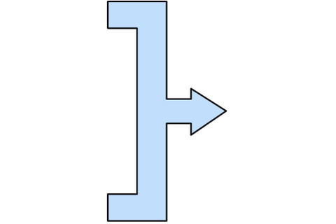 | [arrow-right-two-start](../../elements/svg/bioicons-arrow-right-two-start.svg) | Bioicons · CC-BY-3.0 | — |
| 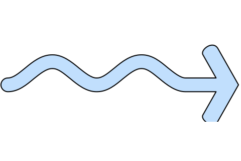 | [arrow-right-wavy-large](../../elements/svg/bioicons-arrow-right-wavy-large.svg) | Bioicons · CC-BY-3.0 | — |
| 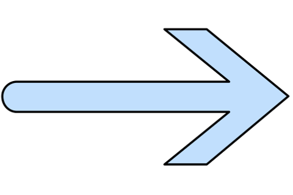 | [右箭头](../../elements/svg/bioicons-arrow-right.svg) | Bioicons · CC-BY-3.0 | — |
| 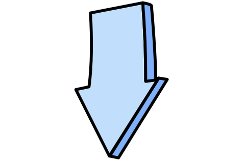 | [arrow-short-down](../../elements/svg/bioicons-arrow-short-down.svg) | Bioicons · CC-BY-3.0 | — |
| 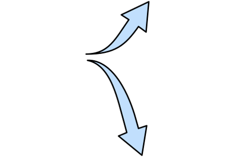 | [arrow-split-right](../../elements/svg/bioicons-arrow-split-right.svg) | Bioicons · CC-BY-3.0 | — |
| 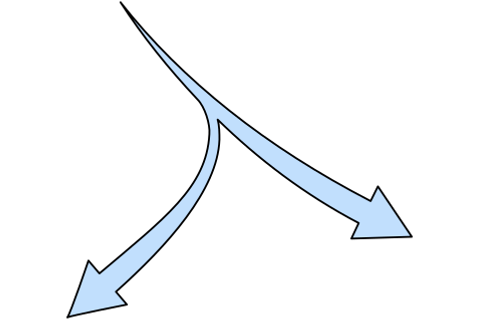 | [arrow-split](../../elements/svg/bioicons-arrow-split.svg) | Bioicons · CC-BY-3.0 | — |
| 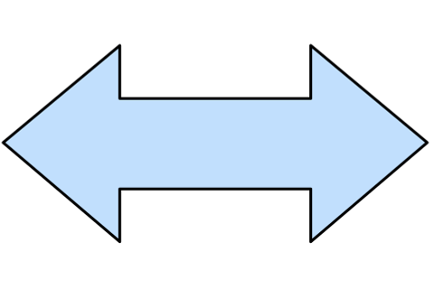 | [arrow-twosides-horizontal](../../elements/svg/bioicons-arrow-twosides-horizontal.svg) | Bioicons · CC-BY-3.0 | — |
|  | [arrow-up-3d-2](../../elements/svg/bioicons-arrow-up-3d-2.svg) | Bioicons · CC-BY-3.0 | — |
|  | [arrow-up-3d-3](../../elements/svg/bioicons-arrow-up-3d-3.svg) | Bioicons · CC-BY-3.0 | — |
|  | [arrow-up-3d](../../elements/svg/bioicons-arrow-up-3d.svg) | Bioicons · CC-BY-3.0 | — |
|  | [arrow-up-long](../../elements/svg/bioicons-arrow-up-long.svg) | Bioicons · CC-BY-3.0 | — |
|  | [arrow-wavy-right-long](../../elements/svg/bioicons-arrow-wavy-right-long.svg) | Bioicons · CC-BY-3.0 | — |
|  | [arrow-wavy-right-medium](../../elements/svg/bioicons-arrow-wavy-right-medium.svg) | Bioicons · CC-BY-3.0 | — |
|  | [arrow-wavy-right-short](../../elements/svg/bioicons-arrow-wavy-right-short.svg) | Bioicons · CC-BY-3.0 | — |
|  | [arrow-zigzag-up](../../elements/svg/bioicons-arrow-zigzag-up.svg) | Bioicons · CC-BY-3.0 | — |
|  | [arrow3d-clockwise-1](../../elements/svg/bioicons-arrow3d-clockwise-1.svg) | Bioicons · CC-BY-3.0 | — |
|  | [arrow3d-clockwise-2](../../elements/svg/bioicons-arrow3d-clockwise-2.svg) | Bioicons · CC-BY-3.0 | — |
|  | [arrow3d-clockwise-3](../../elements/svg/bioicons-arrow3d-clockwise-3.svg) | Bioicons · CC-BY-3.0 | — |
|  | [arrow3d-counterclockwise-1](../../elements/svg/bioicons-arrow3d-counterclockwise-1.svg) | Bioicons · CC-BY-3.0 | — |
