# 数据与文档

[返回 Element](../README.md) · [Teaser](../../examples/teasers/README.md) · [Architecture](../../examples/architectures/README.md) · [范例与元素对照表](../with-examples.md)

关联范例按表达功能互链；是否为原图拆件见对照表与元素来源记录。

| 预览 | 名称与 SVG | 来源与许可 | 关联范例（最多列三项） |
|---|---|---|---|
| 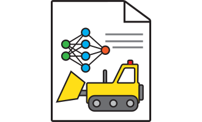 | [神经场论文图标](../../elements/svg/towaki-neuralfieldpaper.svg) | Towaki CC0 · CC0-1.0 | — |
| 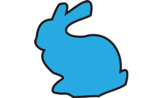 | [兔形图标](../../elements/svg/towaki-bunny.svg) | Towaki CC0 · CC0-1.0 | — |
|  | [存储图标](../../elements/svg/towaki-floppydisk.svg) | Towaki CC0 · CC0-1.0 | — |
|  | [特征表示堆叠](../../elements/svg/rust-feature-stack.svg) | RUST 原图部件 · 原项目未发现独立图形授权；仅作出处明确的参考 | [CUT3R · 持久状态的更新、读取与未见视角推断](../../examples/architectures/cut3r-architecture/README.md) · [D2L · 编码器—解码器](../../examples/architectures/d2l-encoder-decoder/README.md) · [Genie · 视频 tokenizer、潜在动作与动力学模型](../../examples/architectures/genie-architecture/README.md) |
|  | [单层特征块](../../elements/svg/rust-feature-tile.svg) | RUST 原图部件 · 原项目未发现独立图形授权；仅作出处明确的参考 | [D2L · Transformer 编码器与解码器](../../examples/architectures/d2l-transformer/README.md) · [D2L · Vision Transformer](../../examples/architectures/d2l-vit/README.md) · [DiT · 整体主干与三种条件注入模块](../../examples/architectures/dit-architecture/README.md) |
|  | [匹配相似度矩阵](../../elements/svg/lightglue-assignment-matrix.svg) | LightGlue 原图部件 · Apache-2.0（LightGlue 来源仓库） | [CLIP Figure 1：训练到零样本预测](../../examples/architectures/clip/README.md) · [D2L · 带注意力的 Seq2Seq](../../examples/architectures/d2l-seq2seq-attention/README.md) · [D2L · Transformer 编码器与解码器](../../examples/architectures/d2l-transformer/README.md) |
|  | [数据库](../../elements/svg/tabler-database.svg) | Tabler outline · MIT | — |
|  | [数据库导入](../../elements/svg/tabler-database-import.svg) | Tabler outline · MIT | — |
| 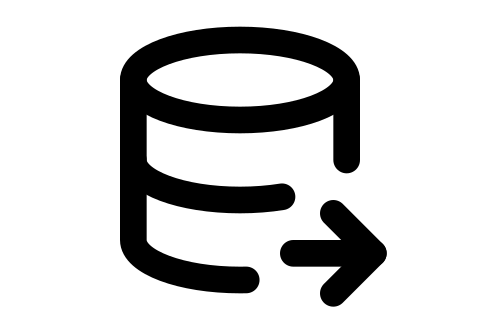 | [数据库导出](../../elements/svg/tabler-database-export.svg) | Tabler outline · MIT | — |
| 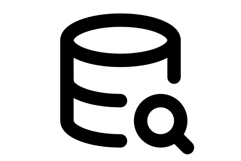 | [数据库检索](../../elements/svg/tabler-database-search.svg) | Tabler outline · MIT | — |
|  | [表格](../../elements/svg/tabler-table.svg) | Tabler outline · MIT | — |
|  | [文件](../../elements/svg/tabler-file.svg) | Tabler outline · MIT | — |
|  | [文本文件](../../elements/svg/tabler-file-text.svg) | Tabler outline · MIT | [CLIP Figure 1：训练到零样本预测](../../examples/architectures/clip/README.md) · [SD3 · 双模态主干与 MM-DiT block 展开](../../examples/architectures/sd3-mmdit-architecture/README.md) |
|  | [代码文件](../../elements/svg/tabler-file-code.svg) | Tabler outline · MIT | — |
|  | [PDF 文件](../../elements/svg/tabler-file-type-pdf.svg) | Tabler outline · MIT | — |
|  | [CSV 文件](../../elements/svg/tabler-file-type-csv.svg) | Tabler outline · MIT | — |
|  | [多文件](../../elements/svg/tabler-files.svg) | Tabler outline · MIT | — |
| 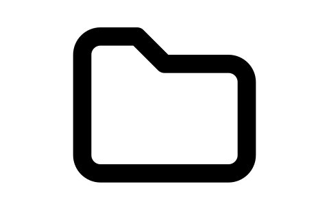 | [文件夹](../../elements/svg/tabler-folder.svg) | Tabler outline · MIT | — |
|  | [多文件夹](../../elements/svg/tabler-folders.svg) | Tabler outline · MIT | — |
|  | [图像](../../elements/svg/tabler-photo.svg) | Tabler outline · MIT | [Uneven Double Refraction：原型与成像能力展示](../../examples/teasers/birefractive-rgbd/README.md) · [CUT3R · 静态、动态与稀疏照片三类场景](../../examples/teasers/cut3r-capabilities/README.md) · [DECOLLAGE：局部风格控制与三维细化](../../examples/teasers/decollage/README.md) |
|  | [图像扫描](../../elements/svg/tabler-photo-scan.svg) | Tabler outline · MIT | — |
| 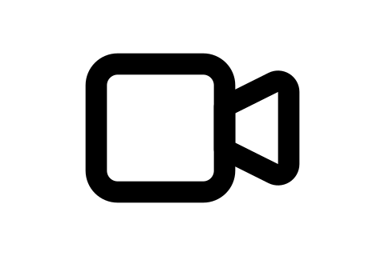 | [视频](../../elements/svg/tabler-video.svg) | Tabler outline · MIT | [CUT3R · 静态、动态与稀疏照片三类场景](../../examples/teasers/cut3r-capabilities/README.md) · [Genie · 不同提示生成可交互世界](../../examples/teasers/genie-interaction/README.md) · [Genie · 视频 tokenizer、潜在动作与动力学模型](../../examples/architectures/genie-architecture/README.md) |
|  | [音频](../../elements/svg/tabler-music.svg) | Tabler outline · MIT | — |
|  | [麦克风](../../elements/svg/tabler-microphone.svg) | Tabler outline · MIT | — |
| 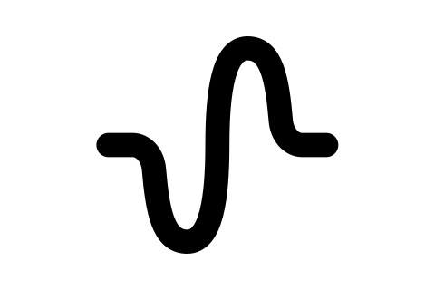 | [正弦信号](../../elements/svg/tabler-wave-sine.svg) | Tabler outline · MIT | — |
|  | [四格网格](../../elements/svg/tabler-layout-grid.svg) | Tabler outline · MIT | — |
|  | [点阵](../../elements/svg/tabler-grid-dots.svg) | Tabler outline · MIT | — |
|  | [二进制](../../elements/svg/tabler-binary.svg) | Tabler outline · MIT | — |
|  | [条形码](../../elements/svg/tabler-barcode.svg) | Tabler outline · MIT | — |
| 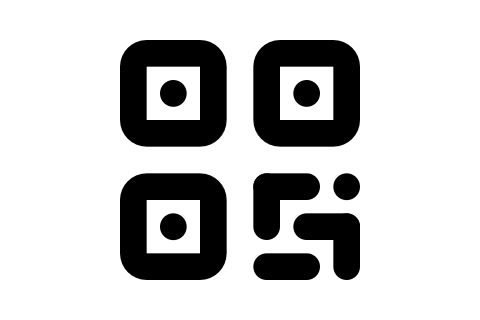 | [二维码](../../elements/svg/tabler-qrcode.svg) | Tabler outline · MIT | — |
|  | [文本](../../elements/svg/tabler-text-size.svg) | Tabler outline · MIT | — |
|  | [语言](../../elements/svg/tabler-language.svg) | Tabler outline · MIT | — |
|  | [书籍](../../elements/svg/tabler-book.svg) | Tabler outline · MIT | — |
|  | [多本书](../../elements/svg/tabler-books.svg) | Tabler outline · MIT | — |
|  | [剪贴板](../../elements/svg/tabler-clipboard.svg) | Tabler outline · MIT | — |
|  | [Document](../../elements/svg/bioicons-document.svg) | Bioicons · CC0-1.0 | — |
| 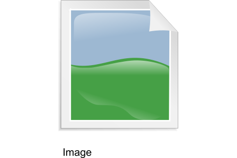 | [Image](../../elements/svg/bioicons-image.svg) | Bioicons · CC0-1.0 | — |
| 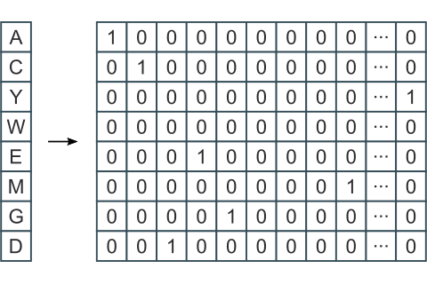 | [独热编码](../../elements/svg/bioicons-onehotencoding.svg) | Bioicons · CC0-1.0 | — |
|  | [database-colored](../../elements/svg/bioicons-database-colored.svg) | Bioicons · CC0-1.0 | — |
|  | [数据库](../../elements/svg/bioicons-database.svg) | Bioicons · CC0-1.0 | — |
|  | [书籍](../../elements/svg/bioicons-book.svg) | Bioicons · CC-BY-3.0 | — |
|  | [labbook](../../elements/svg/bioicons-labbook.svg) | Bioicons · CC-BY-3.0 | — |
|  | [notepad](../../elements/svg/bioicons-notepad.svg) | Bioicons · CC-BY-3.0 | — |
| 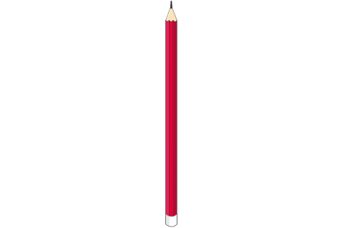 | [pencil](../../elements/svg/bioicons-pencil.svg) | Bioicons · CC-BY-3.0 | — |
|  | [缓存](../../elements/svg/isoflow-cache.svg) | Isoflow · MIT | — |
|  | [文档](../../elements/svg/isoflow-document.svg) | Isoflow · MIT | — |
|  | [图像文件](../../elements/svg/isoflow-image.svg) | Isoflow · MIT | — |
|  | [邮件](../../elements/svg/isoflow-mail.svg) | Isoflow · MIT | — |
|  | [队列](../../elements/svg/isoflow-queue.svg) | Isoflow · MIT | — |
|  | [对话气泡](../../elements/svg/isoflow-speech.svg) | Isoflow · MIT | — |
| 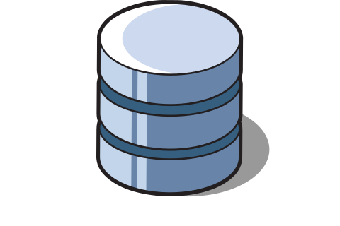 | [存储](../../elements/svg/isoflow-storage.svg) | Isoflow · MIT | — |
|  | [输入特征层](../../elements/svg/task5-input-feature.svg) | Illustrator task5 source · 原作者未声明独立复用授权 | [多尺度网络总览与模块展开](../../examples/architectures/multiscale-network/README.md) |
| 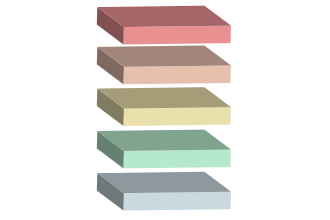 | [多尺度特征堆叠](../../elements/svg/task5-feature-pyramid.svg) | Illustrator task5 source · 原作者未声明独立复用授权 | [VAR · 从逐 token 到逐尺度生成的范式对照](../../examples/teasers/var-paradigm/README.md) · [Instant NGP · 多分辨率哈希编码到 MLP](../../examples/architectures/instant-ngp-hash-architecture/README.md) · [LGM · 非对称 U-Net 与跨视角注意力](../../examples/architectures/lgm-architecture/README.md) |
|  | [多通道彩色张量](../../elements/svg/task5-rgb-tensor.svg) | Illustrator task5 source · 原作者未声明独立复用授权 | [VAR · 从逐 token 到逐尺度生成的范式对照](../../examples/teasers/var-paradigm/README.md) · [D2L · AlexNet](../../examples/architectures/d2l-alexnet/README.md) · [D2L · DenseNet 密集连接块](../../examples/architectures/d2l-densenet-block/README.md) |
|  | [输出特征层](../../elements/svg/task5-output-feature.svg) | Illustrator task5 source · 原作者未声明独立复用授权 | [D2L · AlexNet](../../examples/architectures/d2l-alexnet/README.md) · [D2L · DenseNet 密集连接块](../../examples/architectures/d2l-densenet-block/README.md) · [D2L · 全卷积网络](../../examples/architectures/d2l-fcn/README.md) |
