# 设备与对象

[返回 Element](../README.md) · [Teaser](../../examples/teasers/README.md) · [Architecture](../../examples/architectures/README.md) · [范例与元素对照表](../with-examples.md)

关联范例按表达功能互链；是否为原图拆件见对照表与元素来源记录。

| 预览 | 名称与 SVG | 来源与许可 | 关联范例（最多列三项） |
|---|---|---|---|
| 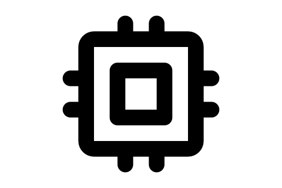 | [CPU](../../elements/svg/tabler-cpu.svg) | Tabler outline · MIT | — |
| 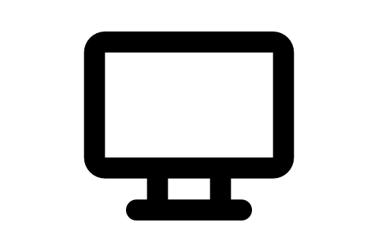 | [台式电脑](../../elements/svg/tabler-device-desktop.svg) | Tabler outline · MIT | — |
| 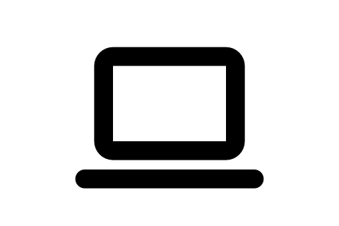 | [笔记本电脑](../../elements/svg/tabler-device-laptop.svg) | Tabler outline · MIT | — |
| 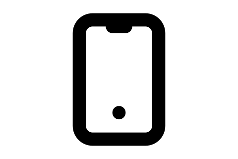 | [手机](../../elements/svg/tabler-device-mobile.svg) | Tabler outline · MIT | — |
| 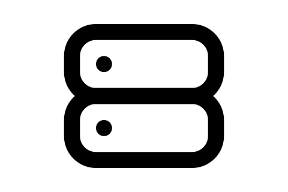 | [服务器](../../elements/svg/tabler-server.svg) | Tabler outline · MIT | — |
| 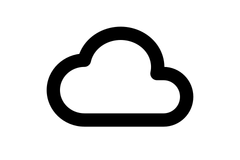 | [云](../../elements/svg/tabler-cloud.svg) | Tabler outline · MIT | — |
| 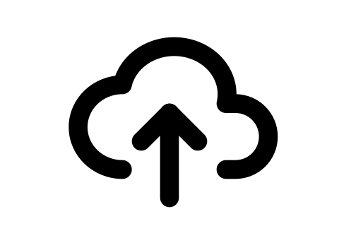 | [上传云端](../../elements/svg/tabler-cloud-upload.svg) | Tabler outline · MIT | — |
| 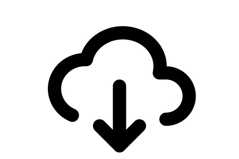 | [云端下载](../../elements/svg/tabler-cloud-download.svg) | Tabler outline · MIT | — |
| 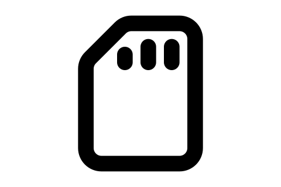 | [存储卡](../../elements/svg/tabler-device-sd-card.svg) | Tabler outline · MIT | — |
| 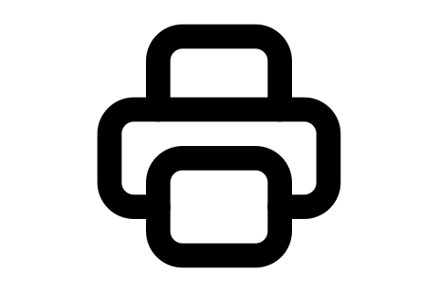 | [打印机](../../elements/svg/tabler-printer.svg) | Tabler outline · MIT | — |
| 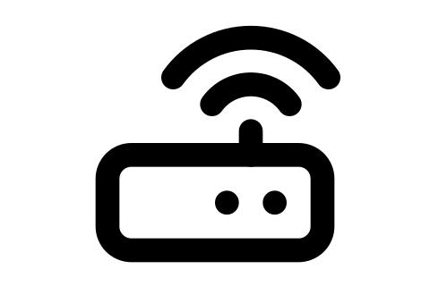 | [路由器](../../elements/svg/tabler-router.svg) | Tabler outline · MIT | — |
| 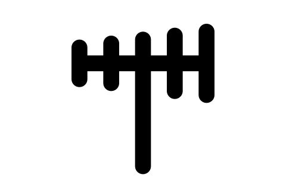 | [天线](../../elements/svg/tabler-antenna.svg) | Tabler outline · MIT | — |
| 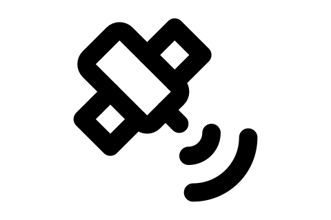 | [卫星](../../elements/svg/tabler-satellite.svg) | Tabler outline · MIT | — |
| 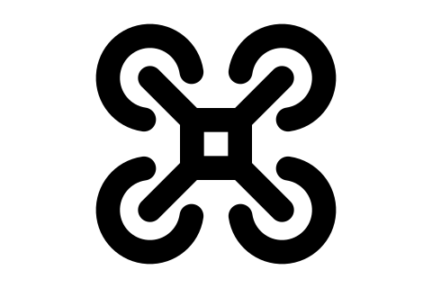 | [无人机](../../elements/svg/tabler-drone.svg) | Tabler outline · MIT | — |
|  | [相机](../../elements/svg/tabler-camera.svg) | Tabler outline · MIT | [Uneven Double Refraction：原型与成像能力展示](../../examples/teasers/birefractive-rgbd/README.md) · [CUT3R · 静态、动态与稀疏照片三类场景](../../examples/teasers/cut3r-capabilities/README.md) · [OrienterNet：用二维地图定位的任务与动机](../../examples/teasers/orienternet/README.md) |
| 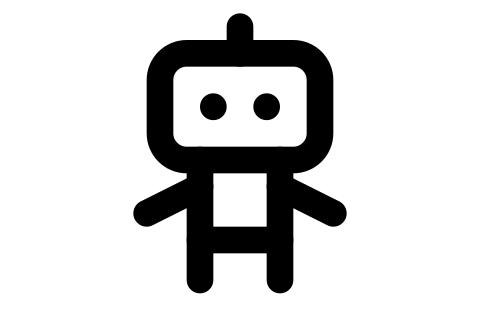 | [机器人](../../elements/svg/tabler-robot.svg) | Tabler outline · MIT | — |
| 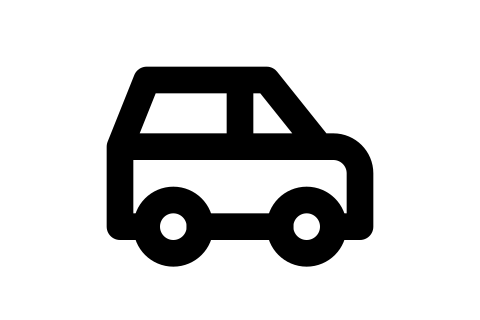 | [汽车](../../elements/svg/tabler-car.svg) | Tabler outline · MIT | [LAV：感知、预测与驾驶控制流程](../../examples/architectures/lav/README.md) |
| 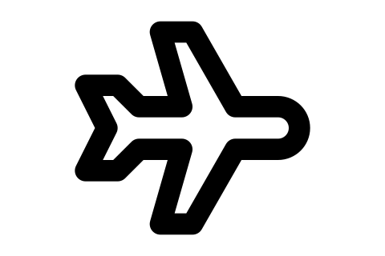 | [飞机](../../elements/svg/tabler-plane.svg) | Tabler outline · MIT | — |
| 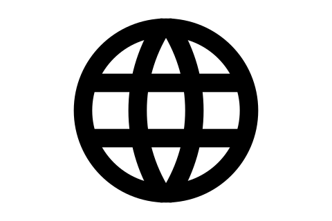 | [地球](../../elements/svg/tabler-world.svg) | Tabler outline · MIT | — |
| 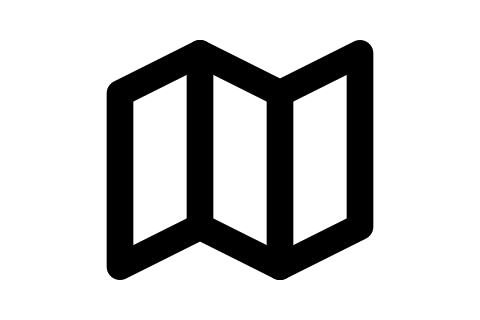 | [地图](../../elements/svg/tabler-map.svg) | Tabler outline · MIT | [OrienterNet：用二维地图定位的任务与动机](../../examples/teasers/orienternet/README.md) |
| 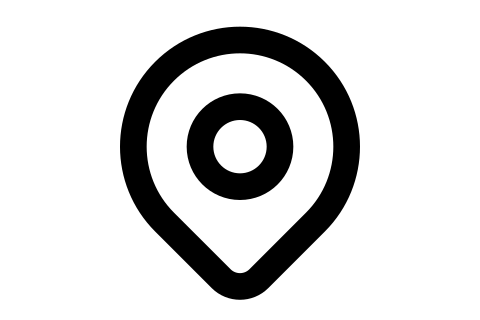 | [定位](../../elements/svg/tabler-map-pin.svg) | Tabler outline · MIT | [OrienterNet：用二维地图定位的任务与动机](../../examples/teasers/orienternet/README.md) |
| 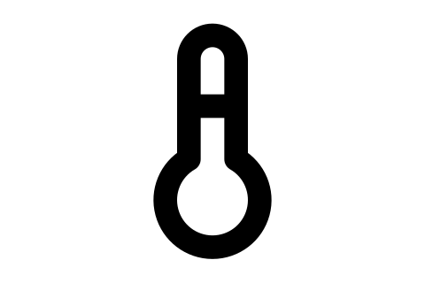 | [温度](../../elements/svg/tabler-temperature.svg) | Tabler outline · MIT | — |
| 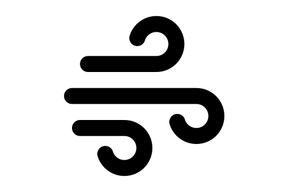 | [风场符号](../../elements/svg/tabler-wind.svg) | Tabler outline · MIT | — |
| 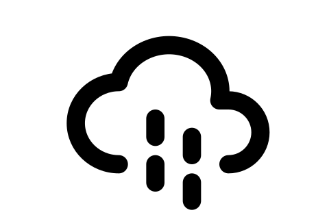 | [降雨](../../elements/svg/tabler-cloud-rain.svg) | Tabler outline · MIT | — |
|  | [闪电](../../elements/svg/tabler-bolt.svg) | Tabler outline · MIT | — |
| 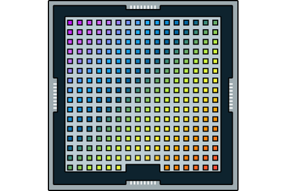 | [CPU](../../elements/svg/bioicons-cpu.svg) | Bioicons · CC0-1.0 | — |
| 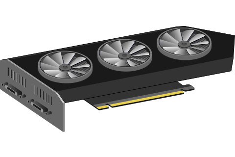 | [三维 GPU](../../elements/svg/bioicons-gpu-3d.svg) | Bioicons · CC0-1.0 | — |
| 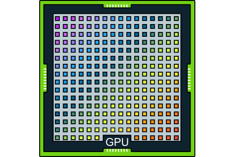 | [GPU](../../elements/svg/bioicons-gpu.svg) | Bioicons · CC0-1.0 | — |
| 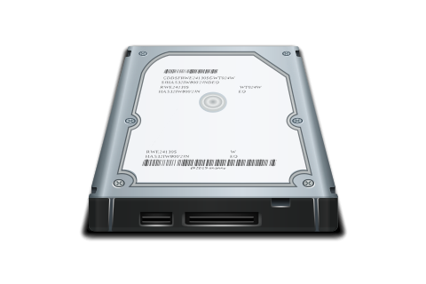 | [硬盘](../../elements/svg/bioicons-hdd.svg) | Bioicons · CC0-1.0 | — |
|  | [笔记本电脑](../../elements/svg/bioicons-laptop.svg) | Bioicons · CC0-1.0 | — |
| 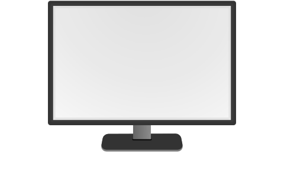 | [显示器](../../elements/svg/bioicons-screen.svg) | Bioicons · CC0-1.0 | — |
| 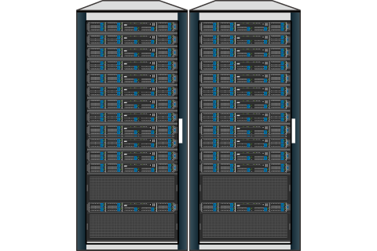 | [超级计算机](../../elements/svg/bioicons-supercomputer.svg) | Bioicons · CC0-1.0 | — |
| 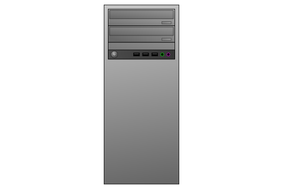 | [工作站](../../elements/svg/bioicons-workstation.svg) | Bioicons · CC0-1.0 | — |
| 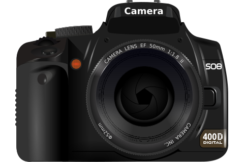 | [相机](../../elements/svg/bioicons-camera.svg) | Bioicons · CC0-1.0 | — |
| 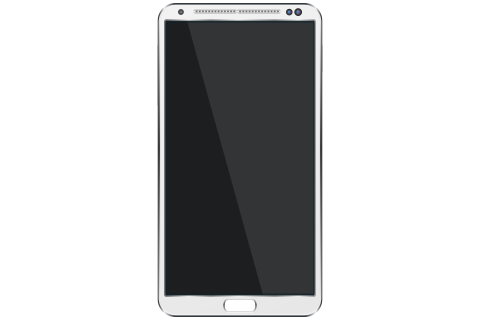 | [smartphone](../../elements/svg/bioicons-smartphone.svg) | Bioicons · CC0-1.0 | — |
| 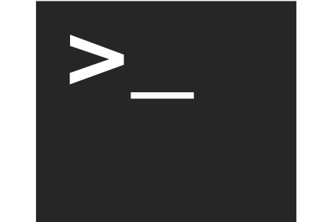 | [terminal](../../elements/svg/bioicons-terminal.svg) | Bioicons · CC0-1.0 | — |
| 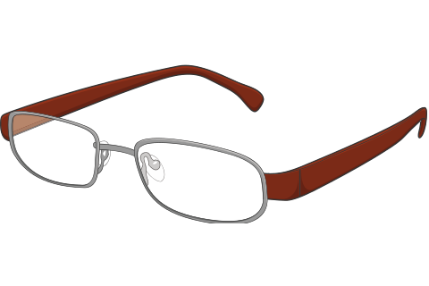 | [glasses](../../elements/svg/bioicons-glasses.svg) | Bioicons · CC-BY-3.0 | — |
| 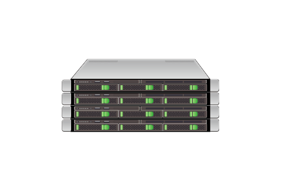 | [Server rack](../../elements/svg/bioicons-server-rack.svg) | Bioicons · CC-BY-4.0 | — |
| 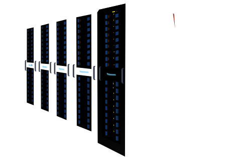 | [serverroom](../../elements/svg/bioicons-serverroom.svg) | Bioicons · CC-BY-4.0 | — |
| 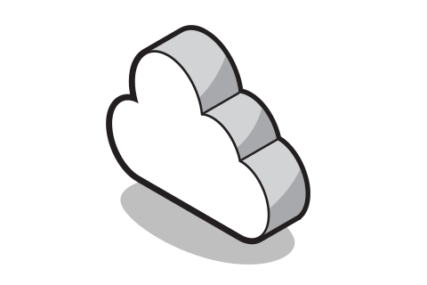 | [云](../../elements/svg/isoflow-cloud.svg) | Isoflow · MIT | — |
| 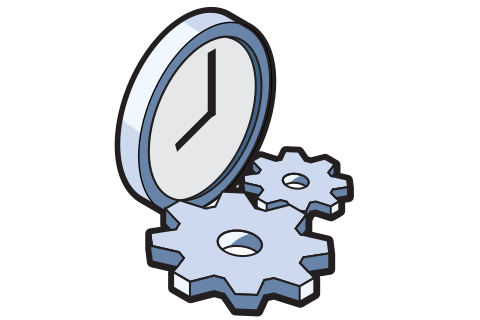 | [定时任务](../../elements/svg/isoflow-cronjob.svg) | Isoflow · MIT | — |
| 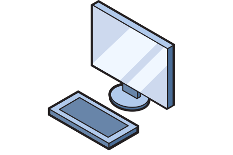 | [台式电脑](../../elements/svg/isoflow-desktop.svg) | Isoflow · MIT | — |
| 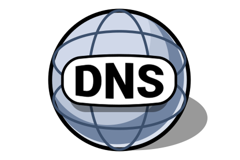 | [DNS](../../elements/svg/isoflow-dns.svg) | Isoflow · MIT | — |
|  | [防火墙](../../elements/svg/isoflow-firewall.svg) | Isoflow · MIT | — |
| 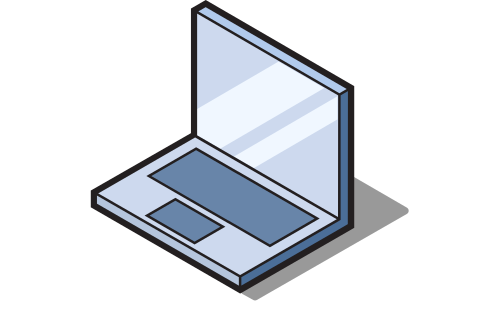 | [笔记本电脑](../../elements/svg/isoflow-laptop.svg) | Isoflow · MIT | — |
| 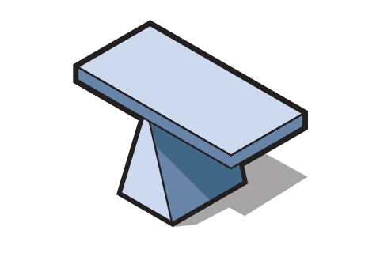 | [负载均衡](../../elements/svg/isoflow-loadbalancer.svg) | Isoflow · MIT | — |
|  | [锁定](../../elements/svg/isoflow-lock.svg) | Isoflow · MIT | — |
| 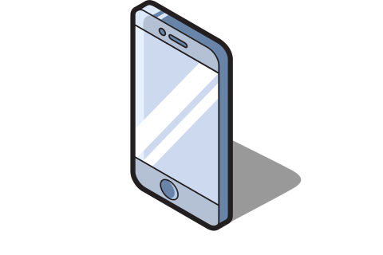 | [移动设备](../../elements/svg/isoflow-mobiledevice.svg) | Isoflow · MIT | — |
| 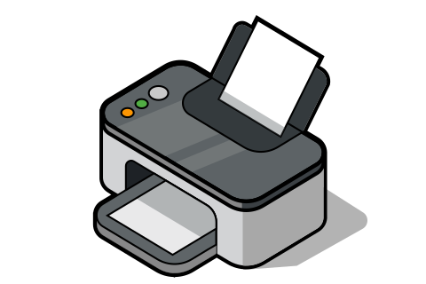 | [打印机](../../elements/svg/isoflow-printer.svg) | Isoflow · MIT | — |
| 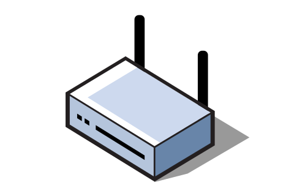 | [路由器](../../elements/svg/isoflow-router.svg) | Isoflow · MIT | — |
| 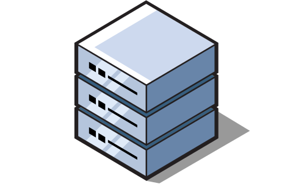 | [服务器](../../elements/svg/isoflow-server.svg) | Isoflow · MIT | — |
| 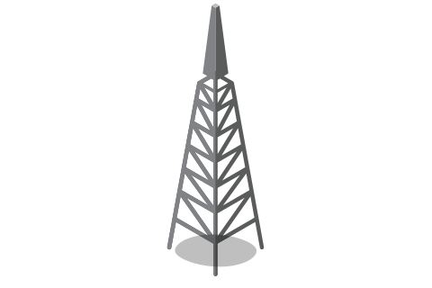 | [信号塔](../../elements/svg/isoflow-tower.svg) | Isoflow · MIT | — |
| 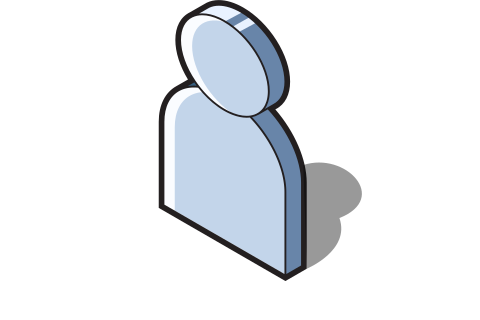 | [用户](../../elements/svg/isoflow-user.svg) | Isoflow · MIT | — |
| 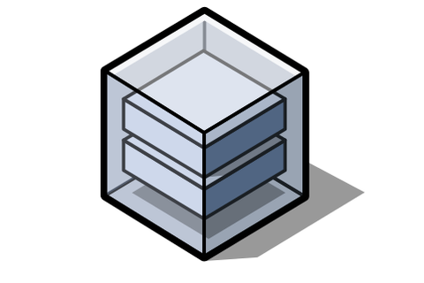 | [虚拟机](../../elements/svg/isoflow-vm.svg) | Isoflow · MIT | — |
