# 网络与模块

[返回 Element](../README.md) · [Teaser](../../examples/teasers/README.md) · [Architecture](../../examples/architectures/README.md) · [范例与元素对照表](../with-examples.md)

关联范例按表达功能互链；是否为原图拆件见对照表与元素来源记录。

| 预览 | 名称与 SVG | 来源与许可 | 关联范例（最多列三项） |
|---|---|---|---|
| 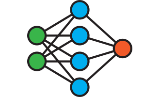 | [浅层神经网络](../../elements/svg/towaki-neuralnetwork.svg) | Towaki CC0 · CC0-1.0 | [DPO · RLHF 与直接偏好优化的流程简化](../../examples/teasers/dpo-comparison/README.md) · [D2L · 多层感知机](../../examples/architectures/d2l-mlp/README.md) · [Instant NGP · 多分辨率哈希编码到 MLP](../../examples/architectures/instant-ngp-hash-architecture/README.md) |
| 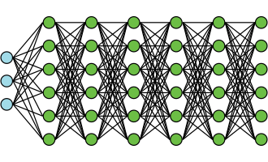 | [深层神经网络](../../elements/svg/towaki-deepneuralnetwork.svg) | Towaki CC0 · CC0-1.0 | [D2L · 生成对抗网络](../../examples/architectures/d2l-gan/README.md) · [D2L · 多层感知机](../../examples/architectures/d2l-mlp/README.md) |
| 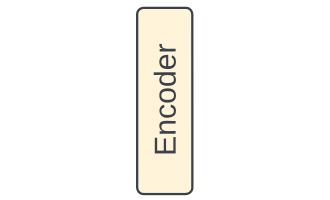 | [编码器块](../../elements/svg/rust-encoder.svg) | RUST 原图部件 · 原项目未发现独立图形授权；仅作出处明确的参考 | [CLIP Figure 1：训练到零样本预测](../../examples/architectures/clip/README.md) · [CUT3R · 持久状态的更新、读取与未见视角推断](../../examples/architectures/cut3r-architecture/README.md) · [D2L · 编码器—解码器](../../examples/architectures/d2l-encoder-decoder/README.md) |
| 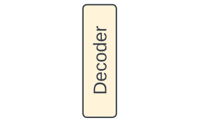 | [解码器块](../../elements/svg/rust-decoder.svg) | RUST 原图部件 · 原项目未发现独立图形授权；仅作出处明确的参考 | [CUT3R · 持久状态的更新、读取与未见视角推断](../../examples/architectures/cut3r-architecture/README.md) · [D2L · 编码器—解码器](../../examples/architectures/d2l-encoder-decoder/README.md) · [D2L · 带注意力的 Seq2Seq](../../examples/architectures/d2l-seq2seq-attention/README.md) |
| 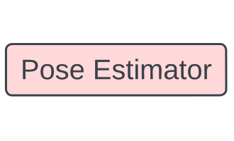 | [位姿估计模块](../../elements/svg/rust-pose-estimator.svg) | RUST 原图部件 · 原项目未发现独立图形授权；仅作出处明确的参考 | [OrienterNet：用二维地图定位的任务与动机](../../examples/teasers/orienternet/README.md) · [RUST：编码器、场景表示与位姿分支](../../examples/architectures/rust/README.md) |
| 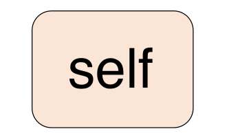 | [Self attention 块](../../elements/svg/lightglue-self-attention.svg) | LightGlue 原图部件 · Apache-2.0（LightGlue 来源仓库） | [D2L · 带注意力的 Seq2Seq](../../examples/architectures/d2l-seq2seq-attention/README.md) · [D2L · Transformer 编码器与解码器](../../examples/architectures/d2l-transformer/README.md) · [D2L · Vision Transformer](../../examples/architectures/d2l-vit/README.md) |
| 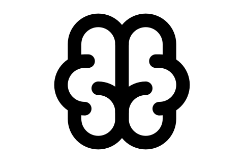 | [大脑](../../elements/svg/tabler-brain.svg) | Tabler outline · MIT | — |
| 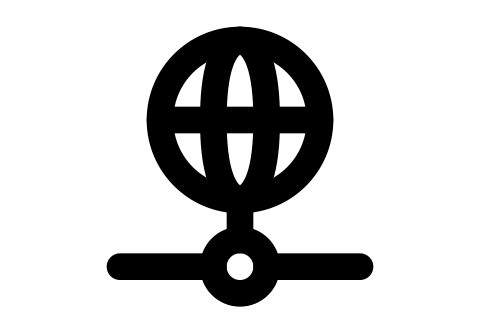 | [网络](../../elements/svg/tabler-network.svg) | Tabler outline · MIT | — |
| 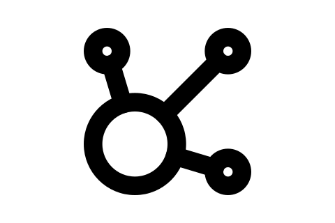 | [节点分支](../../elements/svg/tabler-affiliate.svg) | Tabler outline · MIT | — |
| 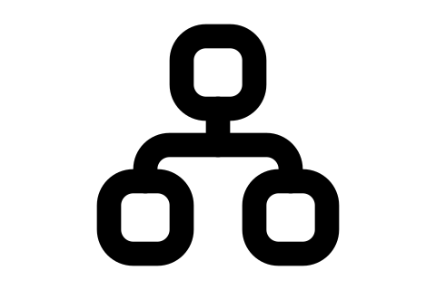 | [层级结构](../../elements/svg/tabler-sitemap.svg) | Tabler outline · MIT | — |
| 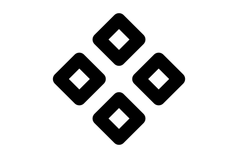 | [组件](../../elements/svg/tabler-components.svg) | Tabler outline · MIT | — |
| 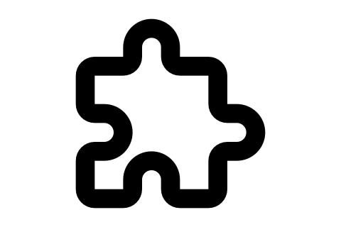 | [拼图](../../elements/svg/tabler-puzzle.svg) | Tabler outline · MIT | — |
| 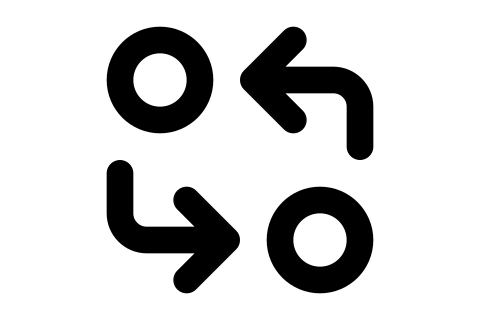 | [变换](../../elements/svg/tabler-transform.svg) | Tabler outline · MIT | — |
| 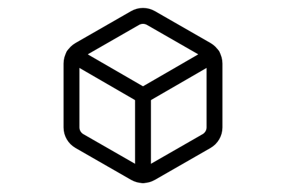 | [立方体](../../elements/svg/tabler-cube.svg) | Tabler outline · MIT | — |
| 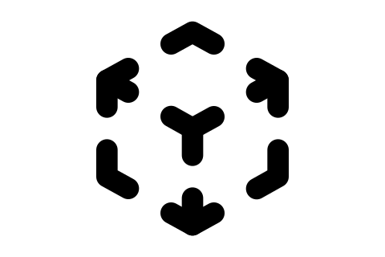 | [三维坐标物体](../../elements/svg/tabler-cube-3d-sphere.svg) | Tabler outline · MIT | [Uneven Double Refraction：原型与成像能力展示](../../examples/teasers/birefractive-rgbd/README.md) · [DECOLLAGE：局部风格控制与三维细化](../../examples/teasers/decollage/README.md) · [DreamGaussian · 生成能力与优化进程同图展示](../../examples/teasers/dreamgaussian-progress/README.md) |
| 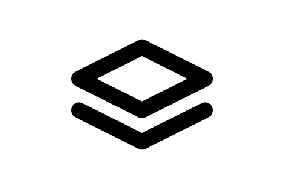 | [堆叠](../../elements/svg/tabler-stack.svg) | Tabler outline · MIT | — |
| 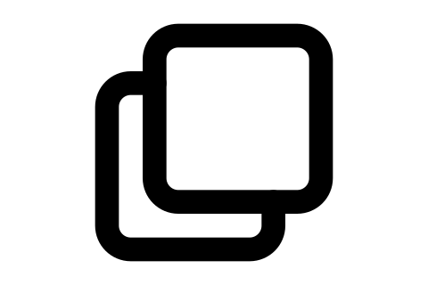 | [多层方框](../../elements/svg/tabler-box-multiple.svg) | Tabler outline · MIT | — |
| 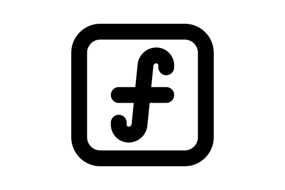 | [函数](../../elements/svg/tabler-function.svg) | Tabler outline · MIT | — |
| 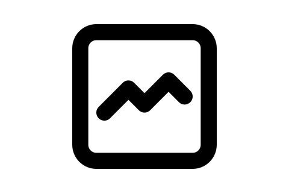 | [函数图形](../../elements/svg/tabler-graph.svg) | Tabler outline · MIT | — |
| 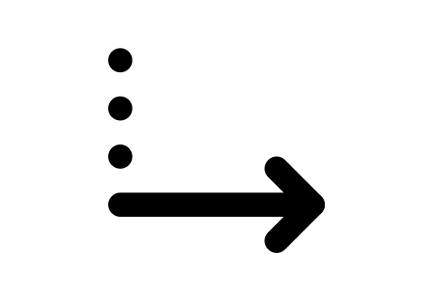 | [横坐标轴](../../elements/svg/tabler-axis-x.svg) | Tabler outline · MIT | — |
| 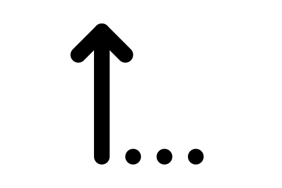 | [纵坐标轴](../../elements/svg/tabler-axis-y.svg) | Tabler outline · MIT | — |
| 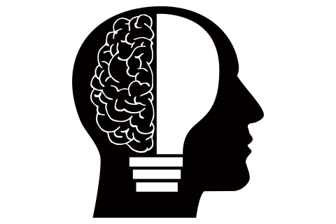 | [AI 灯泡符号](../../elements/svg/bioicons-ai-bulb.svg) | Bioicons · CC0-1.0 | — |
| 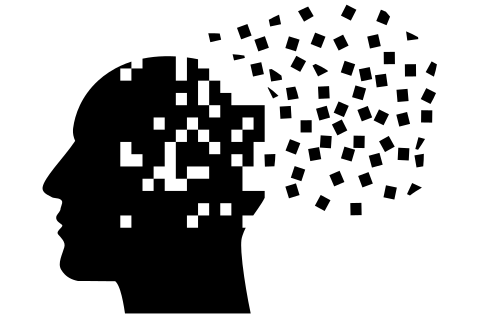 | [认知符号](../../elements/svg/bioicons-ai-cognition.svg) | Bioicons · CC0-1.0 | — |
| 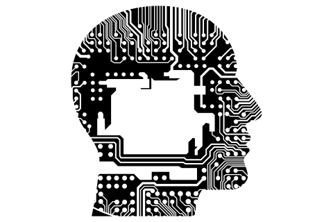 | [AI 人像符号](../../elements/svg/bioicons-ai-head.svg) | Bioicons · CC0-1.0 | — |
| 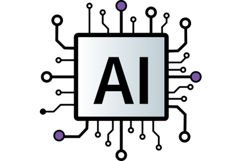 | [AI 芯片符号](../../elements/svg/bioicons-ai.svg) | Bioicons · CC0-1.0 | — |
| 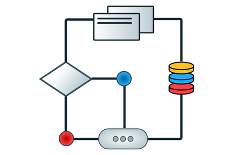 | [算法流程](../../elements/svg/bioicons-algorithm.svg) | Bioicons · CC0-1.0 | — |
| 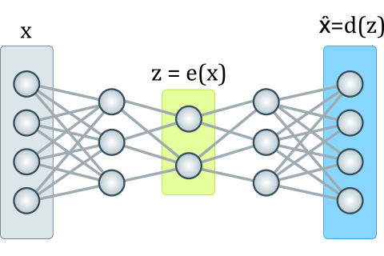 | [自编码器](../../elements/svg/bioicons-autoencoder.svg) | Bioicons · CC0-1.0 | — |
| 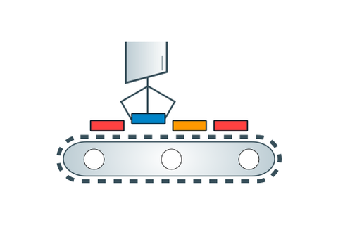 | [自动化](../../elements/svg/bioicons-automation.svg) | Bioicons · CC0-1.0 | — |
| 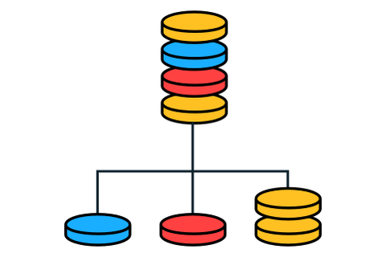 | [分类](../../elements/svg/bioicons-classification.svg) | Bioicons · CC0-1.0 | — |
| 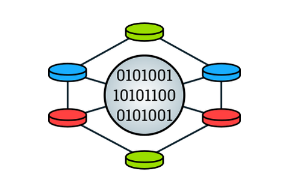 | [数据挖掘](../../elements/svg/bioicons-datamining.svg) | Bioicons · CC0-1.0 | — |
| 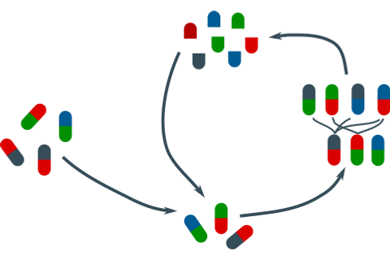 | [遗传算法](../../elements/svg/bioicons-genetic-algorithm.svg) | Bioicons · CC0-1.0 | — |
| 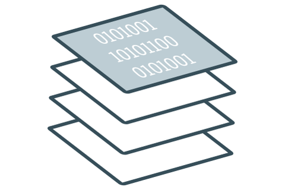 | [模型层堆叠](../../elements/svg/bioicons-model-layers.svg) | Bioicons · CC0-1.0 | — |
| 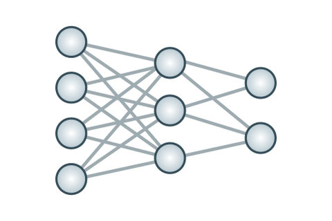 | [神经网络](../../elements/svg/bioicons-neural-network-1.svg) | Bioicons · CC0-1.0 | — |
| 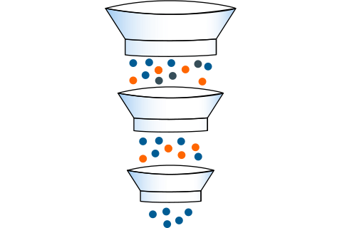 | [处理流程](../../elements/svg/bioicons-pipeline.svg) | Bioicons · CC0-1.0 | — |
| 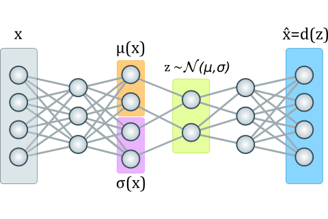 | [变分自编码器](../../elements/svg/bioicons-variational-autoencoder.svg) | Bioicons · CC0-1.0 | — |
| 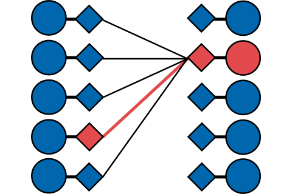 | [注意力机制](../../elements/svg/bioicons-attention-mechanism.svg) | Bioicons · CC-BY-4.0 | — |
| 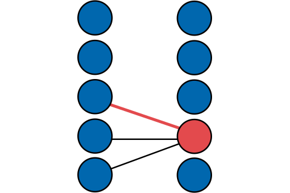 | [卷积连接](../../elements/svg/bioicons-convolutional-network.svg) | Bioicons · CC-BY-4.0 | — |
| 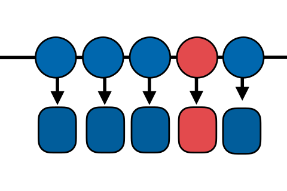 | [隐马尔可夫模型](../../elements/svg/bioicons-hidden-markov-model.svg) | Bioicons · CC-BY-4.0 | — |
| 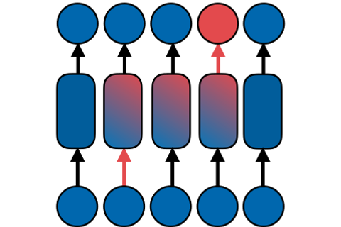 | [循环神经网络](../../elements/svg/bioicons-recurrent-neural-network.svg) | Bioicons · CC-BY-4.0 | — |
| 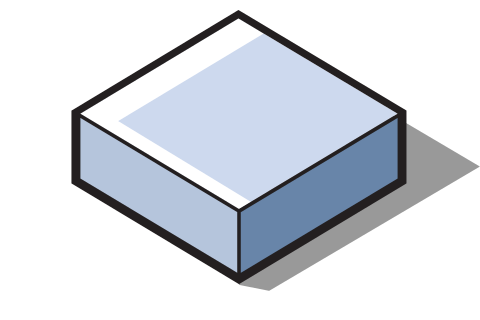 | [块](../../elements/svg/isoflow-block.svg) | Isoflow · MIT | — |
| 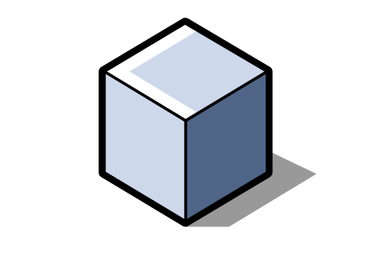 | [立方体](../../elements/svg/isoflow-cube.svg) | Isoflow · MIT | — |
| 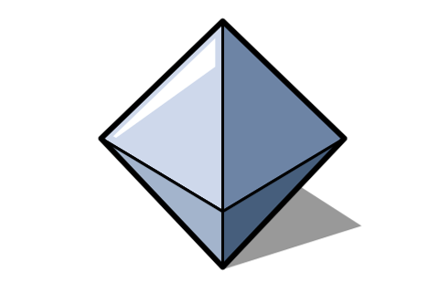 | [菱形体](../../elements/svg/isoflow-diamond.svg) | Isoflow · MIT | — |
| 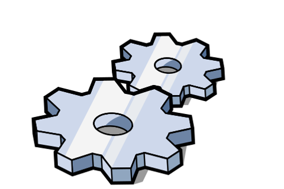 | [功能模块](../../elements/svg/isoflow-function-module.svg) | Isoflow · MIT | — |
| 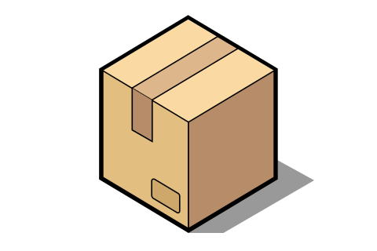 | [包模块](../../elements/svg/isoflow-package-module.svg) | Isoflow · MIT | — |
| 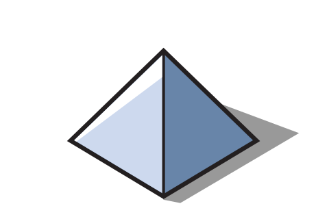 | [金字塔](../../elements/svg/isoflow-pyramid.svg) | Isoflow · MIT | — |
| 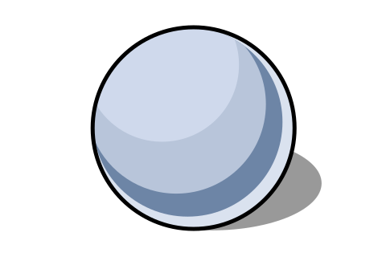 | [球体](../../elements/svg/isoflow-sphere.svg) | Isoflow · MIT | — |
| 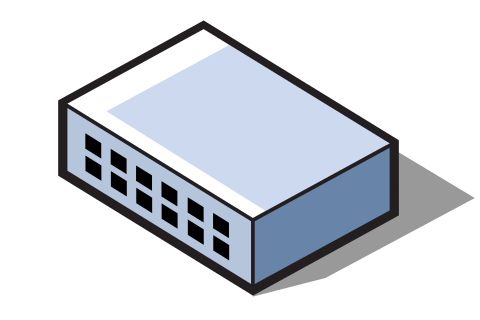 | [交换机模块](../../elements/svg/isoflow-switch-module.svg) | Isoflow · MIT | — |
| 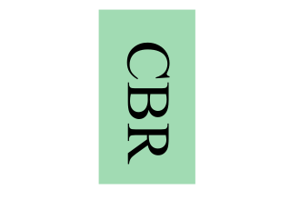 | [CBR 模块](../../elements/svg/task5-cbr.svg) | Illustrator task5 source · 原作者未声明独立复用授权 | [D2L · AlexNet](../../examples/architectures/d2l-alexnet/README.md) · [D2L · DenseNet 密集连接块](../../examples/architectures/d2l-densenet-block/README.md) · [D2L · 全卷积网络](../../examples/architectures/d2l-fcn/README.md) |
| 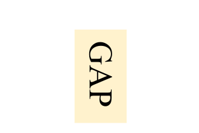 | [GAP 模块](../../elements/svg/task5-gap.svg) | Illustrator task5 source · 原作者未声明独立复用授权 | [多尺度网络总览与模块展开](../../examples/architectures/multiscale-network/README.md) |
| 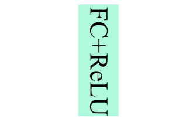 | [FC + ReLU 模块](../../elements/svg/task5-fc-relu.svg) | Illustrator task5 source · 原作者未声明独立复用授权 | [D2L · 多层感知机](../../examples/architectures/d2l-mlp/README.md) · [多尺度网络总览与模块展开](../../examples/architectures/multiscale-network/README.md) |
