# 运算与变换

[返回 Element](../README.md) · [Teaser](../../examples/teasers/README.md) · [Architecture](../../examples/architectures/README.md) · [范例与元素对照表](../with-examples.md)

关联范例按表达功能互链；是否为原图拆件见对照表与元素来源记录。

| 预览 | 名称与 SVG | 来源与许可 | 关联范例（最多列三项） |
|---|---|---|---|
| 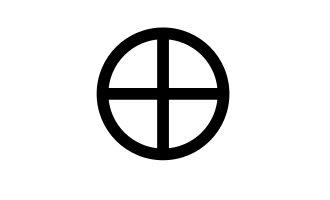 | [残差加法节点](../../elements/svg/lightglue-residual-add.svg) | LightGlue 原图部件 · Apache-2.0（LightGlue 来源仓库） | [D2L · Transformer 编码器与解码器](../../examples/architectures/d2l-transformer/README.md) · [D2L · Vision Transformer](../../examples/architectures/d2l-vit/README.md) · [DiT · 整体主干与三种条件注入模块](../../examples/architectures/dit-architecture/README.md) |
| 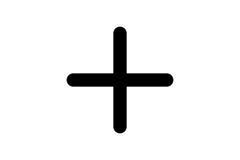 | [加号](../../elements/svg/tabler-plus.svg) | Tabler outline · MIT | — |
| 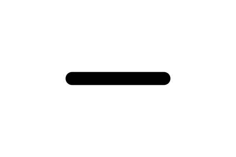 | [减号](../../elements/svg/tabler-minus.svg) | Tabler outline · MIT | — |
| 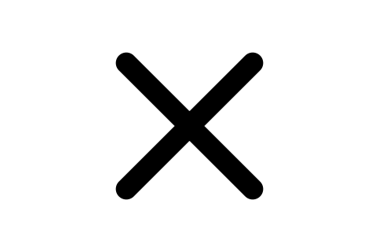 | [叉号](../../elements/svg/tabler-x.svg) | Tabler outline · MIT | — |
| 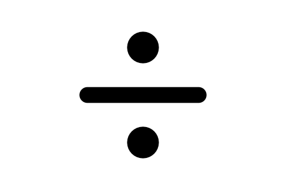 | [除号](../../elements/svg/tabler-divide.svg) | Tabler outline · MIT | — |
| 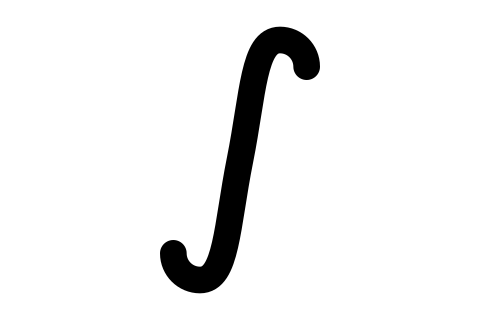 | [积分](../../elements/svg/tabler-math-integral.svg) | Tabler outline · MIT | — |
| 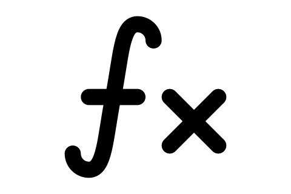 | [函数运算](../../elements/svg/tabler-math-function.svg) | Tabler outline · MIT | — |
| 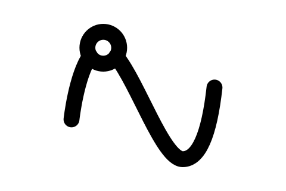 | [最大值](../../elements/svg/tabler-math-max.svg) | Tabler outline · MIT | — |
| 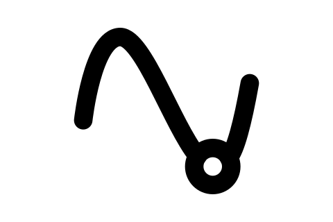 | [最小值](../../elements/svg/tabler-math-min.svg) | Tabler outline · MIT | — |
| 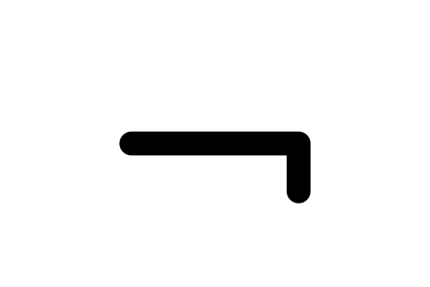 | [逻辑非](../../elements/svg/tabler-math-not.svg) | Tabler outline · MIT | — |
|  | [过滤](../../elements/svg/tabler-filter.svg) | Tabler outline · MIT | — |
| 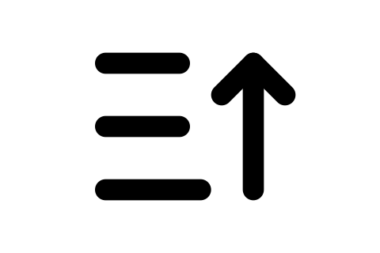 | [升序](../../elements/svg/tabler-sort-ascending.svg) | Tabler outline · MIT | — |
| 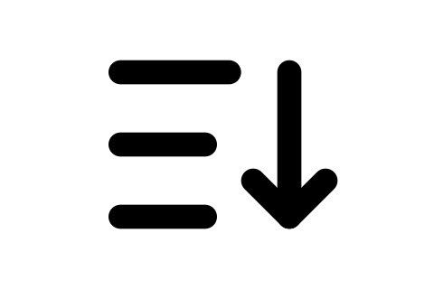 | [降序](../../elements/svg/tabler-sort-descending.svg) | Tabler outline · MIT | — |
| 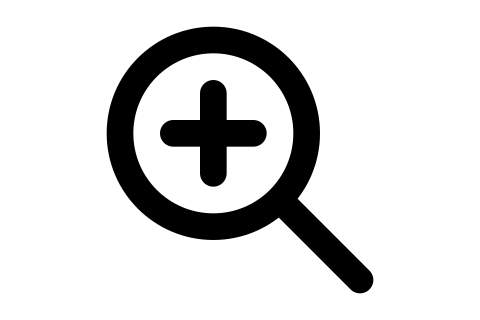 | [放大](../../elements/svg/tabler-zoom-in.svg) | Tabler outline · MIT | — |
| 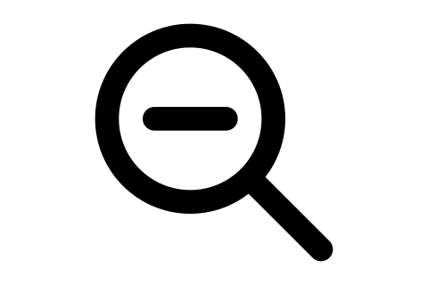 | [缩小](../../elements/svg/tabler-zoom-out.svg) | Tabler outline · MIT | — |
| 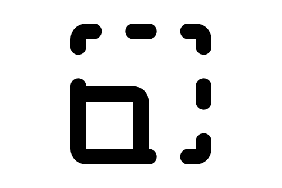 | [改变尺寸](../../elements/svg/tabler-resize.svg) | Tabler outline · MIT | — |
|  | [扩展](../../elements/svg/tabler-arrows-maximize.svg) | Tabler outline · MIT | — |
| 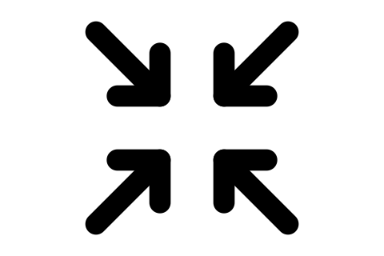 | [收缩](../../elements/svg/tabler-arrows-minimize.svg) | Tabler outline · MIT | — |
| 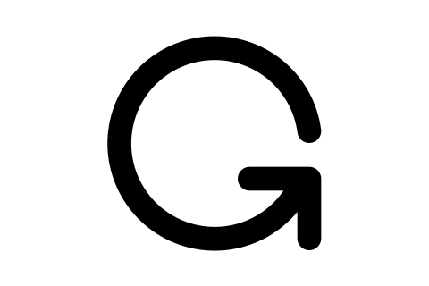 | [旋转](../../elements/svg/tabler-rotate.svg) | Tabler outline · MIT | — |
| 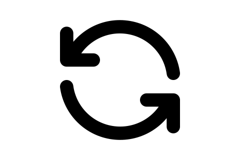 | [循环更新](../../elements/svg/tabler-refresh.svg) | Tabler outline · MIT | — |
| 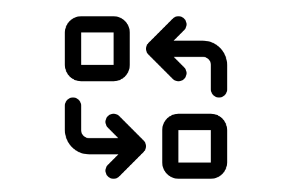 | [替换](../../elements/svg/tabler-replace.svg) | Tabler outline · MIT | — |
| 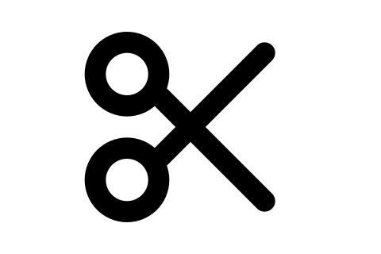 | [裁剪](../../elements/svg/tabler-scissors.svg) | Tabler outline · MIT | — |
| 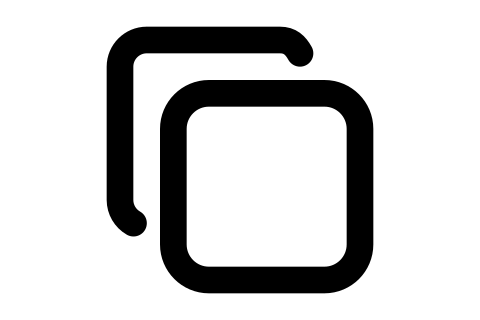 | [复制](../../elements/svg/tabler-copy.svg) | Tabler outline · MIT | — |
|  | [等号](../../elements/svg/tabler-equal.svg) | Tabler outline · MIT | — |
| 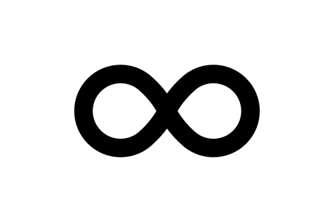 | [无穷](../../elements/svg/tabler-infinity.svg) | Tabler outline · MIT | — |
| 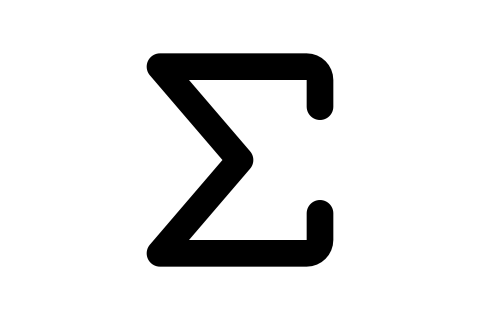 | [求和](../../elements/svg/tabler-sum.svg) | Tabler outline · MIT | — |
|  | [magnifying-glass](../../elements/svg/bioicons-magnifying-glass.svg) | Bioicons · CC0-1.0 | — |
| 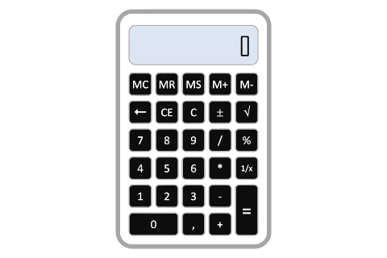 | [calculator](../../elements/svg/bioicons-calculator.svg) | Bioicons · CC0-1.0 | — |
| 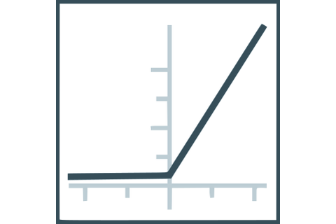 | [ReLU 曲线](../../elements/svg/bioicons-relu.svg) | Bioicons · CC0-1.0 | [D2L · AlexNet](../../examples/architectures/d2l-alexnet/README.md) · [D2L · DenseNet 密集连接块](../../examples/architectures/d2l-densenet-block/README.md) · [D2L · 全卷积网络](../../examples/architectures/d2l-fcn/README.md) |
| 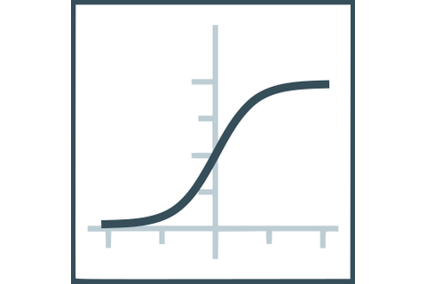 | [Sigmoid 曲线](../../elements/svg/bioicons-sigmoid.svg) | Bioicons · CC0-1.0 | [D2L · GRU 内部门控](../../examples/architectures/d2l-gru-3/README.md) · [D2L · LSTM 内部门控](../../examples/architectures/d2l-lstm-3/README.md) · [D2L · 多层感知机](../../examples/architectures/d2l-mlp/README.md) |
| 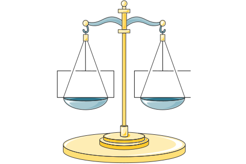 | [scale-balanced](../../elements/svg/bioicons-scale-balanced.svg) | Bioicons · CC-BY-3.0 | — |
| 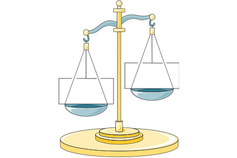 | [scale-imbalanced-left-1](../../elements/svg/bioicons-scale-imbalanced-left-1.svg) | Bioicons · CC-BY-3.0 | — |
|  | [拼接节点](../../elements/svg/task5-concat.svg) | Illustrator task5 source · 原作者未声明独立复用授权 | [VAR · 从逐 token 到逐尺度生成的范式对照](../../examples/teasers/var-paradigm/README.md) · [D2L · DenseNet 密集连接块](../../examples/architectures/d2l-densenet-block/README.md) · [D2L · Inception 并行分支](../../examples/architectures/d2l-inception/README.md) |
| 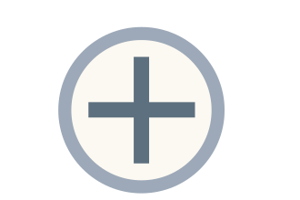 | [加法节点](../../elements/svg/task5-add.svg) | Illustrator task5 source · 原作者未声明独立复用授权 | [D2L · GRU 内部门控](../../examples/architectures/d2l-gru-3/README.md) · [D2L · LSTM 内部门控](../../examples/architectures/d2l-lstm-3/README.md) · [D2L · ResNet 残差块](../../examples/architectures/d2l-resnet-block/README.md) |
|  | [乘法节点](../../elements/svg/task5-multiply.svg) | Illustrator task5 source · 原作者未声明独立复用授权 | [D2L · GRU 内部门控](../../examples/architectures/d2l-gru-3/README.md) · [D2L · LSTM 内部门控](../../examples/architectures/d2l-lstm-3/README.md) · [DiT · 整体主干与三种条件注入模块](../../examples/architectures/dit-architecture/README.md) |
|  | [上采样节点](../../elements/svg/task5-upsample.svg) | Illustrator task5 source · 原作者未声明独立复用授权 | [VAR · 从逐 token 到逐尺度生成的范式对照](../../examples/teasers/var-paradigm/README.md) · [D2L · 全卷积网络](../../examples/architectures/d2l-fcn/README.md) · [LGM · 非对称 U-Net 与跨视角注意力](../../examples/architectures/lgm-architecture/README.md) |
