# 科学与图表

[返回 Element](../README.md) · [Teaser](../../examples/teasers/README.md) · [Architecture](../../examples/architectures/README.md) · [范例与元素对照表](../with-examples.md)

关联范例按表达功能互链；是否为原图拆件见对照表与元素来源记录。

| 预览 | 名称与 SVG | 来源与许可 | 关联范例（最多列三项） |
|---|---|---|---|
| 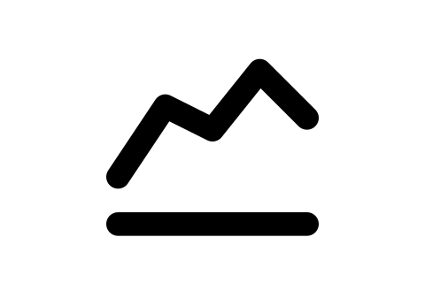 | [折线图符号](../../elements/svg/tabler-chart-line.svg) | Tabler outline · MIT | — |
|  | [柱状图符号](../../elements/svg/tabler-chart-bar.svg) | Tabler outline · MIT | — |
| 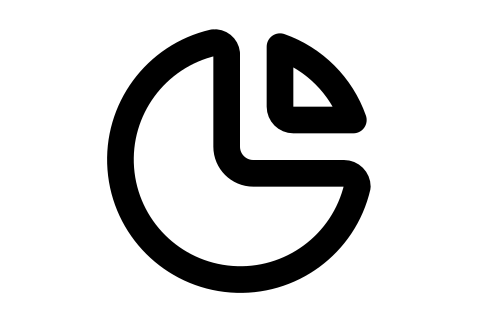 | [饼图符号](../../elements/svg/tabler-chart-pie.svg) | Tabler outline · MIT | — |
| 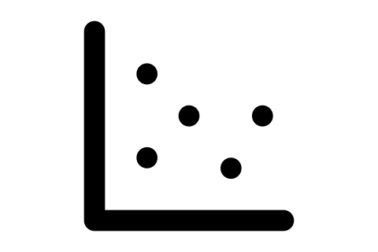 | [散点图符号](../../elements/svg/tabler-chart-scatter.svg) | Tabler outline · MIT | [LightGlue：速度与精度权衡](../../examples/teasers/lightglue-tradeoff/README.md) |
|  | [直方图符号](../../elements/svg/tabler-chart-histogram.svg) | Tabler outline · MIT | — |
| 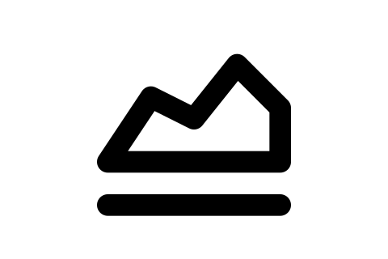 | [面积图符号](../../elements/svg/tabler-chart-area.svg) | Tabler outline · MIT | — |
| 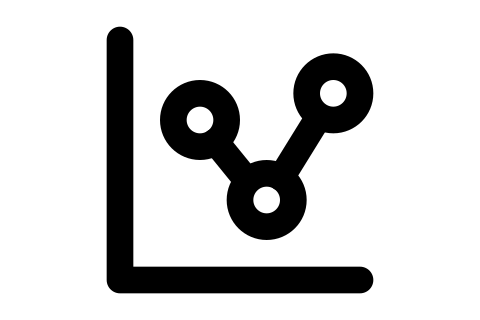 | [点线图符号](../../elements/svg/tabler-chart-dots.svg) | Tabler outline · MIT | — |
| 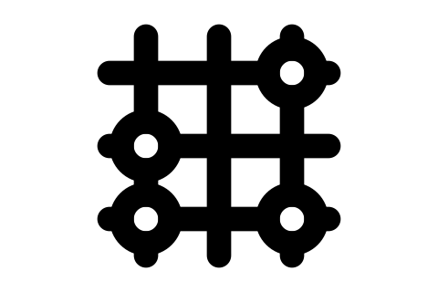 | [网格图符号](../../elements/svg/tabler-chart-grid-dots.svg) | Tabler outline · MIT | — |
| 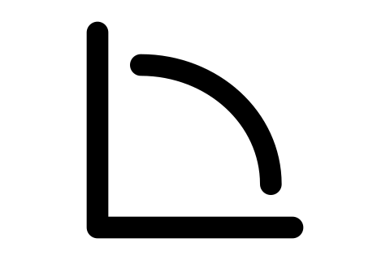 | [分布曲线符号](../../elements/svg/tabler-chart-ppf.svg) | Tabler outline · MIT | — |
| 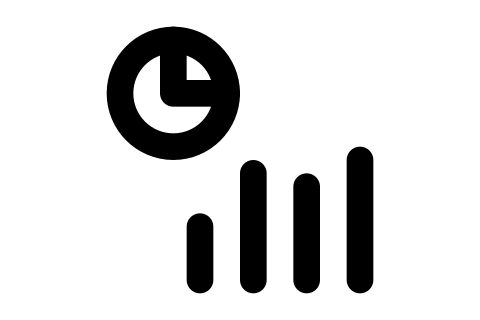 | [信息图符号](../../elements/svg/tabler-chart-infographic.svg) | Tabler outline · MIT | — |
| 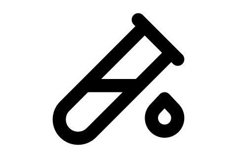 | [试管](../../elements/svg/tabler-test-pipe.svg) | Tabler outline · MIT | — |
| 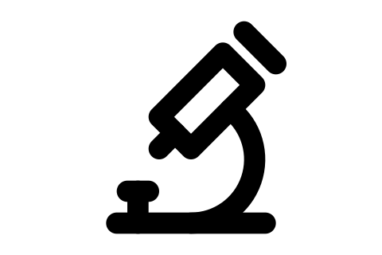 | [显微镜](../../elements/svg/tabler-microscope.svg) | Tabler outline · MIT | — |
| 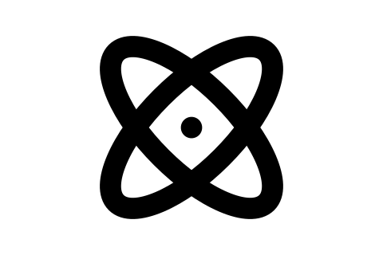 | [原子](../../elements/svg/tabler-atom.svg) | Tabler outline · MIT | — |
| 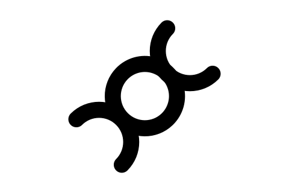 | [DNA](../../elements/svg/tabler-dna.svg) | Tabler outline · MIT | — |
| 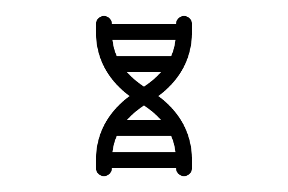 | [DNA 双螺旋](../../elements/svg/tabler-dna-2.svg) | Tabler outline · MIT | — |
| 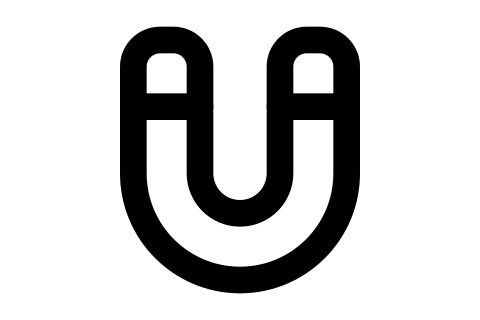 | [磁体](../../elements/svg/tabler-magnet.svg) | Tabler outline · MIT | — |
| 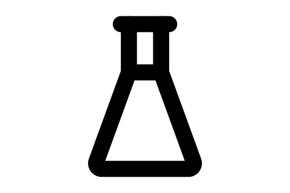 | [烧瓶](../../elements/svg/tabler-flask.svg) | Tabler outline · MIT | — |
| 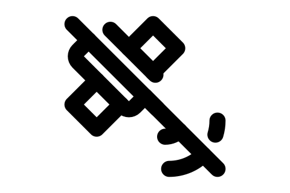 | [卫星关闭](../../elements/svg/tabler-satellite-off.svg) | Tabler outline · MIT | — |
| 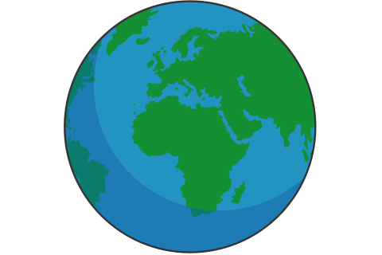 | [earth](../../elements/svg/bioicons-earth.svg) | Bioicons · CC-BY-3.0 | — |
