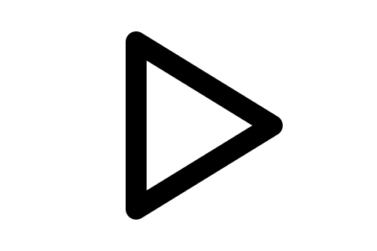
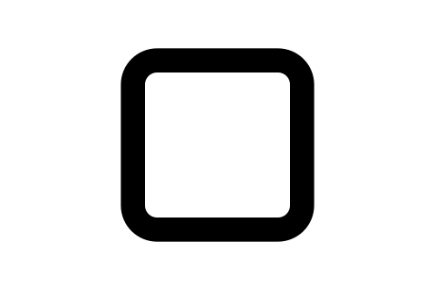
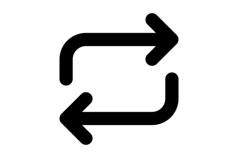
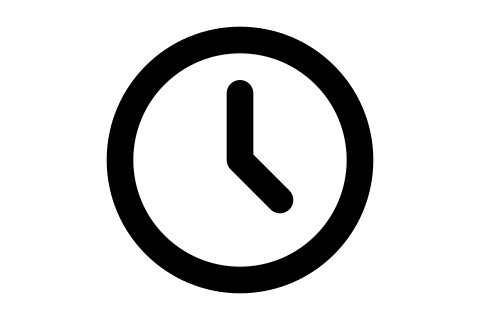
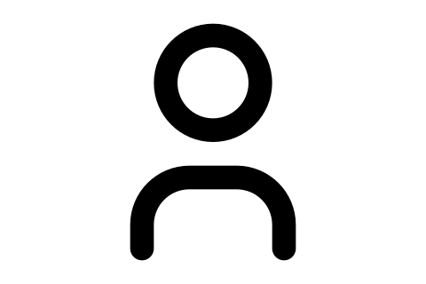
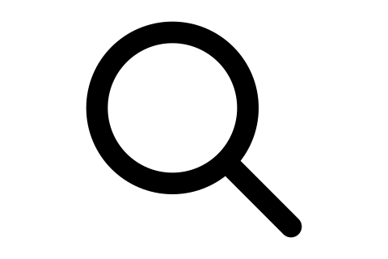
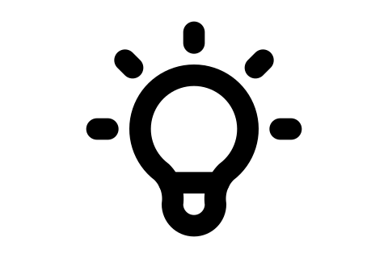

# 训练与标记

[返回元素库](../README.md)

| 预览 | 名称与 SVG | 来源与许可 |
|---|---|---|
|  | [锁定](../../elements/svg/tabler-lock.svg) | Tabler outline · MIT |
|  | [解锁](../../elements/svg/tabler-lock-open.svg) | Tabler outline · MIT |
|  | [冻结标记](../../elements/svg/tabler-snowflake.svg) | Tabler outline · MIT |
|  | [训练标记](../../elements/svg/tabler-flame.svg) | Tabler outline · MIT |
|  | [开始](../../elements/svg/tabler-player-play.svg) | Tabler outline · MIT |
|  | [暂停](../../elements/svg/tabler-player-pause.svg) | Tabler outline · MIT |
|  | [停止](../../elements/svg/tabler-player-stop.svg) | Tabler outline · MIT |
|  | [重复](../../elements/svg/tabler-repeat.svg) | Tabler outline · MIT |
|  | [参数设置](../../elements/svg/tabler-adjustments.svg) | Tabler outline · MIT |
|  | [目标](../../elements/svg/tabler-target.svg) | Tabler outline · MIT |
|  | [聚焦](../../elements/svg/tabler-focus.svg) | Tabler outline · MIT |
|  | [时钟](../../elements/svg/tabler-clock.svg) | Tabler outline · MIT |
|  | [沙漏](../../elements/svg/tabler-hourglass.svg) | Tabler outline · MIT |
|  | [保护](../../elements/svg/tabler-shield.svg) | Tabler outline · MIT |
|  | [验证](../../elements/svg/tabler-shield-check.svg) | Tabler outline · MIT |
|  | [警告](../../elements/svg/tabler-alert-triangle.svg) | Tabler outline · MIT |
|  | [问号](../../elements/svg/tabler-help.svg) | Tabler outline · MIT |
|  | [信息](../../elements/svg/tabler-info-circle.svg) | Tabler outline · MIT |
|  | [勾选](../../elements/svg/tabler-check.svg) | Tabler outline · MIT |
|  | [星标](../../elements/svg/tabler-star.svg) | Tabler outline · MIT |
|  | [旗帜](../../elements/svg/tabler-flag.svg) | Tabler outline · MIT |
|  | [图钉](../../elements/svg/tabler-pin.svg) | Tabler outline · MIT |
|  | [奖章](../../elements/svg/tabler-award.svg) | Tabler outline · MIT |
|  | [奖杯](../../elements/svg/tabler-trophy.svg) | Tabler outline · MIT |
|  | [天平](../../elements/svg/tabler-scale.svg) | Tabler outline · MIT |
|  | [多用户](../../elements/svg/tabler-users.svg) | Tabler outline · MIT |
|  | [用户](../../elements/svg/tabler-user.svg) | Tabler outline · MIT |
|  | [对话](../../elements/svg/tabler-message.svg) | Tabler outline · MIT |
|  | [聊天机器人](../../elements/svg/tabler-message-chatbot.svg) | Tabler outline · MIT |
|  | [可见](../../elements/svg/tabler-eye.svg) | Tabler outline · MIT |
|  | [隐藏](../../elements/svg/tabler-eye-off.svg) | Tabler outline · MIT |
|  | [搜索](../../elements/svg/tabler-search.svg) | Tabler outline · MIT |
|  | [想法](../../elements/svg/tabler-bulb.svg) | Tabler outline · MIT |
|  | [时钟](../../elements/svg/bioicons-clock.svg) | Bioicons · CC-BY-3.0 |
|  | [key](../../elements/svg/bioicons-key.svg) | Bioicons · CC-BY-3.0 |
|  | [padlock-closed](../../elements/svg/bioicons-padlock-closed.svg) | Bioicons · CC-BY-3.0 |
|  | [padlock-open](../../elements/svg/bioicons-padlock-open.svg) | Bioicons · CC-BY-3.0 |
|  | [sand-clock](../../elements/svg/bioicons-sand-clock.svg) | Bioicons · CC-BY-3.0 |
|  | [stopwatch-digital](../../elements/svg/bioicons-stopwatch-digital.svg) | Bioicons · CC-BY-3.0 |
|  | [stopwatch](../../elements/svg/bioicons-stopwatch.svg) | Bioicons · CC-BY-3.0 |
