# 训练与标记

[返回 Element](../README.md) · [Teaser](../../examples/teasers/README.md) · [Architecture](../../examples/architectures/README.md) · [范例与元素对照表](../with-examples.md)

关联范例按表达功能互链；是否为原图拆件见对照表与元素来源记录。

| 预览 | 名称与 SVG | 来源与许可 | 关联范例（最多列三项） |
|---|---|---|---|
|  | [锁定](../../elements/svg/tabler-lock.svg) | Tabler outline · MIT | [K-LoRA：主体风格组合与训练范式比较](../../examples/teasers/k-lora/README.md) · [RayDer：数据瓶颈与新训练范式](../../examples/teasers/rayder-concept/README.md) · [LGM · 从文本或图像到三维高斯和网格的流程](../../examples/architectures/lgm-pipeline/README.md) |
|  | [解锁](../../elements/svg/tabler-lock-open.svg) | Tabler outline · MIT | [K-LoRA：主体风格组合与训练范式比较](../../examples/teasers/k-lora/README.md) · [LGM · 从文本或图像到三维高斯和网格的流程](../../examples/architectures/lgm-pipeline/README.md) · [SAM / LoRA 总体流程与 Transformer 模块](../../examples/architectures/sam-lora/README.md) |
| 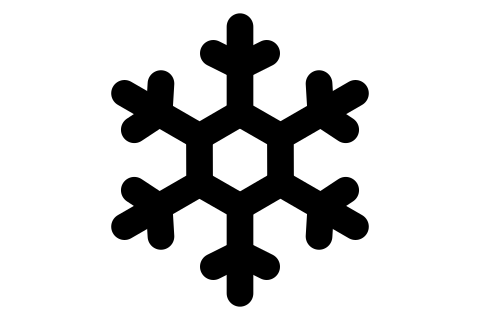 | [冻结标记](../../elements/svg/tabler-snowflake.svg) | Tabler outline · MIT | — |
| 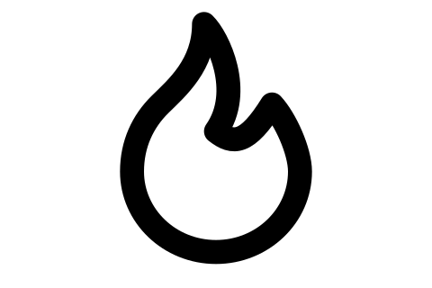 | [训练标记](../../elements/svg/tabler-flame.svg) | Tabler outline · MIT | — |
|  | [开始](../../elements/svg/tabler-player-play.svg) | Tabler outline · MIT | [Genie · 不同提示生成可交互世界](../../examples/teasers/genie-interaction/README.md) |
| 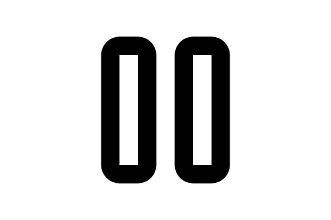 | [暂停](../../elements/svg/tabler-player-pause.svg) | Tabler outline · MIT | — |
|  | [停止](../../elements/svg/tabler-player-stop.svg) | Tabler outline · MIT | — |
|  | [重复](../../elements/svg/tabler-repeat.svg) | Tabler outline · MIT | — |
| 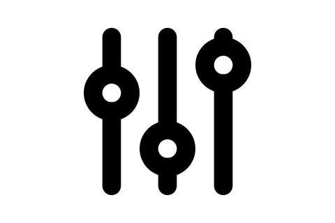 | [参数设置](../../elements/svg/tabler-adjustments.svg) | Tabler outline · MIT | [DECOLLAGE：局部风格控制与三维细化](../../examples/teasers/decollage/README.md) · [ShaDDR：粗形状与示例驱动的成果展示](../../examples/teasers/shaddr/README.md) |
| 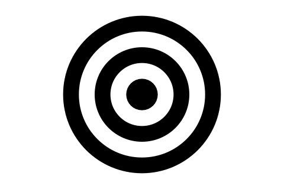 | [目标](../../elements/svg/tabler-target.svg) | Tabler outline · MIT | [LightGlue：速度与精度权衡](../../examples/teasers/lightglue-tradeoff/README.md) |
| 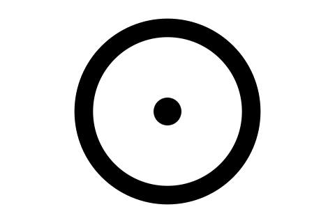 | [聚焦](../../elements/svg/tabler-focus.svg) | Tabler outline · MIT | — |
|  | [时钟](../../elements/svg/tabler-clock.svg) | Tabler outline · MIT | [DreamGaussian · 生成能力与优化进程同图展示](../../examples/teasers/dreamgaussian-progress/README.md) · [LightGlue：速度与精度权衡](../../examples/teasers/lightglue-tradeoff/README.md) · [DreamGaussian · 高斯生成、网格提取与纹理细化](../../examples/architectures/dreamgaussian-architecture/README.md) |
| 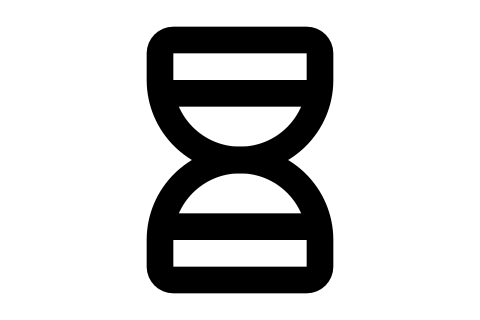 | [沙漏](../../elements/svg/tabler-hourglass.svg) | Tabler outline · MIT | — |
| 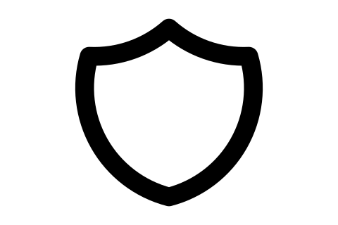 | [保护](../../elements/svg/tabler-shield.svg) | Tabler outline · MIT | — |
| 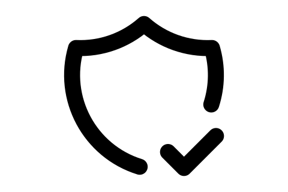 | [验证](../../elements/svg/tabler-shield-check.svg) | Tabler outline · MIT | — |
| 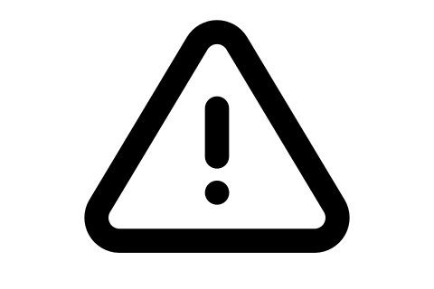 | [警告](../../elements/svg/tabler-alert-triangle.svg) | Tabler outline · MIT | — |
| 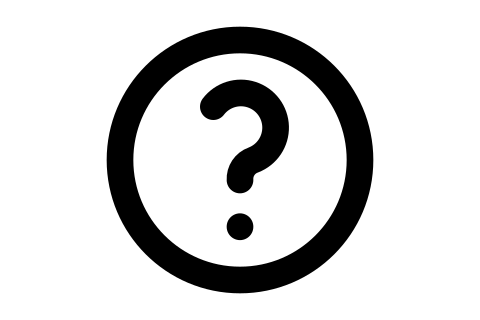 | [问号](../../elements/svg/tabler-help.svg) | Tabler outline · MIT | — |
| 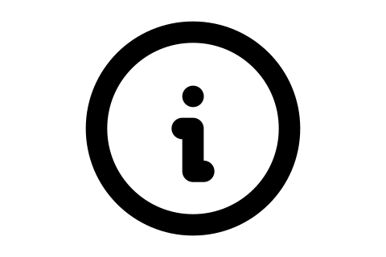 | [信息](../../elements/svg/tabler-info-circle.svg) | Tabler outline · MIT | — |
|  | [勾选](../../elements/svg/tabler-check.svg) | Tabler outline · MIT | — |
|  | [星标](../../elements/svg/tabler-star.svg) | Tabler outline · MIT | — |
| 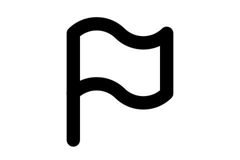 | [旗帜](../../elements/svg/tabler-flag.svg) | Tabler outline · MIT | — |
| 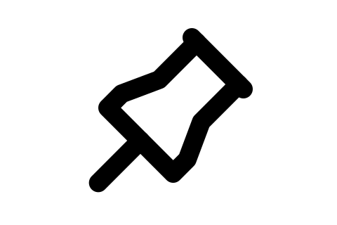 | [图钉](../../elements/svg/tabler-pin.svg) | Tabler outline · MIT | — |
|  | [奖章](../../elements/svg/tabler-award.svg) | Tabler outline · MIT | — |
| 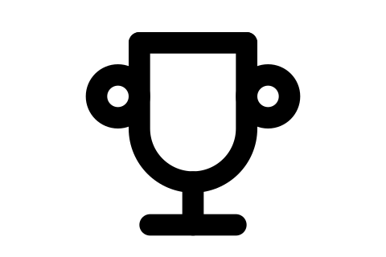 | [奖杯](../../elements/svg/tabler-trophy.svg) | Tabler outline · MIT | — |
|  | [天平](../../elements/svg/tabler-scale.svg) | Tabler outline · MIT | — |
| 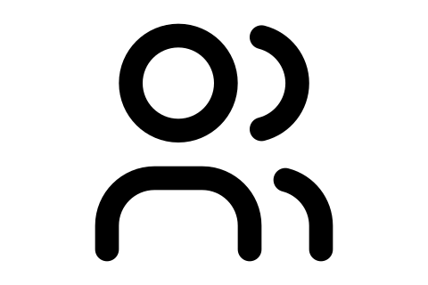 | [多用户](../../elements/svg/tabler-users.svg) | Tabler outline · MIT | [DPO · RLHF 与直接偏好优化的流程简化](../../examples/teasers/dpo-comparison/README.md) |
|  | [用户](../../elements/svg/tabler-user.svg) | Tabler outline · MIT | — |
|  | [对话](../../elements/svg/tabler-message.svg) | Tabler outline · MIT | [DPO · RLHF 与直接偏好优化的流程简化](../../examples/teasers/dpo-comparison/README.md) |
|  | [聊天机器人](../../elements/svg/tabler-message-chatbot.svg) | Tabler outline · MIT | — |
| 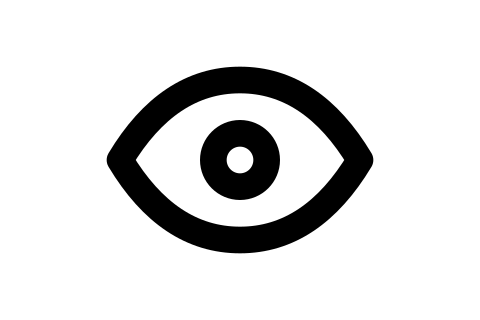 | [可见](../../elements/svg/tabler-eye.svg) | Tabler outline · MIT | — |
| 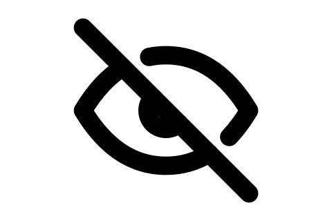 | [隐藏](../../elements/svg/tabler-eye-off.svg) | Tabler outline · MIT | — |
|  | [搜索](../../elements/svg/tabler-search.svg) | Tabler outline · MIT | — |
|  | [想法](../../elements/svg/tabler-bulb.svg) | Tabler outline · MIT | — |
| 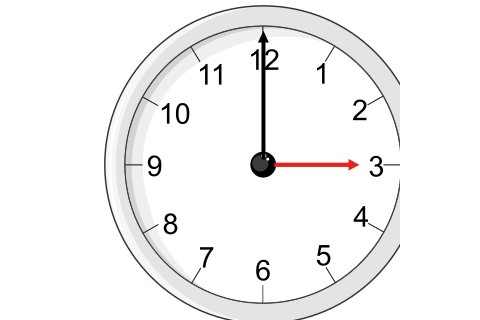 | [时钟](../../elements/svg/bioicons-clock.svg) | Bioicons · CC-BY-3.0 | — |
| 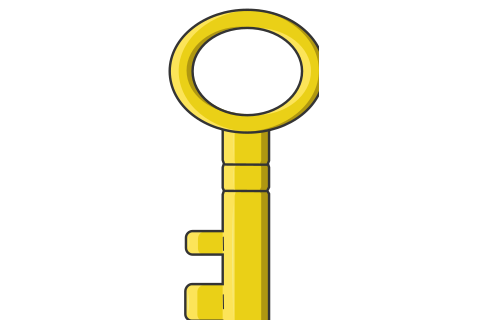 | [key](../../elements/svg/bioicons-key.svg) | Bioicons · CC-BY-3.0 | — |
|  | [padlock-closed](../../elements/svg/bioicons-padlock-closed.svg) | Bioicons · CC-BY-3.0 | — |
|  | [padlock-open](../../elements/svg/bioicons-padlock-open.svg) | Bioicons · CC-BY-3.0 | — |
| 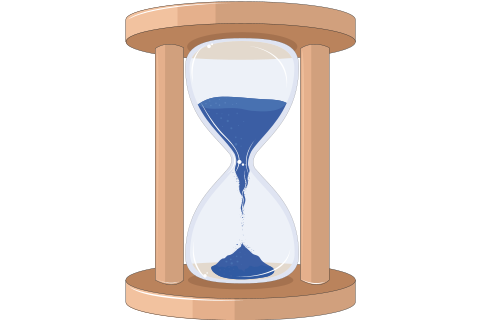 | [sand-clock](../../elements/svg/bioicons-sand-clock.svg) | Bioicons · CC-BY-3.0 | — |
| 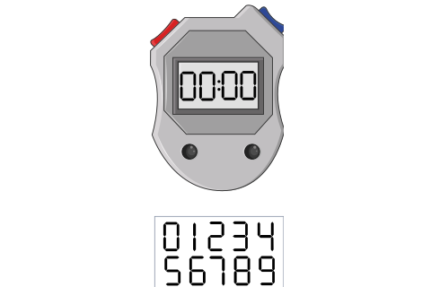 | [stopwatch-digital](../../elements/svg/bioicons-stopwatch-digital.svg) | Bioicons · CC-BY-3.0 | — |
| 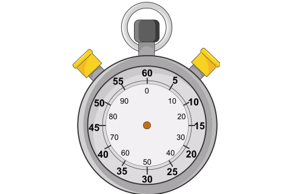 | [stopwatch](../../elements/svg/bioicons-stopwatch.svg) | Bioicons · CC-BY-3.0 | — |
