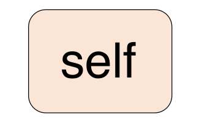
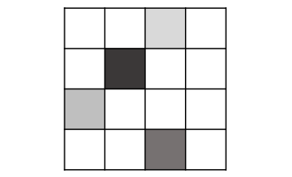
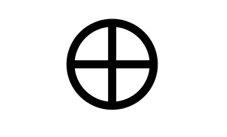
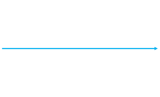

# LightGlue 原图部件

[返回元素库](../README.md)

| 预览 | 名称 | 原来源 |
|---|---|---|
|  | [Self attention 块](../../elements/svg/lightglue-self-attention.svg) | [出处](https://raw.githubusercontent.com/cvg/LightGlue/eb42fee2d71449efb0aa5c10549752b5d75384d8/assets/architecture.svg) · Apache-2.0（LightGlue 来源仓库） |
|  | [匹配相似度矩阵](../../elements/svg/lightglue-assignment-matrix.svg) | [出处](https://raw.githubusercontent.com/cvg/LightGlue/eb42fee2d71449efb0aa5c10549752b5d75384d8/assets/architecture.svg) · Apache-2.0（LightGlue 来源仓库） |
|  | [残差加法节点](../../elements/svg/lightglue-residual-add.svg) | [出处](https://raw.githubusercontent.com/cvg/LightGlue/eb42fee2d71449efb0aa5c10549752b5d75384d8/assets/architecture.svg) · Apache-2.0（LightGlue 来源仓库） |
|  | [蓝色流程箭头](../../elements/svg/lightglue-flow-arrow.svg) | [出处](https://raw.githubusercontent.com/cvg/LightGlue/eb42fee2d71449efb0aa5c10549752b5d75384d8/assets/architecture.svg) · Apache-2.0（LightGlue 来源仓库） |
