# Tabler outline

[返回元素库](../README.md)

| 预览 | 名称 | 原来源 |
|---|---|---|
|  | [数据库](../../elements/svg/tabler-database.svg) | [出处](https://raw.githubusercontent.com/tabler/tabler-icons/a4ce1404bc6d24d3c365afe7b258d6bf6f48d62d/icons/outline/database.svg) · MIT |
|  | [数据库导入](../../elements/svg/tabler-database-import.svg) | [出处](https://raw.githubusercontent.com/tabler/tabler-icons/a4ce1404bc6d24d3c365afe7b258d6bf6f48d62d/icons/outline/database-import.svg) · MIT |
|  | [数据库导出](../../elements/svg/tabler-database-export.svg) | [出处](https://raw.githubusercontent.com/tabler/tabler-icons/a4ce1404bc6d24d3c365afe7b258d6bf6f48d62d/icons/outline/database-export.svg) · MIT |
| 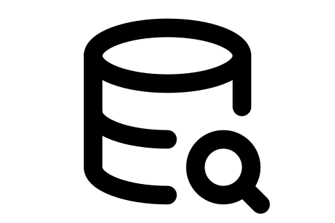 | [数据库检索](../../elements/svg/tabler-database-search.svg) | [出处](https://raw.githubusercontent.com/tabler/tabler-icons/a4ce1404bc6d24d3c365afe7b258d6bf6f48d62d/icons/outline/database-search.svg) · MIT |
|  | [表格](../../elements/svg/tabler-table.svg) | [出处](https://raw.githubusercontent.com/tabler/tabler-icons/a4ce1404bc6d24d3c365afe7b258d6bf6f48d62d/icons/outline/table.svg) · MIT |
|  | [文件](../../elements/svg/tabler-file.svg) | [出处](https://raw.githubusercontent.com/tabler/tabler-icons/a4ce1404bc6d24d3c365afe7b258d6bf6f48d62d/icons/outline/file.svg) · MIT |
|  | [文本文件](../../elements/svg/tabler-file-text.svg) | [出处](https://raw.githubusercontent.com/tabler/tabler-icons/a4ce1404bc6d24d3c365afe7b258d6bf6f48d62d/icons/outline/file-text.svg) · MIT |
|  | [代码文件](../../elements/svg/tabler-file-code.svg) | [出处](https://raw.githubusercontent.com/tabler/tabler-icons/a4ce1404bc6d24d3c365afe7b258d6bf6f48d62d/icons/outline/file-code.svg) · MIT |
|  | [PDF 文件](../../elements/svg/tabler-file-type-pdf.svg) | [出处](https://raw.githubusercontent.com/tabler/tabler-icons/a4ce1404bc6d24d3c365afe7b258d6bf6f48d62d/icons/outline/file-type-pdf.svg) · MIT |
|  | [CSV 文件](../../elements/svg/tabler-file-type-csv.svg) | [出处](https://raw.githubusercontent.com/tabler/tabler-icons/a4ce1404bc6d24d3c365afe7b258d6bf6f48d62d/icons/outline/file-type-csv.svg) · MIT |
|  | [多文件](../../elements/svg/tabler-files.svg) | [出处](https://raw.githubusercontent.com/tabler/tabler-icons/a4ce1404bc6d24d3c365afe7b258d6bf6f48d62d/icons/outline/files.svg) · MIT |
|  | [文件夹](../../elements/svg/tabler-folder.svg) | [出处](https://raw.githubusercontent.com/tabler/tabler-icons/a4ce1404bc6d24d3c365afe7b258d6bf6f48d62d/icons/outline/folder.svg) · MIT |
|  | [多文件夹](../../elements/svg/tabler-folders.svg) | [出处](https://raw.githubusercontent.com/tabler/tabler-icons/a4ce1404bc6d24d3c365afe7b258d6bf6f48d62d/icons/outline/folders.svg) · MIT |
|  | [图像](../../elements/svg/tabler-photo.svg) | [出处](https://raw.githubusercontent.com/tabler/tabler-icons/a4ce1404bc6d24d3c365afe7b258d6bf6f48d62d/icons/outline/photo.svg) · MIT |
|  | [图像扫描](../../elements/svg/tabler-photo-scan.svg) | [出处](https://raw.githubusercontent.com/tabler/tabler-icons/a4ce1404bc6d24d3c365afe7b258d6bf6f48d62d/icons/outline/photo-scan.svg) · MIT |
|  | [视频](../../elements/svg/tabler-video.svg) | [出处](https://raw.githubusercontent.com/tabler/tabler-icons/a4ce1404bc6d24d3c365afe7b258d6bf6f48d62d/icons/outline/video.svg) · MIT |
|  | [音频](../../elements/svg/tabler-music.svg) | [出处](https://raw.githubusercontent.com/tabler/tabler-icons/a4ce1404bc6d24d3c365afe7b258d6bf6f48d62d/icons/outline/music.svg) · MIT |
|  | [麦克风](../../elements/svg/tabler-microphone.svg) | [出处](https://raw.githubusercontent.com/tabler/tabler-icons/a4ce1404bc6d24d3c365afe7b258d6bf6f48d62d/icons/outline/microphone.svg) · MIT |
| 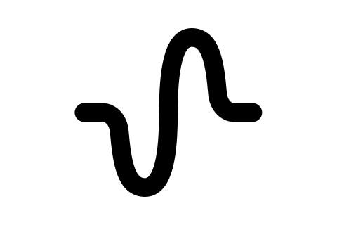 | [正弦信号](../../elements/svg/tabler-wave-sine.svg) | [出处](https://raw.githubusercontent.com/tabler/tabler-icons/a4ce1404bc6d24d3c365afe7b258d6bf6f48d62d/icons/outline/wave-sine.svg) · MIT |
| 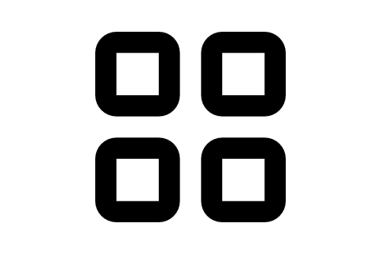 | [四格网格](../../elements/svg/tabler-layout-grid.svg) | [出处](https://raw.githubusercontent.com/tabler/tabler-icons/a4ce1404bc6d24d3c365afe7b258d6bf6f48d62d/icons/outline/layout-grid.svg) · MIT |
|  | [点阵](../../elements/svg/tabler-grid-dots.svg) | [出处](https://raw.githubusercontent.com/tabler/tabler-icons/a4ce1404bc6d24d3c365afe7b258d6bf6f48d62d/icons/outline/grid-dots.svg) · MIT |
|  | [二进制](../../elements/svg/tabler-binary.svg) | [出处](https://raw.githubusercontent.com/tabler/tabler-icons/a4ce1404bc6d24d3c365afe7b258d6bf6f48d62d/icons/outline/binary.svg) · MIT |
|  | [条形码](../../elements/svg/tabler-barcode.svg) | [出处](https://raw.githubusercontent.com/tabler/tabler-icons/a4ce1404bc6d24d3c365afe7b258d6bf6f48d62d/icons/outline/barcode.svg) · MIT |
|  | [二维码](../../elements/svg/tabler-qrcode.svg) | [出处](https://raw.githubusercontent.com/tabler/tabler-icons/a4ce1404bc6d24d3c365afe7b258d6bf6f48d62d/icons/outline/qrcode.svg) · MIT |
|  | [文本](../../elements/svg/tabler-text-size.svg) | [出处](https://raw.githubusercontent.com/tabler/tabler-icons/a4ce1404bc6d24d3c365afe7b258d6bf6f48d62d/icons/outline/text-size.svg) · MIT |
| 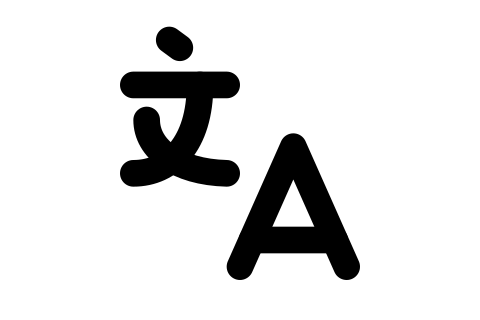 | [语言](../../elements/svg/tabler-language.svg) | [出处](https://raw.githubusercontent.com/tabler/tabler-icons/a4ce1404bc6d24d3c365afe7b258d6bf6f48d62d/icons/outline/language.svg) · MIT |
|  | [书籍](../../elements/svg/tabler-book.svg) | [出处](https://raw.githubusercontent.com/tabler/tabler-icons/a4ce1404bc6d24d3c365afe7b258d6bf6f48d62d/icons/outline/book.svg) · MIT |
|  | [多本书](../../elements/svg/tabler-books.svg) | [出处](https://raw.githubusercontent.com/tabler/tabler-icons/a4ce1404bc6d24d3c365afe7b258d6bf6f48d62d/icons/outline/books.svg) · MIT |
|  | [剪贴板](../../elements/svg/tabler-clipboard.svg) | [出处](https://raw.githubusercontent.com/tabler/tabler-icons/a4ce1404bc6d24d3c365afe7b258d6bf6f48d62d/icons/outline/clipboard.svg) · MIT |
| 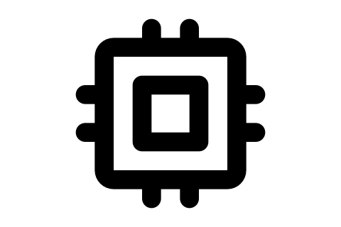 | [CPU](../../elements/svg/tabler-cpu.svg) | [出处](https://raw.githubusercontent.com/tabler/tabler-icons/a4ce1404bc6d24d3c365afe7b258d6bf6f48d62d/icons/outline/cpu.svg) · MIT |
|  | [台式电脑](../../elements/svg/tabler-device-desktop.svg) | [出处](https://raw.githubusercontent.com/tabler/tabler-icons/a4ce1404bc6d24d3c365afe7b258d6bf6f48d62d/icons/outline/device-desktop.svg) · MIT |
|  | [笔记本电脑](../../elements/svg/tabler-device-laptop.svg) | [出处](https://raw.githubusercontent.com/tabler/tabler-icons/a4ce1404bc6d24d3c365afe7b258d6bf6f48d62d/icons/outline/device-laptop.svg) · MIT |
|  | [手机](../../elements/svg/tabler-device-mobile.svg) | [出处](https://raw.githubusercontent.com/tabler/tabler-icons/a4ce1404bc6d24d3c365afe7b258d6bf6f48d62d/icons/outline/device-mobile.svg) · MIT |
| 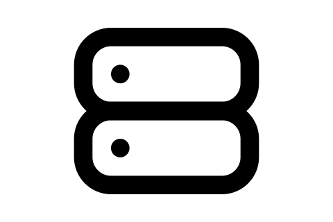 | [服务器](../../elements/svg/tabler-server.svg) | [出处](https://raw.githubusercontent.com/tabler/tabler-icons/a4ce1404bc6d24d3c365afe7b258d6bf6f48d62d/icons/outline/server.svg) · MIT |
|  | [云](../../elements/svg/tabler-cloud.svg) | [出处](https://raw.githubusercontent.com/tabler/tabler-icons/a4ce1404bc6d24d3c365afe7b258d6bf6f48d62d/icons/outline/cloud.svg) · MIT |
|  | [上传云端](../../elements/svg/tabler-cloud-upload.svg) | [出处](https://raw.githubusercontent.com/tabler/tabler-icons/a4ce1404bc6d24d3c365afe7b258d6bf6f48d62d/icons/outline/cloud-upload.svg) · MIT |
| 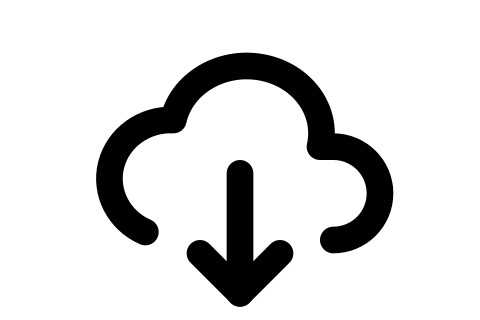 | [云端下载](../../elements/svg/tabler-cloud-download.svg) | [出处](https://raw.githubusercontent.com/tabler/tabler-icons/a4ce1404bc6d24d3c365afe7b258d6bf6f48d62d/icons/outline/cloud-download.svg) · MIT |
|  | [存储卡](../../elements/svg/tabler-device-sd-card.svg) | [出处](https://raw.githubusercontent.com/tabler/tabler-icons/a4ce1404bc6d24d3c365afe7b258d6bf6f48d62d/icons/outline/device-sd-card.svg) · MIT |
|  | [打印机](../../elements/svg/tabler-printer.svg) | [出处](https://raw.githubusercontent.com/tabler/tabler-icons/a4ce1404bc6d24d3c365afe7b258d6bf6f48d62d/icons/outline/printer.svg) · MIT |
|  | [路由器](../../elements/svg/tabler-router.svg) | [出处](https://raw.githubusercontent.com/tabler/tabler-icons/a4ce1404bc6d24d3c365afe7b258d6bf6f48d62d/icons/outline/router.svg) · MIT |
| 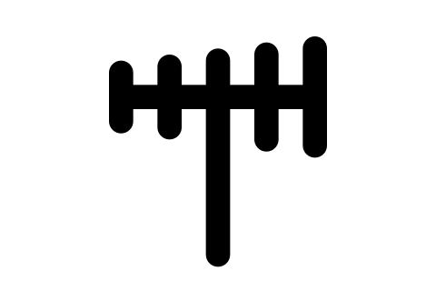 | [天线](../../elements/svg/tabler-antenna.svg) | [出处](https://raw.githubusercontent.com/tabler/tabler-icons/a4ce1404bc6d24d3c365afe7b258d6bf6f48d62d/icons/outline/antenna.svg) · MIT |
|  | [卫星](../../elements/svg/tabler-satellite.svg) | [出处](https://raw.githubusercontent.com/tabler/tabler-icons/a4ce1404bc6d24d3c365afe7b258d6bf6f48d62d/icons/outline/satellite.svg) · MIT |
|  | [无人机](../../elements/svg/tabler-drone.svg) | [出处](https://raw.githubusercontent.com/tabler/tabler-icons/a4ce1404bc6d24d3c365afe7b258d6bf6f48d62d/icons/outline/drone.svg) · MIT |
|  | [相机](../../elements/svg/tabler-camera.svg) | [出处](https://raw.githubusercontent.com/tabler/tabler-icons/a4ce1404bc6d24d3c365afe7b258d6bf6f48d62d/icons/outline/camera.svg) · MIT |
|  | [机器人](../../elements/svg/tabler-robot.svg) | [出处](https://raw.githubusercontent.com/tabler/tabler-icons/a4ce1404bc6d24d3c365afe7b258d6bf6f48d62d/icons/outline/robot.svg) · MIT |
|  | [汽车](../../elements/svg/tabler-car.svg) | [出处](https://raw.githubusercontent.com/tabler/tabler-icons/a4ce1404bc6d24d3c365afe7b258d6bf6f48d62d/icons/outline/car.svg) · MIT |
|  | [飞机](../../elements/svg/tabler-plane.svg) | [出处](https://raw.githubusercontent.com/tabler/tabler-icons/a4ce1404bc6d24d3c365afe7b258d6bf6f48d62d/icons/outline/plane.svg) · MIT |
|  | [地球](../../elements/svg/tabler-world.svg) | [出处](https://raw.githubusercontent.com/tabler/tabler-icons/a4ce1404bc6d24d3c365afe7b258d6bf6f48d62d/icons/outline/world.svg) · MIT |
| 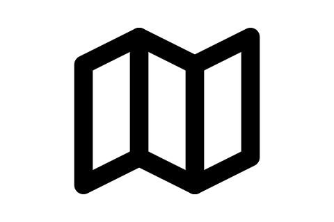 | [地图](../../elements/svg/tabler-map.svg) | [出处](https://raw.githubusercontent.com/tabler/tabler-icons/a4ce1404bc6d24d3c365afe7b258d6bf6f48d62d/icons/outline/map.svg) · MIT |
|  | [定位](../../elements/svg/tabler-map-pin.svg) | [出处](https://raw.githubusercontent.com/tabler/tabler-icons/a4ce1404bc6d24d3c365afe7b258d6bf6f48d62d/icons/outline/map-pin.svg) · MIT |
| 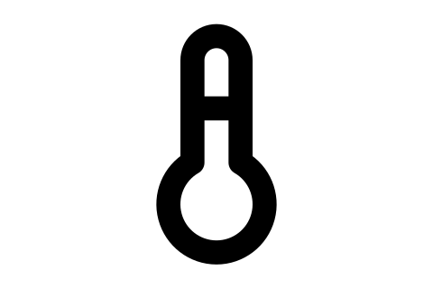 | [温度](../../elements/svg/tabler-temperature.svg) | [出处](https://raw.githubusercontent.com/tabler/tabler-icons/a4ce1404bc6d24d3c365afe7b258d6bf6f48d62d/icons/outline/temperature.svg) · MIT |
| 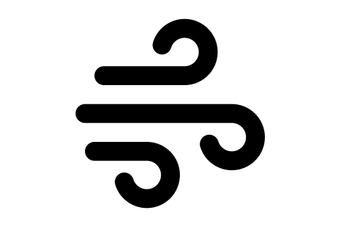 | [风场符号](../../elements/svg/tabler-wind.svg) | [出处](https://raw.githubusercontent.com/tabler/tabler-icons/a4ce1404bc6d24d3c365afe7b258d6bf6f48d62d/icons/outline/wind.svg) · MIT |
|  | [降雨](../../elements/svg/tabler-cloud-rain.svg) | [出处](https://raw.githubusercontent.com/tabler/tabler-icons/a4ce1404bc6d24d3c365afe7b258d6bf6f48d62d/icons/outline/cloud-rain.svg) · MIT |
|  | [闪电](../../elements/svg/tabler-bolt.svg) | [出处](https://raw.githubusercontent.com/tabler/tabler-icons/a4ce1404bc6d24d3c365afe7b258d6bf6f48d62d/icons/outline/bolt.svg) · MIT |
|  | [大脑](../../elements/svg/tabler-brain.svg) | [出处](https://raw.githubusercontent.com/tabler/tabler-icons/a4ce1404bc6d24d3c365afe7b258d6bf6f48d62d/icons/outline/brain.svg) · MIT |
| 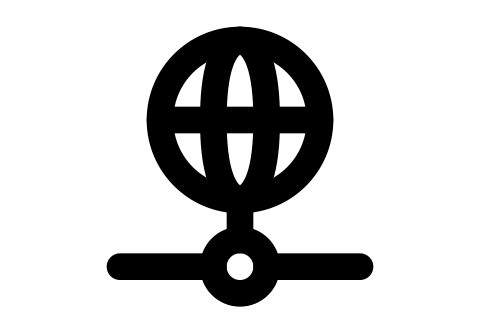 | [网络](../../elements/svg/tabler-network.svg) | [出处](https://raw.githubusercontent.com/tabler/tabler-icons/a4ce1404bc6d24d3c365afe7b258d6bf6f48d62d/icons/outline/network.svg) · MIT |
| 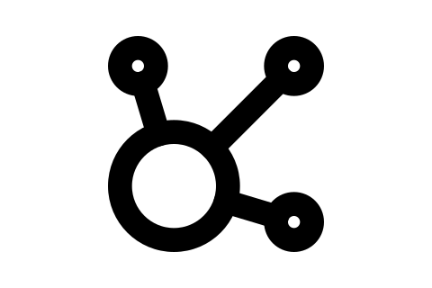 | [节点分支](../../elements/svg/tabler-affiliate.svg) | [出处](https://raw.githubusercontent.com/tabler/tabler-icons/a4ce1404bc6d24d3c365afe7b258d6bf6f48d62d/icons/outline/affiliate.svg) · MIT |
|  | [层级结构](../../elements/svg/tabler-sitemap.svg) | [出处](https://raw.githubusercontent.com/tabler/tabler-icons/a4ce1404bc6d24d3c365afe7b258d6bf6f48d62d/icons/outline/sitemap.svg) · MIT |
|  | [组件](../../elements/svg/tabler-components.svg) | [出处](https://raw.githubusercontent.com/tabler/tabler-icons/a4ce1404bc6d24d3c365afe7b258d6bf6f48d62d/icons/outline/components.svg) · MIT |
|  | [拼图](../../elements/svg/tabler-puzzle.svg) | [出处](https://raw.githubusercontent.com/tabler/tabler-icons/a4ce1404bc6d24d3c365afe7b258d6bf6f48d62d/icons/outline/puzzle.svg) · MIT |
| 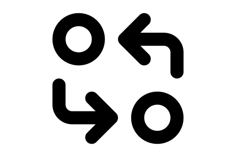 | [变换](../../elements/svg/tabler-transform.svg) | [出处](https://raw.githubusercontent.com/tabler/tabler-icons/a4ce1404bc6d24d3c365afe7b258d6bf6f48d62d/icons/outline/transform.svg) · MIT |
| 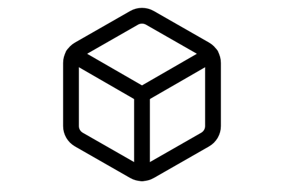 | [立方体](../../elements/svg/tabler-cube.svg) | [出处](https://raw.githubusercontent.com/tabler/tabler-icons/a4ce1404bc6d24d3c365afe7b258d6bf6f48d62d/icons/outline/cube.svg) · MIT |
| 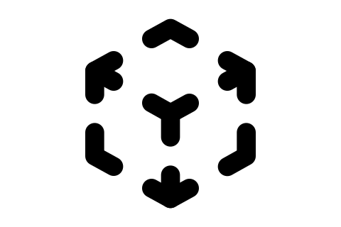 | [三维坐标物体](../../elements/svg/tabler-cube-3d-sphere.svg) | [出处](https://raw.githubusercontent.com/tabler/tabler-icons/a4ce1404bc6d24d3c365afe7b258d6bf6f48d62d/icons/outline/cube-3d-sphere.svg) · MIT |
| 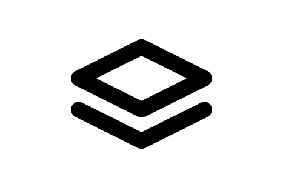 | [堆叠](../../elements/svg/tabler-stack.svg) | [出处](https://raw.githubusercontent.com/tabler/tabler-icons/a4ce1404bc6d24d3c365afe7b258d6bf6f48d62d/icons/outline/stack.svg) · MIT |
|  | [多层方框](../../elements/svg/tabler-box-multiple.svg) | [出处](https://raw.githubusercontent.com/tabler/tabler-icons/a4ce1404bc6d24d3c365afe7b258d6bf6f48d62d/icons/outline/box-multiple.svg) · MIT |
|  | [函数](../../elements/svg/tabler-function.svg) | [出处](https://raw.githubusercontent.com/tabler/tabler-icons/a4ce1404bc6d24d3c365afe7b258d6bf6f48d62d/icons/outline/function.svg) · MIT |
|  | [函数图形](../../elements/svg/tabler-graph.svg) | [出处](https://raw.githubusercontent.com/tabler/tabler-icons/a4ce1404bc6d24d3c365afe7b258d6bf6f48d62d/icons/outline/graph.svg) · MIT |
| 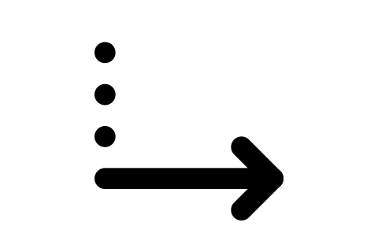 | [横坐标轴](../../elements/svg/tabler-axis-x.svg) | [出处](https://raw.githubusercontent.com/tabler/tabler-icons/a4ce1404bc6d24d3c365afe7b258d6bf6f48d62d/icons/outline/axis-x.svg) · MIT |
|  | [纵坐标轴](../../elements/svg/tabler-axis-y.svg) | [出处](https://raw.githubusercontent.com/tabler/tabler-icons/a4ce1404bc6d24d3c365afe7b258d6bf6f48d62d/icons/outline/axis-y.svg) · MIT |
|  | [右箭头](../../elements/svg/tabler-arrow-right.svg) | [出处](https://raw.githubusercontent.com/tabler/tabler-icons/a4ce1404bc6d24d3c365afe7b258d6bf6f48d62d/icons/outline/arrow-right.svg) · MIT |
| 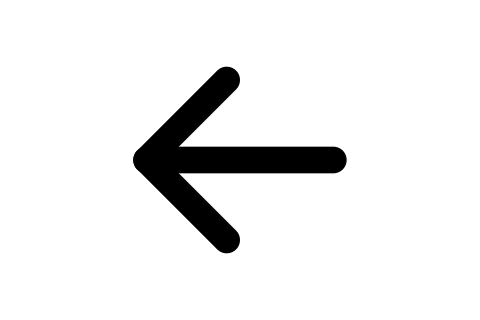 | [左箭头](../../elements/svg/tabler-arrow-left.svg) | [出处](https://raw.githubusercontent.com/tabler/tabler-icons/a4ce1404bc6d24d3c365afe7b258d6bf6f48d62d/icons/outline/arrow-left.svg) · MIT |
| 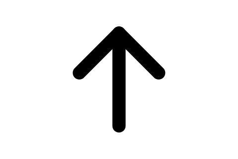 | [上箭头](../../elements/svg/tabler-arrow-up.svg) | [出处](https://raw.githubusercontent.com/tabler/tabler-icons/a4ce1404bc6d24d3c365afe7b258d6bf6f48d62d/icons/outline/arrow-up.svg) · MIT |
|  | [下箭头](../../elements/svg/tabler-arrow-down.svg) | [出处](https://raw.githubusercontent.com/tabler/tabler-icons/a4ce1404bc6d24d3c365afe7b258d6bf6f48d62d/icons/outline/arrow-down.svg) · MIT |
| 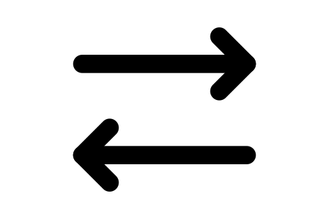 | [水平双向箭头](../../elements/svg/tabler-arrows-right-left.svg) | [出处](https://raw.githubusercontent.com/tabler/tabler-icons/a4ce1404bc6d24d3c365afe7b258d6bf6f48d62d/icons/outline/arrows-right-left.svg) · MIT |
|  | [垂直双向箭头](../../elements/svg/tabler-arrows-up-down.svg) | [出处](https://raw.githubusercontent.com/tabler/tabler-icons/a4ce1404bc6d24d3c365afe7b258d6bf6f48d62d/icons/outline/arrows-up-down.svg) · MIT |
| 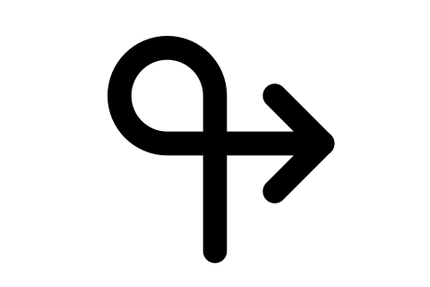 | [回环箭头](../../elements/svg/tabler-arrow-loop-right.svg) | [出处](https://raw.githubusercontent.com/tabler/tabler-icons/a4ce1404bc6d24d3c365afe7b258d6bf6f48d62d/icons/outline/arrow-loop-right.svg) · MIT |
| 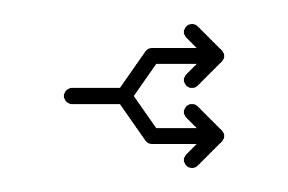 | [分流箭头](../../elements/svg/tabler-arrows-split.svg) | [出处](https://raw.githubusercontent.com/tabler/tabler-icons/a4ce1404bc6d24d3c365afe7b258d6bf6f48d62d/icons/outline/arrows-split.svg) · MIT |
| 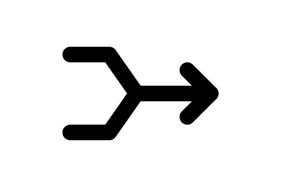 | [汇合箭头](../../elements/svg/tabler-arrows-join.svg) | [出处](https://raw.githubusercontent.com/tabler/tabler-icons/a4ce1404bc6d24d3c365afe7b258d6bf6f48d62d/icons/outline/arrows-join.svg) · MIT |
| 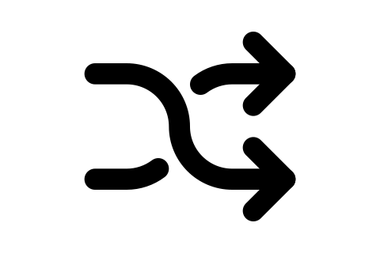 | [交叉连接](../../elements/svg/tabler-arrows-shuffle.svg) | [出处](https://raw.githubusercontent.com/tabler/tabler-icons/a4ce1404bc6d24d3c365afe7b258d6bf6f48d62d/icons/outline/arrows-shuffle.svg) · MIT |
|  | [折线箭头](../../elements/svg/tabler-arrow-elbow-right.svg) | [出处](https://raw.githubusercontent.com/tabler/tabler-icons/a4ce1404bc6d24d3c365afe7b258d6bf6f48d62d/icons/outline/arrow-elbow-right.svg) · MIT |
|  | [曲线箭头](../../elements/svg/tabler-arrow-curve-right.svg) | [出处](https://raw.githubusercontent.com/tabler/tabler-icons/a4ce1404bc6d24d3c365afe7b258d6bf6f48d62d/icons/outline/arrow-curve-right.svg) · MIT |
| 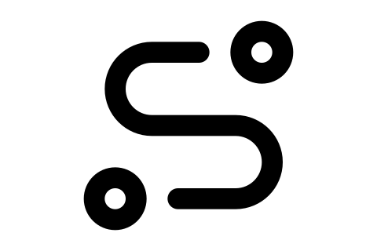 | [路径](../../elements/svg/tabler-route.svg) | [出处](https://raw.githubusercontent.com/tabler/tabler-icons/a4ce1404bc6d24d3c365afe7b258d6bf6f48d62d/icons/outline/route.svg) · MIT |
| 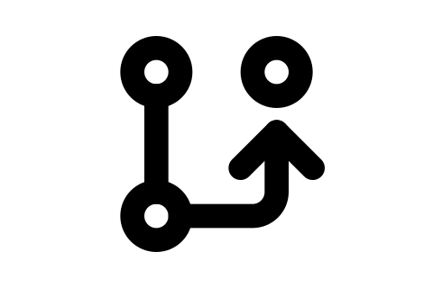 | [分支](../../elements/svg/tabler-git-branch.svg) | [出处](https://raw.githubusercontent.com/tabler/tabler-icons/a4ce1404bc6d24d3c365afe7b258d6bf6f48d62d/icons/outline/git-branch.svg) · MIT |
| 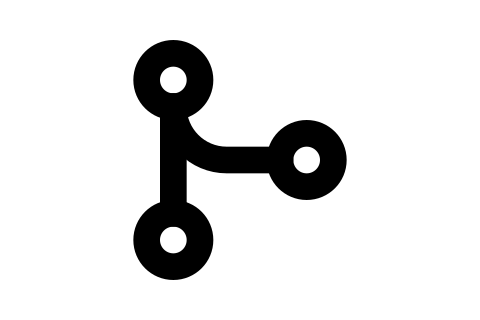 | [合并](../../elements/svg/tabler-git-merge.svg) | [出处](https://raw.githubusercontent.com/tabler/tabler-icons/a4ce1404bc6d24d3c365afe7b258d6bf6f48d62d/icons/outline/git-merge.svg) · MIT |
| 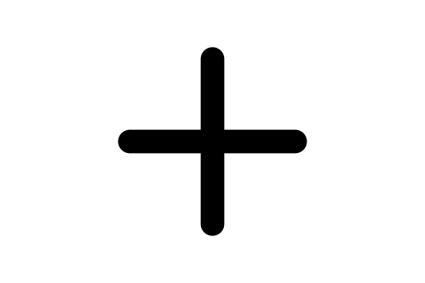 | [加号](../../elements/svg/tabler-plus.svg) | [出处](https://raw.githubusercontent.com/tabler/tabler-icons/a4ce1404bc6d24d3c365afe7b258d6bf6f48d62d/icons/outline/plus.svg) · MIT |
| 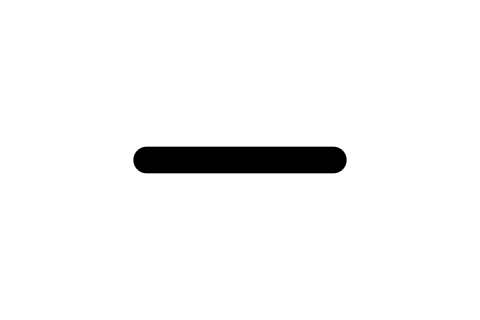 | [减号](../../elements/svg/tabler-minus.svg) | [出处](https://raw.githubusercontent.com/tabler/tabler-icons/a4ce1404bc6d24d3c365afe7b258d6bf6f48d62d/icons/outline/minus.svg) · MIT |
|  | [叉号](../../elements/svg/tabler-x.svg) | [出处](https://raw.githubusercontent.com/tabler/tabler-icons/a4ce1404bc6d24d3c365afe7b258d6bf6f48d62d/icons/outline/x.svg) · MIT |
| 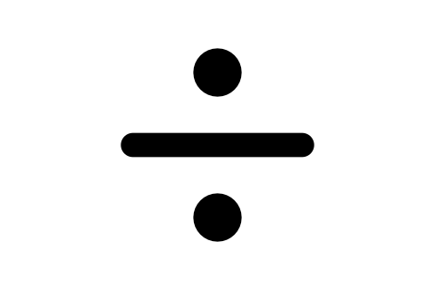 | [除号](../../elements/svg/tabler-divide.svg) | [出处](https://raw.githubusercontent.com/tabler/tabler-icons/a4ce1404bc6d24d3c365afe7b258d6bf6f48d62d/icons/outline/divide.svg) · MIT |
| 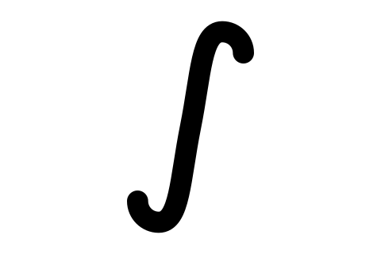 | [积分](../../elements/svg/tabler-math-integral.svg) | [出处](https://raw.githubusercontent.com/tabler/tabler-icons/a4ce1404bc6d24d3c365afe7b258d6bf6f48d62d/icons/outline/math-integral.svg) · MIT |
| 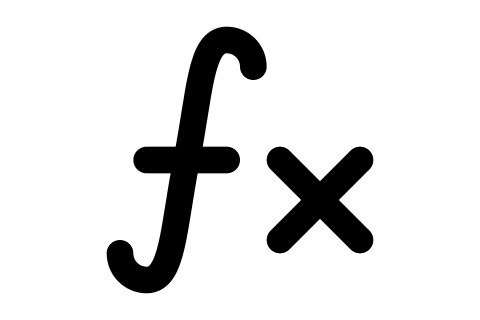 | [函数运算](../../elements/svg/tabler-math-function.svg) | [出处](https://raw.githubusercontent.com/tabler/tabler-icons/a4ce1404bc6d24d3c365afe7b258d6bf6f48d62d/icons/outline/math-function.svg) · MIT |
| 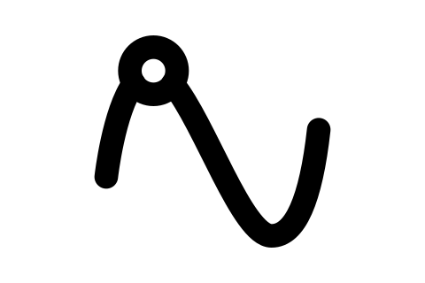 | [最大值](../../elements/svg/tabler-math-max.svg) | [出处](https://raw.githubusercontent.com/tabler/tabler-icons/a4ce1404bc6d24d3c365afe7b258d6bf6f48d62d/icons/outline/math-max.svg) · MIT |
| 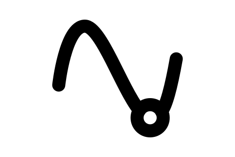 | [最小值](../../elements/svg/tabler-math-min.svg) | [出处](https://raw.githubusercontent.com/tabler/tabler-icons/a4ce1404bc6d24d3c365afe7b258d6bf6f48d62d/icons/outline/math-min.svg) · MIT |
| 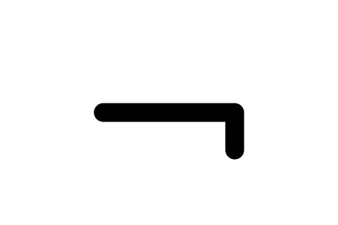 | [逻辑非](../../elements/svg/tabler-math-not.svg) | [出处](https://raw.githubusercontent.com/tabler/tabler-icons/a4ce1404bc6d24d3c365afe7b258d6bf6f48d62d/icons/outline/math-not.svg) · MIT |
|  | [过滤](../../elements/svg/tabler-filter.svg) | [出处](https://raw.githubusercontent.com/tabler/tabler-icons/a4ce1404bc6d24d3c365afe7b258d6bf6f48d62d/icons/outline/filter.svg) · MIT |
| 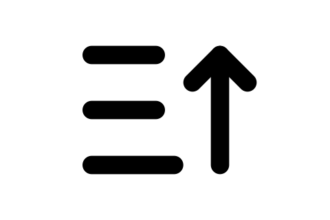 | [升序](../../elements/svg/tabler-sort-ascending.svg) | [出处](https://raw.githubusercontent.com/tabler/tabler-icons/a4ce1404bc6d24d3c365afe7b258d6bf6f48d62d/icons/outline/sort-ascending.svg) · MIT |
|  | [降序](../../elements/svg/tabler-sort-descending.svg) | [出处](https://raw.githubusercontent.com/tabler/tabler-icons/a4ce1404bc6d24d3c365afe7b258d6bf6f48d62d/icons/outline/sort-descending.svg) · MIT |
|  | [放大](../../elements/svg/tabler-zoom-in.svg) | [出处](https://raw.githubusercontent.com/tabler/tabler-icons/a4ce1404bc6d24d3c365afe7b258d6bf6f48d62d/icons/outline/zoom-in.svg) · MIT |
|  | [缩小](../../elements/svg/tabler-zoom-out.svg) | [出处](https://raw.githubusercontent.com/tabler/tabler-icons/a4ce1404bc6d24d3c365afe7b258d6bf6f48d62d/icons/outline/zoom-out.svg) · MIT |
| 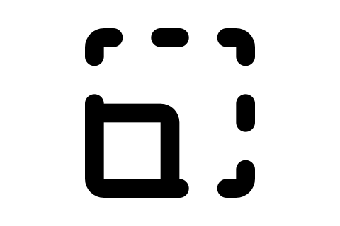 | [改变尺寸](../../elements/svg/tabler-resize.svg) | [出处](https://raw.githubusercontent.com/tabler/tabler-icons/a4ce1404bc6d24d3c365afe7b258d6bf6f48d62d/icons/outline/resize.svg) · MIT |
|  | [扩展](../../elements/svg/tabler-arrows-maximize.svg) | [出处](https://raw.githubusercontent.com/tabler/tabler-icons/a4ce1404bc6d24d3c365afe7b258d6bf6f48d62d/icons/outline/arrows-maximize.svg) · MIT |
|  | [收缩](../../elements/svg/tabler-arrows-minimize.svg) | [出处](https://raw.githubusercontent.com/tabler/tabler-icons/a4ce1404bc6d24d3c365afe7b258d6bf6f48d62d/icons/outline/arrows-minimize.svg) · MIT |
| 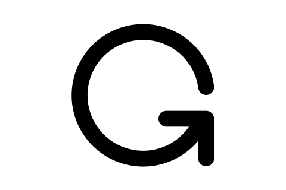 | [旋转](../../elements/svg/tabler-rotate.svg) | [出处](https://raw.githubusercontent.com/tabler/tabler-icons/a4ce1404bc6d24d3c365afe7b258d6bf6f48d62d/icons/outline/rotate.svg) · MIT |
| 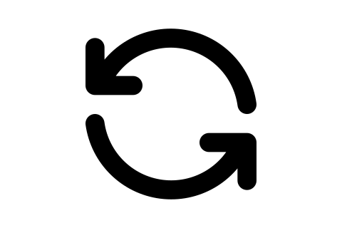 | [循环更新](../../elements/svg/tabler-refresh.svg) | [出处](https://raw.githubusercontent.com/tabler/tabler-icons/a4ce1404bc6d24d3c365afe7b258d6bf6f48d62d/icons/outline/refresh.svg) · MIT |
| 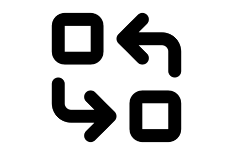 | [替换](../../elements/svg/tabler-replace.svg) | [出处](https://raw.githubusercontent.com/tabler/tabler-icons/a4ce1404bc6d24d3c365afe7b258d6bf6f48d62d/icons/outline/replace.svg) · MIT |
| 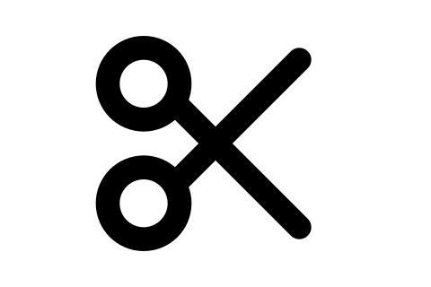 | [裁剪](../../elements/svg/tabler-scissors.svg) | [出处](https://raw.githubusercontent.com/tabler/tabler-icons/a4ce1404bc6d24d3c365afe7b258d6bf6f48d62d/icons/outline/scissors.svg) · MIT |
|  | [复制](../../elements/svg/tabler-copy.svg) | [出处](https://raw.githubusercontent.com/tabler/tabler-icons/a4ce1404bc6d24d3c365afe7b258d6bf6f48d62d/icons/outline/copy.svg) · MIT |
|  | [等号](../../elements/svg/tabler-equal.svg) | [出处](https://raw.githubusercontent.com/tabler/tabler-icons/a4ce1404bc6d24d3c365afe7b258d6bf6f48d62d/icons/outline/equal.svg) · MIT |
|  | [无穷](../../elements/svg/tabler-infinity.svg) | [出处](https://raw.githubusercontent.com/tabler/tabler-icons/a4ce1404bc6d24d3c365afe7b258d6bf6f48d62d/icons/outline/infinity.svg) · MIT |
| 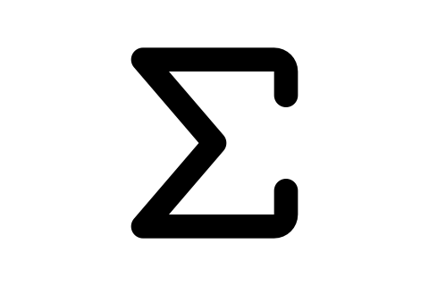 | [求和](../../elements/svg/tabler-sum.svg) | [出处](https://raw.githubusercontent.com/tabler/tabler-icons/a4ce1404bc6d24d3c365afe7b258d6bf6f48d62d/icons/outline/sum.svg) · MIT |
|  | [锁定](../../elements/svg/tabler-lock.svg) | [出处](https://raw.githubusercontent.com/tabler/tabler-icons/a4ce1404bc6d24d3c365afe7b258d6bf6f48d62d/icons/outline/lock.svg) · MIT |
|  | [解锁](../../elements/svg/tabler-lock-open.svg) | [出处](https://raw.githubusercontent.com/tabler/tabler-icons/a4ce1404bc6d24d3c365afe7b258d6bf6f48d62d/icons/outline/lock-open.svg) · MIT |
| 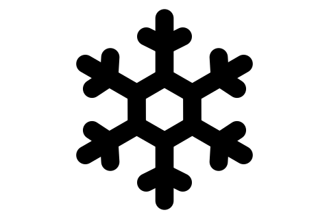 | [冻结标记](../../elements/svg/tabler-snowflake.svg) | [出处](https://raw.githubusercontent.com/tabler/tabler-icons/a4ce1404bc6d24d3c365afe7b258d6bf6f48d62d/icons/outline/snowflake.svg) · MIT |
|  | [训练标记](../../elements/svg/tabler-flame.svg) | [出处](https://raw.githubusercontent.com/tabler/tabler-icons/a4ce1404bc6d24d3c365afe7b258d6bf6f48d62d/icons/outline/flame.svg) · MIT |
|  | [开始](../../elements/svg/tabler-player-play.svg) | [出处](https://raw.githubusercontent.com/tabler/tabler-icons/a4ce1404bc6d24d3c365afe7b258d6bf6f48d62d/icons/outline/player-play.svg) · MIT |
|  | [暂停](../../elements/svg/tabler-player-pause.svg) | [出处](https://raw.githubusercontent.com/tabler/tabler-icons/a4ce1404bc6d24d3c365afe7b258d6bf6f48d62d/icons/outline/player-pause.svg) · MIT |
| 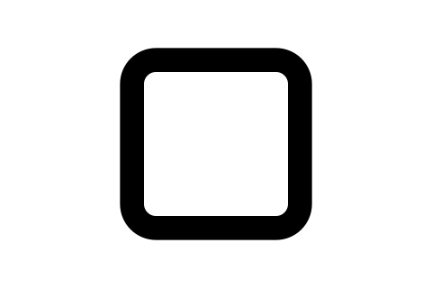 | [停止](../../elements/svg/tabler-player-stop.svg) | [出处](https://raw.githubusercontent.com/tabler/tabler-icons/a4ce1404bc6d24d3c365afe7b258d6bf6f48d62d/icons/outline/player-stop.svg) · MIT |
|  | [重复](../../elements/svg/tabler-repeat.svg) | [出处](https://raw.githubusercontent.com/tabler/tabler-icons/a4ce1404bc6d24d3c365afe7b258d6bf6f48d62d/icons/outline/repeat.svg) · MIT |
| 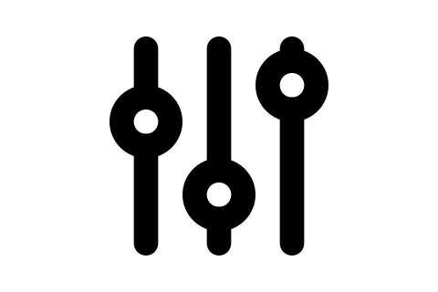 | [参数设置](../../elements/svg/tabler-adjustments.svg) | [出处](https://raw.githubusercontent.com/tabler/tabler-icons/a4ce1404bc6d24d3c365afe7b258d6bf6f48d62d/icons/outline/adjustments.svg) · MIT |
| 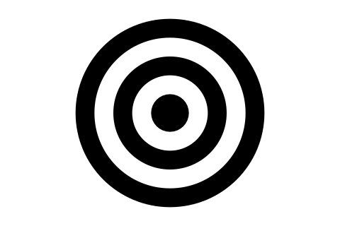 | [目标](../../elements/svg/tabler-target.svg) | [出处](https://raw.githubusercontent.com/tabler/tabler-icons/a4ce1404bc6d24d3c365afe7b258d6bf6f48d62d/icons/outline/target.svg) · MIT |
| 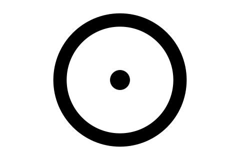 | [聚焦](../../elements/svg/tabler-focus.svg) | [出处](https://raw.githubusercontent.com/tabler/tabler-icons/a4ce1404bc6d24d3c365afe7b258d6bf6f48d62d/icons/outline/focus.svg) · MIT |
|  | [时钟](../../elements/svg/tabler-clock.svg) | [出处](https://raw.githubusercontent.com/tabler/tabler-icons/a4ce1404bc6d24d3c365afe7b258d6bf6f48d62d/icons/outline/clock.svg) · MIT |
| 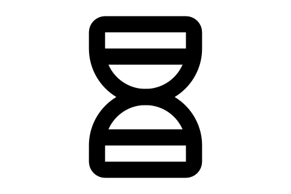 | [沙漏](../../elements/svg/tabler-hourglass.svg) | [出处](https://raw.githubusercontent.com/tabler/tabler-icons/a4ce1404bc6d24d3c365afe7b258d6bf6f48d62d/icons/outline/hourglass.svg) · MIT |
|  | [保护](../../elements/svg/tabler-shield.svg) | [出处](https://raw.githubusercontent.com/tabler/tabler-icons/a4ce1404bc6d24d3c365afe7b258d6bf6f48d62d/icons/outline/shield.svg) · MIT |
|  | [验证](../../elements/svg/tabler-shield-check.svg) | [出处](https://raw.githubusercontent.com/tabler/tabler-icons/a4ce1404bc6d24d3c365afe7b258d6bf6f48d62d/icons/outline/shield-check.svg) · MIT |
|  | [警告](../../elements/svg/tabler-alert-triangle.svg) | [出处](https://raw.githubusercontent.com/tabler/tabler-icons/a4ce1404bc6d24d3c365afe7b258d6bf6f48d62d/icons/outline/alert-triangle.svg) · MIT |
|  | [问号](../../elements/svg/tabler-help.svg) | [出处](https://raw.githubusercontent.com/tabler/tabler-icons/a4ce1404bc6d24d3c365afe7b258d6bf6f48d62d/icons/outline/help.svg) · MIT |
|  | [信息](../../elements/svg/tabler-info-circle.svg) | [出处](https://raw.githubusercontent.com/tabler/tabler-icons/a4ce1404bc6d24d3c365afe7b258d6bf6f48d62d/icons/outline/info-circle.svg) · MIT |
|  | [勾选](../../elements/svg/tabler-check.svg) | [出处](https://raw.githubusercontent.com/tabler/tabler-icons/a4ce1404bc6d24d3c365afe7b258d6bf6f48d62d/icons/outline/check.svg) · MIT |
|  | [星标](../../elements/svg/tabler-star.svg) | [出处](https://raw.githubusercontent.com/tabler/tabler-icons/a4ce1404bc6d24d3c365afe7b258d6bf6f48d62d/icons/outline/star.svg) · MIT |
|  | [旗帜](../../elements/svg/tabler-flag.svg) | [出处](https://raw.githubusercontent.com/tabler/tabler-icons/a4ce1404bc6d24d3c365afe7b258d6bf6f48d62d/icons/outline/flag.svg) · MIT |
|  | [图钉](../../elements/svg/tabler-pin.svg) | [出处](https://raw.githubusercontent.com/tabler/tabler-icons/a4ce1404bc6d24d3c365afe7b258d6bf6f48d62d/icons/outline/pin.svg) · MIT |
|  | [奖章](../../elements/svg/tabler-award.svg) | [出处](https://raw.githubusercontent.com/tabler/tabler-icons/a4ce1404bc6d24d3c365afe7b258d6bf6f48d62d/icons/outline/award.svg) · MIT |
|  | [奖杯](../../elements/svg/tabler-trophy.svg) | [出处](https://raw.githubusercontent.com/tabler/tabler-icons/a4ce1404bc6d24d3c365afe7b258d6bf6f48d62d/icons/outline/trophy.svg) · MIT |
|  | [天平](../../elements/svg/tabler-scale.svg) | [出处](https://raw.githubusercontent.com/tabler/tabler-icons/a4ce1404bc6d24d3c365afe7b258d6bf6f48d62d/icons/outline/scale.svg) · MIT |
| 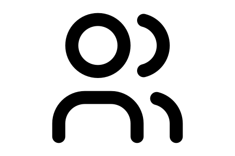 | [多用户](../../elements/svg/tabler-users.svg) | [出处](https://raw.githubusercontent.com/tabler/tabler-icons/a4ce1404bc6d24d3c365afe7b258d6bf6f48d62d/icons/outline/users.svg) · MIT |
|  | [用户](../../elements/svg/tabler-user.svg) | [出处](https://raw.githubusercontent.com/tabler/tabler-icons/a4ce1404bc6d24d3c365afe7b258d6bf6f48d62d/icons/outline/user.svg) · MIT |
|  | [对话](../../elements/svg/tabler-message.svg) | [出处](https://raw.githubusercontent.com/tabler/tabler-icons/a4ce1404bc6d24d3c365afe7b258d6bf6f48d62d/icons/outline/message.svg) · MIT |
|  | [聊天机器人](../../elements/svg/tabler-message-chatbot.svg) | [出处](https://raw.githubusercontent.com/tabler/tabler-icons/a4ce1404bc6d24d3c365afe7b258d6bf6f48d62d/icons/outline/message-chatbot.svg) · MIT |
|  | [可见](../../elements/svg/tabler-eye.svg) | [出处](https://raw.githubusercontent.com/tabler/tabler-icons/a4ce1404bc6d24d3c365afe7b258d6bf6f48d62d/icons/outline/eye.svg) · MIT |
|  | [隐藏](../../elements/svg/tabler-eye-off.svg) | [出处](https://raw.githubusercontent.com/tabler/tabler-icons/a4ce1404bc6d24d3c365afe7b258d6bf6f48d62d/icons/outline/eye-off.svg) · MIT |
|  | [搜索](../../elements/svg/tabler-search.svg) | [出处](https://raw.githubusercontent.com/tabler/tabler-icons/a4ce1404bc6d24d3c365afe7b258d6bf6f48d62d/icons/outline/search.svg) · MIT |
|  | [想法](../../elements/svg/tabler-bulb.svg) | [出处](https://raw.githubusercontent.com/tabler/tabler-icons/a4ce1404bc6d24d3c365afe7b258d6bf6f48d62d/icons/outline/bulb.svg) · MIT |
|  | [折线图符号](../../elements/svg/tabler-chart-line.svg) | [出处](https://raw.githubusercontent.com/tabler/tabler-icons/a4ce1404bc6d24d3c365afe7b258d6bf6f48d62d/icons/outline/chart-line.svg) · MIT |
|  | [柱状图符号](../../elements/svg/tabler-chart-bar.svg) | [出处](https://raw.githubusercontent.com/tabler/tabler-icons/a4ce1404bc6d24d3c365afe7b258d6bf6f48d62d/icons/outline/chart-bar.svg) · MIT |
|  | [饼图符号](../../elements/svg/tabler-chart-pie.svg) | [出处](https://raw.githubusercontent.com/tabler/tabler-icons/a4ce1404bc6d24d3c365afe7b258d6bf6f48d62d/icons/outline/chart-pie.svg) · MIT |
|  | [散点图符号](../../elements/svg/tabler-chart-scatter.svg) | [出处](https://raw.githubusercontent.com/tabler/tabler-icons/a4ce1404bc6d24d3c365afe7b258d6bf6f48d62d/icons/outline/chart-scatter.svg) · MIT |
|  | [直方图符号](../../elements/svg/tabler-chart-histogram.svg) | [出处](https://raw.githubusercontent.com/tabler/tabler-icons/a4ce1404bc6d24d3c365afe7b258d6bf6f48d62d/icons/outline/chart-histogram.svg) · MIT |
|  | [面积图符号](../../elements/svg/tabler-chart-area.svg) | [出处](https://raw.githubusercontent.com/tabler/tabler-icons/a4ce1404bc6d24d3c365afe7b258d6bf6f48d62d/icons/outline/chart-area.svg) · MIT |
|  | [点线图符号](../../elements/svg/tabler-chart-dots.svg) | [出处](https://raw.githubusercontent.com/tabler/tabler-icons/a4ce1404bc6d24d3c365afe7b258d6bf6f48d62d/icons/outline/chart-dots.svg) · MIT |
|  | [网格图符号](../../elements/svg/tabler-chart-grid-dots.svg) | [出处](https://raw.githubusercontent.com/tabler/tabler-icons/a4ce1404bc6d24d3c365afe7b258d6bf6f48d62d/icons/outline/chart-grid-dots.svg) · MIT |
|  | [分布曲线符号](../../elements/svg/tabler-chart-ppf.svg) | [出处](https://raw.githubusercontent.com/tabler/tabler-icons/a4ce1404bc6d24d3c365afe7b258d6bf6f48d62d/icons/outline/chart-ppf.svg) · MIT |
|  | [信息图符号](../../elements/svg/tabler-chart-infographic.svg) | [出处](https://raw.githubusercontent.com/tabler/tabler-icons/a4ce1404bc6d24d3c365afe7b258d6bf6f48d62d/icons/outline/chart-infographic.svg) · MIT |
|  | [试管](../../elements/svg/tabler-test-pipe.svg) | [出处](https://raw.githubusercontent.com/tabler/tabler-icons/a4ce1404bc6d24d3c365afe7b258d6bf6f48d62d/icons/outline/test-pipe.svg) · MIT |
|  | [显微镜](../../elements/svg/tabler-microscope.svg) | [出处](https://raw.githubusercontent.com/tabler/tabler-icons/a4ce1404bc6d24d3c365afe7b258d6bf6f48d62d/icons/outline/microscope.svg) · MIT |
|  | [原子](../../elements/svg/tabler-atom.svg) | [出处](https://raw.githubusercontent.com/tabler/tabler-icons/a4ce1404bc6d24d3c365afe7b258d6bf6f48d62d/icons/outline/atom.svg) · MIT |
|  | [DNA](../../elements/svg/tabler-dna.svg) | [出处](https://raw.githubusercontent.com/tabler/tabler-icons/a4ce1404bc6d24d3c365afe7b258d6bf6f48d62d/icons/outline/dna.svg) · MIT |
|  | [DNA 双螺旋](../../elements/svg/tabler-dna-2.svg) | [出处](https://raw.githubusercontent.com/tabler/tabler-icons/a4ce1404bc6d24d3c365afe7b258d6bf6f48d62d/icons/outline/dna-2.svg) · MIT |
|  | [磁体](../../elements/svg/tabler-magnet.svg) | [出处](https://raw.githubusercontent.com/tabler/tabler-icons/a4ce1404bc6d24d3c365afe7b258d6bf6f48d62d/icons/outline/magnet.svg) · MIT |
|  | [烧瓶](../../elements/svg/tabler-flask.svg) | [出处](https://raw.githubusercontent.com/tabler/tabler-icons/a4ce1404bc6d24d3c365afe7b258d6bf6f48d62d/icons/outline/flask.svg) · MIT |
|  | [卫星关闭](../../elements/svg/tabler-satellite-off.svg) | [出处](https://raw.githubusercontent.com/tabler/tabler-icons/a4ce1404bc6d24d3c365afe7b258d6bf6f48d62d/icons/outline/satellite-off.svg) · MIT |
