# Isoflow

[返回元素库](../README.md)

| 预览 | 名称 | 原来源 |
|---|---|---|
| 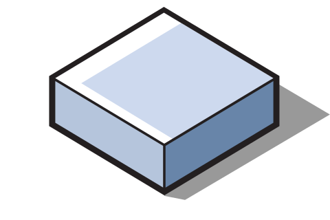 | [块](../../elements/svg/isoflow-block.svg) | [出处](https://raw.githubusercontent.com/markmanx/isopacks/ab717516031a384d478f456e2a95fd276aa56353/collections/isoflow/icons/block.svg) · MIT |
| 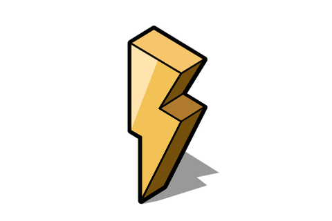 | [缓存](../../elements/svg/isoflow-cache.svg) | [出处](https://raw.githubusercontent.com/markmanx/isopacks/ab717516031a384d478f456e2a95fd276aa56353/collections/isoflow/icons/cache.svg) · MIT |
| 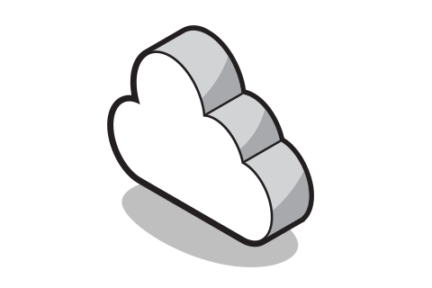 | [云](../../elements/svg/isoflow-cloud.svg) | [出处](https://raw.githubusercontent.com/markmanx/isopacks/ab717516031a384d478f456e2a95fd276aa56353/collections/isoflow/icons/cloud.svg) · MIT |
|  | [定时任务](../../elements/svg/isoflow-cronjob.svg) | [出处](https://raw.githubusercontent.com/markmanx/isopacks/ab717516031a384d478f456e2a95fd276aa56353/collections/isoflow/icons/cronjob.svg) · MIT |
| 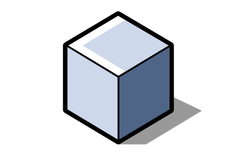 | [立方体](../../elements/svg/isoflow-cube.svg) | [出处](https://raw.githubusercontent.com/markmanx/isopacks/ab717516031a384d478f456e2a95fd276aa56353/collections/isoflow/icons/cube.svg) · MIT |
| 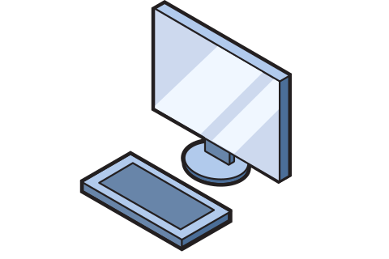 | [台式电脑](../../elements/svg/isoflow-desktop.svg) | [出处](https://raw.githubusercontent.com/markmanx/isopacks/ab717516031a384d478f456e2a95fd276aa56353/collections/isoflow/icons/desktop.svg) · MIT |
| 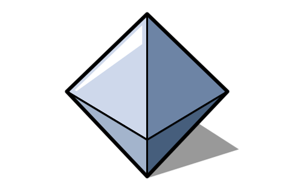 | [菱形体](../../elements/svg/isoflow-diamond.svg) | [出处](https://raw.githubusercontent.com/markmanx/isopacks/ab717516031a384d478f456e2a95fd276aa56353/collections/isoflow/icons/diamond.svg) · MIT |
| 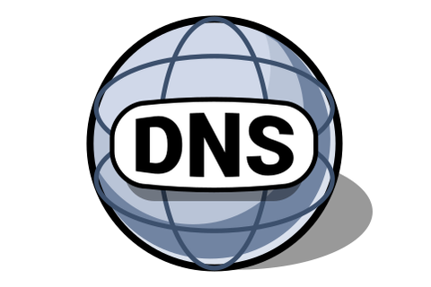 | [DNS](../../elements/svg/isoflow-dns.svg) | [出处](https://raw.githubusercontent.com/markmanx/isopacks/ab717516031a384d478f456e2a95fd276aa56353/collections/isoflow/icons/dns.svg) · MIT |
|  | [文档](../../elements/svg/isoflow-document.svg) | [出处](https://raw.githubusercontent.com/markmanx/isopacks/ab717516031a384d478f456e2a95fd276aa56353/collections/isoflow/icons/document.svg) · MIT |
|  | [防火墙](../../elements/svg/isoflow-firewall.svg) | [出处](https://raw.githubusercontent.com/markmanx/isopacks/ab717516031a384d478f456e2a95fd276aa56353/collections/isoflow/icons/firewall.svg) · MIT |
| 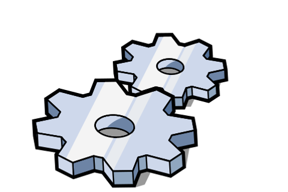 | [功能模块](../../elements/svg/isoflow-function-module.svg) | [出处](https://raw.githubusercontent.com/markmanx/isopacks/ab717516031a384d478f456e2a95fd276aa56353/collections/isoflow/icons/function-module.svg) · MIT |
| 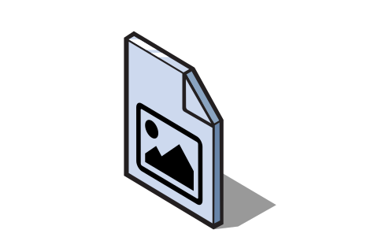 | [图像文件](../../elements/svg/isoflow-image.svg) | [出处](https://raw.githubusercontent.com/markmanx/isopacks/ab717516031a384d478f456e2a95fd276aa56353/collections/isoflow/icons/image.svg) · MIT |
| 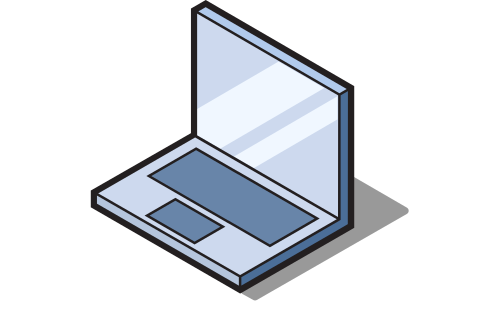 | [笔记本电脑](../../elements/svg/isoflow-laptop.svg) | [出处](https://raw.githubusercontent.com/markmanx/isopacks/ab717516031a384d478f456e2a95fd276aa56353/collections/isoflow/icons/laptop.svg) · MIT |
| 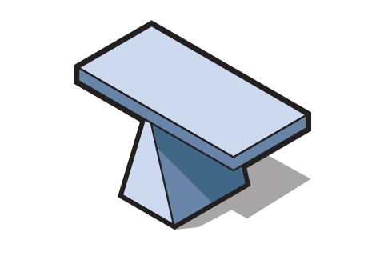 | [负载均衡](../../elements/svg/isoflow-loadbalancer.svg) | [出处](https://raw.githubusercontent.com/markmanx/isopacks/ab717516031a384d478f456e2a95fd276aa56353/collections/isoflow/icons/loadbalancer.svg) · MIT |
|  | [锁定](../../elements/svg/isoflow-lock.svg) | [出处](https://raw.githubusercontent.com/markmanx/isopacks/ab717516031a384d478f456e2a95fd276aa56353/collections/isoflow/icons/lock.svg) · MIT |
|  | [邮件](../../elements/svg/isoflow-mail.svg) | [出处](https://raw.githubusercontent.com/markmanx/isopacks/ab717516031a384d478f456e2a95fd276aa56353/collections/isoflow/icons/mail.svg) · MIT |
|  | [移动设备](../../elements/svg/isoflow-mobiledevice.svg) | [出处](https://raw.githubusercontent.com/markmanx/isopacks/ab717516031a384d478f456e2a95fd276aa56353/collections/isoflow/icons/mobiledevice.svg) · MIT |
| 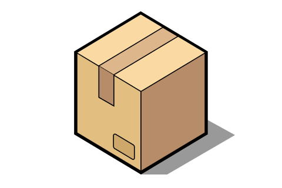 | [包模块](../../elements/svg/isoflow-package-module.svg) | [出处](https://raw.githubusercontent.com/markmanx/isopacks/ab717516031a384d478f456e2a95fd276aa56353/collections/isoflow/icons/package-module.svg) · MIT |
| 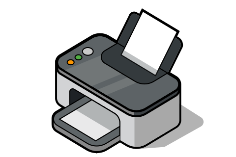 | [打印机](../../elements/svg/isoflow-printer.svg) | [出处](https://raw.githubusercontent.com/markmanx/isopacks/ab717516031a384d478f456e2a95fd276aa56353/collections/isoflow/icons/printer.svg) · MIT |
| 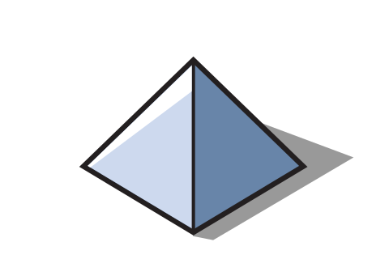 | [金字塔](../../elements/svg/isoflow-pyramid.svg) | [出处](https://raw.githubusercontent.com/markmanx/isopacks/ab717516031a384d478f456e2a95fd276aa56353/collections/isoflow/icons/pyramid.svg) · MIT |
|  | [队列](../../elements/svg/isoflow-queue.svg) | [出处](https://raw.githubusercontent.com/markmanx/isopacks/ab717516031a384d478f456e2a95fd276aa56353/collections/isoflow/icons/queue.svg) · MIT |
| 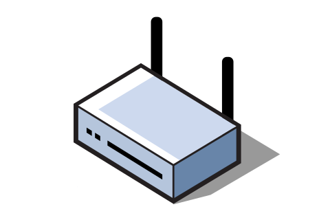 | [路由器](../../elements/svg/isoflow-router.svg) | [出处](https://raw.githubusercontent.com/markmanx/isopacks/ab717516031a384d478f456e2a95fd276aa56353/collections/isoflow/icons/router.svg) · MIT |
| 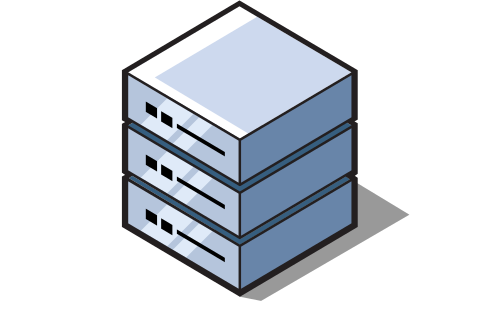 | [服务器](../../elements/svg/isoflow-server.svg) | [出处](https://raw.githubusercontent.com/markmanx/isopacks/ab717516031a384d478f456e2a95fd276aa56353/collections/isoflow/icons/server.svg) · MIT |
| 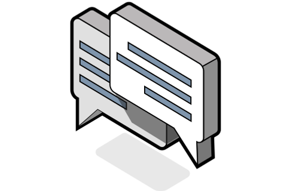 | [对话气泡](../../elements/svg/isoflow-speech.svg) | [出处](https://raw.githubusercontent.com/markmanx/isopacks/ab717516031a384d478f456e2a95fd276aa56353/collections/isoflow/icons/speech.svg) · MIT |
|  | [球体](../../elements/svg/isoflow-sphere.svg) | [出处](https://raw.githubusercontent.com/markmanx/isopacks/ab717516031a384d478f456e2a95fd276aa56353/collections/isoflow/icons/sphere.svg) · MIT |
|  | [存储](../../elements/svg/isoflow-storage.svg) | [出处](https://raw.githubusercontent.com/markmanx/isopacks/ab717516031a384d478f456e2a95fd276aa56353/collections/isoflow/icons/storage.svg) · MIT |
| 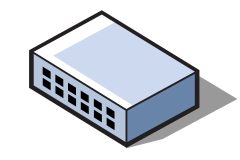 | [交换机模块](../../elements/svg/isoflow-switch-module.svg) | [出处](https://raw.githubusercontent.com/markmanx/isopacks/ab717516031a384d478f456e2a95fd276aa56353/collections/isoflow/icons/switch-module.svg) · MIT |
| 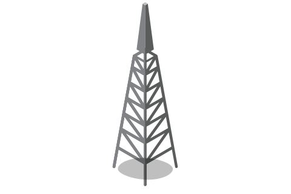 | [信号塔](../../elements/svg/isoflow-tower.svg) | [出处](https://raw.githubusercontent.com/markmanx/isopacks/ab717516031a384d478f456e2a95fd276aa56353/collections/isoflow/icons/tower.svg) · MIT |
|  | [用户](../../elements/svg/isoflow-user.svg) | [出处](https://raw.githubusercontent.com/markmanx/isopacks/ab717516031a384d478f456e2a95fd276aa56353/collections/isoflow/icons/user.svg) · MIT |
| 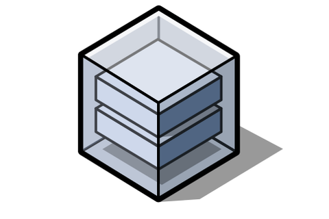 | [虚拟机](../../elements/svg/isoflow-vm.svg) | [出处](https://raw.githubusercontent.com/markmanx/isopacks/ab717516031a384d478f456e2a95fd276aa56353/collections/isoflow/icons/vm.svg) · MIT |
