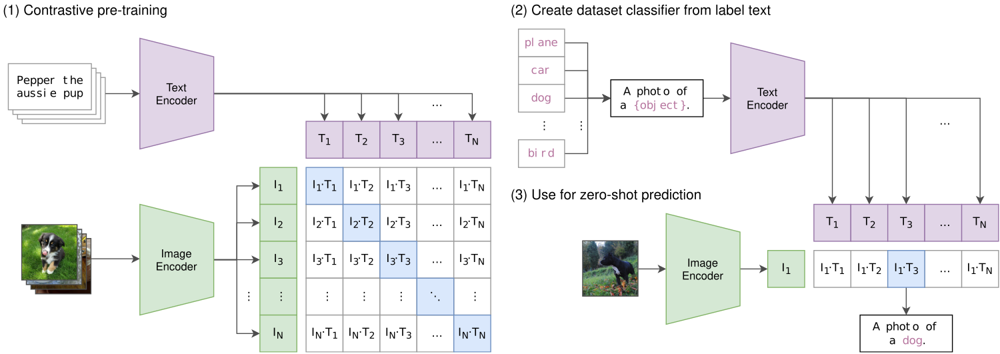
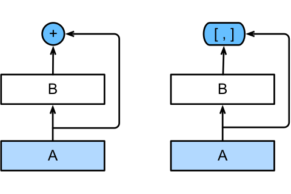

# Architecture 范例

[回到总目录](../../CATALOG.md)

## [CLIP Figure 1：训练到零样本预测](clip/README.md)

**论文范例** · CLIP 的训练与零样本使用流程，按方法流程归入 architecture。

## [D2L · AlexNet](d2l-alexnet/README.md)

**教材或教程范例** · D2L 教材作者提供的原始矢量图，适合借鉴结构与模块表达；明确作为教材范例收录。

## [D2L · DenseNet 密集连接块](d2l-densenet-block/README.md)

**教材或教程范例** · D2L 教材作者提供的原始矢量图，适合借鉴结构与模块表达；明确作为教材范例收录。

## [D2L · 编码器—解码器](d2l-encoder-decoder/README.md)

**教材或教程范例** · D2L 教材作者提供的原始矢量图，适合借鉴结构与模块表达；明确作为教材范例收录。

## [D2L · 全卷积网络](d2l-fcn/README.md)

**教材或教程范例** · D2L 教材作者提供的原始矢量图，适合借鉴结构与模块表达；明确作为教材范例收录。

## [D2L · 生成对抗网络](d2l-gan/README.md)

**教材或教程范例** · D2L 教材作者提供的原始矢量图，适合借鉴结构与模块表达；明确作为教材范例收录。

## [D2L · GRU 内部门控](d2l-gru-3/README.md)

**教材或教程范例** · D2L 教材作者提供的原始矢量图，适合借鉴结构与模块表达；明确作为教材范例收录。

## [D2L · Inception 并行分支](d2l-inception/README.md)

**教材或教程范例** · D2L 教材作者提供的原始矢量图，适合借鉴结构与模块表达；明确作为教材范例收录。

## [D2L · LeNet](d2l-lenet/README.md)

**教材或教程范例** · D2L 教材作者提供的原始矢量图，适合借鉴结构与模块表达；明确作为教材范例收录。

## [D2L · LSTM 内部门控](d2l-lstm-3/README.md)

**教材或教程范例** · D2L 教材作者提供的原始矢量图，适合借鉴结构与模块表达；明确作为教材范例收录。

## [D2L · 多层感知机](d2l-mlp/README.md)

**教材或教程范例** · D2L 教材作者提供的原始矢量图，适合借鉴结构与模块表达；明确作为教材范例收录。

## [D2L · ResNet 残差块](d2l-resnet-block/README.md)

**教材或教程范例** · D2L 教材作者提供的原始矢量图，适合借鉴结构与模块表达；明确作为教材范例收录。

## [D2L · ResNeXt 分组残差块](d2l-resnext-block/README.md)

**教材或教程范例** · D2L 教材作者提供的原始矢量图，适合借鉴结构与模块表达；明确作为教材范例收录。

## [D2L · 带注意力的 Seq2Seq](d2l-seq2seq-attention/README.md)

**教材或教程范例** · D2L 教材作者提供的原始矢量图，适合借鉴结构与模块表达；明确作为教材范例收录。

## [D2L · Transformer 编码器与解码器](d2l-transformer/README.md)

**教材或教程范例** · D2L 教材作者提供的原始矢量图，适合借鉴结构与模块表达；明确作为教材范例收录。

## [D2L · VGG](d2l-vgg/README.md)

**教材或教程范例** · D2L 教材作者提供的原始矢量图，适合借鉴结构与模块表达；明确作为教材范例收录。

## [D2L · Vision Transformer](d2l-vit/README.md)

**教材或教程范例** · D2L 教材作者提供的原始矢量图，适合借鉴结构与模块表达；明确作为教材范例收录。

## [LAV：感知、预测与驾驶控制流程](lav/README.md)

**论文范例** · 多摄像头输入、语义分割、传感器融合、三维主干、运动预测与控制的整体数据流。原文件虽叫 teaser.svg，按内容归入 architecture。

## [LightGlue：注意力、动态剪枝与匹配](lightglue/README.md)

**论文范例** · 双分支局部特征经过 self/cross attention、置信度预测、剪枝和匹配分配。

## [多尺度网络总览与模块展开](multiscale-network/README.md)

**教材或教程范例** · 作者 Illustrator 科研绘图教程中的多尺度网络案例：Backbone、高低层特征、SPPA／LFSA／GMFF 模块、预测结果，以及模块细节。原文件含 7 个画板。

## [RayDer：统一 Transformer 的两个使用阶段](rayder/README.md)

**论文范例** · 左右并列相机估计与新视角合成，清楚标明共用模型与不同输入输出。

## [RUST：编码器、场景表示与位姿分支](rust/README.md)

**论文范例** · 无位姿输入图像经 Encoder、场景表示、Decoder 输出新视角，训练时有 Pose Estimator 分支。按内容归入 architecture。

## [SAM / LoRA 总体流程与 Transformer 模块](sam-lora/README.md)

**教材或教程范例** · 作者 Illustrator 科研绘图教程中的 SAM / LoRA 案例，含总体方法流程与 Transformer／LoRA 模块结构，共 2 个画板；公开的 PNG、PDF 与 PPTX 配套素材一并保留。

