# Architecture 范例

[回到总目录](../../CATALOG.md)

## [CLIP Figure 1：训练到零样本预测](clip/README.md)

**论文范例** · CLIP 的训练与零样本使用流程，按方法流程归入 architecture。

## [CUT3R · 持久状态的更新、读取与未见视角推断](cut3r-architecture/README.md)

**论文范例** · 左侧按时间展开状态更新，右侧用独立色块解释状态读取；重建结果紧邻对应计算步骤。

CVPR 2025 · Oral · 矢量 + 原有位图

[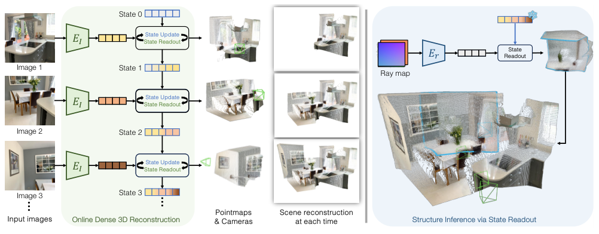](cut3r-architecture/source.svg)

## [D2L · AlexNet](d2l-alexnet/README.md)

**教材或教程范例** · D2L 教材作者提供的原始矢量图，适合借鉴结构与模块表达；明确作为教材范例收录。

[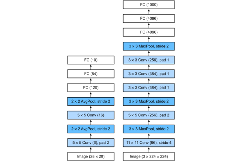](d2l-alexnet/source.svg)

## [D2L · DenseNet 密集连接块](d2l-densenet-block/README.md)

**教材或教程范例** · D2L 教材作者提供的原始矢量图，适合借鉴结构与模块表达；明确作为教材范例收录。

## [D2L · 编码器—解码器](d2l-encoder-decoder/README.md)

**教材或教程范例** · D2L 教材作者提供的原始矢量图，适合借鉴结构与模块表达；明确作为教材范例收录。

[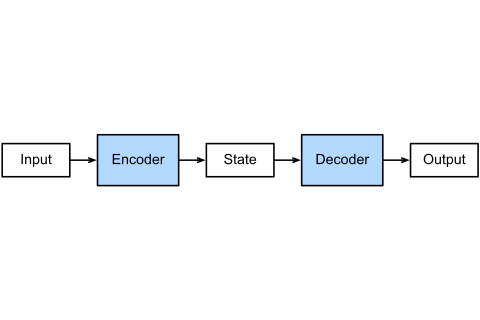](d2l-encoder-decoder/source.svg)

## [D2L · 全卷积网络](d2l-fcn/README.md)

**教材或教程范例** · D2L 教材作者提供的原始矢量图，适合借鉴结构与模块表达；明确作为教材范例收录。

[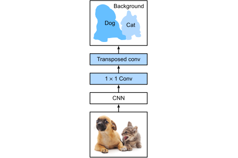](d2l-fcn/source.svg)

## [D2L · 生成对抗网络](d2l-gan/README.md)

**教材或教程范例** · D2L 教材作者提供的原始矢量图，适合借鉴结构与模块表达；明确作为教材范例收录。

[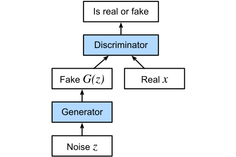](d2l-gan/source.svg)

## [D2L · GRU 内部门控](d2l-gru-3/README.md)

**教材或教程范例** · D2L 教材作者提供的原始矢量图，适合借鉴结构与模块表达；明确作为教材范例收录。

[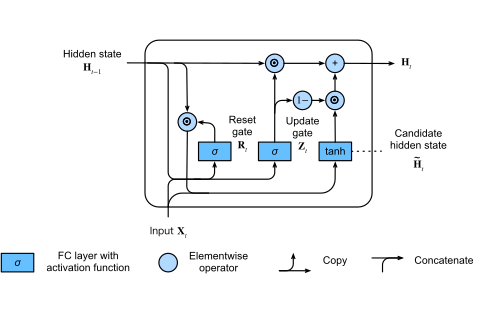](d2l-gru-3/source.svg)

## [D2L · Inception 并行分支](d2l-inception/README.md)

**教材或教程范例** · D2L 教材作者提供的原始矢量图，适合借鉴结构与模块表达；明确作为教材范例收录。

[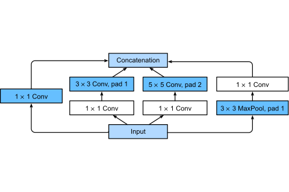](d2l-inception/source.svg)

## [D2L · LeNet](d2l-lenet/README.md)

**教材或教程范例** · D2L 教材作者提供的原始矢量图，适合借鉴结构与模块表达；明确作为教材范例收录。

[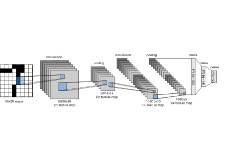](d2l-lenet/source.svg)

## [D2L · LSTM 内部门控](d2l-lstm-3/README.md)

**教材或教程范例** · D2L 教材作者提供的原始矢量图，适合借鉴结构与模块表达；明确作为教材范例收录。

[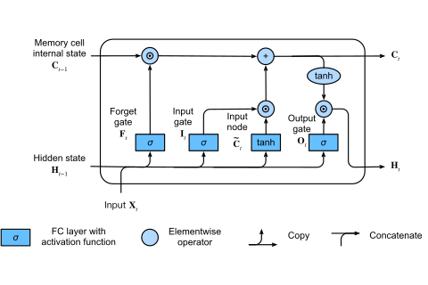](d2l-lstm-3/source.svg)

## [D2L · 多层感知机](d2l-mlp/README.md)

**教材或教程范例** · D2L 教材作者提供的原始矢量图，适合借鉴结构与模块表达；明确作为教材范例收录。

[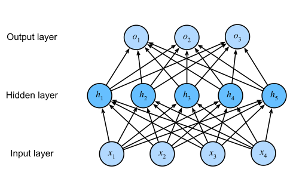](d2l-mlp/source.svg)

## [D2L · ResNet 残差块](d2l-resnet-block/README.md)

**教材或教程范例** · D2L 教材作者提供的原始矢量图，适合借鉴结构与模块表达；明确作为教材范例收录。

[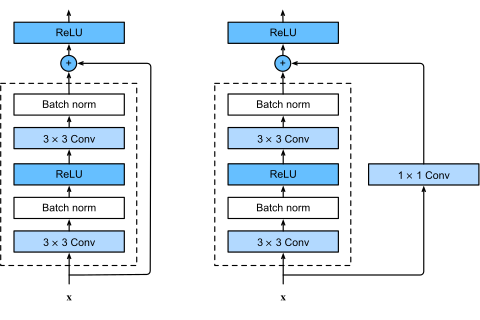](d2l-resnet-block/source.svg)

## [D2L · ResNeXt 分组残差块](d2l-resnext-block/README.md)

**教材或教程范例** · D2L 教材作者提供的原始矢量图，适合借鉴结构与模块表达；明确作为教材范例收录。

[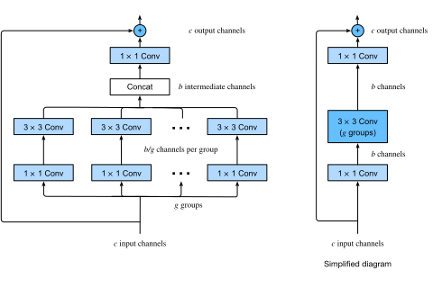](d2l-resnext-block/source.svg)

## [D2L · 带注意力的 Seq2Seq](d2l-seq2seq-attention/README.md)

**教材或教程范例** · D2L 教材作者提供的原始矢量图，适合借鉴结构与模块表达；明确作为教材范例收录。

[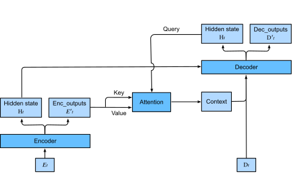](d2l-seq2seq-attention/source.svg)

## [D2L · Transformer 编码器与解码器](d2l-transformer/README.md)

**教材或教程范例** · D2L 教材作者提供的原始矢量图，适合借鉴结构与模块表达；明确作为教材范例收录。

[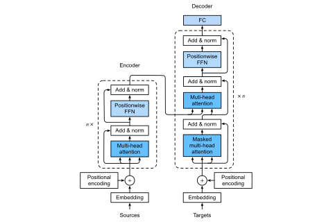](d2l-transformer/source.svg)

## [D2L · VGG](d2l-vgg/README.md)

**教材或教程范例** · D2L 教材作者提供的原始矢量图，适合借鉴结构与模块表达；明确作为教材范例收录。

[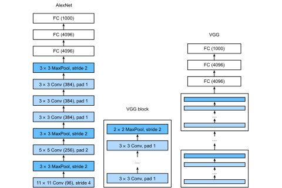](d2l-vgg/source.svg)

## [D2L · Vision Transformer](d2l-vit/README.md)

**教材或教程范例** · D2L 教材作者提供的原始矢量图，适合借鉴结构与模块表达；明确作为教材范例收录。

[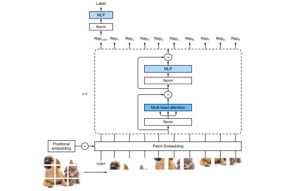](d2l-vit/source.svg)

## [DiT · 整体主干与三种条件注入模块](dit-architecture/README.md)

**论文范例** · 左侧给完整主干，右侧展开 block 变体；推荐模块使用更高视觉对比，完整展示论文的结构选择。

ICCV 2023 · Oral · 矢量结构

[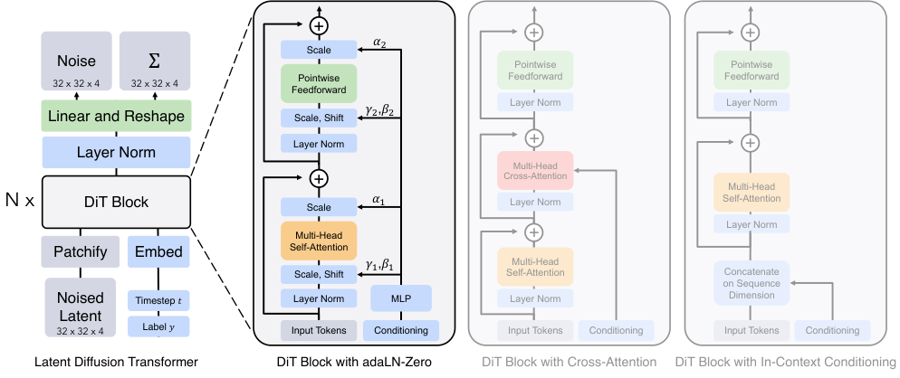](dit-architecture/source.svg)

## [DreamGaussian · 高斯生成、网格提取与纹理细化](dreamgaussian-architecture/README.md)

**论文范例** · 三个带编号的区域分别解释表示初始化、表示转换和后续细化，同时把不同损失放在对应优化回路内。

ICLR 2024 · Oral · 矢量 + 原有位图

[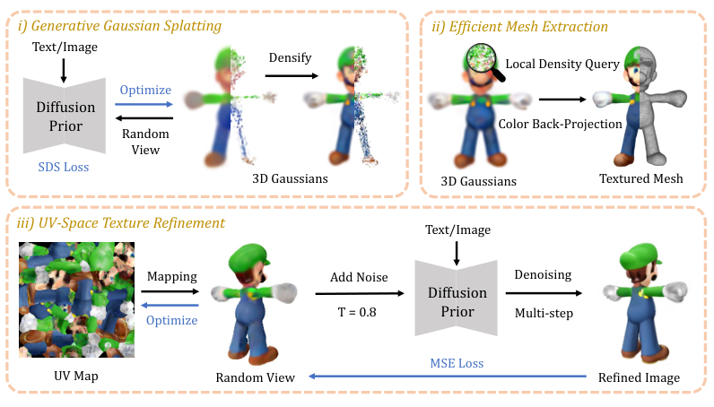](dreamgaussian-architecture/source.svg)

## [3D Gaussian Splatting · 优化与光栅化双向流程](gaussian-splatting-architecture/README.md)

**论文范例** · 黑色实线和蓝色箭头分别表达正向操作与梯度回传，让自适应密度控制与可微渲染的关系无需依赖长图注。

SIGGRAPH 2023 · 会议论文，未核实 Oral · 矢量 + 原有位图

[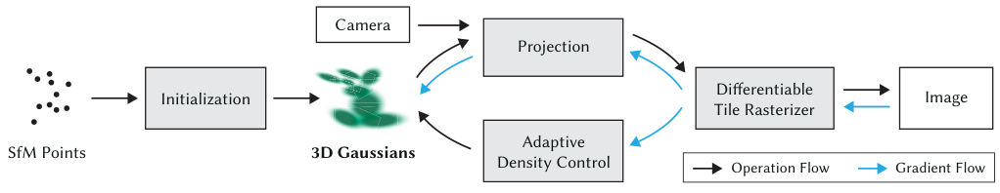](gaussian-splatting-architecture/source.svg)

## [Genie · 视频 tokenizer、潜在动作与动力学模型](genie-architecture/README.md)

**论文范例** · 只保留三个核心模块，视频 tokens 与潜在动作分别编码后汇入动力学模型；简单分支就讲清训练信息来源。

ICML 2024 · Oral · 整图位图，仅构图参考

[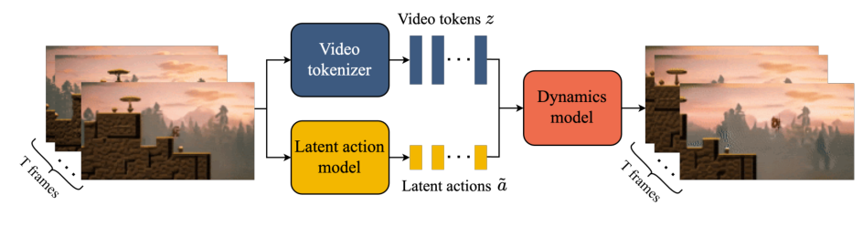](genie-architecture/source.png)

## [Instant NGP · 多分辨率哈希编码到 MLP](instant-ngp-hash-architecture/README.md)

**论文范例** · 通过五个编号步骤，将空间采样、哈希查表、插值、拼接与网络连接起来；不同尺度的颜色可贯穿整张图。

SIGGRAPH 2022 · 会议论文，未核实 Oral · 矢量 + 原有位图

[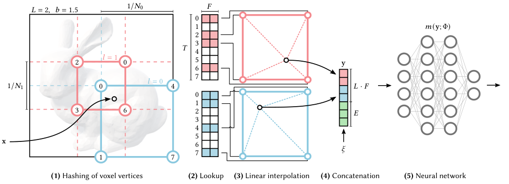](instant-ngp-hash-architecture/source.svg)

## [LAV：感知、预测与驾驶控制流程](lav/README.md)

**论文范例** · 多摄像头输入、语义分割、传感器融合、三维主干、运动预测与控制的整体数据流。原文件虽叫 teaser.svg，按内容归入 architecture。

[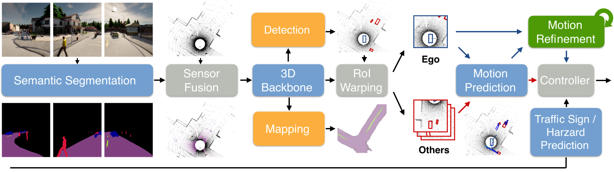](lav/source.svg)

## [LGM · 非对称 U-Net 与跨视角注意力](lgm-architecture/README.md)

**论文范例** · 把多视图输入、相机射线编码、U-Net、三维融合和监督闭环放在一张图里；顶部局部放大说明跨视角交互。

ECCV 2024 · Oral · 矢量 + 原有位图

[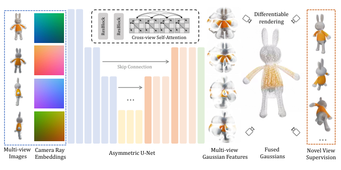](lgm-architecture/source.svg)

## [LGM · 从文本或图像到三维高斯和网格的流程](lgm-pipeline/README.md)

**论文范例** · 用少量大模块完成端到端说明，同时把各阶段耗时直接放在阶段下方，适合紧凑的方法总览。

ECCV 2024 · Oral · 矢量 + 原有位图

[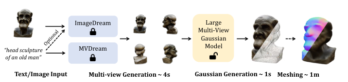](lgm-pipeline/source.svg)

## [LightGlue：注意力、动态剪枝与匹配](lightglue/README.md)

**论文范例** · 双分支局部特征经过 self/cross attention、置信度预测、剪枝和匹配分配。

[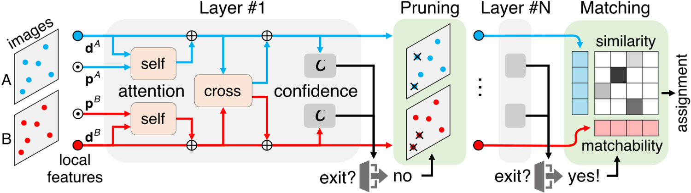](lightglue/source.svg)

## [多尺度网络总览与模块展开](multiscale-network/README.md)

**教材或教程范例** · 作者 Illustrator 科研绘图教程中的多尺度网络案例：Backbone、高低层特征、SPPA／LFSA／GMFF 模块、预测结果，以及模块细节。原文件含 7 个画板。

[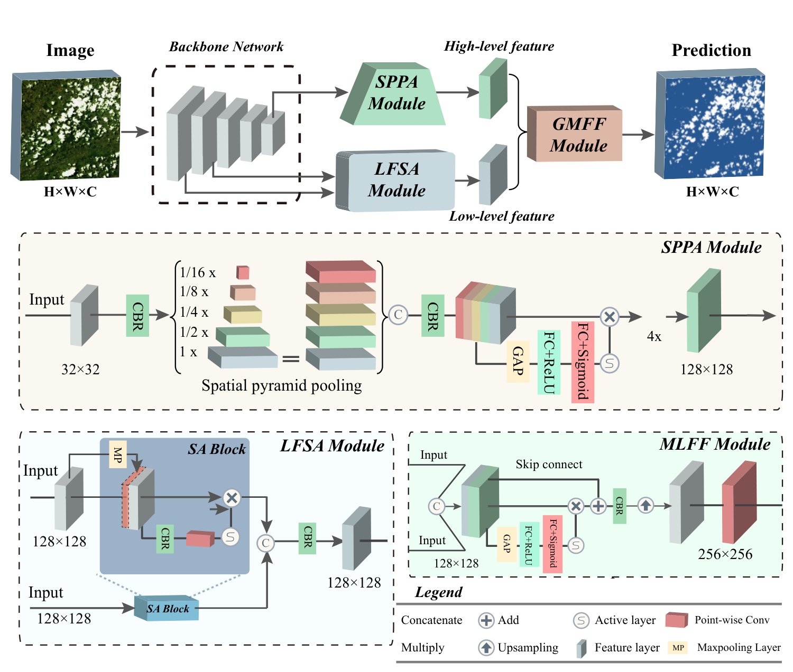](multiscale-network/source.ai)

## [RayDer：统一 Transformer 的两个使用阶段](rayder/README.md)

**论文范例** · 左右并列相机估计与新视角合成，清楚标明共用模型与不同输入输出。

[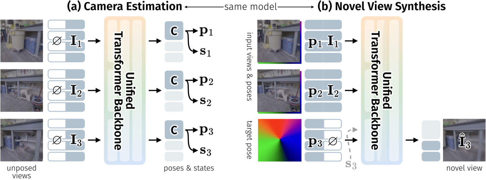](rayder/source.svg)

## [RUST：编码器、场景表示与位姿分支](rust/README.md)

**论文范例** · 无位姿输入图像经 Encoder、场景表示、Decoder 输出新视角，训练时有 Pose Estimator 分支。按内容归入 architecture。

## [SAM / LoRA 总体流程与 Transformer 模块](sam-lora/README.md)

**教材或教程范例** · 作者 Illustrator 科研绘图教程中的 SAM / LoRA 案例，含总体方法流程与 Transformer／LoRA 模块结构，共 2 个画板；公开的 PNG、PDF 与 PPTX 配套素材一并保留。

[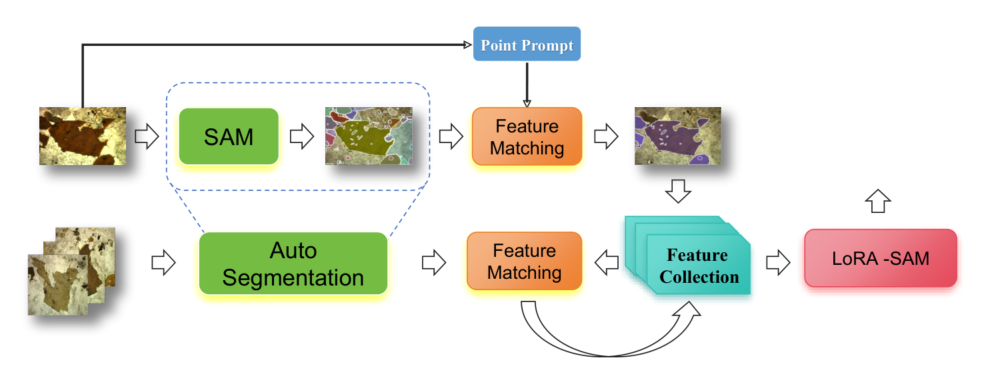](sam-lora/source.ai)

## [SD3 · 双模态主干与 MM-DiT block 展开](sd3-mmdit-architecture/README.md)

**论文范例** · 左侧说明文本与图像条件如何进入主干，右侧以对称双路结构展开联合注意力，颜色和符号在两部分保持一致。

ICML 2024 · Oral · 矢量结构

[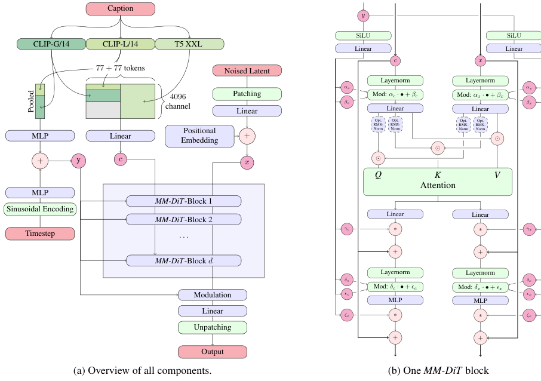](sd3-mmdit-architecture/source.svg)

## [VAR · 多尺度 VQVAE 与 VAR 两阶段训练](var-architecture/README.md)

**论文范例** · 两块并列区域分别解释表示学习和自回归训练，尺度、token 序列和因果 mask 的对应关系可在图中追踪。

NeurIPS 2024 · Oral · 矢量 + 原有位图

[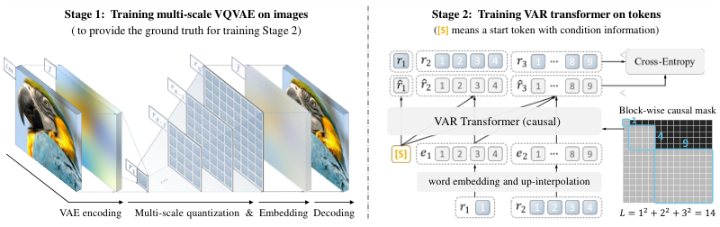](var-architecture/source.svg)

## [VGGT · 交替注意力主干与多任务输出头](vggt-architecture/README.md)

**论文范例** · 整图始终沿左到右阅读；颜色区分 token，虚线框标出重复主干，右侧分组展开输出任务。

CVPR 2025 · Oral · 矢量 + 原有位图

[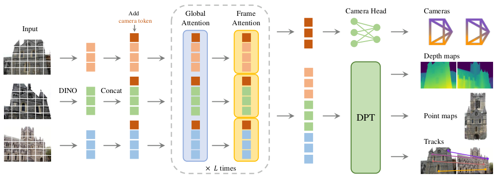](vggt-architecture/source.svg)

## [ViT 原论文 · 图像分块、token 序列与编码器展开](vit-original-architecture/README.md)

**论文范例** · 输入图像、patch 序列、位置编码和分类 token 都有直观的对应关系；右侧独立展开重复的 Transformer 编码器。

ICLR 2021 · Oral · 矢量 + 原有位图

[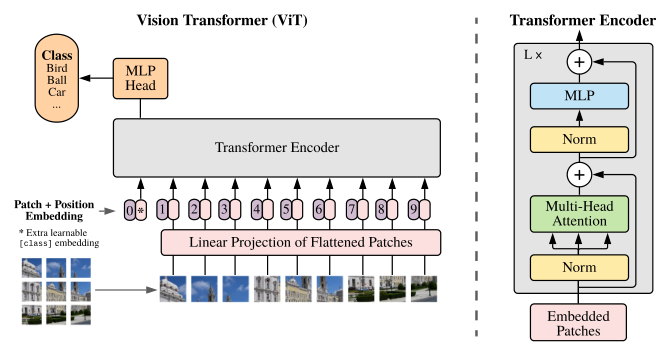](vit-original-architecture/source.svg)
