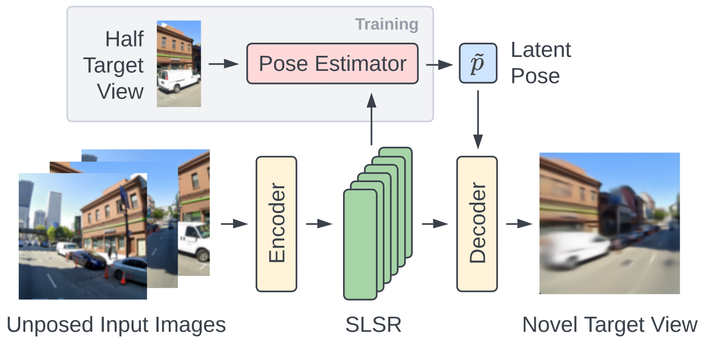

# Architecture 范例

按结构、模块与数据流收录。保留的两份原生 AI 教程明确标注为教程范例。

## [CLIP Figure 1：训练到零样本预测](clip/README.md)

CLIP 的训练与零样本使用流程，按方法流程归入 architecture。

## [LAV：感知、预测与驾驶控制流程](lav/README.md)

多摄像头输入、语义分割、传感器融合、三维主干、运动预测与控制的整体数据流。原文件虽叫 teaser.svg，按内容归入 architecture。

## [LightGlue：注意力、动态剪枝与匹配](lightglue/README.md)

双分支局部特征经过 self/cross attention、置信度预测、剪枝和匹配分配。

## [多尺度网络总览与模块展开](multiscale-network/README.md)

作者 Illustrator 科研绘图教程中的多尺度网络案例：Backbone、高低层特征、SPPA／LFSA／GMFF 模块、预测结果，以及模块细节。原文件含 7 个画板。

## [RayDer：统一 Transformer 的两个使用阶段](rayder/README.md)

左右并列相机估计与新视角合成，清楚标明共用模型与不同输入输出。

## [RUST：编码器、场景表示与位姿分支](rust/README.md)

无位姿输入图像经 Encoder、场景表示、Decoder 输出新视角，训练时有 Pose Estimator 分支。按内容归入 architecture。

## [SAM / LoRA 总体流程与 Transformer 模块](sam-lora/README.md)

作者 Illustrator 科研绘图教程中的 SAM / LoRA 案例，含总体方法流程与 Transformer／LoRA 模块结构，共 2 个画板；公开的 PNG、PDF 与 PPTX 配套素材一并保留。

