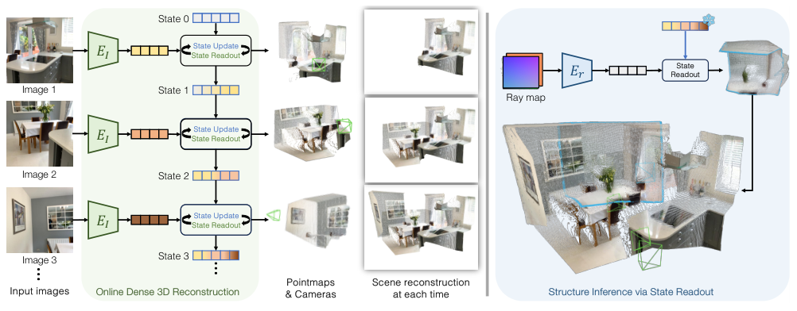

# CUT3R · 持久状态的更新、读取与未见视角推断

<!-- CATEGORY NAV -->
[Teaser](../../teasers/README.md) · [Architecture](../README.md) · [Element](../../../elements/README.md) · [总目录](../../../CATALOG.md)
<!-- END CATEGORY NAV -->

**CVPR 2025 · Oral · 原论文 Figure 3**

## 为什么收这张图

左侧按时间展开状态更新，右侧用独立色块解释状态读取；重建结果紧邻对应计算步骤。

完整方法框架；重点是状态信息流和两个使用分支。

## 可以借鉴

- 递归状态按时间纵向展开
- 更新与只读分支分区表达
- 中间输出与场景结果保持对齐

## 文件与编辑范围

[主文件](source.svg) · [单图 PDF](figure.pdf) · [来源与校验记录](metadata.json)

原 PDF 的几何路径与线条保留，SVG 文字转为轮廓；照片、三维渲染与原有位图部件仍为嵌入图片。

SVG 是原论文图形的提取转换件，未取得作者原生 AI 工程。不同 PDF 阅读器或 Illustrator 对字体、透明度的导入可能有差异。

## 原始出处

- 论文：[Continuous 3D Perception Model with Persistent State](https://arxiv.org/abs/2501.12387)
- 作者：Wang, Qianqian, Zhang, Yifei, Holynski, Aleksander, Efros, Alexei A., Kanazawa, Angjoo
- [作者项目或代码](https://cut3r.github.io/)
- [会议与展示身份依据](https://github.com/CUT3R/CUT3R/blob/main/README.md)
- PDF 第 4 页，Figure 3；截取坐标见 metadata.json。

## 权利与修改记录

arXiv 原文声明 CC BY 4.0；保留作者署名、论文链接和裁剪转换说明。第三方照片与模型若有独立声明，仍按原声明。

原文许可声明：https://creativecommons.org/licenses/by/4.0/

只提取、裁剪与转换原图；没有重新绘制。

<!-- BEGIN FIGURE LINKS -->
## 关联范例与元素

同论文的其他图：[CUT3R · 静态、动态与稀疏照片三类场景](../../teasers/cut3r-capabilities/README.md)

**可搭配的现有元素：** [编码器块](../../../elements/svg/rust-encoder.svg) · [解码器块](../../../elements/svg/rust-decoder.svg) · [特征表示堆叠](../../../elements/svg/rust-feature-stack.svg) · [回环箭头](../../../elements/svg/tabler-arrow-loop-right.svg) · [相机](../../../elements/svg/tabler-camera.svg)

这些元素按表达功能关联，并非从本论文原图拆出；来源和许可仍以各元素记录为准。

[范例与元素对照表](../../../elements/with-examples.md) · [元素分类目录](../../../elements/README.md)
<!-- END FIGURE LINKS -->
