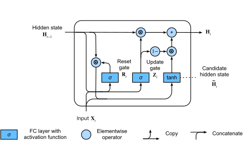

# D2L · GRU 内部门控

<!-- CATEGORY NAV -->
[Teaser](../../teasers/README.md) · [Architecture](../README.md) · [Element](../../../elements/README.md) · [总目录](../../../CATALOG.md)
<!-- END CATEGORY NAV -->

D2L 教材作者提供的原始矢量图，适合借鉴结构与模块表达；明确作为教材范例收录。

[原始 SVG](source.svg) · [来源与许可](metadata.json)

CC-BY-SA-4.0。文字可能为轮廓或依赖本机字体；照片仍是嵌入位图。

<!-- BEGIN FIGURE LINKS -->
## 关联范例与元素

**可搭配的现有元素：** [乘法节点](../../../elements/svg/task5-multiply.svg) · [加法节点](../../../elements/svg/task5-add.svg) · [Sigmoid 曲线](../../../elements/svg/bioicons-sigmoid.svg) · [回环箭头](../../../elements/svg/tabler-arrow-loop-right.svg)

这些元素按表达功能关联，并非从本论文原图拆出；来源和许可仍以各元素记录为准。

[范例与元素对照表](../../../elements/with-examples.md) · [元素分类目录](../../../elements/README.md)
<!-- END FIGURE LINKS -->
