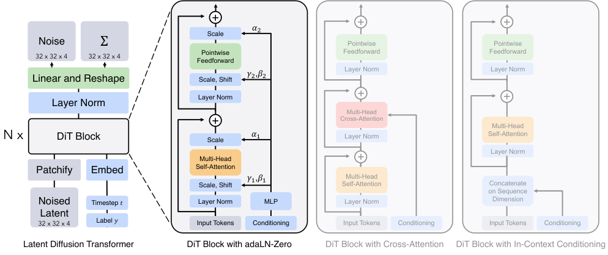

# DiT · 整体主干与三种条件注入模块

<!-- CATEGORY NAV -->
[Teaser](../../teasers/README.md) · [Architecture](../README.md) · [Element](../../../elements/README.md) · [总目录](../../../CATALOG.md)
<!-- END CATEGORY NAV -->

**ICCV 2023 · Oral · 原论文 Figure 3**

## 为什么收这张图

左侧给完整主干，右侧展开 block 变体；推荐模块使用更高视觉对比，完整展示论文的结构选择。

网络架构与 block 设计对照。原图右侧两个变体的浅色是作者设计。

## 可以借鉴

- 整体网络与局部模块放在同一水平基线
- 放大连线连接主干和 block
- 作者用淡化处理弱化对照变体

## 文件与编辑范围

[主文件](source.svg) · [单图 PDF](figure.pdf) · [来源与校验记录](metadata.json)

结构与文字轮廓均为矢量路径；另附 PDF 摘图保留原字体和结构。

SVG 是原论文图形的提取转换件，未取得作者原生 AI 工程。不同 PDF 阅读器或 Illustrator 对字体、透明度的导入可能有差异。

## 原始出处

- 论文：[Scalable Diffusion Models with Transformers](https://arxiv.org/abs/2212.09748)
- 作者：Peebles, William, Xie, Saining
- [作者项目或代码](https://www.wpeebles.com/DiT)
- [会议与展示身份依据](https://www.wpeebles.com/DiT)
- PDF 第 3 页，Figure 3；截取坐标见 metadata.json。

## 权利与修改记录

arXiv 原文声明 CC BY 4.0；保留作者署名、论文链接和裁剪转换说明。第三方照片与模型若有独立声明，仍按原声明。

原文许可声明：https://creativecommons.org/licenses/by/4.0/

只提取、裁剪与转换原图；没有重新绘制。

<!-- BEGIN FIGURE LINKS -->
## 关联范例与元素

**可搭配的现有元素：** [Self attention 块](../../../elements/svg/lightglue-self-attention.svg) · [残差加法节点](../../../elements/svg/lightglue-residual-add.svg) · [匹配相似度矩阵](../../../elements/svg/lightglue-assignment-matrix.svg) · [单层特征块](../../../elements/svg/rust-feature-tile.svg) · [乘法节点](../../../elements/svg/task5-multiply.svg) · [加法节点](../../../elements/svg/task5-add.svg)

这些元素按表达功能关联，并非从本论文原图拆出；来源和许可仍以各元素记录为准。

[范例与元素对照表](../../../elements/with-examples.md) · [元素分类目录](../../../elements/README.md)
<!-- END FIGURE LINKS -->
