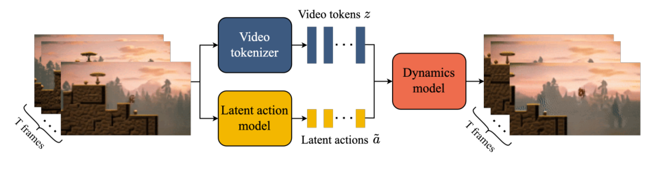

# Genie · 视频 tokenizer、潜在动作与动力学模型

[顶会精选图文目录](../../../collections/top-conference-figures.md) · [总目录](../../../CATALOG.md)

**ICML 2024 · Oral · 原论文 Figure 3**

## 为什么收这张图

只保留三个核心模块，视频 tokens 与潜在动作分别编码后汇入动力学模型；简单分支就讲清训练信息来源。

世界模型整体训练架构；作者 PDF 中此图为整张位图，作为构图参考保存。

## 可以借鉴

- 同一输入分支提取两类表示
- 表示类型通过颜色与排列方式区分
- 核心模块数量少，适合方法总览

## 文件与编辑范围

[主文件](source.png) · [单图 PDF](figure.pdf) · [来源与校验记录](metadata.json)

作者 PDF 内该图为整张位图。源 PNG 原样提取，PDF 摘图也不会增加可编辑矢量节点。

此条明确作为位图构图参考；不是可编辑模板。

## 原始出处

- 论文：[Genie: Generative Interactive Environments](https://arxiv.org/abs/2402.15391)
- 作者：Bruce, Jake, Dennis, Michael, Edwards, Ashley, Parker-Holder, Jack, Shi, Yuge, Hughes, Edward, Lai, Matthew, Mavalankar, Aditi, Steigerwald, Richie, Apps, Chris, Aytar, Yusuf, Bechtle, Sarah, Behbahani, Feryal, Chan, Stephanie, Heess, Nicolas, Gonzalez, Lucy, Osindero, Simon, Ozair, Sherjil, Reed, Scott, Zhang, Jingwei, Zolna, Konrad, Clune, Jeff, de Freitas, Nando, Singh, Satinder, Rocktäschel, Tim
- [作者项目或代码](https://sites.google.com/view/genie2024/home)
- [会议与展示身份依据](https://icml.cc/virtual/2024/oral/35508)
- PDF 第 4 页，Figure 3；截取坐标见 metadata.json。

## 权利与修改记录

arXiv 标注的是授予 arXiv 的非独占分发许可，不是第三方图形重用许可。本条用于个人私有参考，改编或公开再用需核对原权利。

原文许可声明：https://arxiv.org/licenses/nonexclusive-distrib/1.0/

只提取、裁剪与转换原图；没有重新绘制。
