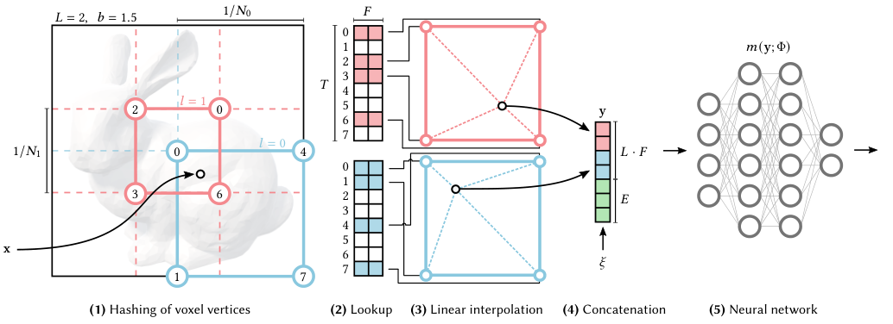

# Instant NGP · 多分辨率哈希编码到 MLP

[顶会精选图文目录](../../../collections/top-conference-figures.md) · [总目录](../../../CATALOG.md)

**SIGGRAPH 2022 · 会议论文；未核实 Oral · 原论文 Figure 3**

## 为什么收这张图

通过五个编号步骤，将空间采样、哈希查表、插值、拼接与网络连接起来；不同尺度的颜色可贯穿整张图。

编码方法与网络输入的完整结构图；SIGGRAPH 精选，未标作已核实 Oral。

## 可以借鉴

- 几何对象与数据结构直接建立对应关系
- 用持续一致的颜色追踪多个尺度
- 让步骤编号代替大段流程解释

## 文件与编辑范围

[主文件](source.svg) · [单图 PDF](figure.pdf) · [来源与校验记录](metadata.json)

原 PDF 的几何路径与线条保留，SVG 文字转为轮廓；照片、三维渲染与原有位图部件仍为嵌入图片。

SVG 是原论文图形的提取转换件，未取得作者原生 AI 工程。不同 PDF 阅读器或 Illustrator 对字体、透明度的导入可能有差异。

## 原始出处

- 论文：[Instant Neural Graphics Primitives with a Multiresolution Hash Encoding](https://arxiv.org/abs/2201.05989)
- 作者：Müller, Thomas, Evans, Alex, Schied, Christoph, Keller, Alexander
- [作者项目或代码](https://nvlabs.github.io/instant-ngp/)
- [会议与展示身份依据](https://nvlabs.github.io/instant-ngp/)
- PDF 第 4 页，Figure 3；截取坐标见 metadata.json。

## 权利与修改记录

arXiv 标注的是授予 arXiv 的非独占分发许可，不是第三方图形重用许可。本条用于个人私有参考，改编或公开再用需核对原权利。

原文许可声明：https://arxiv.org/licenses/nonexclusive-distrib/1.0/

只提取、裁剪与转换原图；没有重新绘制。
