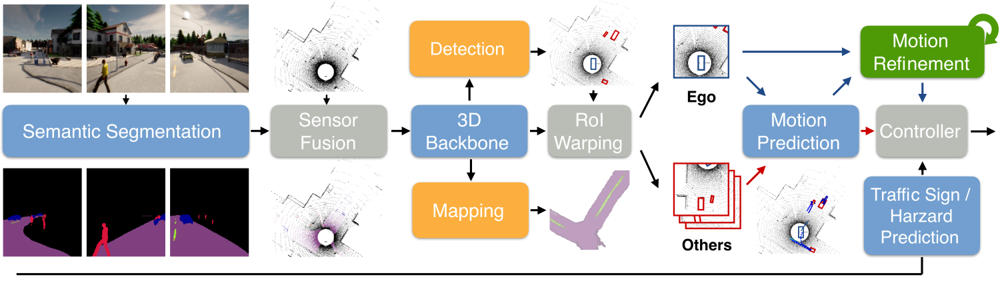

# LAV：感知、预测与驾驶控制流程

多摄像头输入、语义分割、传感器融合、三维主干、运动预测与控制的整体数据流。原文件虽叫 teaser.svg，按内容归入 architecture。

[作者原始 SVG](source.svg) · [来源与检查记录](metadata.json) · [原项目](https://dotchen.github.io/LAV/)

## 来源与可编辑范围

来源：`dotchen/LAV` / `assets/teaser.svg`，固定版本 `12540bd5f7b8`。原 SVG 未重绘、未修改字节。

SVG 对象：93 个 path，24 个 text，42 个 image。有 SVG 容器不代表每个区域都是可编辑矢量；内嵌照片和渲染图保持位图，公式可能为轮廓。

Apache-2.0（来源仓库）。

已检查预览；桌面 Illustrator 的字体与链接兼容性尚未逐项实测。
