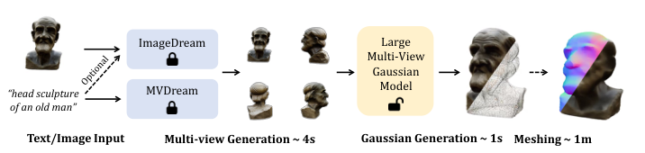

# LGM · 从文本或图像到三维高斯和网格的流程

[顶会精选图文目录](../../../collections/top-conference-figures.md) · [总目录](../../../CATALOG.md)

**ECCV 2024 · Oral · 原论文 Figure 2**

## 为什么收这张图

用少量大模块完成端到端说明，同时把各阶段耗时直接放在阶段下方，适合紧凑的方法总览。

方法 pipeline；细粒度网络结构另见 LGM Figure 3。

## 可以借鉴

- 文本与图像两种输入在起点汇合
- 用代表性结果解释中间表示
- 阶段耗时附在对应模块下方

## 文件与编辑范围

[主文件](source.svg) · [单图 PDF](figure.pdf) · [来源与校验记录](metadata.json)

原 PDF 的几何路径与线条保留，SVG 文字转为轮廓；照片、三维渲染与原有位图部件仍为嵌入图片。

SVG 是原论文图形的提取转换件，未取得作者原生 AI 工程。不同 PDF 阅读器或 Illustrator 对字体、透明度的导入可能有差异。

## 原始出处

- 论文：[LGM: Large Multi-View Gaussian Model for High-Resolution 3D Content Creation](https://arxiv.org/abs/2402.05054)
- 作者：Tang, Jiaxiang, Chen, Zhaoxi, Chen, Xiaokang, Wang, Tengfei, Zeng, Gang, Liu, Ziwei
- [作者项目或代码](https://me.kiui.moe/lgm/)
- [会议与展示身份依据](https://me.kiui.moe/lgm/)
- PDF 第 5 页，Figure 2；截取坐标见 metadata.json。

## 权利与修改记录

arXiv 标注的是授予 arXiv 的非独占分发许可，不是第三方图形重用许可。本条用于个人私有参考，改编或公开再用需核对原权利。

原文许可声明：https://arxiv.org/licenses/nonexclusive-distrib/1.0/

只提取、裁剪与转换原图；没有重新绘制。
