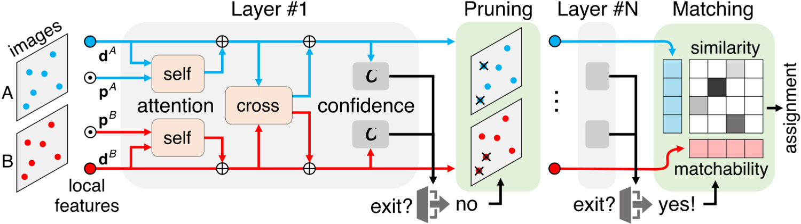

# LightGlue：注意力、动态剪枝与匹配

<!-- CATEGORY NAV -->
[Teaser](../../teasers/README.md) · [Architecture](../README.md) · [Element](../../../elements/README.md) · [总目录](../../../CATALOG.md)
<!-- END CATEGORY NAV -->

双分支局部特征经过 self/cross attention、置信度预测、剪枝和匹配分配。

[作者原始 SVG](source.svg) · [来源与检查记录](metadata.json) · [原项目](https://github.com/cvg/LightGlue)

## 来源与可编辑范围

来源：`cvg/LightGlue` / `assets/architecture.svg`，固定版本 `eb42fee2d714`。原 SVG 未重绘、未修改字节。

SVG 对象：162 个 path，38 个 text，12 个 image。有 SVG 容器不代表每个区域都是可编辑矢量；内嵌照片和渲染图保持位图，公式可能为轮廓。

Apache-2.0（来源仓库）。

已检查预览；桌面 Illustrator 的字体与链接兼容性尚未逐项实测。

<!-- BEGIN FIGURE LINKS -->
## 关联范例与元素

同论文的其他图：[LightGlue：速度与精度权衡](../../teasers/lightglue-tradeoff/README.md)

**从本图拆出的部件：** [Self attention 块](../../../elements/svg/lightglue-self-attention.svg) · [匹配相似度矩阵](../../../elements/svg/lightglue-assignment-matrix.svg) · [残差加法节点](../../../elements/svg/lightglue-residual-add.svg) · [蓝色流程箭头](../../../elements/svg/lightglue-flow-arrow.svg)

**可搭配的现有元素：** [单层特征块](../../../elements/svg/rust-feature-tile.svg)

这些元素按表达功能关联，并非从本论文原图拆出；来源和许可仍以各元素记录为准。

[范例与元素对照表](../../../elements/with-examples.md) · [元素分类目录](../../../elements/README.md)
<!-- END FIGURE LINKS -->
