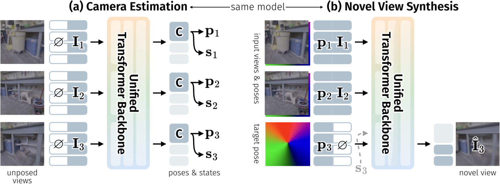

# RayDer：统一 Transformer 的两个使用阶段

<!-- CATEGORY NAV -->
[Teaser](../../teasers/README.md) · [Architecture](../README.md) · [Element](../../../elements/README.md) · [总目录](../../../CATALOG.md)
<!-- END CATEGORY NAV -->

左右并列相机估计与新视角合成，清楚标明共用模型与不同输入输出。

[作者原始 SVG](source.svg) · [来源与检查记录](metadata.json) · [原项目](https://compvis.github.io/rayder/)

## 来源与可编辑范围

来源：`CompVis/rayder` / `docs/static/images/paper-svg/architecture-overview.svg`，固定版本 `2ce3a3fbe499`。原 SVG 未重绘、未修改字节。

SVG 对象：218 个 path，0 个 text，7 个 image。有 SVG 容器不代表每个区域都是可编辑矢量；内嵌照片和渲染图保持位图，公式可能为轮廓。

保存仓库原许可证；用途限于其原有条款。

已检查预览；桌面 Illustrator 的字体与链接兼容性尚未逐项实测。

<!-- BEGIN FIGURE LINKS -->
## 关联范例与元素

同论文的其他图：[RayDer：数据瓶颈与新训练范式](../../teasers/rayder-concept/README.md)

**可搭配的现有元素：** [编码器块](../../../elements/svg/rust-encoder.svg) · [解码器块](../../../elements/svg/rust-decoder.svg) · [Self attention 块](../../../elements/svg/lightglue-self-attention.svg) · [锁定](../../../elements/svg/tabler-lock.svg)

这些元素按表达功能关联，并非从本论文原图拆出；来源和许可仍以各元素记录为准。

[范例与元素对照表](../../../elements/with-examples.md) · [元素分类目录](../../../elements/README.md)
<!-- END FIGURE LINKS -->
