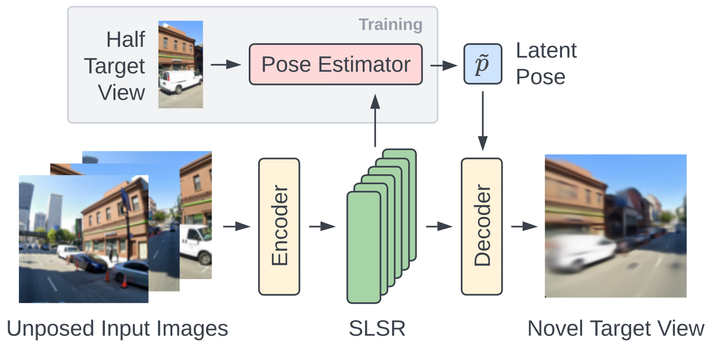

# RUST：编码器、场景表示与位姿分支

无位姿输入图像经 Encoder、场景表示、Decoder 输出新视角，训练时有 Pose Estimator 分支。按内容归入 architecture。

[作者原始 SVG](source.svg) · [来源与检查记录](metadata.json) · [原项目](https://rust-paper.github.io/)

## 来源与可编辑范围

来源：`rust-paper/rust-paper.github.io` / `data/teaser.svg`，固定版本 `8c3a856479a9`。原 SVG 未重绘、未修改字节。

SVG 对象：199 个 path，9 个 text，7 个 image。有 SVG 容器不代表每个区域都是可编辑矢量；内嵌照片和渲染图保持位图，公式可能为轮廓。

项目仓库未发现 LICENSE；仅作出处明确的参考，元素提取不新增授权。

已检查预览；桌面 Illustrator 的字体与链接兼容性尚未逐项实测。
