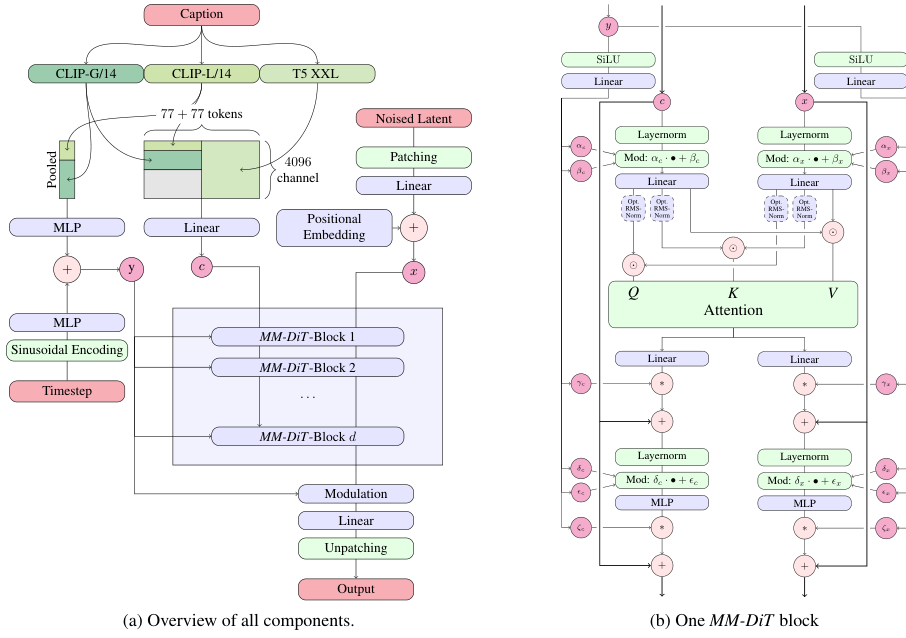

# SD3 · 双模态主干与 MM-DiT block 展开

[顶会精选图文目录](../../../collections/top-conference-figures.md) · [总目录](../../../CATALOG.md)

**ICML 2024 · Oral · 原论文 Figure 2**

## 为什么收这张图

左侧说明文本与图像条件如何进入主干，右侧以对称双路结构展开联合注意力，颜色和符号在两部分保持一致。

多模态网络架构；适合借鉴整体图加模块详图的排版。

## 可以借鉴

- 整体网络与 block 内部各占一个清晰区域
- 双模态用对称布局区分
- 局部运算符与残差连线统一使用

## 文件与编辑范围

[主文件](source.svg) · [单图 PDF](figure.pdf) · [来源与校验记录](metadata.json)

结构与文字轮廓均为矢量路径；另附 PDF 摘图保留原字体和结构。

SVG 是原论文图形的提取转换件，未取得作者原生 AI 工程。不同 PDF 阅读器或 Illustrator 对字体、透明度的导入可能有差异。

## 原始出处

- 论文：[Scaling Rectified Flow Transformers for High-Resolution Image Synthesis](https://arxiv.org/abs/2403.03206)
- 作者：Esser, Patrick, Kulal, Sumith, Blattmann, Andreas, Entezari, Rahim, Müller, Jonas, Saini, Harry, Levi, Yam, Lorenz, Dominik, Sauer, Axel, Boesel, Frederic, Podell, Dustin, Dockhorn, Tim, English, Zion, Lacey, Kyle, Goodwin, Alex, Marek, Yannik, Rombach, Robin
- [作者项目或代码](https://stability.ai/news/stable-diffusion-3-research-paper)
- [会议与展示身份依据](https://icml.cc/virtual/2024/oral/35548)
- PDF 第 5 页，Figure 2；截取坐标见 metadata.json。

## 权利与修改记录

arXiv 标注的是授予 arXiv 的非独占分发许可，不是第三方图形重用许可。本条用于个人私有参考，改编或公开再用需核对原权利。

原文许可声明：https://arxiv.org/licenses/nonexclusive-distrib/1.0/

只提取、裁剪与转换原图；没有重新绘制。
