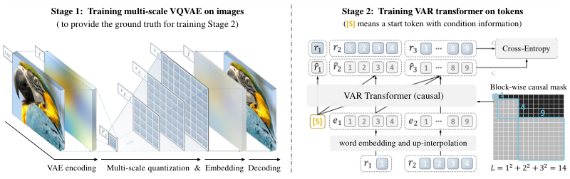

# VAR · 多尺度 VQVAE 与 VAR 两阶段训练

<!-- CATEGORY NAV -->
[Teaser](../../teasers/README.md) · [Architecture](../README.md) · [Element](../../../elements/README.md) · [总目录](../../../CATALOG.md)
<!-- END CATEGORY NAV -->

**NeurIPS 2024 · Oral · 原论文 Figure 4**

## 为什么收这张图

两块并列区域分别解释表示学习和自回归训练，尺度、token 序列和因果 mask 的对应关系可在图中追踪。

训练框架主图；区别于 Figure 2 的范式概念图。

## 可以借鉴

- 两个训练阶段明确分区
- 三维特征平面表达多尺度编码
- 用小型 mask 插图解释约束

## 文件与编辑范围

[主文件](source.svg) · [单图 PDF](figure.pdf) · [来源与校验记录](metadata.json)

原 PDF 的几何路径与线条保留，SVG 文字转为轮廓；照片、三维渲染与原有位图部件仍为嵌入图片。

SVG 是原论文图形的提取转换件，未取得作者原生 AI 工程。不同 PDF 阅读器或 Illustrator 对字体、透明度的导入可能有差异。

## 原始出处

- 论文：[Visual Autoregressive Modeling: Scalable Image Generation via Next-Scale Prediction](https://arxiv.org/abs/2404.02905)
- 作者：Tian, Keyu, Jiang, Yi, Yuan, Zehuan, Peng, Bingyue, Wang, Liwei
- [作者项目或代码](https://github.com/FoundationVision/VAR)
- [会议与展示身份依据](https://neurips.cc/virtual/2024/oral/97960)
- PDF 第 5 页，Figure 4；截取坐标见 metadata.json。

## 权利与修改记录

arXiv 原文声明 CC0 1.0；仍保留论文来源和修改记录，第三方素材以其原声明为准。

原文许可声明：https://creativecommons.org/publicdomain/zero/1.0/

只提取、裁剪与转换原图；没有重新绘制。

<!-- BEGIN FIGURE LINKS -->
## 关联范例与元素

同论文的其他图：[VAR · 从逐 token 到逐尺度生成的范式对照](../../teasers/var-paradigm/README.md)

**可搭配的现有元素：** [多尺度特征堆叠](../../../elements/svg/task5-feature-pyramid.svg) · [多通道彩色张量](../../../elements/svg/task5-rgb-tensor.svg) · [拼接节点](../../../elements/svg/task5-concat.svg) · [上采样节点](../../../elements/svg/task5-upsample.svg) · [匹配相似度矩阵](../../../elements/svg/lightglue-assignment-matrix.svg)

这些元素按表达功能关联，并非从本论文原图拆出；来源和许可仍以各元素记录为准。

[范例与元素对照表](../../../elements/with-examples.md) · [元素分类目录](../../../elements/README.md)
<!-- END FIGURE LINKS -->
