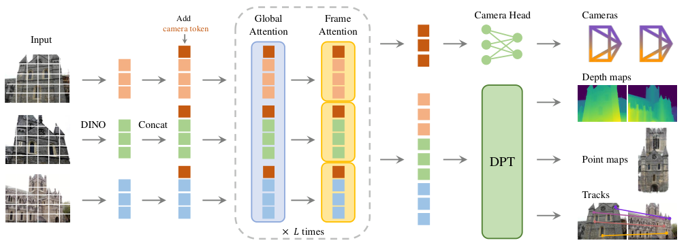

# VGGT · 交替注意力主干与多任务输出头

[顶会精选图文目录](../../../collections/top-conference-figures.md) · [总目录](../../../CATALOG.md)

**CVPR 2025 · Oral · 原论文 Figure 2**

## 为什么收这张图

整图始终沿左到右阅读；颜色区分 token，虚线框标出重复主干，右侧分组展开输出任务。

模型整体架构，覆盖 token 化、主干和输出头。

## 可以借鉴

- 同色 token 在不同阶段保持身份
- 重复层使用统一虚线容器
- 多任务输出头按任务整齐分组

## 文件与编辑范围

[主文件](source.svg) · [单图 PDF](figure.pdf) · [来源与校验记录](metadata.json)

原 PDF 的几何路径与线条保留，SVG 文字转为轮廓；照片、三维渲染与原有位图部件仍为嵌入图片。

SVG 是原论文图形的提取转换件，未取得作者原生 AI 工程。不同 PDF 阅读器或 Illustrator 对字体、透明度的导入可能有差异。

## 原始出处

- 论文：[VGGT: Visual Geometry Grounded Transformer](https://arxiv.org/abs/2503.11651)
- 作者：Wang, Jianyuan, Chen, Minghao, Karaev, Nikita, Vedaldi, Andrea, Rupprecht, Christian, Novotny, David
- [作者项目或代码](https://vgg-t.github.io/)
- [会议与展示身份依据](https://cvpr.thecvf.com/Conferences/2025/News/Awards_Press)
- PDF 第 3 页，Figure 2；截取坐标见 metadata.json。

## 权利与修改记录

arXiv 标注的是授予 arXiv 的非独占分发许可，不是第三方图形重用许可。本条用于个人私有参考，改编或公开再用需核对原权利。

原文许可声明：https://arxiv.org/licenses/nonexclusive-distrib/1.0/

只提取、裁剪与转换原图；没有重新绘制。
