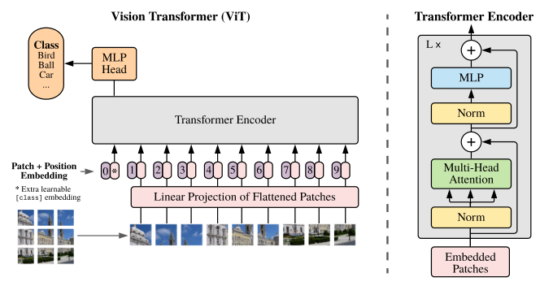

# ViT 原论文 · 图像分块、token 序列与编码器展开

<!-- CATEGORY NAV -->
[Teaser](../../teasers/README.md) · [Architecture](../README.md) · [Element](../../../elements/README.md) · [总目录](../../../CATALOG.md)
<!-- END CATEGORY NAV -->

**ICLR 2021 · Oral · 原论文 Figure 1**

## 为什么收这张图

输入图像、patch 序列、位置编码和分类 token 都有直观的对应关系；右侧独立展开重复的 Transformer 编码器。

原论文的模型架构图。作为论文范例保存，与库中的 D2L 教材示意图区分。

## 可以借鉴

- 图像块与序列位置一一对应
- 主流程与重复模块分开解释
- 颜色区分功能，形状保持统一

## 文件与编辑范围

[主文件](source.svg) · [单图 PDF](figure.pdf) · [来源与校验记录](metadata.json)

原 PDF 的几何路径与线条保留，SVG 文字转为轮廓；照片、三维渲染与原有位图部件仍为嵌入图片。

SVG 是原论文图形的提取转换件，未取得作者原生 AI 工程。不同 PDF 阅读器或 Illustrator 对字体、透明度的导入可能有差异。

## 原始出处

- 论文：[An Image is Worth 16x16 Words: Transformers for Image Recognition at Scale](https://arxiv.org/abs/2010.11929)
- 作者：Dosovitskiy, Alexey, Beyer, Lucas, Kolesnikov, Alexander, Weissenborn, Dirk, Zhai, Xiaohua, Unterthiner, Thomas, Dehghani, Mostafa, Minderer, Matthias, Heigold, Georg, Gelly, Sylvain, Uszkoreit, Jakob, Houlsby, Neil
- [作者项目或代码](https://github.com/google-research/vision_transformer)
- [会议与展示身份依据](https://iclr.cc/virtual/2021/oral/3458)
- PDF 第 3 页，Figure 1；截取坐标见 metadata.json。

## 权利与修改记录

arXiv 标注的是授予 arXiv 的非独占分发许可，不是第三方图形重用许可。本条用于个人私有参考，改编或公开再用需核对原权利。

原文许可声明：https://arxiv.org/licenses/nonexclusive-distrib/1.0/

只提取、裁剪与转换原图；没有重新绘制。

<!-- BEGIN FIGURE LINKS -->
## 关联范例与元素

**可搭配的现有元素：** [Self attention 块](../../../elements/svg/lightglue-self-attention.svg) · [残差加法节点](../../../elements/svg/lightglue-residual-add.svg) · [匹配相似度矩阵](../../../elements/svg/lightglue-assignment-matrix.svg) · [单层特征块](../../../elements/svg/rust-feature-tile.svg) · [多通道彩色张量](../../../elements/svg/task5-rgb-tensor.svg)

这些元素按表达功能关联，并非从本论文原图拆出；来源和许可仍以各元素记录为准。

[范例与元素对照表](../../../elements/with-examples.md) · [元素分类目录](../../../elements/README.md)
<!-- END FIGURE LINKS -->
