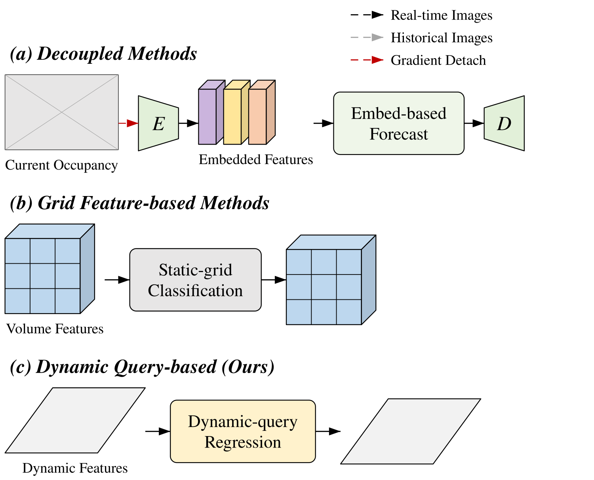
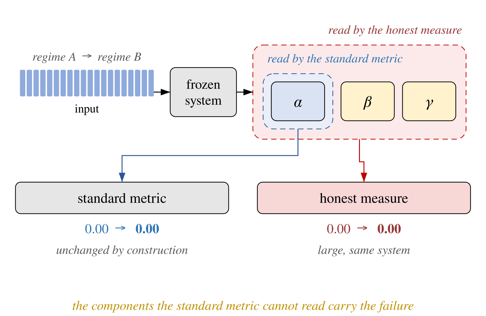
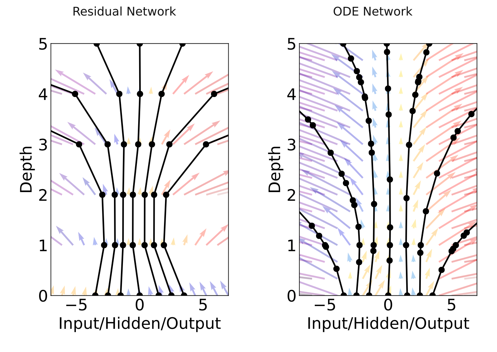
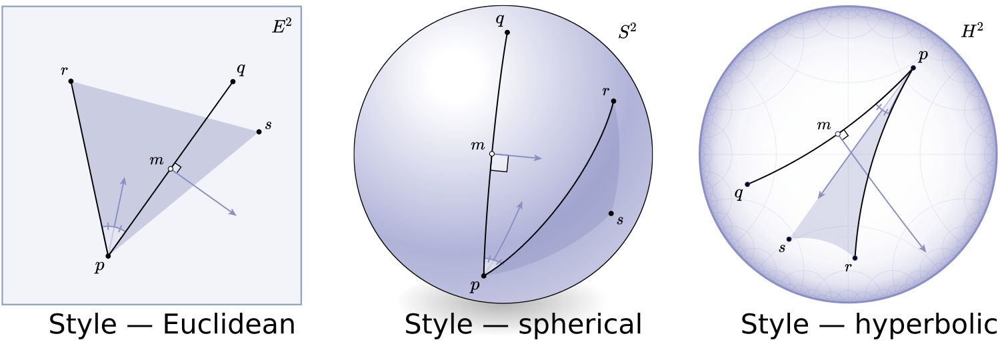

# Teaser 范例

用于传达研究动机、核心概念和方法差异。前两项是通用模板，后三项是论文实例；每项的来源、转换过程和许可分别记录。

| 范例 | 类型 | 可编辑格式 | 适合借鉴 |
|---|---|---|---|
| [方法范式对比 / Method comparison](method-comparison/) | 通用模板 | SVG | 三行并列展示 Decoupled、Grid feature-based 与 Dynamic query-based 三种范式。适合把两类既有方法与本文方法的核心差异放在同一张首图中。 |
| [评估盲点与研究动机 / Evaluation blind spot](evaluation-blindspot/) | 通用模板 | SVG | 用系统的不同区域与指标覆盖范围的差别，解释“当前评估遗漏了什么”。适合论文动机、评价方法或诊断方法的首图。 |
| [CLIP Figure 1：训练到零样本预测](clip/) | 论文实例 | SVG | 真实论文 Figure 1：左侧为图文对比预训练，右侧依次为用类别文本构建分类器、零样本预测。适合借鉴“一个训练阶段 + 两个使用阶段”的信息层级。 |
| [Neural ODE Figure 1：离散层与连续动力学](neural-ode/) | 论文实例 | SVG | 真实论文 Figure 1 的两个面板：离散残差变换与连续 ODE 向量场对比。适合借鉴用轨迹、采样位置与连续场解释方法差异的方式。 |
| [Penrose Figure 1：三种几何的概念对照](penrose/) | 论文实例 | SVG | Penrose 论文 Figure 1 右侧的三联可视化，展示欧氏、球面和双曲几何。原 Figure 1 左侧还包含语句／代码，所以本条目不是整张 Figure 1。 |

## [方法范式对比 / Method comparison](method-comparison/)

先替换三个行标题，再改每行的输入、表示与输出；保持三行对齐，用同一种颜色突出本文新增的结构。图中术语是模板内容，应按你的方法重写。

## [评估盲点与研究动机 / Evaluation blind spot](evaluation-blindspot/)

把 α、β、γ 区域替换为自己的状态、能力或误差类型，再调整两种评估方式观察到的范围。所有 0.00 都是占位数字，必须换成实际结果或删除。

## [CLIP Figure 1：训练到零样本预测](clip/)

借鉴左大右小的三阶段布局、输入与表示的对应关系、阶段编号和颜色复用。本文原图归入论文参考范例；为自己的论文重绘时替换模型、文字与样本图，并按实际使用情况保留引用。

## [Neural ODE Figure 1：离散层与连续动力学](neural-ode/)

保留左右共同的坐标和视觉尺度，让差异集中在轨迹或更新规则。可借鉴这种离散—连续对照来讲数值积分、动力学或优化过程；图内具体数学对象应按自己的方法重新绘制。

## [Penrose Figure 1：三种几何的概念对照](penrose/)

借鉴“相同对象、不同假设”的三栏对照：保持对应实体和配色不变，让几何环境承担解释差异的任务。适合数学结构、约束或不同物理假设的概念首图。

[返回仓库首页](../../README.md)
