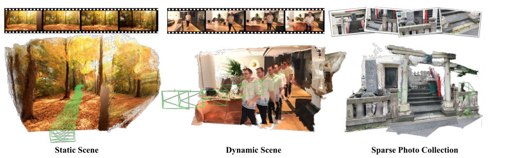
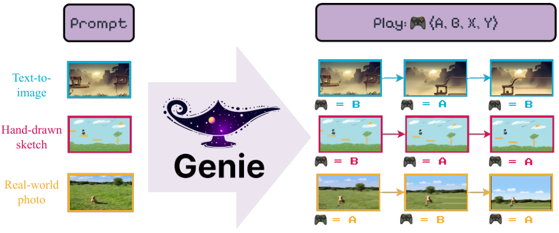
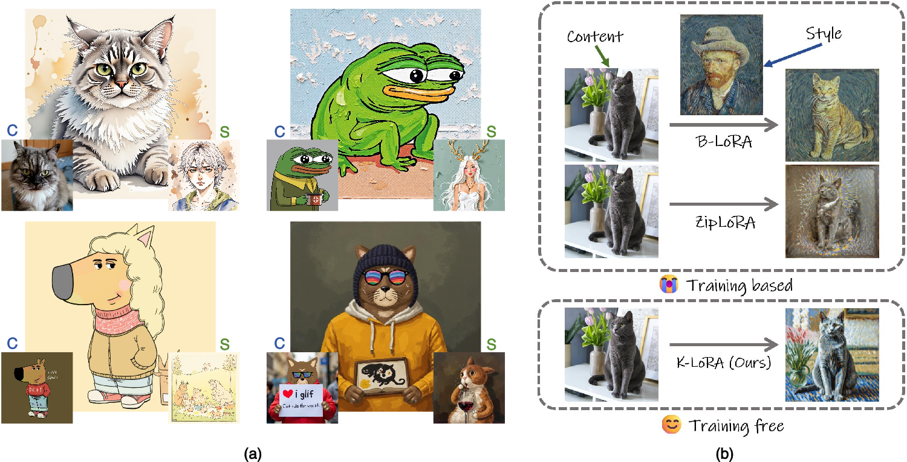

# Teaser 范例

[回到总目录](../../CATALOG.md)

## [Uneven Double Refraction：原型与成像能力展示](birefractive-rgbd/README.md)

**论文范例** · 相机原型、输入、恢复彩色图和深度图横排，适合硬件或成像方法的 teaser。

## [CUT3R · 静态、动态与稀疏照片三类场景](cut3r-capabilities/README.md)

**论文范例** · 三列分别说明输入场景和重建能力，借助同一版式把连续三维感知的应用范围讲清楚。

CVPR 2025 · Oral · 矢量 + 原有位图

## [DECOLLAGE：局部风格控制与三维细化](decollage/README.md)

**论文范例** · 从粗体素结构出发，用不同示例为局部赋予风格，再展示细化结果。作者的首屏 teaser，包含原始矢量箭头与嵌入渲染图。

## [DPO · RLHF 与直接偏好优化的流程简化](dpo-comparison/README.md)

**论文范例** · 左右两块使用同一输入与终点，只改变中间步骤；简化过程本身就是论文的主要观点。

NeurIPS 2023 · Oral · 整图位图，仅构图参考

## [DreamGaussian · 生成能力与优化进程同图展示](dreamgaussian-progress/README.md)

**论文范例** · 上方多视角结果说明输出能力，下方时间序列展示从模糊到成形的优化过程，让效率与质量成为同一视觉叙事。

ICLR 2024 · Oral · 矢量 + 原有位图

## [Genie · 不同提示生成可交互世界](genie-interaction/README.md)

**论文范例** · 左侧三种输入沿统一箭头进入模型，右侧按动作展示连续变化；一张图同时回答输入是什么、输出是什么、为什么可交互。

ICML 2024 · Oral · 矢量 + 原有位图

## [K-LoRA：主体风格组合与训练范式比较](k-lora/README.md)

**论文范例** · 左侧主体与风格组合示例，右侧比较需要训练与免训练的融合方式。

## [LightGlue：速度与精度权衡](lightglue-tradeoff/README.md)

**论文范例** · 准确率与吞吐量的权衡作为论文的贡献展示，比较固定深度、动态深度与既有方法。它属于结果型 teaser。

## [OrienterNet：用二维地图定位的任务与动机](orienternet/README.md)

**论文范例** · 展示人类使用二维地图与既有三维点云定位的差别，再给出新方法的输入与输出。

## [RayDer：数据瓶颈与新训练范式](rayder-concept/README.md)

**论文范例** · 数据金字塔、训练过程、结果与规模变化并列，先说明问题和核心差异。

## [ShaDDR：粗形状与示例驱动的成果展示](shaddr/README.md)

**论文范例** · 上排粗形状与风格示例，下排生成结果与局部放大，以成果直接展示任务和贡献。

## [VAR · 从逐 token 到逐尺度生成的范式对照](var-paradigm/README.md)

**论文范例** · 同一张图比较语言自回归、图像逐 token 生成和逐尺度生成，核心差异直接表现为生成顺序与尺度变化。

NeurIPS 2024 · Oral · 矢量 + 原有位图

## [VGGT · 多视图输入与统一三维感知能力](vggt-capabilities/README.md)

**论文范例** · 用一个大型三维场景作为视觉中心，两侧安排输入与多种输出，让读者先理解方法能做什么。

CVPR 2025 · Oral · 矢量 + 原有位图

