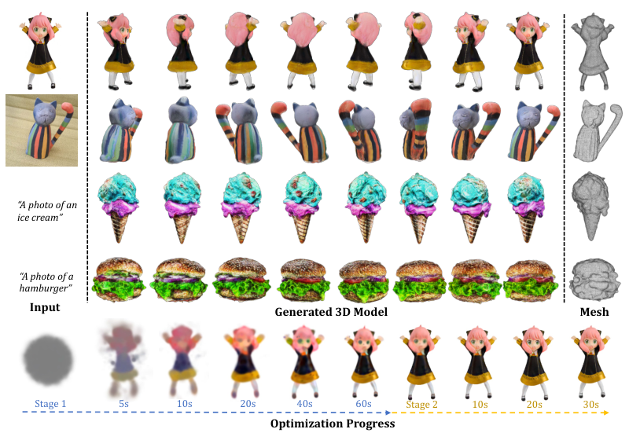

# DreamGaussian · 生成能力与优化进程同图展示

[顶会精选图文目录](../../../collections/top-conference-figures.md) · [总目录](../../../CATALOG.md)

**ICLR 2024 · Oral · 原论文 Figure 1**

## 为什么收这张图

上方多视角结果说明输出能力，下方时间序列展示从模糊到成形的优化过程，让效率与质量成为同一视觉叙事。

结果与过程结合的 teaser；不是单纯的生成样例拼图。

## 可以借鉴

- 输入、多个视角、网格形成固定列结构
- 在能力展示下方补充时间轴
- 用过程变化表达核心优势

## 文件与编辑范围

[主文件](source.svg) · [单图 PDF](figure.pdf) · [来源与校验记录](metadata.json)

原 PDF 的几何路径与线条保留，SVG 文字转为轮廓；照片、三维渲染与原有位图部件仍为嵌入图片。

SVG 是原论文图形的提取转换件，未取得作者原生 AI 工程。不同 PDF 阅读器或 Illustrator 对字体、透明度的导入可能有差异。

## 原始出处

- 论文：[DreamGaussian: Generative Gaussian Splatting for Efficient 3D Content Creation](https://arxiv.org/abs/2309.16653)
- 作者：Tang, Jiaxiang, Ren, Jiawei, Zhou, Hang, Liu, Ziwei, Zeng, Gang
- [作者项目或代码](https://dreamgaussian.github.io/)
- [会议与展示身份依据](https://dreamgaussian.github.io/)
- PDF 第 1 页，Figure 1；截取坐标见 metadata.json。

## 权利与修改记录

arXiv 标注的是授予 arXiv 的非独占分发许可，不是第三方图形重用许可。本条用于个人私有参考，改编或公开再用需核对原权利。

原文许可声明：https://arxiv.org/licenses/nonexclusive-distrib/1.0/

只提取、裁剪与转换原图；没有重新绘制。
