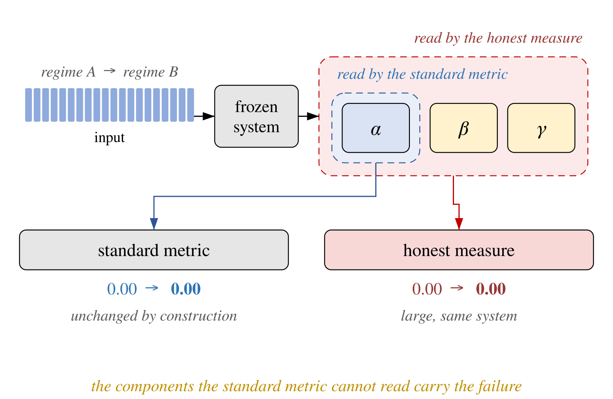

# 评估盲点与研究动机 / Evaluation blind spot

用系统的不同区域与指标覆盖范围的差别，解释“当前评估遗漏了什么”。适合论文动机、评价方法或诊断方法的首图。

## 可编辑文件

- **主文件：[source.svg](source.svg)**
- [结构化元数据](metadata.json)

配套原始文件与许可：

- [`originals/blindspot-teaser.yaml`](originals/blindspot-teaser.yaml)
- [`LICENSE.source.txt`](LICENSE.source.txt)

## 借鉴什么

把 α、β、γ 区域替换为自己的状态、能力或误差类型，再调整两种评估方式观察到的范围。所有 0.00 都是占位数字，必须换成实际结果或删除。

## 打开与编辑

在 Illustrator 中使用“文件 → 打开”选择 `source.svg`，按需要取消编组并另存自己的工作副本。SVG 可另外用 Inkscape 打开；AI 预览来自其 PDF 兼容层。

- 由作者 YAML 模板及公开渲染程序导出，保留文字和图形对象。
- 0.00 是模板占位数值，不是实验结果。
- 尚未在桌面 Illustrator 中打开验证。

## 来源

- https://github.com/ChizkiyahuOhayon/CVPR-Figure
- https://github.com/ChizkiyahuOhayon/CVPR-Figure/blob/main/templates/blindspot-teaser.yaml

原始文件名：`templates/blindspot-teaser.yaml`。

## 许可与使用范围

**MIT License**。许可证针对来源项目；复制或再分发其内容时保留原版权和许可声明。

## 整理时做了什么

- 由作者原始 YAML 模板使用其渲染程序导出 SVG；未修改模板内容。
- 本条目仅复制、重命名已有 SVG 和预览。

收录日期：2026-10-25。主文件与所有随附二进制文件的 SHA256 记录在 `metadata.json`。

